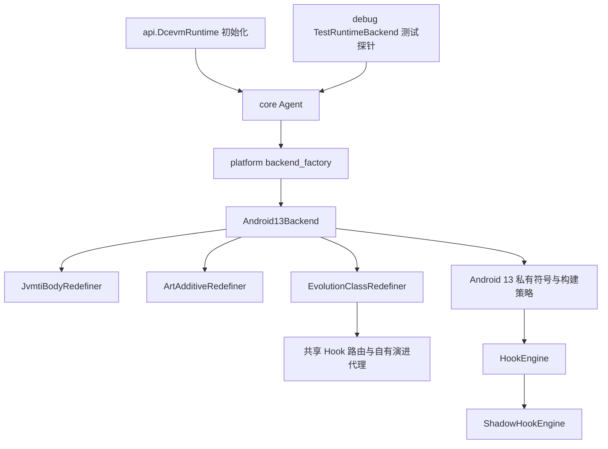

# ART DCEVM 实验工程

验证结论与复现入口见 [VERIFICATION.md](VERIFICATION.md)。Android 11–17 的公开路径矩阵、16 KB 构建和 AOSP 私有声明差异见 [ANDROID_COMPATIBILITY.md](ANDROID_COMPATIBILITY.md)。逐次测试报告保存在本地 `build/evidence/`，由 Git 忽略；文中的历史报告链接只在保留了本地报告的工作区可打开。

目标是在自有、从启动时就可调试的应用内，实现接近 DCEVM 的类演进。完整演进后端目前只针对 Android 13 / API 33 / arm64 的已验证 ART 构建；Android 11 / API 30 及以上的其他构建提供公开 JVMTI 方法体替换，并在 ART 暴露结构扩展时提供新增成员能力。不需要 root，也不改系统分区。

标准 JVMTI 入口的使用方式：在用户 Agent 第一次重定义前调用一次
`DcevmRuntime.initialize(context)`，随后用户 Agent 只向自己的
`jvmtiEnv::RedefineClasses` 提交完整 `jvmtiClassDefinition[]`。初始化会附加增强 Agent、
严格匹配目标设备 ART/JVMTI、DEX 与平台 libc++ 的 Build ID，检查必需命名符号，
完成自有固定声明与公开 JNI/JVMTI 校准后安装命名 Hook；失败时抛出异常。
Hook 检查调用者能力和类参数，再把完整批次交给增强库的演进事务协调器；ART 在转换回调后校验最终 DEX 并提交。提前读取实时类结构会干扰复杂层级批次，因此标准入口不做 schema 规划。`RetransformClasses` 不在此入口范围内。
对外 Java API 包含完整演进入口 `DcevmRuntime.initialize` 和基础代理入口 `DcevmRuntime.attachPublicJvmti`；SDK Java 仅保留初始化入口与两个平台无关的预定义校准类；`TestRuntimeBackend` 及请求/结果封装位于应用的 debug 测试目录。JNI 测试桥位于库 `src/debug`；App 的测试 Java、instrumentation、fixture 和补丁素材仅进入 debug 构建；Native 探针位于 debug 专用的 `libartdcevm_test_support.so`。[构建边界](../build/evidence/build/20261006T154308Z-variant-boundary.json)
独立用户 Agent 的设备回归入口为 `com.github.ytlog.artdcevm.testing.StandardJvmtiInstrumentation`。
迁移前标准入口双加载顺序、两个 Agent 并发调用及 `ClassFileLoadHook` 转换新增字段和移除父类的设备结果见 `build/evidence/standard-jvmti/20261006T153842Z/result.json`；
ShadowHook 官方 2.0.1 AAR 与 SDK 37 构建后的源码回归见
`build/evidence/source-engine/20261006T153859Z/run.json` 和
`build/evidence/source-engine/20261006T154308Z/run.json`。两组完整套件的主要重定义调用已由独立测试 Agent 通过标准 JVMTI 入口执行；少量前置失败及旧路径对照仍使用内部接口。
迁移前加入跨版本公开后端后，Android 13 / arm64 的完整源码演进套件再次通过：[历史报告](../build/evidence/source-engine/20261006T213857Z/run.json)。

当前默认 NDK 构建只生成增强引擎 `libartdcevm.so`，不下载或编译 AOSP，不加载独立源码引擎，也不需要 `-PsourceEngine13`。自有 `evolution_runtime` 通过命名设备函数及 Hook 代理处理演进。最终无源码 APK `1c532b1f…` 已通过 39 个 Host runner、41 项真机一致性检查、标准入口六组、两种 Hook 顺序的完整套件及相关专项；迁移验收完成，完整哈希、命令和逐次证据以 [VERIFICATION.md](VERIFICATION.md) 为准。原有能力限制保持不变。

下面的 2026-10-04 至 2026-10-06 专项、APK 哈希和 `build/evidence/source-engine/` 链接是迁移前历史证据。历史报告目录与 Hook 顺序名继续保留，不表示现行实现包含源码 SO。

不支持和未充分验证的 class redefine 能力集中记录在 [LIMITATIONS.md](LIMITATIONS.md)；已暂缓的 boot JIT 与非调试 AOT 专项保留在 [TODO.md](TODO.md)。

非调试 AOT 安全边界现有直接设备证据：`dex2oat64 --compiler-filter=speed` 生成的活动父类调用者为 AOT 帧（状态 7）。父类替换在旧定义完整时返回 66；旧调用随后返回 14，帧退出后重试提交 0，后续旧调用抛出 `IncompatibleClassChangeError`。两种 Hook 顺序均通过，见 `build/evidence/device-aot/20261006T091108Z/result.json`、`build/evidence/source-engine/20261006T091127Z/probe.json` 与 `build/evidence/source-engine/20261006T091149Z/probe.json`。这验证了安全拒绝和重试，尚未实现活动非调试 AOT 帧的即时 DeOPT。

成员组合修饰符现支持同一实例方法的 `final` 与 `synchronized` 同批添加和撤回：旧反射 `Method`、旧 `MethodHandle` 的标志与监视器行为随事务更新；若已加载子类覆写该方法，组合添加返回 71 且提交数不变。两种 Hook 顺序的手机专项见 `build/evidence/source-engine/20261006T093015Z/probe.json` 与 `build/evidence/source-engine/20261006T093032Z/probe.json`。方法 `public`↔`protected synchronized` 同批切换也通过：旧句柄保留可调用性并执行监视器语义，新跨包调用受新权限限制，见 `build/evidence/source-engine/20261006T094623Z/probe.json` 与 `build/evidence/source-engine/20261006T094642Z/probe.json`。字段 `public`↔`protected volatile` 同批切换通过旧 `VarHandle` 读写、缓存反射修饰符更新与新跨包访问拒绝，见 `build/evidence/source-engine/20261006T095236Z/probe.json` 与 `build/evidence/source-engine/20261006T095253Z/probe.json`。字段 `public`↔`protected final` 同批切换也通过旧值保留、旧 `VarHandle` 写入拒绝与跨包访问控制，见 `build/evidence/source-engine/20261006T101601Z/probe.json` 与 `build/evidence/source-engine/20261006T101619Z/probe.json`。其他修饰符组合仍待覆盖，`memberModifierChange` 总括标志保持 `false`。

修复 final 字段旧句柄漏洞：修复前，在字段变为 final 后，变更前创建的实例与静态 `VarHandle.set` 仍返回成功并把 73/84 改成 99，见 `build/evidence/source-engine/20261006T100707Z/probe.json`。现在命名符号安装的 `FieldVarHandle::Access` Inline Hook 按 ART 访问模式模板拒绝所有写模式；`set`、CAS 和原子更新均抛出 `UnsupportedOperationException` 且不改值，撤回 final 后旧句柄重新可写。两种 Hook 顺序见 `build/evidence/source-engine/20261006T101601Z/probe.json` 与 `build/evidence/source-engine/20261006T101619Z/probe.json`。

旧 `MethodHandle` setter 也曾在字段变为 final 后继续写入实例和静态字段，见 `build/evidence/source-engine/20261006T103501Z/probe.json`。现在通过命名的 ART `MethodHandleFieldPut` 符号安装 Inline Hook，旧 setter 抛出 `IllegalAccessError` 且字段值不变；旧 `invokeExact` 调用者先达到 JIT 状态 2，切换后同样被拒绝，撤回 final 后两类旧句柄均恢复可写。两种 Hook 顺序的手机专项见 `build/evidence/source-engine/20261006T104657Z/probe.json` 与 `build/evidence/source-engine/20261006T104714Z/probe.json`。

历史 APK `4fe0ac9f…` 在目标手机上通过 validation-first 与 source-first 两种 Hook 顺序的完整源码演进回归，各完成 31 次结构提交及 135 项修饰符检查，分别见 `build/evidence/source-engine/20261006T104741Z/probe.json` 与 `build/evidence/source-engine/20261006T105256Z/probe.json`。按已验证的大多数常用类变更范围，可作为当前设备上可调试应用开发阶段的初步 class redefine 能力；遇到不支持的活动编译帧或类关系时仍需按返回码拒绝并重试，不能把此判断扩大为完整 DCEVM 语义。

**目前是可构建的实验实现，还不是完整 DCEVM。** 标准 JVMTI 入口使用增强库自有协调与提交代理，并复用设备 ART 事务服务；内部后端保留 ART 原生增量接口和结构演进分析。完整演进初始化成功后，该事务已支持经过目标手机验证的方法/字段删除与重新添加、方法签名变更、字段类型变更、字段/方法的 static 与实例形式互换、native 与 Java 方法实现互换、保留旧可赋值关系的继承扩展、移除旧父类、成员在 public、protected、包可见之间转换、实例与静态 Java 方法同步声明位的双向转换，以及方法、字段和类 `final` 位的双向转换；抽象基类中单个方法的 abstract 与具体实现双向转换也已验证。类级 abstract 与具体类切换可用；类与方法的 abstract 位同时切换也已通过手机验证。实例方法的 private/direct 与 public/virtual 双向转换已通过手机验证，包含已加载的覆写子类和普通子类；private↔protected↔包可见也已验证，跨包子类覆写关系会随可见性重新链接。静态方法的 private→protected→包可见→public→private 往返和实例及静态字段的 private↔public/protected/包可见转换通过手机验证，保留旧值并更新反射标志及新解析访问；独立探针确认 private↔public 转换前的调用点与目标方法都存在 JIT 代码，且编译调用点在转换后按新的子类关系分派，见 `build/evidence/source-engine/20261005T054149Z/probe.json`。若具体类变为抽象类时仍有直属实例存活且方法保持具体，会保守地对进程持续启用解释执行；若该实例将继承抽象方法，事务以错误码 71 拒绝。已加载子类覆写将变为 `final` 的方法时，事务以错误码 71 拒绝。未成功初始化完整演进时返回 `JVMTI_ERROR_NOT_AVAILABLE`，不自动降级。

本地解析器和迁移计划已通过 ASan/UBSan 测试，包含 7 组实际 DEX 样例和 10,000 个变异输入，见 `build/evidence/host/evolution-tests.json`。此前 APK `0f79a212…` 在两种 Hook 初始化顺序下均通过完整源码演进检查，见 `build/evidence/source-engine/20261006T023011Z/probe.json` 和 `build/evidence/source-engine/20261006T023330Z/probe.json`；前一 APK `c0ec74c6…` 补充直接子接口默认方法 `findSpecial` 的正向验证；再前一 APK `84e86492…` 新增父类与子类间接口关系转移及缓存直接 `findSpecial` 校验；前一 APK `0977eeca…` 验证了接口关系移除与普通成员演进的混合批次及无效事务回滚；再前一 APK `d553a503…` 验证了两个独立类的批量接口移除与恢复，并保留 `findSpecial` 和 `unreflectSpecial` 缓存句柄验证；前一 APK 对两种 Hook 顺序各通过 1001 项完整回归，见 `build/evidence/source-engine/20261006T041600Z/probe.json` 与 `build/evidence/source-engine/20261006T041944Z/probe.json`；前一 APK `97b5b013…` 新增普通父类缓存 `findSpecial` 和 `unreflectSpecial` 的关系守卫：子类移除父类后旧句柄抛出 `IncompatibleClassChangeError`，恢复父类后旧句柄重新可用；两种 Hook 顺序的专项见 `build/evidence/source-engine/20261006T043516Z/probe.json` 与 `build/evidence/source-engine/20261006T043530Z/probe.json`，完整回归见 `build/evidence/source-engine/20261006T043547Z/probe.json` 与 `build/evidence/source-engine/20261006T043919Z/probe.json`。 前一 APK `16624886…` 进一步覆盖三级继承：孙类缓存的两种特殊调用句柄在中间类移除目标祖先后拒绝，在继承关系恢复后重新可用；两种 Hook 顺序见 `build/evidence/source-engine/20261006T044450Z/probe.json` 与 `build/evidence/source-engine/20261006T044506Z/probe.json`。 前一 APK `9eb141ad…` 另验证已绑定普通父类特殊句柄的 `invokeExact` 调用点在提交前达到 JIT 状态 2，移除父类后抛出 `IncompatibleClassChangeError`，恢复后重新返回 1；两种 Hook 顺序见 `build/evidence/source-engine/20261006T045808Z/probe.json` 与 `build/evidence/source-engine/20261006T045827Z/probe.json`。前一 APK `1e72d533…` 在后台 GC 下对混合字段及方法退役、类加载器卸载执行 256 轮，两种 Hook 顺序均通过；每轮弱引用清空，字段和方法登记各清理 256 次，字段令牌槽保持 1 个，见 `build/evidence/source-engine/20261006T044759Z/probe.json` 与 `build/evidence/source-engine/20261006T044857Z/probe.json`。此前 APK `23c7a5a8…` 通过 64 轮测试。前一 APK `53cac534…` 新增无关父类替换往返：`NarrowSubject` 从 `NarrowParent` 改为 `NarrowAlternate` 再恢复。旧调用点在提交前 JIT 状态为 2；替换后旧类型调用及缓存特殊句柄被拒绝，存活对象与子类保留自身字段并得到新父类字段默认值 0，新对象通过新父类构造器得到 29；恢复后新父类句柄失效、旧句柄重新可用。两种 Hook 顺序见 `build/evidence/source-engine/20261006T051133Z/probe.json` 与 `build/evidence/source-engine/20261006T051152Z/probe.json`。前一 APK `6cc760cc…` 进一步在同一 ART 事务中更新两个类：新父类增加 `revision` 字段并改变方法体，子类同时切换到该父类。两类结构更新计数增加 2，依赖分配计数增加 2；存活对象新字段为 0，新对象初始化为 5，旧 JIT 调用被拒绝，缓存特殊句柄在恢复父类后随之切换。类定义两种顺序与 Hook 两种顺序的四种组合均通过，见 `build/evidence/source-engine/20261006T051909Z/probe.json`、`build/evidence/source-engine/20261006T051931Z/probe.json`、`build/evidence/source-engine/20261006T052016Z/probe.json` 和 `build/evidence/source-engine/20261006T052035Z/probe.json`。前一 APK `4c477b8e…` 还在有效双类父类替换前分别注入无效的新父类和子类 DEX：两次均返回错误码 60，结构提交增量为 0；需要预先启用的接收者守卫激活及回滚各一次，旧 JIT 调用与原层级不变，之后有效批次仍可提交。两种类定义顺序和两种 Hook 顺序全部通过，见 `build/evidence/source-engine/20261006T052519Z/probe.json`、`build/evidence/source-engine/20261006T052551Z/probe.json`、`build/evidence/source-engine/20261006T052553Z/probe.json` 和 `build/evidence/source-engine/20261006T052554Z/probe.json`。历史 APK `7f636b4b…` 在双类父类替换期间让旧父类调用和子类新方法调用两个线程持续运行，两调用点提交前均有 JIT 代码（状态 2）。四种 Hook 与类定义顺序组合在提交后分别观察至少 100 次旧调用拒绝和 100 次新值 21；错误值、意外异常及守卫帧漏判均为 0，见 `build/evidence/source-engine/20261006T052939Z/probe.json`、`build/evidence/source-engine/20261006T053004Z/probe.json`、`build/evidence/source-engine/20261006T053005Z/probe.json` 和 `build/evidence/source-engine/20261006T053007Z/probe.json`。单独的收窄用例确认两个旧调用点提交前均有 JIT 代码，正式版移除旧父类返回 0，自动 DeOPT 并保留接收者保护；存活旧对象和子类保留自身字段，新方法正常分派，旧父类字段、方法、数组及绑定句柄访问被拒绝，见 `build/evidence/source-engine/20261005T124514Z/probe.json`。没有旧实例时，旧字节码在提交后新建对象的失效访问也被拒绝，见 `build/evidence/source-engine/20261005T124539Z/probe.json`。此前版本对接口关系丢失的事务拒绝并回滚保护，见 `build/evidence/source-engine/20261005T124558Z/probe.json`；当前实验版已将接口丢失纳入提交前保护。

当前实验版在目标手机上完成接口关系移除：独立用例先确认旧 `invoke-interface` 调用点有 JIT 代码，再提交接口移除、执行进程级 DeOPT；旧调用、类型转换、接口数组访问及向新接口数组存储均被拒绝，对象字段和新方法分派保持正确。提交前缓存的反射 `Method`、绑定及未绑定 `MethodHandle` 都拒绝失效接收者；JNI 接口 `jmethodID` 的普通、`A`、`V` 调用，缓存及重新查询形式，在 CheckJNI 关/开两态下共 12 种组合全部返回 `IncompatibleClassChangeError`。两种 Hook 顺序均通过，见 `build/evidence/source-engine/20261005T235048Z/probe.json` 与 `build/evidence/source-engine/20261005T235049Z/probe.json`。层级专项在同一事务移除父类及继承接口，旧接口和默认方法调用均拒绝，旧字段值和新构造路径正确；两种顺序各通过 62 项检查，见 `build/evidence/source-engine/20261005T142850Z/probe.json` 与 `build/evidence/source-engine/20261005T143530Z/probe.json`。接口“移除→恢复→再移除”在两种 Hook 顺序下均成功，未绑定旧句柄和 6 种 JNI 调用形式在恢复期间重新可用，第二次移除后再次被拒绝，见 `build/evidence/source-engine/20261005T235050Z/probe.json` 与 `build/evidence/source-engine/20261005T235052Z/probe.json`。并发用例的旧接口调用和类型判断在提交前均有 JIT 代码，两次设备运行中提交后每个线程至少观察到 100 次预期拒绝或类型变化，错误值、意外异常和帧漏判均为 0，见 `build/evidence/source-engine/20261005T142540Z/probe.json` 与 `build/evidence/source-engine/20261005T142608Z/probe.json`。新增接口默认方法专项：旧字节码、反射、绑定/未绑定句柄及 JNI 虚/非虚调用在“移除→恢复→再移除”中按预期拒绝、恢复和再次拒绝；CheckJNI 开启后的首轮移除，缓存/新查询共 8 种 JNI 形式也安全拒绝。两种 Hook 顺序通过，见 `build/evidence/source-engine/20261005T234048Z/probe.json` 与 `build/evidence/source-engine/20261005T234113Z/probe.json`。新增同名方法冲突往返专项：接口移除后，类声明同签名 `defaultValue()` 并返回 88；提交前 JIT 状态为 2 的旧 `invoke-interface` 调用者，以及缓存接口反射、旧句柄和 8 种 JNI 接口调用形式均拒绝旧接收者。恢复接口后，缓存类反射对象与句柄转为调用默认实现并返回 77，反射声明类也更新为接口；再次移除后，它们转回类方法并返回 88，旧接口调用再次拒绝。两种 Hook 顺序均通过，见 `build/evidence/source-engine/20261006T004534Z/probe.json` 与 `build/evidence/source-engine/20261006T004600Z/probe.json`。新增缓存 `findSpecial` 默认方法句柄专项：修复前，接口关系移除后旧句柄仍错误地返回 77，见 `build/evidence/source-engine/20261006T030004Z/probe.json`；现在通过命名的 ART MethodHandle 调用入口校验特殊调用者与接口的关系，移除时抛出 `IncompatibleClassChangeError`，恢复后旧句柄再次返回 77。两种 Hook 顺序均通过，见 `build/evidence/source-engine/20261006T030220Z/probe.json` 与 `build/evidence/source-engine/20261006T030236Z/probe.json`。历史 APK 进一步覆盖缓存 `unreflectSpecial`：两种句柄在移除时均拒绝、恢复时均返回 77、再次移除且类声明同名方法返回 88 时均继续拒绝，见 `build/evidence/source-engine/20261006T031842Z/probe.json` 与 `build/evidence/source-engine/20261006T031858Z/probe.json`。前一 APK `251bb68e…` 增加已绑定接口默认方法 `findSpecial` 的 JIT 调用专项：提交前 `invokeExact` 调用点达到 JIT 状态 2，接口移除时旧句柄被拒绝，恢复时返回 77，再次移除且类声明同签名方法返回 88 时仍被拒绝；两种 Hook 顺序见 `build/evidence/source-engine/20261006T050301Z/probe.json` 与 `build/evidence/source-engine/20261006T050319Z/probe.json`。历史 APK 还在单次事务内同时移除两个独立类的接口关系，JIT 编译的旧调用者及三个存活对象的旧 `invoke-interface`、缓存 `MethodHandle` 和 JNI 调用各 3/3 拒绝；原字段与新方法结果正确。单次事务恢复两个类后，三个旧对象重新接受接口分派。两种 Hook 顺序均通过，见 `build/evidence/source-engine/20261006T032912Z/probe.json` 与 `build/evidence/source-engine/20261006T032928Z/probe.json`。历史 APK 还验证接口移除与 `Peer` 字段增加、方法体变化在同一批次内提交：先以无效第二补丁验证原子回滚，返回错误码 60，提交增量 0，保护激活及回滚各 1 次，DeOPT 状态恢复；有效批次提交后旧 JIT 接口调用和缓存句柄被拒绝，新字段默认 0，恢复批次后旧接口调用重新可用，新字段写入值 29 保留。两种 Hook 顺序均通过，见 `build/evidence/source-engine/20261006T034448Z/probe.json` 与 `build/evidence/source-engine/20261006T034514Z/probe.json`。父类到子类的接口关系转移也通过了两类批量事务验证：父类旧 `invoke-interface`、句柄和 JNI 调用被拒绝，原有子类保留普通及默认方法分派；恢复父类实现后，子类重新通过父类继承接口。修复前，子类在失去直接接口关系后，缓存的直接 `findSpecial` 句柄仍错误返回 77，见 `build/evidence/source-engine/20261006T041210Z/probe.json`；现在命名 ART MethodHandle Hook 检查特殊调用者的直接接口，旧句柄抛出 `IncompatibleClassChangeError`，两种 Hook 顺序均通过，见 `build/evidence/source-engine/20261006T041425Z/probe.json` 与 `build/evidence/source-engine/20261006T041445Z/probe.json`。历史 APK 另验证类直接实现子接口时，对父接口所声明默认方法的 `findSpecial` 仍返回 77，即使另一个类移除了相同父接口；失效的直接接口句柄同时保持拒绝。两种 Hook 顺序见 `build/evidence/source-engine/20261006T042858Z/probe.json` 与 `build/evidence/source-engine/20261006T042931Z/probe.json`。其他默认方法形态及更大或混合依赖层级批次仍待验证；活动 AOT 普通接口与默认方法调用已在下述专项通过，因此总括能力标志 `hierarchyChange` 维持 `false`。

历史活动 AOT 接口调用专项（已被当前安全策略取代）：设备 `dex2oat` 编译独立 sidecar，普通接口调用与默认方法调用各有 AOT 机器码；ART `StackVisitor` 在阻塞线程上采到调用者机器码帧状态 7，入口状态为 131。接口移除返回 0 后，旧活动帧继续执行和后续调用均抛出 `IncompatibleClassChangeError`；调用者 AOT 入口失效，进程级 DeOPT 生效。默认方法用例还在新类中加入同签名方法并返回 88，旧接口调用没有误调该方法。两种 Hook 顺序均通过，见 `build/evidence/device-aot/20261006T012336Z/result.json`、`build/evidence/source-engine/20261006T012407Z/probe.json`、`build/evidence/source-engine/20261006T012445Z/probe.json`、`build/evidence/source-engine/20261006T012519Z/probe.json` 与 `build/evidence/source-engine/20261006T012545Z/probe.json`。其他优化调用者和长期运行策略仍待验证。

当前安全边界：目标手机曾复现活动 AOT 父类切换的错误提交：事务返回 0，恢复后的旧机器码帧返回错误值 10，见 `build/evidence/source-engine/20261006T053705Z/probe.json`。仅暂停和标记 DeOPT 不足以防止该错误。现在对接收者关系收窄事务先启用进程级 DeOPT，并暂停线程扫描活动应用编译帧；可安全处理的活动帧通过命名符号 `artTestSuspendFromCode` 的 Inline Hook 调用 ART `artDeoptimize`。处于已安装 Java 返回插桩下方的帧可在返回时由 ART 切换；预检只把真实物理帧的返回地址视为这种屏障。无法切换且没有屏障的帧在旧定义仍完整时返回 66。纯 volatile 活动 AOT 父类调用在两种 Hook 顺序下均直接提交 0、显式去优化命中 1 次、旧调用抛出 `IncompatibleClassChangeError`，见 `build/evidence/source-engine/20261006T074702Z/probe.json` 与 `build/evidence/source-engine/20261006T074703Z/probe.json`。双线程专项在提交前采到两个状态 7 的 AOT 帧；预检达到清空扫描，提交后且放开 gate 前两帧均为解释器状态 1，旧调用都抛出 ICCE，见 `build/evidence/source-engine/20261006T074615Z/probe.json` 与 `build/evidence/source-engine/20261006T074701Z/probe.json`。活动 AOT 普通接口和默认方法调用也直接提交并安全拒绝旧调用，见 `build/evidence/source-engine/20261006T074705Z/probe.json` 与 `build/evidence/source-engine/20261006T074706Z/probe.json`。纯 volatile 活动 JIT 父类调用在两种 Hook 顺序下各记录一次显式去优化，见 `build/evidence/source-engine/20261006T074707Z/probe.json` 与 `build/evidence/source-engine/20261006T074709Z/probe.json`。历史 APK 在两种 Hook 顺序下通过完整源码回归，见 `build/evidence/source-engine/20261006T074749Z/probe.json` 与 `build/evidence/source-engine/20261006T075116Z/probe.json`。仍需验证活动 boot JIT 帧稍后执行尚未到达的应用内联代码、其他编译调用形态和长期运行；`fullDcevmComplete` 保持 `false`。 历史 APK 还会识别带内联表的活动 boot JIT 物理帧：ART 私有 JIT 区域内的帧尝试在暂停入口去优化，无法确认可去优化的帧拒绝替换；当前专项没有稳定产生 boot→应用的真实未来内联帧，因此这一路径只是保守保护，尚无直接命中证据。两种 Hook 顺序的完整回归见 `build/evidence/source-engine/20261006T081648Z/probe.json` 与 `build/evidence/source-engine/20261006T082126Z/probe.json`。

早期未加接收者保护时，父类移除曾使旧代码按新布局误读字段和方法，见 `build/evidence/source-engine/20261005T061107Z/probe.json`；旧 VarHandle 也曾误读 `own=17`，见 `build/evidence/source-engine/20261005T101949Z/probe.json`。当前实现通过 ART instrumentation、进程级 DeOPT 及按命名符号安装的 Inline Hook 保护已验证的字节码、反射、JNI、MethodHandle 和 VarHandle 路径。当前正式 APK 中的“移除→恢复→再移除”在两种 Hook 顺序下通过，见 `build/evidence/source-engine/20261005T125739Z/probe.json` 与 `build/evidence/source-engine/20261005T125851Z/probe.json`。五次并发旧调用实测提交前均有 JIT 代码、提交后各线程至少 100 次拒绝，错误值、意外异常和帧漏判均为 0，见 `build/evidence/source-engine/20261005T125756Z/probe.json`、`build/evidence/source-engine/20261005T125838Z/probe.json` 和 `build/evidence/source-engine/20261005T125915Z/probe.json`。早期调试 APK 的 `speed` 与 `everything` dexopt 请求虽返回 Success，实际状态分别为 `verify` 与 `run-from-apk`，见 `build/evidence/device-dexopt/20261005T163000Z/result.json`。另用手机 `dex2oat64` 生成了 `speed` 且 `debuggable=true` 的完整编译 DEX，见 `build/evidence/device-aot/20261005T165047Z/oatdump.txt`；两种 Hook 顺序的运行时探针均读到 AOT 方法体，却发现方法入口为 Nterp，见 `build/evidence/source-engine/20261005T170413Z/probe.json` 与 `build/evidence/source-engine/20261005T170414Z/probe.json`。设备 ART 的 `instrumentation.cc::CanUseAotCode()` 对 Java 调试运行时明确拒绝 AOT，编译器 `inliner.cc::HInliner::Run()` 对调试图明确跳过内联。JIT 调用点已编译但无内联信息，重定义后继续得到新值，两种顺序通过，见 `build/evidence/source-engine/20261005T170342Z/probe.json` 与 `build/evidence/source-engine/20261005T170411Z/probe.json`。独立 AOT 实验在目标手机临时切换 ART 的 Java debuggable 标志，用源码 API 重建单个方法入口，确认实际 AOT 入口和调用路径（状态 131）。保持该 AOT 入口时提交结构演进返回 0，旧入口切回 Nterp（状态 16），方法值从 1 变为 2；恢复调试标志后两种 Hook 顺序均通过，见 `build/evidence/source-engine/20261005T195240Z/probe.json` 与 `build/evidence/source-engine/20261005T195342Z/probe.json`。另一个阻塞样例的 `value()` 有独立 AOT 机器码，见 `build/evidence/device-aot/20261005T200949Z/oatdump.txt`。工作线程在旧方法内等待时，ART `StackVisitor` 直接读到目标 quick 栈帧的 PC 位于该方法 AOT 代码内（采样状态 7）；随后结构演进提交，旧调用结束并返回 1，新调用返回 2，入口由状态 131 变为 16。两种 Hook 顺序均通过，见 `build/evidence/source-engine/20261005T202508Z/probe.json` 与 `build/evidence/source-engine/20261005T202602Z/probe.json`。新增的独立 AOT 调用者与目标方法在提交时均有活跃机器码栈帧，ART `StackVisitor` 对两帧都采到状态 7；旧调用返回 1，提交后调用者仍保持 AOT 入口状态 131，并调用目标的新实现得到 2，目标入口切回 Nterp 状态 16。两种 Hook 顺序通过，见 `build/evidence/source-engine/20261005T204421Z/probe.json` 与 `build/evidence/source-engine/20261005T204437Z/probe.json`，编译产物见 `build/evidence/device-aot/20261005T204401Z/oatdump.txt`。这仍是隔离测试，长期启用 AOT 与更多调用者形态仍待验证。固定 ART 源码中 `JitCompiler` 创建时读取 debuggable 编译选项，`HInliner::Run()` 对 debuggable 图直接跳过内联；进程启动后仅调用 `Runtime::SetJavaDebuggable(false)` 不足以证明真实 JIT 内联。隔离实验在校验手机 `libart-compiler.so` Build-ID 后，用源码声明的编译器选项和 `ScopedJitSuspend` 将状态切到非调试、非 baseline 且允许内联（状态 4）。按名称安装的 `HGraph::InlineInto` Hook 确认目标方法被目标调用者并入一次，调用者缓存入口状态 17。修复前，方法体更新虽提交成功，旧调用者仍返回 41；手动失效 JIT 后才返回 42，见 `build/evidence/source-engine/20261005T215535Z/probe.json`。早期修复用固定 Build-ID 的设备 JVMTI `UpdateClassInPlace` 命名符号 Hook 在事务内撤销编译入口，见 `build/evidence/source-engine/20261005T220314Z/probe.json` 与 `build/evidence/source-engine/20261005T220342Z/probe.json`。之后新增阻塞样例：ART 栈采样读到真实的活跃 JIT 内联帧（状态 15），原地更新会在 `StackVisitor::SetMethod` 检查中使测试进程崩溃，证据见 `build/evidence/source-engine/20261005T221938Z/`。现由源码 `CheckMethods` 在 `EVOLVE_SCHEMA` 中把纯方法体更新也标记为结构事务，保留旧类、旧方法和 DEX 供活动帧退出，并在事务中撤销编译入口。历史 APK 的两种 Hook 顺序均测得两个线程同时处于活动 JIT 内联帧（各状态 15），第一次结构提交 0→1 后两个旧调用各返回 1，新调用返回 2；第二版再次出现内联命中和活动帧状态 15，第二次结构提交 1→2 后旧调用返回 2、第三版新调用返回 3。每次提交都将调用者 JIT 缓存从 17 撤销到 1，见 `build/evidence/source-engine/20261005T235056Z/probe.json` 与 `build/evidence/source-engine/20261005T235057Z/probe.json`。另一个已编译内联调用者的后续调用在历史 APK 中也返回新值 42，见 `build/evidence/source-engine/20261005T235053Z/probe.json` 与 `build/evidence/source-engine/20261005T235054Z/probe.json`。更多内联方法组合、长期非调试编译策略和其他优化代码形态仍待验证。其他编译调用形式仍待扩展，绑定失效接收者的 MethodHandle 由 ART 抛出的 `IllegalStateException` 也需语义审查。无退役成员、删除方法和删除字段的动态类都已验证 ClassLoader 可卸载；字段删除并发 GC 的 32 轮专项也已通过，更多引用形式仍待验证。

元数据生命周期对照：先前 APK 中，未演进的动态类可在首次 GC 后卸载，而演进类被 JNI 强全局引用固定，见 `build/evidence/source-engine/20261005T144503Z/probe.json` 与 `build/evidence/source-engine/20261005T144540Z/probe.json`。当前事务只临时持有 JNI 强引用；ART 删除 ClassLoader 时，按其 LinearAlloc 所属范围清理退役指针。删除方法的动态类在两种 Hook 顺序下均于首次 GC 清除 Class 和 ClassLoader 弱引用，退役方法记录计数增加 1，见 `build/evidence/source-engine/20261005T152725Z/probe.json` 与 `build/evidence/source-engine/20261005T152806Z/probe.json`。旧 APK 中对应类保持存活 40 轮 GC，可作为对照，见 `build/evidence/source-engine/20261005T145722Z/probe.json`。删除字段的动态类连续八轮装载和卸载在两种 Hook 顺序下均通过；每轮旧 Field 访问被拒绝、弱引用于首次 GC 清空，退役字段清理计数逐次增加，令牌槽位始终为 1，见 `build/evidence/source-engine/20261005T155106Z/probe.json` 与 `build/evidence/source-engine/20261005T155145Z/probe.json`。后台持续触发 GC 时，两种 Hook 顺序各完成 32 轮字段删除与卸载，弱引用均于首次检查清空，退役计数每轮增加而令牌槽位保持为 1，后台 GC 线程正常退出，见 `build/evidence/source-engine/20261005T160121Z/probe.json` 与 `build/evidence/source-engine/20261005T160200Z/probe.json`。同一动态类同时删除字段与方法的八轮卸载在两种 Hook 顺序下各成功清理两类记录，见 `build/evidence/source-engine/20261005T162131Z/probe.json` 与 `build/evidence/source-engine/20261005T162137Z/probe.json`。缓存的旧反射 `Method`/`Field`、`MethodHandle` 和 `VarHandle` 保活 ClassLoader；释放缓存后首次 GC 才卸载并清理两类记录，见 `build/evidence/source-engine/20261005T162011Z/probe.json` 与 `build/evidence/source-engine/20261005T162054Z/probe.json`。历史 APK 还在两种 Hook 顺序下各完成 64 轮混合字段/方法删除与卸载，期间后台持续触发 GC；每轮旧引用失效、Class 和 ClassLoader 弱引用清空、两类退役计数各增加 1，字段令牌槽位始终为 1，后台线程正常退出，见 `build/evidence/source-engine/20261006T025316Z/probe.json` 与 `build/evidence/source-engine/20261006T025352Z/probe.json`。更长时间运行和其他引用形式仍待验证，故 `metadataReclamation` 保持 `false`。

历史源码先初始化的结果见 `build/evidence/source-engine/20261004T171445Z/probe.json`；两种顺序均验证重复初始化、两个后端实例并发提交、普通重定义与演进共存，以及当时不支持的接口关系移除整体拒绝。当时未打包源码模块的 APK 通过 39 项检查，包含模块缺失时明确返回不可用，见 `build/evidence/runs/20261004T155317Z/conformance.json`。

前台稳定性仍未完成长期验收：旧 APK 在 `Choreographer.doFrame` 去优化恢复路径出现过崩溃，历史 APK 又在启动竞态第 4 次复现 `ColorDrawable.draw` 解释器崩溃，见 `build/evidence/ui/20261006T013839Z/crash-recovered.txt`。结构事务原先强制去优化所有线程的所有活动帧；现在先由 ART 正常安装栈插桩，再仅对应用类加载器的活动机器码帧设置强制 DeOPT，避免强制去优化无关的 boot framework 帧。历史 APK 的栈遍历还包含 JIT 内联帧，应用方法内联到 boot 类 JIT 调用者时也能标记承载它的机器码帧；该特定组合尚无直接设备样例。前一 APK 在手机上通过两种 Hook 顺序的完整源码回归、活动 AOT 接口与默认方法调用、活动 JIT 内联帧专项；实体屏幕上完成 200 次结构提交和 630 次绘制，见 `build/evidence/ui/20261006T023701Z/run.json`。另有 10 次独立实体屏幕启动竞态合计完成 240 次提交和 517 次绘制，每次均获得焦点且焦点丢失为 0，见 `build/evidence/ui-batch/20261006T023930Z/summary.json`。前一 APK 在同一进程内完成 1000 次结构提交与 15713 次实体屏幕绘制，焦点丢失为 0，见 `build/evidence/ui/20261006T024351Z/run.json`；前一 APK 另完成 200 次提交与 777 次绘制，焦点丢失为 0，见 `build/evidence/ui/20261006T025518Z/run.json`。上一版选择性 DeOPT APK 另通过 20 次虚拟显示启动、480 次提交，见 `build/evidence/ui-batch/20261006T020950Z/summary.json`。前一 APK 的 `ArrayList.forEach` 诊断确实得到 JIT 入口，但 16 轮预热编译均未观察到应用 `Consumer.accept` 内联；两个 Hook 顺序的证据见 `build/evidence/source-engine/20261006T022934Z/probe.json` 和 `build/evidence/source-engine/20261006T022936Z/probe.json`。长期运行和其他优化栈形态仍需验证。 历史 APK 在手机唤醒、解锁后完成 48 次结构提交和 104 次实体屏幕绘制，焦点丢失 0，见 `build/evidence/ui/20261006T072129Z/run.json`；首次运行时手机处于锁屏/Dozing，因 0 次绘制而未通过，见 `build/evidence/ui/20261006T072027Z/run.json`。 历史 APK 的实体屏幕用例在唤醒解锁后完成 48 次结构提交和 104 次绘制，焦点丢失 0，见 `build/evidence/ui/20261006T075836Z/run.json`；锁屏/Dozing 时的首次尝试因 0 次绘制未通过，见 `build/evidence/ui/20261006T075516Z/run.json`。 历史 APK 再次通过 48 次提交、104 次实体屏幕绘制，焦点丢失 0，见 `build/evidence/ui/20261006T082722Z/run.json`。

前一 APK 在手机重新解锁后通过实体屏幕 200 次结构提交与 611 次绘制，焦点丢失为 0，见 `build/evidence/ui/20261006T033815Z/run.json`。此前一次复测因休眠锁屏未获得焦点，见 `build/evidence/ui/20261006T031328Z/run.json`；此前 APK 的启动竞态也已通过。焦点中断后恢复及更广的系统调用栈尚未覆盖。

## Gradle 模块

增强库的 Java 根包与 Library namespace 为 `com.github.ytlog.artdcevm`；演示应用的 Java namespace 为 `com.github.ytlog.artdcevm.demo`。演示应用的安装 ID 仍为 `dev.artdcevm.lab`，供现有设备脚本定位应用。JNI 导出名、补丁 DEX 类名和测试入口与新 Java 包名一致。

- `:artdcevm` 是可复用的 Android Library，包含 `DcevmRuntime`、后端、Agent 和 Native 实现；Release AAR 的 Native 部分只包含 `libartdcevm.so`；ShadowHook 2.0.1 通过 Gradle 传递依赖提供。
- `:app` 是演示与设备测试应用，通过 `implementation project(':artdcevm')` 使用增强库。补丁 fixture、instrumentation 和测试页面保留在应用模块。
- 完整演进代理默认由 NDK 编入主库；已删除 `sourceEngine13` 属性分支、源码构建器与独立演进 SO。

构建命令：`./gradlew :artdcevm:assembleRelease :app:assembleDebug`。

## 目录与接口

```text
artdcevm/src/main/java/com/github/ytlog/artdcevm/
  api/                         应用侧契约、不可变补丁请求、结果
  engine/                      版本注册与稳定 JNI 协议
  platform/android13/          API 33 的 attach、debuggable 策略
  platform/jvmti/               未校准 ART 构建的公开 JVMTI 后端
artdcevm/src/main/cpp/
  api/runtime_backend.h        平台后端契约
  api/class_redefiner.h         整批类变更事务接口
  api/hook_engine.h             查找符号、安装和移除 Hook
  core/                        Agent 生命周期、JNI 输入校验、串行调度
  evolution/                   DEX 结构解析与旧/新成员迁移计划，无 ART 私有布局
  support/                     ELF 模块与 GNU Build ID 读取
  hooks/                       Hook 机制实现；不理解 ART 对象布局
  platform/backend_factory.*   唯一 Native 版本选择入口
  platform/android13/
    android13_backend.*        平台能力探测与实现组合
    jvmti_redefiner.*           方法体与增量结构变更实现
    schema_snapshot.*          从当前存活类读取字段、方法与继承结构
    evolution_planner.*        验证整批目标并生成迁移计划
    validation_hooks.*         共享校验/提交 Hook 路由、线程事务范围与计数
    evolution_runtime.*        命名设备函数、自有校准、Hook 与演进事务初始化
    device_profile.*           严格设备库 Build ID 与固定声明集匹配
    owned_calibration.*        公开 JNI/JVMTI 真实元数据及存储行为校准
    evolution_transaction.*    事务预检、guard 回滚、活动帧排空与设备事务调用
    hierarchy_allocation.*     rooted 批次分配与未发布 verifier 替换视图
    structural_commit.*        字段复制、映射、引用修复、发布及缓存失效代理
    retired_method_hooks.*     退役方法的反射、JNI、MethodHandle 调用守卫
    retired_field_hooks.*      反射、JNI、VarHandle 的字段访问守卫
    instrumentation_listener.* 接收者守卫的事件处理与注册
  platform/symbols/            按系统、厂商组织的私有符号配置
app/src/debug/cpp/testing/      仅演示应用使用的 JNI 与独立 Agent 探针
app/src/debug/java/            演示应用的测试入口与业务样例
fixtures/                      方法体、增删、类型、继承、元数据的单类补丁源码
tests/host/                    本地解析器及迁移计划测试，启用内存/未定义行为检测
third_party/                   固定来源、保留许可证的 JVMTI 头文件
tools/android13/               独立 Agent、完整演进及编译帧设备验证
build/evidence/                      构建、设备与实际运行证据
```



Java 公共 API 不暴露 `ArtMethod`、`ArtField`、对象布局或私有地址。Native 公共调度层也不引用 Android 13 实现头文件，只调用平台工厂。`ClassRedefiner` 以**整批类变更**为边界：线程停顿、对象迁移、GC 屏障、旧元数据保活、缓存失效与提交必须由同一平台实现统一掌握，不能由公共层拼接不同版本的半个事务。

## 能力与版本选择

| 能力 | 当前实现 | 验证要求 |
|---|---|---|
| `REDEFINE_BODY` | `JvmtiBodyRedefiner` → `RedefineClasses` | 方法体、旧栈帧、已缓存反射/JNI ID |
| `REDEFINE_STRUCTURE` | `ArtAdditiveRedefiner` → ART 扩展 | 增加字段/方法、已有实例与子类迁移、静态状态、锁、GC |
| `enableEvolution()` | 严格 Build ID、命名符号与自有校准、幂等初始化 | 不依赖业务类结构；两种 Hook 初始化顺序 |
| `EVOLVE_SCHEMA` | `EvolutionClassRedefiner`：成员删除/重新添加、类型/签名及存储形式变化、native/Java 互换、继承扩展、旧父类移除、非 private 可见性转换 | 旧引用失效语义、旧对象、批次、并发调用、同批祖先依赖；旧父类移除和实验性接口移除在目标手机上启用，接口缓存引用路径仍待验证 |
| 私有 Hook | `ValidationHooks` + `HookEngine` | 命名符号预检、回调计数、保持原有语义 |
| `analyze(request)` | 当前类快照 + DEX 解析 + `MigrationPlan` | 成员身份映射、完整批次校验、结构变化识别；不提交变更 |

API 33/arm64 保留专用后端，其私有 Hook 预检 `libart.so` 与 `libopenjdkjvmti.so` 的必需命名符号，增强库在私有访问前严格匹配四个设备库 Build ID，并在安装演进 Hook 前完成真实校准。其他 API 30+ 构建进入公开 JVMTI 后端，运行时探测标准重定义能力和 ART 结构扩展；`EVOLVE_SCHEMA`、私有演进事务、私有 Hook 及 schema 预览明确返回不可用。应用可调用 `DcevmRuntime.attachPublicJvmti(context)` 附加代理并读取能力，随后自己的 JVMTI Agent 可走标准 `RedefineClasses` 替换方法体；ART 的结构扩展需要独立调用对应扩展函数。`DcevmRuntime.initialize` 要求完整演进初始化，因此在公开后端会失败。API 30、34、35、36 的 x86_64 模拟器通过实际方法体和增量结构替换；API 30 的独立测试 APK 还验证了成员删除被拒绝时的事务状态，结果见本地 `build/evidence/compatibility/20261007/`。其他设备仍需逐台回归。自有校准检查 Thread/Runtime、类描述符、字段数量、实例/静态字段、字段偏移、方法身份及 JNI ID 与 ART 对象的对应关系；它不能穷尽 Heap、GC、编译器和事务内部布局。未知 Build ID 在私有对象读取和设备函数调用前被拒绝。已匹配配置仍需持续行为回归，不能仅凭匹配和校准通过宣称完整 DCEVM 兼容。**扩展名称相同不代表私有 ABI 可复用。**

公开 JVMTI 入口的调用方式如下。附加后，用户 Agent 用自己的 `jvmtiEnv::RedefineClasses` 提交完整定义；增量结构扩展需要从自身的 JVMTI 环境获取 ART 扩展函数。

```java
JSONObject capabilities = DcevmRuntime.attachPublicJvmti(context);
if (!capabilities.optBoolean("methodBody")) throw new IllegalStateException("No JVMTI redefine capability");
```

完整演进使用 `DcevmRuntime.initialize(context)`；内部诊断的 `PatchRequest` 要求目标类与单类 DEX 一一对应。

`capabilities()` 分别报告 `evolutionAvailable`、`nativeDelete`、`fieldTypeEvolution`、`methodSignatureEvolution` 等能力。构造器、原生方法、类初始化器删除和 static/实例互换分别由 `constructorDeletion`、`nativeMethodDeletion`、`classInitializerDeletion`、`memberStorageChange` 表示。`nativeImplementationChange` 表示 native 与 Java 方法实现互换。`hierarchyAddition` 和 `hierarchyBatchDependencies` 表示保留旧可赋值关系的继承扩展与同批祖先依赖；`hierarchyNarrowing` 表示目标手机已启用旧父类移除。接口关系移除已在目标手机实验性启用；缓存接口引用形式未完成验证，因此总括字段 `hierarchyChange` 保持 `false`。`memberVisibilityWidening` 与 `memberVisibilityNarrowing` 表示字段和方法在 public、protected、包可见之间转换。新解析的跨包非法调用返回 `IllegalAccessError`；已解析的旧调用可能保留访问，也可能在重新解析时被拒绝，若继续执行则使用新成员实现。静态方法 public→private 的跨包专项现通过命名 Nterp Hook 调用 ART checked resolver，旧解析和新加载的调用者均返回 `IllegalAccessError`。旧调用者在转换前确实达到 JIT 编译状态（状态 2），且未启用全局 DeOPT；两种 Hook 顺序均通过，见 `build/evidence/source-engine/20261005T190443Z/probe.json` 和 `build/evidence/source-engine/20261005T190520Z/probe.json`。在 public 时创建的旧静态 `MethodHandle` 转换后执行新方法体并返回 75；转换后新建的 public 句柄被拒绝。缓存与新查询的 JNI `jmethodID` 均在 CheckJNI 关闭和开启两态下通过普通、`A`、`V` 三种静态调用并返回新值 75，见 `build/evidence/source-engine/20261005T193440Z/probe.json` 和 `build/evidence/source-engine/20261005T193538Z/probe.json`。其他调用形式的旧解析权限收窄仍待验证。已加载跨包子类的覆写关系在实测可见性收窄后重新链接；子类同名方法保留为自身方法。`javaMethodSynchronizationChange` 表示实例与静态 Java 方法同步声明位双向转换，已验证旧反射对象、旧 `MethodHandle` 和实际监视器行为；`instanceMethodSynchronizationChange` 保留实例方法的单独标志。`methodFinalTransition` 表示方法 `final` 位双向转换；已加载的覆写子类使添加 `final` 返回错误码 71，且事务不提交。`fieldFinalTransition` 表示实例与静态字段 `final` 位双向转换；对旧字节码的写入检查由命名 Nterp 字段入口的 Inline Hook 补齐。`fieldVolatileTransition` 表示实例与静态字段 `volatile` 位双向转换；旧对象值、缓存/新反射修饰符、旧 `VarHandle` 读写与已 JIT 编译的旧字节码读取在两种 Hook 顺序下通过，见 `build/evidence/source-engine/20261006T000250Z/probe.json` 与 `build/evidence/source-engine/20261006T000310Z/probe.json`。`classFinalTransition` 表示类 `final` 位双向转换；添加时若已有加载的子类则返回错误码 70，事务不提交。`classAbstractConservativeTransition` 表示类级 abstract 与具体类切换；若具体类变抽象时有直属实例存活，使用进程级解释执行回退，当前持续到进程结束。`privatePublicInstanceMethodTransition` 表示实例方法的 private/direct 与 public/virtual 双向转换，包含已加载的覆写子类和普通子类；结构事务重建子类并重新链接 vtable。`privateMethodTransitionNoSubclass` 是先前已验证的较窄能力标志，仍保留兼容。`privateFieldVisibilityTransition` 表示实例和静态字段 private↔public 双向转换；已验证旧值、缓存反射、JIT 热读取、外部新解析读写及恢复 private 后的新解析拒绝。验证器在事务内通过命名符号 Hook 读取未发布的新类，避免把新 DEX 的虚调用解析到旧 private 方法。`combinedAbstractTransition` 表示类与方法 abstract 位同批变更；若旧直属实例将继承抽象方法，ART 对象预分配后、事务提交前以错误码 71 拒绝。预检通过命名符号 Inline Hook 接入，原 ART 负责堆收集与分配。现存字段值在转换后保留，常量表达式初始化的 `final` 字段仍可能被 Java 编译器直接内联为常量，因而读取该方法体与读取字段存储可得到不同值。`abstractMethodTransition` 表示保持类为 abstract 时，实例方法的 abstract 与具体实现双向转换；已有覆写仍分派到子类，已加载子类若依赖即将变为抽象的方法则返回错误码 71，事务不提交。当前还允许单独改变 static 位或 native 位；实例/静态方法和实例/静态字段的 private 与 protected/包可见性转换已验证；其他未测的修饰符组合尚未验证，`memberModifierChange` 仍为 `false`。元数据回收同样仍为 `false`。`evolutionError` 保留初始化错误。`analyze()` 是预览；提交仍由 ART 在事务内重新校验。

## 自研结构演进的准备阶段

`TestRuntimeBackend.analyze()` 对新补丁解析标准单类 DEX，并通过 JVMTI/JNI 读取**当时的存活类**，因此第二次补丁不会仍以 APK 初始结构作为基线。结果包含整批所需能力，以及每个字段/方法的 `retain`、`retire`、`initialize` 动作。成员按名称、完整描述符与 static 属性匹配；DEX 索引和成员顺序不作为身份。

字段从 `int` 改为 `long` 或对象引用时，计划将旧字段退役并初始化新字段；不会直接复制不兼容的位模式。方法签名变化同样拆成旧方法退役与新方法安装，不会按同名方法猜测重载的对应关系。重复目标类、错误类名或无法解析的 DEX 会拒绝整批计划，且不发布部分计划。`Class` 对象身份区分同名但不同 ClassLoader 的类。

该解析器读取类、字段、方法及继承元数据，检查相关索引、偏移、长度和 checksum；它不是 ART 的完整 DEX 验证器。代码体、注解、encoded values 仍须由提交实现交给 ART 验证。`analyze()` 是只读预览，后续提交实现必须在自己的事务中重新验证基线，不能直接执行已经过时的客户端预览结果。

当前符号表 `platform/symbols/android13/xiaomi/cas_tkq1_221114_001.h` 源自小米 M2007J1SC / cas，Android 13，`V816.0.4.0.TJJCNXM`。运行时严格比较已加载 `libart.so`、`libopenjdkjvmti.so`、`libdexfile.so` 和平台 `libc++.so` 的 Build ID；匹配后仍须真实校准。其他设备需独立配置和回归，同名符号不能证明 ABI 兼容。

以后为 Android 14 等版本补齐私有演进时，新建版本专用 Java 包和 C++ 目录，选择或编写自己的 `ClassRedefiner`，再向 Java 注册入口、Native 工厂和 CMake 源码清单注册。需要私有 Hook 时，在 `platform/symbols/android<版本>/<厂商>/<构建>.h` 添加命名符号，并为对应源码 ABI 编写布局探针；对应实现仍需源码 ABI 校验与设备回归。Android 11、12、14、15、16、17 目前没有经过验证的私有配置，不能仅按 API 等级套用 Android 13 的符号。公开 JVMTI 后端不推断私有 ART 对象布局。

## Hook 的当前作用

`ValidationHooks` 统一管理本机 `libopenjdkjvmti.so` 的 `CheckFields()`、`CheckMethods()`、`CollectNewFieldAndMethodMappings()` 和 `UpdateClassStructurally()`。初始化与事务使用同一套自有 Hook，不重复安装。普通方法体/增量请求保留原 ART 校验；标准 JVMTI 入口和内部 `EVOLVE_SCHEMA` 的线程事务范围会路由到自有演进代理。

当前手机已验证校验、映射与结构提交回调，且 Hook 后的重定义与方法执行正确。Hook 地址由 ShadowHook 按 ELF 符号解析，不使用 SO 基址加偏移；映射与提交代理使用已匹配的固定声明读取事务输入，不跨库传递 NDK STL 对象。ClassLoader 删除回调也通过命名符号 Inline Hook 安装，在 ART 释放对应 LinearAlloc 前清理退役成员指针。Agent 使用 `Debug.attachJvmtiAgent("libartdcevm.so", null, appClassLoader)` 加载，由应用 ClassLoader 解析库名；避免传入安装目录中含 `=` 的完整路径，后者会被该 API 的参数检查拒绝。

完整 DCEVM 引擎需要协同处理变更校验、成员映射、字段拷贝、引用失效、对象图替换、反射/JNI/DexCache 修复、JIT 去优化以及旧栈帧和旧类的生命周期。AOSP 13 原始路径在成员映射和字段拷贝处假设旧成员都存在于新类；因此自有代理共同处理方法校验、映射和调用路径，不能只让校验返回成功。

## 自有结构提交与历史回归

完整事务由 `evolution_runtime` 和自有协调器接入命名设备 `Redefiner::StructurallyRedefineClasses`；设备 ART 负责原生分配、停止线程及事务准备。命名 Inline Hook 的自有代理处理校验、层级分配/验证视图、字段复制、退役映射、结构引用修复与发布，并更新反射/JNI/DexCache、失效 JIT 及解释器缓存。事务入口还处理接收者保护、活动帧预检、排空、挂起去优化和失败回滚。

函数地址来自 ELF 动态或普通符号表；固定对象声明来自已核对源码，不使用反汇编推导出的地址或偏移。Handle 根链每次可能 GC 后重新读取，平台字符串/容器只借用固定声明，平台分配由设备析构释放。自有校准使用 SDK-owned `EvolutionCalibration` 与 `CalibrationFixture`，通过公开 JNI/JVMTI 与实际命名设备调用交叉核对；不依赖业务类值或旧源码 SO。

以下专项清单及旧报告保留迁移前的语义验证范围，不代替最终无源码 APK 的回归结论。

独立测试已证实自有提交回调执行 23 次，具体覆盖：

- 方法从类结构和反射枚举中删除；正在执行的旧栈帧完成旧方法体。
- 已缓存的反射、JNI、MethodHandle，以及已预热/未解析的直接调用，在方法删除后抛出 `NoSuchMethodError`。
- 同名同签名方法重新添加后，新引用可用，已退役引用仍报错。
- `addedMethod()I` 改为 `addedMethod(J)J`，新方法通过反射、MethodHandle 和 JNI 保留 64 位参数及返回值。
- 存续方法的缓存引用随版本更新；原对象、子类、静态状态及 GC 请求后的状态保持正确。
- 含无效第二份 DEX 的批次在提交前整体拒绝；两个有效类在一次调用中完成提交。
- 实例/静态字段删除，覆盖 8 种基本类型和引用类型；旧的通用/类型专用反射、JNI、MethodHandle、VarHandle 读写和 CAS 均报 `NoSuchFieldError`。已进入的旧栈帧再次访问已删除字段时也报错。
- 字段重新添加后采用零值或 `null`，旧引用继续失效。`int → long`、基本类型与引用类型互换均使用新字段的默认值，未重解释旧数据或重跑 `<clinit>`；保留字段、子类、对象身份及 GC 请求后状态保持正确。
- 分别显式启用和关闭当前测试线程的 CheckJNI，核对实际 JNI 函数表后执行字段访问检查，最后恢复原模式。生产守卫不切换 CheckJNI。
- 删除构造器和实例/静态原生方法；删除时正在执行的旧构造器与原生帧正常完成，之后缓存的反射、JNI、MethodHandle 失效。保留原生方法继承原绑定；重新添加的原生方法需要重新绑定。
- native 与 Java 实现往返切换，保留同一方法身份。旧活动 native/Java 帧完成旧实现，新调用执行新实现；缓存的 Method、MethodHandle、JNI ID 继续可用，Method 的 native 修饰符同步更新。Java 再变为 native 时重新解析/注册原生绑定，不把旧 JNI 函数指针当作 Java 方法数据。测试包含静态和实例方法、混合 long/double/对象参数、对象或 null 返回、CheckJNI 两种模式、无效批次整体拒绝及 GC 后对象状态。
- 删除最后一个已初始化静态字段及 `<clinit>`；构造器参数从无参变为 `long` 后，新反射、MethodHandle、JNI NewObject/A/V 和 AllocObject + CallNonvirtual 调用正常，旧引用保持退役。
- 字段及 Java/原生方法的 static/实例互换，并切回原结构。旧成员按删除处理，新存储从零值或 null 开始；不把静态值广播到实例，也不把多个实例值合并。已有对象、子类、身份及保留字段保持；两种 receiver 的活动方法帧完成旧方法体。
- 已预热和未解析的旧字节码调用返回链接错误；旧反射、JNI、MethodHandle、VarHandle 返回 NoSuchFieldError/NoSuchMethodError。新方法的调用约定及新 VarHandle 的坐标类型正确。带 JVMTI 断点的调用也通过，单独验证切换解释器路径。
- 并发 GC 中反射读写保持一致；通过测试专用 JVMTI 环境发起 24 次回收，记录 GarbageCollectionFinish 事件、系统统计及读屏障慢路径调用。验收要求实际完成事件和慢路径调用均出现，不以 `System.gc()` 调用次数充当回收次数。

缓存的 `java.lang.reflect.Field` 保存字段索引和偏移。删除时将其索引改为自有退役标识，并通过增强库自有 `Field::GetArtField` / `VisitTarget` 代理 保留旧字段元数据；这避免索引落到新类的其他字段，也让标识随对象正常参与 GC。字段访问守卫在读取旧偏移前抛出异常。元数据中的字段名称、类型和声明类也经过测试。

这些结果来自固定手机上的实验用例，尚不代表所有调用种类或完整 DCEVM 语义已覆盖。其他未测的修饰符组合仍待实现或验证。接口移除虽在目标手机实验性启用，缓存引用、并发和三代变更的已测路径通过，但更大批次及其他调用形式仍未穷尽；旧父类移除也尚未穷尽所有编译路径。删除方法的动态类已验证在 GC 后卸载：ART 的 ClassLoader 删除回调先清除退役方法指针，再释放 LinearAlloc；两种 Hook 顺序下旧反射 Method 均被拒绝且弱引用清空。删除字段的动态卸载、八轮重复装载和后台 GC 并发的 32 轮专项已通过；混合删除及缓存反射对象和句柄的保活/释放也已验证。历史 APK 在两种 Hook 顺序下通过后台 GC 的 256 轮混合字段/方法退役与类加载器卸载，原生堆采样末值均低于首值；测试报告保留逐轮记录，因此 Java 堆采样增长不能直接归因为元数据泄漏。其他引用形式及更长时段运行仍需验证，元数据回收总括标志仍为 `false`。

完整演进回归的主要重定义请求由独立测试 Agent 通过标准 JVMTI 入口提交；初始化前拒绝和旧路径对照仍走debug `TestRuntimeBackend`。两条路径使用同一个进程事务锁，线程事务标记通过 RAII 恢复。内部 `EvolutionCalibration` 校准类用于初始化检查，不依赖业务样例类的值或结构。

static/实例切换会使已验证字节码的旧分派假设失效。方法映射以名称、描述符和 static 属性共同匹配；不兼容的旧方法保持退役。第一次这类提交之后，按符号名安装的 `NterpGetMethod` 和两种未检查的 `ClassLinker::ResolveMethod` 入口使用系统 ART 的完整调用类型/访问检查，阻止将新静态方法误当作虚表条目。自有提交代理继续清理 DexCache、解释器缓存并去优化旧代码。

预热测试曾暴露源码内联读屏障访问不兼容 Heap 布局的问题，失败证据保存在 `build/evidence/source-engine/20261004T161609Z/`。当时的过渡修复构建独立 runtime 头文件副本，将慢路径委托给设备 `artReadBarrierMark`。当前已删除这些源码补丁，自有 Baker reader 按固定声明调用同一命名慢路径；不跳过读屏障、不推导 Heap 偏移。另一次旧 Nterp 调用崩溃及后续修复的证据分别保存在 `build/evidence/source-engine/20261004T161913Z/` 和最新通过报告中。

完整移植重定义事务的早期实验触发了 `Invalid allocator type`，记录在 `build/evidence/source-engine/20261004T143908Z/`。这说明基本类/线程探针无法验证完整 Heap ABI。当前实现通过复用原 ART 的分配与事务准备避免该路径；源码归档版本和 API 等级均不作为完整私有 ABI 兼容保证。

当前构建只需 `./gradlew :app:assembleDebug`。AOSP 下载、链接占位库、源码对象和独立 SO 已退出构建；历史归档、锁定源码布局对照与旧报告仅用于追溯，不是运行时启用条件。启用条件是严格设备 Profile、命名符号和自有行为校准。

`platform/symbols/` 是私有 ELF 符号层：`art_symbol_compat.h` 定义库、Hook 路由和符号检查接口；`android13/xiaomi/` 存放已验证的小米构建符号。新增系统或厂商时先加独立配置，再对实际 ELF 的调用点检查 PLT 重定位覆盖范围。标准 JVMTI 的 `RedefineClasses` 和当前同库直接调用入口必须保留 Inline Hook；只在所有目标调用点都经过导入表时使用 PLT Hook。

```sh
./gradlew :app:assembleDebug
python3 tools/android13/run-source-probe.py --serial DEVICE_001
python3 tools/android13/run-source-probe.py --serial DEVICE_001 --hook-order source-first
python3 tools/android13/run-source-probe.py --serial DEVICE_001 --suite modifier
python3 tools/android13/run-source-probe.py --serial DEVICE_001 --suite private
python3 tools/android13/run-source-probe.py --serial DEVICE_001 --suite narrow
python3 tools/android13/prepare-aot-probe.py --serial DEVICE_001
python3 tools/android13/run-source-probe.py --serial DEVICE_001 --suite aot-loader --skip-install
python3 tools/android13/run-source-probe.py --serial DEVICE_001 --suite jit-inline --skip-install
python3 tools/android13/run-source-probe.py --serial DEVICE_001 --suite jit-inline-active --skip-install
python3 tools/android13/run-source-probe.py --serial DEVICE_001 --suite interface-default-checkjni --skip-install
```

后续验收还需覆盖更多编译/内联路径、其余成员修饰符及组合变化、继承演进，以及可回收元数据生命周期。

## 构建和测试

需要 JDK 17、Android SDK 37、NDK 27.2.12479018、CMake 4.3.4。`local.properties` 中设置本机 `sdk.dir`。Gradle Wrapper 8.11.1，AGP 8.9.1。默认打包 arm64；`-PtargetAbi=x86_64` 构建模拟器 APK。两个 ABI 分开构建，因为 ShadowHook 的 Prefab 库只提供 arm 架构。

```sh
./gradlew :app:assembleDebug
./gradlew :app:assembleDebug -PtargetAbi=x86_64
python3 tools/run-public-jvmti.py --serial emulator-5554
python3 tools/test-evolution-host.py
python3 tools/run-device-tests.py --serial DEVICE_001
python3 tools/run-foreground-tests.py --serial DEVICE_001
python3 tools/run-foreground-tests.py --serial DEVICE_001 --stress stock --rounds 96 --virtual-display
python3 tools/run-foreground-tests.py --serial DEVICE_001 --stress source --rounds 200 --virtual-display
python3 tools/run-foreground-tests.py --serial DEVICE_001 --stress stock --rounds 24 --virtual-display --startup-race
```

脚本仅安装并操作 `dev.artdcevm.lab`，每次测试先结束该应用进程，保证补丁从初始类开始。手机需允许 USB 安装。测试运行于普通应用 UID，未声明额外权限。报告会保存到 `build/evidence/runs/`；失败或进程崩溃时保留已经完成的检查。

跨版本验证可先用 Android Studio 模拟器安装 x86_64 系统镜像，分别启动 API 30/34/35/36 AVD，再对各设备运行 `tools/run-public-jvmti.py`。这条路径只验证公开 JVMTI，不验证 ARM 私有 Hook。ARM 优先使用实体设备或 [Firebase Test Lab ARM 虚拟设备](https://firebase.google.com/docs/test-lab/android/avds)；先从[设备目录](https://firebase.google.com/docs/test-lab/android/available-testing-devices)选择支持 arm64 和目标 API 的型号，再运行独立的测试 APK：

```sh
./gradlew :app:assembleDebug :app:assembleDebugAndroidTest
gcloud firebase test android models list --filter=virtual
gcloud firebase test android models describe MODEL_ID
gcloud firebase test android run --type instrumentation \
  --app app/build/outputs/apk/debug/app-debug.apk \
  --test app/build/outputs/apk/androidTest/debug/app-debug-androidTest.apk \
  --device model=MODEL_ID,version=OS_VERSION_ID
```

运行前需在 `gcloud` 中登录并选择有 Test Lab 权限的项目；型号和版本以实时目录为准。`PublicJvmtiCloudTest` 使用标准 AndroidJUnitRunner，测试结果为一个 JUnit 用例，`ArtDcevmCloud` 日志包含实际 SDK、ABI、能力位、方法体与新增成员结果，以及删除请求的返回码。该测试 APK 使用公开 JVMTI 路径，不把扩展存在误报为完整 DCEVM；新 ART 构建的私有事务仍须单独做命名符号检查、源码 ABI 校准和 ARM 真机回归。[Test Lab 命令说明](https://firebase.google.com/docs/test-lab/android/command-line)。

持续绘制测试每次提交前要求新的 `View.onDraw`，虚拟屏幕模式还要求 ImageReader 收到实际渲染缓冲。它使用普通应用可创建的私有 VirtualDisplay，不读取其他应用或锁屏内容；手机熄屏时也能排查 ViewRoot、Choreographer 与结构提交的交互。它不替代物理屏幕前台验收，后者运行时需解锁并保持亮屏。`--callbacks-only` 仅用于诊断帧回调，不计为持续绘制通过。

APK 中包含测试用单类 DEX。生产补丁分发、签名、访问控制和发布系统不在当前原型中。`fullDcevmComplete` 在报告中保持 `false`，直到完整能力及一致性验收通过。

来源：[AOSP Android 13 重定义实现](https://android.googlesource.com/platform/art/+/refs/tags/android-13.0.0_r1/openjdkjvmti/ti_redefine.cc)、[ShadowHook 官方集成说明](https://github.com/bytedance/android-inline-hook/blob/main/doc/manual.md)。ShadowHook 2.0.1 由 Maven Central/Prefab 提供，编译使用 Android SDK 37；仓库内 JVMTI 头文件的来源和许可证见 `third_party/jvmti/ORIGIN.txt`。
