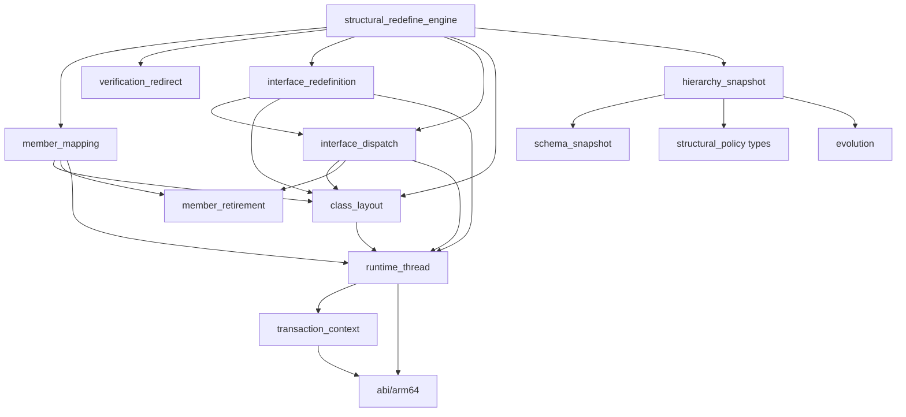

# Structural redefinition engine

English | [中文](STRUCTURAL_REDEFINE_ENGINE.md)

This document explains how the enhancement library evolves classes using the structural redefinition transaction built into the device's ART: which decisions it takes over, what each step does, and the semantics of each change. For user-facing semantics, see [LIMITATIONS.en.md](LIMITATIONS.en.md).

## Goals and prerequisites

- **Goal**: provide VM-level DCEVM inside an app process on Android 11–17 / arm64 without root: add and remove fields and methods, change types, signatures, modifiers and inheritance, and retain compatible field values in live objects.
- **Prerequisite**: the app process must be **Java-debuggable from startup** (manifest `debuggable`). In AOSP `openjdkjvmti/art_jvmti.h`, `can_redefine_classes` belongs to `kNonDebuggableUnsupportedCapabilities`. `IsFullJvmtiAvailable()` accepts only `IsJavaDebuggableAtInit()` or forced interpretation; changing the debug state after process startup has no effect.
- **Outside the design**: replacing system ART, relying on root, deriving addresses or offsets from disassembly, or reimplementing ART's instance migration, reference rewriting, deoptimization and cache invalidation.

## Why ART's structural transaction is the engine

Since Android 11, `Redefiner::StructurallyRedefineClasses` (JVMTI extension `com.android.art.class.structurally_redefine_classes`) already implements the hardest parts of DCEVM:

| Step | Existing ART implementation (`ti_redefine.cc`) |
| --- | --- |
| Class allocation | `FinishNewClassAllocations` creates new Class objects for targets and **all loaded subclasses** in topological order. `AllocateNewClassObject` loads from the new DEX and calls `LinkClass`; ClassLinker recalculates the vtable, iftable and field layout |
| Instance migration | `CollectAndCreateNewInstances` walks the heap and allocates a replacement for each old instance |
| Field copying | `UpdateClassStructurally` copies static and instance fields by name and type, migrates the lock word and clears old objects |
| Reference rewriting | `Runtime::VisitReflectiveTargets` rewrites ArtField*/ArtMethod* references in JNI IDs, reflection Field/Method, MethodHandle, VarHandle and DexCache. `HeapExtensions::ReplaceReferences` replaces old objects and classes in the heap and roots |
| Execution state | `DeoptimizeAllThreadFrames` deoptimizes frames, `InvalidateAllCompiledCode` clears JIT code, per-thread interpreter caches are cleared, and old methods are marked obsolete |

ART normally allows additions only; its restrictions are concentrated in a few decision functions. The library takes over those decisions. ART performs the commit, migration and invalidation.

## Interception points

| ART decision point | Original behavior | Enhanced behavior |
| --- | --- | --- |
| `JvmtiFunctions::RedefineClasses` in the public table | Ordinary redefinition rejects structural changes; an exported entry may be inlined | Route to the original structural transaction, retaining argument and capability checks, ClassFileLoadHook and ordinary method-body updates. Before entering ART, load classes referenced by the new DEX through the target's loader, including added interfaces and superclasses, and inspect old declarations |
| `CheckClass` | Class modifiers, superclass and interfaces cannot change | Parse the final DEX, probe the layout, evaluate the [validation rules](#validation-rules) and cache the decision |
| `CheckFields` / `CheckMethods` | Only additions are allowed; modifiers cannot change | Call `RecordNewFieldAdded` / `RecordNewMethodAdded` according to the decision to select ART's structural path; call the original function when no decision exists |
| `AllocateNewClassObject` | Rebuild classes and subclasses using the old hierarchy | On a superclass change, write the new superclass into the caller's superclass handle slot |
| `CheckVerification` | The verifier resolves the class descriptor to the old class | On a superclass change, the current thread's `FindClass` returns the new class object for that descriptor during verification |
| `CollectAndCreateNewInstances` | Allocate replacements for old instances | After the original succeeds, validate the slot declarations and precompute member mappings. Return an error on failure when the transaction depends on custom mapping |
| `CollectNewFieldAndMethodMappings` | A missing method with the same name and signature causes a CHECK, including when copied default/miranda methods disappear during subclass relinking | Write the precomputed mappings; use the original mapping for transactions without a plan |
| `UpdateClassStructurally` | Migrate fields and lock words, mark methods obsolete, replace references, deoptimize and invalidate caches | Establish the visitor's transaction scope and call the original in full. During copying, substitute old field arrays without retired entries, and temporarily point the new class at the old superclass when the superclass changes |
| `Runtime::VisitReflectiveTargets` | Apply original member mappings and shadowing rules | Restore old field arrays; clear retired members' DexCache entries, record retired JNI IDs, and rewrite reflection `Field` and VarHandle references for retired fields. Delegate all other work to the original visitor |
| JNI table, `Method_invoke`, `Constructor_newInstance0`, MethodHandle entries and JNI ID encoding | Cached targets are obsolete methods of the old declaring class; calls may fail receiver checks or use old vtable indexes to dispatch to another method | Throw before dispatch only for retired targets; forward all other calls unchanged |

## Transaction flow

### Installation

`DcevmRuntime.initialize()` loads `libartdcevm.so` and attaches it as a JVMTI agent. `core/agent.cc` calls the idempotent `structural_redefine::Install`:

1. Check that the agent's own jvmtiEnv has `can_redefine_classes` among its potential capabilities; otherwise fail.
2. Call the official `shadowhook_init()` and resolve the seven base symbols by name: the public table's `JvmtiFunctions::RedefineClasses`, the structural entry, three validation points and two `RecordNew*Added` functions. Initialization fails with a diagnostic if any symbol is missing or the named wrapper does not match the public JVMTI table.
3. `Install` is the only assembly entry. It explicitly prepares, in dependency order: `runtime_thread` → named Class services → retirement guard hooks → member mapping → verification redirection → interface dispatch → interface redefinition. Services are passed in structures. Thread preparation always runs, even if NDK map compatibility or mapping names fail; such failures retain their original `memberMapping` diagnosis. Missing required retirement services disable that hook group; missing `EncodeFieldId` disables only field retirement, and missing both `FindClass` signatures disables superclass changes. The engine records separate process capabilities for thread services, mapping, retirement, field retirement, superclass changes, interface runtime, instance checks and subclass watching.
4. Install every inline hook with `shadowhook_hook_sym_addr()`, routing the standard entry last. Any failure rolls back installed hooks in reverse order with `shadowhook_unhook()` and leaves the JNI function table untouched. The transaction lock prevents routed calls from observing partial installation.
5. Only after all inline hooks succeed, install JNI wrappers through `member_retirement::InstallJniGuards` / `SetJNIFunctionTable`. If that final operation fails, undo retirement/interface inline hooks while keeping the base validators and route, preserving the existing fallback for additions, body edits and other base changes; initialization fails if rollback itself fails. Then obtain retired-field placeholders through JVMTI `GetClassFields` without initializing their classes, and publish the process capabilities.

### Standard entry

1. Before entering ART, the thread remains in Native state. The transaction context first verifies the current thread through the shared thread service. For each target, use `Class.forName(name, false, target class loader)` to load every class referenced by the new DEX's `type_ids`, without initialization. For arrays, load the element class; see [class loading during transactions](#class-loading-during-transactions). Keep added interfaces and the new superclass as policy inputs. Loading precedes declaration snapshots because it may load classes. Then inspect old declarations through public JVMTI: methods declared by loaded subclasses, methods in their interfaces that the subclasses do not declare, and public methods of superclasses.
2. Create one context with `transaction::Scope`, owning the engine batch, mapping plans, interface state, Native-probed thread services, probed layouts and per-target `Requirements`. Nested transactions push and restore the whole context. Batch snapshots are keyed by `jclass`, the same value as ART's `ClassRedefinition::klass_`. Create JNI global roots for affected classes and loaded subclasses in advance. An outer recursive transaction lock serializes snapshotting and the ART transaction. A successful nested transaction initiated by ClassFileLoadHook invalidates the outer snapshot.
3. Call `StructurallyRedefineClasses` unchanged. Keep global roots after successful retirement; otherwise release them. Clear the context on return and return ART's result.

ART-internal stages such as `Check*` do not use JNI/JVMTI for loading, traversal, assignability or policy computation. The sole exception is JNI `SetObjectArrayElement` (with named local-reference bridging and exception checks) in the allocation hook, on the current thread's transaction-private arrays and holder. ART 13/16 `ScopedThreadStateChange` does not transition when both states are Runnable. This store executes ART's own GC write barrier, allocates no managed object and has no suspension point. Local-reference capacity is reserved while Native. This exception never applies inside an ART callback, while holding ART locks, or to published arrays.

### Class loading during transactions

ART's structural transaction handles subclasses in two steps:

- `FinishNewClassAllocations` walks the heap, collects resolved subclasses of targets, and rebuilds their class objects under the new classes.
- Only afterwards does `CheckVerification` verify the new DEX.

Between these steps, `ClassDefinitionPauser` prevents other threads from defining classes but allows the transaction's own thread to do so. When the verifier resolves types referenced by new code, it can define an unloaded class through `ClassLinker::FindClass`. A subclass defined this way is absent from the rebuild list and remains linked under the old class after commit:

- Its first instantiation fails verification because `this` is not an instance of the new class.
- If verification has been skipped, its field offsets overlap fields added to the new class.

The standard entry therefore loads every class referenced by the submitted DEX through the target's defining loader before entering ART, without initialization. This includes classes that the verifier might load, so the heap walk sees all subclasses and the policy snapshot (`GetLoadedClasses`) includes them. Types that the loader cannot load are left to the verifier's original behavior. Preloading changes only the timing: it does not execute initializers, and loading failures merely mark the class erroneous, as verification or first use would.

Preloading covers only the bytes submitted to the standard entry. Subclasses can still be missed in two cases:

- A class is first referenced by DEX rewritten by ClassFileLoadHook.
- Another thread loads a subclass before ART pauses class definition.

The engine therefore registers JVMTI `ClassPrepare` on its own jvmtiEnv and enables it only during a transaction, covering all threads. Starting with inspection of loaded classes, preparation of any new subclass of a target marks the attempt. ART creates replacement class objects through `LinkClass`, which does not trigger that event.

A marked attempt fails with `JVMTI_ERROR_INTERNAL` in `CollectAndCreateNewInstances`, ART's last fallible step, without committing the batch. The subclass is now loaded, so the standard entry takes a fresh snapshot and retries, up to three attempts. Each attempt calls ClassFileLoadHook again. `subclassLoadRetries` counts retries in the capability report. Without the method-retirement hooks, this failure point is unavailable and only preloading is performed.

### Interface transaction failure cleanup

The API 33/36 interface engine accepts multiple interface targets with supported body/member edits alongside unrelated classes, implementations or their subclasses. Parent/child targets share their highest batch ancestor as owner; disjoint interfaces keep separate groups. Groups sharing a subtype without a batch common ancestor reject with 66 to avoid duplicate migration/commit. Interface replacements use the custom allocation path and unrelated classes use ART allocation, within one atomic ART validation/commit/failure transaction. Holder probes use the actual batch length, the fixed `ClassRedefinition` element declaration, three flag vectors and ART-sorted entry indices. While Native, it reuses the standard entry's `GetLoadedClasses` snapshot to collect prepared implementations, their subclasses and subinterfaces, rejecting proxies with public `Proxy.isProxyClass`; some replacements retain their original superclass. On failure ART frees the new DEX, so a later superclass redefinition could collect these abandoned classes from the heap.

Batch implementations/subclasses allocate from their own incoming DEX and holder DexCache; affected types without an incoming DEX keep private link caches for their original DEX. The first affected `FinishNewClassAllocations` entry completes the entire interface group regardless of ART's superclass-depth order. After probing the full fixed holder, only private `initialized_`, `actually_structural_` and `initial_structural_` flags change: the interface owns the initial structural group; batch implementations are allocated structural dependents and later allocation entries skip them. Like ART's `setup_single_redefinition`, every batch entry retains its new-class slot for DEX verification, but only the interface owns the group class/instance arrays. ART's original instance collection, shared mapping plan and structural update therefore process the group once. Abstract-class admission checks every target against the owner's collected instances, avoiding empty dependent-entry arrays. Existing policy still validates implementation additions, retirement and modifiers. An external implementation superclass may share the batch for body edits; structural edits return 66 because its ART class transaction and the interface transaction would rebuild the same implementation subtree twice. The Native snapshot records overlap, and final DEX policy rejects only when that external superclass requires structural replacement, naming the class and overlap reason. Verification redirection covers the entire private group, matching old classes with named `LookupClass` and loader identity only during current-thread `CheckVerification`; no replacements enter old class tables or old DexCaches.

A named `Redefiner::Run` hook roots every group replacement array in a separate ART HandleScope until the batch result is known. A named `ClassLinker::LinkClass` hook only assigns a linked replacement to a reserved pending HandleScope root, without JNI or heap-array stores. The allocation hook transfers it to the private array after returning outside the callback and ART locks. The pending root covers failures while allocating JNI ID arrays, including classes not yet stored in the holder. Failed returns and native allocation exceptions discard the private replacements before their DEX is freed; successful returns preserve their status.

Cleanup uses the named, allocation-free `Class::SetStatusInternal` writer to set only unpublished replacements to `kErrorUnresolved`, preserving subtype bits. In `android-13.0.0_r1` `mirror/class.h`, `kErrorResolved` still satisfies `IsResolved()` and cannot exclude them from heap scans. The ordinary `SetStatus` initialization, locking, exception and notification protocol does not apply to these discarded private classes. As specified by `class-refvisitor-inl.h`, GC still visits Class instance references and native roots; skipping static references is safe because failure precedes the commit's static-field copy and private replacements never execute initializers.

`InterfaceAbortInstrumentation` exercises real DEX verification failures (an invalid return instruction and calling `String.length()` with an integer receiver, both returning 62), failure after linking, after full allocation, during instance allocation, and from the actual mapping probe in one process. Each failure is followed by superclass and interface redefinition, behavior checks and GC. The incompatible invocation is followed by explicit GC before further transactions. A transforming ClassFileLoadHook also tests a real retry after a late implementation loads. Only the app test module explicitly enables fault injection and test JNI exports through its Debug CMake arguments. It builds a test copy from the same engine source directory. Library-owned Debug and Release builds default to OFF and reject an enabled option in a standalone library build. The test APK selects the app copy. `tools/check-interface-abort-isolation.py` uses `llvm-nm` to check both AARs and their Build-ID-matched unstripped libraries for absent injection symbols, and confirms the APK Build ID belongs to the app test engine.

These behaviors have been verified on Android 13 / API 33 and Android 16 / API 36 in normal and CheckJNI modes; the API 33 control APK with cleanup disabled crashes in the failure test. Known limits: actual Java/native memory exhaustion, other ART module revisions, and other Android versions remain unverified. Injected allocation failures do not establish behavior under real memory exhaustion.

Private implementation caches reuse the named `ClassRedefinition::CreateNewDexCache` service with the current driver and a non-owning prefix for the original DEX. The original DexCache is unchanged and the new cache is not registered. ART handles allocation, roots, location, the dex lock and initialization. Descriptor redirection uses the named `LookupClass`, which does not fill the cache (`const char*` on API 33, `string_view` on API 36). Assignability uses JNI `IsAssignableFrom` only in the Native snapshot phase. An `IdentityHashMap` keyed by Class identity distinguishes same-named classes in different loaders. Direct superclass/interface edges feed one Kahn traversal, producing a topology and superclass indices in expected O(loaded classes + affected types + direct edges) work. ART allocation only decodes these roots, checks resolved status and the target-first invariant, and uses the saved superclass index; it performs no class traversal or pairwise assignability ordering. `ClassPrepare` still marks subtypes loaded after capture, rejects before instance allocation and triggers a fresh snapshot/retry at the standard entry. The abort instrumentation covers both a late subclass and a direct late implementation, including successful dispatch after retry and GC. Named `JNIEnvExt::NewLocalRef/DeleteLocalRef` services create real local references, and private array stores use JNI `SetObjectArrayElement`, including ART's write barrier, only outside callbacks and ART locks in the allocation hook. `LinkClass` only assigns the pending root; cleanup covers that root as well as the replacement array.

Thread, Class and HandleScope differences live only in `platform/abi/arm64/androidNN/`. The interface runtime registry limits installation-time platform API admission to verified API 33/36; subsequent declaration selection uses the bottom-layer `abi/arm64/release_order.h` ordering through `class_layout::CandidateReleases` and the same `VerifyTarget` member probes to filter interface declarations. Native capture checks the current JNI environment, OS tid and marking-flag range. Before creating any private HandleScope, admission uses named `Thread::HandleScopeVisitRoots` to observe ART's existing root slots. Its callback only records addresses: no allocation, JNI, object dereference or scope mutation. The single-root scopes in both fixed admission callers must match the candidate header/capacity/size, the actual incoming Handle slot and ART's root walk. A candidate Thread scope pointer is never dereferenced unless it is adjacent to that known root at the source-declared header position.

`Run` requires completed probes; the chosen declaration is local to the transaction thread and restored after nested transactions. Before allocation, holder probes check array length, vector target and begin/end/capacity, all three boolean-vector lengths and the new DEX-cache slot. Only a declaration mismatch disables interface redefinition with an explicit `interfaceRuntime` reason while ordinary class transactions remain available. Only completed probes report `verified`. ART's named Mark service still handles read barriers; the private JNI store exception is unchanged. Device validation remains limited to Android13/API33 and Android16/API36, without claiming support for other platforms or modules. Separate abort-test processes verify Thread, HandleScope and holder rejection, persistent interface disablement and subsequent class transactions.

ART-called hooks and visitors must not propagate C++ exceptions. The interface path no longer registers `VisitClasses` callbacks. Admission, class checking, allocation, and instance/mapping preparation translate failures locally to `OUT_OF_MEMORY` or `INTERNAL` without allocating another diagnostic. The pending root covers replacements whose transfer to the private array fails; failed lookup redirection records an error that allocation must reject. Catching at `Run` alone would already unwind ART frames.

Shared commit mapping, update, reflective visitor, and ID encoding boundaries are explicitly `noexcept`. ART offers no recoverable error protocol after its commit point: native allocation failure there remains fatal, rather than continuing a partial commit. Real memory exhaustion recovery is not established. Removing the visitors also removes injections 6, 7, 9 and 10. Admission, lookup and array-transfer exception injections, plus Native scope-construction failure with restoration of the unified transaction context, check error codes, live instances, subsequent parent/interface transactions, and GC on both devices in both JNI modes.

Interface admission reads access flags from the target's current DEX ClassDef with `evolution::ReadClassAccess`, using the same valid interface bits as the access probes in `class_layout`. JVMTI `GetClassModifiers` cannot supply this baseline: it prefers InnerClass flags, where member interfaces include `static`, while ClassDef and runtime Class flags do not. Nested and top-level interfaces follow the same admission rules.

Permanent disablement is limited to declaration evidence: Thread env/tid/marking fields, HandleScope root traversal under an accepted Class candidate, Class flags checked against their own DEX, the Redefiner's current thread, and holder/private-array/private-DexCache shape and identity probes. Injected Thread/HandleScope/holder probe failures belong to the same category. Missing target member evidence, no supported Class candidate, unavailable ClassDef, initialization changes since capture, incomplete admission, and unsuitable holder index/allocation/structural state reject only the current transaction with a reason. Boolean-vector lengths probe declarations; their values describe the current transaction and are checked separately. Hooks save only static rejection reasons; Native return formats the target descriptor and reason into `lastRejection`. Both the full suite and abort instrumentation update a nested interface's default method on an existing instance, check GC, reject unsupported method addition, and then successfully update a top-level interface in the same process.

The `interface-stress` scenario loads 200 implementations, four subinterfaces forming a diamond, and two affected superclasses. Its snapshot must contain exactly 207 types; it verifies preserved instance fields, old/new dispatch and dispatch after GC. `interfaceSnapshotNanos` measures this attempt's `GetLoadedClasses` and interface capture/ordering. `interfaceAllocationNanos` measures the interface allocation hook, including private caches, linking and array stores. Both use a monotonic clock and nanoseconds, describe the calling transaction thread's latest attempt, and are diagnostics rather than a performance guarantee. Device timings stay in local verification records.

The interface named-service catalog follows the implementation: `VisitClasses` and unused ClassVisitor declarations have been removed. `tools/check-structural-symbols.py` rejects unreferenced interface catalog entries, records catalog/implementation hashes, and reports coverage per name and its declared ELF tables. Admission spellings and array-allocation overloads are alternatives; the catalog total is not a count of names simultaneously required on every device.

ART class states use the complete fixed `abi::arm64::ClassStatus` enum shared by 11–17 in `platform/abi/arm64/common/class_status.h`, referenced directly by the shared implementation. Status reads return that enum; initialization and cleanup comparisons use named states rather than numbers or JVMTI status masks. Java/DEX access bits use named constants, including interface, class super, synthetic, annotation and enum flags. Proxy detection remains a public Native-phase API check, without internal Proxy flag access.

Structural interface admission checks every type in its captured group with ART's pointer-id marker semantics: any nonnull, non-array instanceJfieldIDs, jmethodIDs or staticJfieldIDs slot rejects with 79 and names the marked class in lastRejection. Named FindInstanceField resolves Class.extData, the three ID slots and Class.componentType by name/descriptor; ART read barriers handle references, with no fixed field offsets or old ClassExt writes. ART creates the marker when first preparing JNI ID slots in swapable-pointer mode; switching to indices preserves it. Tests attempt normal JNI ID creation before agent installation and also inject target/subtype validation results without changing published objects. Sources: [ClassExt](https://android.googlesource.com/platform/art/+/refs/tags/android-13.0.0_r1/runtime/mirror/class_ext-inl.h), [JNI ID manager](https://android.googlesource.com/platform/art/+/refs/tags/android-13.0.0_r1/runtime/jni/jni_id_manager.cc).

The Thread layout table lives in `platform/abi/arm64/runtime_thread_table.h`. A compile-time assertion requires declarations sharing a JNI-env offset to share exception and top-HandleScope offsets. Only `runtime_thread::Ready()` can construct a `VerifiedThread`; `Read`, `Layout` and `LayoutFor` require it. Interface probes and operations use `LayoutFor` for the selected release, including tid, exception and HandleScope slots. The interface registry's `linked_iftable_acceptance` property determines whether early link-error services are required; shared code contains no release-number special case.

### Validation

`CheckClass` reads `klass` and `dex_file` according to `redefinition.h`, calling the original function if the class is absent from the context. It then reads the new declaration (ClassDef 0) through `DexView`, probes the layout, reads runtime flags of added interfaces and the new superclass, and calls `structural_policy::Evaluate`:

- On rejection, write only `driver_->result_` and return false; `Redefiner::RecordFailure` itself does the same. Record the reason in `lastRejection` and logcat.
- On acceptance, store the decision, including the retired-declaration list, in the context's engine batch keyed by `ClassRedefinition*`, and record mapping, instance and verification requirements in per-target `Requirements`. The policy directly sets `Decision::requires_member_mapping` when accepting a mapping-dependent branch; the engine no longer derives it with a second evaluation disabling mapping. For accepted decisions, it equals rejection with mapping and its derived abilities disabled while retaining `instance_check`: field retirement, method retirement/signature changes, native-to-Java changes, interface member additions (including abstract methods), superclass changes, and copied/miranda changes rejected without custom mapping. Adding an interface itself, ordinary member additions, modifier changes and body edits do not inherently require mapping; making a class abstract only requires instance inspection. Interface targets still unconditionally require mapping, including body-only edits. Rejected decisions carry no requirement.

`CheckFields` / `CheckMethods` call the appropriate `RecordNew*Added` according to `fields_structural` / `methods_structural`. The decision is cleared after `CheckMethods`.

### Mapping and commit

The engine owns the `CollectAndCreateNewInstances` hook at ART's last fallible step. Its fixed order is: subclass-load retry guard → original ART function → live-instance checks for classes made abstract → replacement-layout verification and member planning → new-superclass verification → interface dispatch validation → new default conflicts. Checks carry the Native-probed `VerifiedThread`; rejections use `transaction::Context::Reject` to set both the reason and `driver->result`. `member_mapping` only builds/stores plans and applies them in ART's later commit hooks; it does not inspect instances or call interface dispatch. Layout or planning failure rejects mapping-dependent transactions; other transactions retain ART's original mapping.

`PlanMethods` is shared by every layout and structural transaction, including ordinary classes. It decodes each method's name and full prototype using its declaring class DEX and `dex_method_index`, then matches (name, descriptor); raw indices are not comparable across DEX files. The interface engine introduced this rule because ART `HasSameNameAndSignature`/`GetCanonicalMethod` consult the obsolete method array's DexCache, whereas copied default/miranda storage belongs to an implementation class. Replacing an interface can invalidate that assumption. The mapping no longer depends on those two named symbols; the catalog and checker retain only currently referenced services.

Newly linked default conflicts are semantic rejections before commit; see [interface member evolution](#interface-member-evolution).

The remaining commit cannot fail. `CollectNewFieldAndMethodMappings` only writes the plan into ART's maps, after confirming they are empty libc++ trees. `UpdateClassStructurally` calls the original in full. The engine only swaps field arrays and superclass pointers around the copying phase and handles retired members in the visitor. The commit section performs no JNI/JVMTI calls or Java-object allocation.

## Interface member evolution

On Android 13/API 33 and Android 16/API 36 arm64, interface targets with verified runtime declarations and member mapping support new public abstract and default methods, static methods at any access level (including synthetic methods), and private instance methods. Static/private methods can be deleted or change signature. Adding native or `<clinit>` methods rejects with 63; deleting or changing default/abstract signatures rejects with 67. Field, parent-interface and method-modifier changes still reject with 64, 66 and 71. Interfaces always use structural replacement; the engine enables `Abilities::interface_members` only when it owns member mapping.

The existing interface group is reused: ART re-links the interface, loaded subinterfaces, implementations and their subclasses. An implementation without submitted DEX keeps its original DEX and a private DexCache and still receives copied defaults. New declarations have no old mapping entry. Public class implementations take precedence; a more specific subinterface overrides its parent, and a miranda can become a default copy. ART continues to perform all instance migration, reference rewriting, deoptimization and cache invalidation.

The following checks constrain additions:

1. A new static/private method must not hide an inherited superinterface virtual method or a public Object instance method; otherwise return 63. `CollectInheritedInterface` records their identities in `LoadedHierarchy::inherited_interface`. Already verified `invoke-interface` code may still dispatch through the IMT; changing the declaration cannot safely make it throw an invoke-kind error.
2. A new default must not overlap a same-signature static/non-public method in an implementation or its superclass chain. Reject with 63 and name that declaring class. `subtype_shadows` uses `interface_redefinition::Scope::GroupTypes`, matching the prepared, non-error types ART actually rebuilds. Superclass chains are included; unique boot descriptors may be deduplicated, while names from other loaders are not. Public instance implementations remain admissible.
3. `PlanMethods` reads ART's linked result and records any newly introduced `IsDefaultConflicting` method. Before ART's no-failure point, `CollectAndCreateNewInstances` returns 63 and `lastRejection` names the implementation and method descriptor, preserving old definitions. It does not use `Fail()`, which denotes a layout probe failure and could fall back to ART mapping. This check is shared by all structural transactions using custom mapping, including ordinary classes gaining interfaces.

4. New public abstract declarations bypass the default-only `subtype_shadows` check. The policy records pending (name, full descriptor) conditions. `CheckClass` stores them with the interface's `ClassRedefinition*` identity in batch-wide `Context::interface_obligations`, independently of which input owns the rebuild group. The dispatch verifier finds the candidate interface by old identity in the owner's old/new class arrays, then checks every concrete implementation's actual IfTable, including classes without instances or submitted DEX. An ancestor owner validates conditions from dependent subinterface inputs; same-named types in other loaders or groups stay distinct.

The read-only accessor follows fixed-source `mirror/class-inl.h::FindVirtualMethodForInterface`: select the IfTable entry by candidate declaring-class identity and index its PointerArray by the candidate method's `method_index`. Before following pointers, named `FindDeclaredInstanceField` confirms `java.lang.Class.ifTable`'s owner, type, instance storage and fixed offset. Runtime ObjectArray/long[] classes, paired length, consecutive declared-interface method indices, method-array length and target membership in known method arrays are checked before reading target flags and DEX identity. The fixed PointerArray declaration follows `android-13.0.0_r1` and `android-16.0.0_r1` `mirror/array.h` (8-byte data alignment on arm64); IfTable follows both releases' `mirror/iftable.h`. Heap references use shared `runtime_thread::Read` and the named Mark read barrier. Class probes and mapping plans use the same reader for declaring classes, DexCaches and array elements, so concurrent GC forwarding cannot make an identity comparison treat them as different classes. The accessor neither writes dispatch tables nor simulates method selection.

Dispatch must select a public, concrete, non-static/non-private, non-conflicting, non-obsolete and non-retired method with the same DEX name and full descriptor. Existing/same-batch and inherited implementations and a more specific default selected by ART are accepted; bridges must actually exist. Failure rejects the whole batch with 63, naming the interface method and concrete class in `lastRejection`. Accessor mismatches also reject with 63 and a probe reason. Validation runs beside default-conflict rejection in the `CollectAndCreateNewInstances` planning stage, before the no-failure boundary, and reuses existing abandoned-class cleanup and retry. `interfaceAbstractDispatch` reports the latest accessor probe state; every transaction checks again.

Dispatch validation lives in `interface_dispatch`, which owns read-only layout probes, obligation checks and rejection formatting. `structural_redefine_engine` schedules it at the commit gate after member planning; mapping has no dispatch dependency. Both reuse bounded DEX identity readers in `art_method_identity.h`. ART 13's `LinkInterfaceMethods` calls the fixed-source `ThrowIllegalAccessErrorForImplementingMethod` before constructing a usable IfTable for a non-public implementation. `interface_redefinition` observes the actual selected pair through this named NO_INLINE service. Under linker locks it records only native metadata and existing HandleScope roots, preserving the original service. After allocation fails and leaves those locks, the verifier matches candidate interface identity and complete descriptor to produce rejection 63. It neither parses exception text nor guesses implementations by name, and does not relax ART linking. If this service cannot be located on ART 13, only abstract additions are disabled with a capability and rejection reason; ART 16 validates the linked IfTable.

Focused regressions also cover a more specific abstract declaration masking a distant default, same-batch removal of the last implementation, rejection in a later independent group, failure after mapping planning, and late-loaded missing implementations including retry exhaustion. Cached reflection, MethodHandle, JNI IDs and warmed bytecode are invoked before and after failure, followed by a corrected or withdrawn retry. `interfaceAbstractMethodAddition` describes probe readiness and does not replace transaction validation.

The predicate uses fixed source declarations: for 12–17, common/runtime_objects.h compares the relevant intrinsic/copied/abstract/default bits with copied/abstract/default (`0x80000000`, `0x01000000`, `0x0400`, `0x00400000`, respectively). Android 11's android11/art_method.h instead tests its dedicated `0x01000000` default-conflict bit and excludes intrinsics. ArtMethod overloads select the predicate without new offsets. Existing lengths bound method-array iteration; a non-null address does not prove members exist. Shared empty field arrays on API 36 must also pass the existing layout probes.

Interface direct-method retirement reuses `{old, old, kRetired}`, DexCache clearing and the existing access guards. Bytecode, JNI and MethodHandle calls throw `NoSuchMethodError`; cached reflection wraps it in `InvocationTargetException`; active old frames continue. Standard-entry roots already cover the interface and its full subtype group and are retained until process exit after retirement. Each target records retired kinds, so restoring the same name/descriptor with another invoke kind still rejects with 71. No interface-specific access guard is needed.

### Lambdas in interface defaults

Local compilation with Kotlin 2.3.21 (`-jvm-default=enable`, JVM target 1.8) and D8 8.10.9 showed that appending a lambda adds a private static implementation method, a public static synthetic `$r8$lambda$` bridge and a synthetic class. Inserting before an existing lambda can also change an old implementation signature and remove its bridge. A new interface body can add `DefaultImpls` and implementation bridges. The reload tool must therefore append new classes to the loader, then submit the interface, changed existing synthetic classes and implementation bridges atomically. Patch distribution and the new-class loading protocol belong to that tool.

Renumbering can change an old lambda instance's synthetic class into another lambda's implementation; changing its functional interface may still reject with 66. Tools must isolate old closures as they do for ordinary classes, or preserve old bridges and only append new ones. Supporting direct-method retirement does not preserve an old closure's business meaning.

`InterfaceEvolutionFixture` and `interfacelambda` fixtures cover additions, retirement, copied defaults, subinterface precedence, mirandas, bridge batches and lambda insertion; `interface-stress-add` covers 200 implementations. `InterfaceAbortInstrumentation` checks old behavior, subsequent superclass/interface transactions and GC after a linked conflict rejects. Raw device logs and individual verification records remain in local ignored directories.

## Validation rules

`structural_policy` is a pure function that can be tested on the host. Field identity is (name, type, static); method identity is (name, descriptor), and a method's invoke kind is further constrained by [invoke kinds stay fixed](#invoke-kinds-stay-fixed). Before comparison, raw DEX flags are normalized to the JVMTI view, consistently with `ti_method.cc`, `ti_field.cc` and `ti_class.cc`: retain Java flag bits, map a method's declared-synchronized flag to synchronized, and remove native from abstract methods.

“Retirement available” means the method-retirement hooks are installed and this transaction's layout probes pass. Field changes also require field guards.

| Change | Result |
| --- | --- |
| Interface target method-body edits | Accepted with verified interface runtime and member mapping |
| Interface target new default/static methods and private instance methods; static/private deletion or signature change | Accept with verified member mapping and interface runtime, subject to inherited/shadow/default-conflict checks |
| Interface target new native/`<clinit>` methods; abstract additions without valid dispatch or a verified IfTable accessor; direct-method hiding or default conflicts | Reject `METHOD_ADDED` (63) |
| Interface target default/abstract deletion or signature change | Reject `METHOD_DELETED` (67) |
| Interface target field changes; method modifiers; parent interfaces; class modifiers | Reject `SCHEMA_CHANGED` (64), `METHOD_MODIFIERS_CHANGED` (71), `HIERARCHY_CHANGED` (66), and `CLASS_MODIFIERS_CHANGED` (70), respectively |
| Unavailable interface runtime capability (unsupported version, named service or probe) | Reject `NOT_AVAILABLE` (98); declaration changes use the standard errors above |
| Add fields or methods | Accept |
| Change existing members' access, final, volatile, transient or synchronized flags, except making an instance method private; Java → native; abstract ↔ concrete | Accept |
| Make a method final when a loaded subclass overrides it | Reject with `METHOD_MODIFIERS_CHANGED` (71) |
| Add an instance method or change its access level when it may displace a loaded subclass's copied default/miranda method | Accept through custom mapping when retirement is available; otherwise reject additions with `METHOD_ADDED` (63) and access changes with 71 |
| native → Java | Accept when retirement is available; the engine handles JNI-entry copying. Otherwise reject with 71 |
| Switch a method between static and instance, make an instance method private, or re-add a retired method as another invoke kind | Reject with 71; see [invoke kinds stay fixed](#invoke-kinds-stay-fixed) |
| Change a method's varargs or strict flags | Reject with 71 |
| Delete methods or change signatures, including native, abstract, constructors and class initializers | Accept when retirement is available; otherwise reject with `METHOD_DELETED` (67); interface default/abstract methods always reject |
| Delete fields or change their types or static flags | Accept when retirement and field guards are available; otherwise reject with `SCHEMA_CHANGED` (64) |
| Change class visibility, final, abstract, synthetic or InnerClass flags | Accept through the structural path. Adding final with a loaded subclass rejects with `CLASS_MODIFIERS_CHANGED` (70); adding abstract while the class itself has instances rejects with 70 after `CollectAndCreateNewInstances` |
| Switch a class between class, interface, annotation and enum kinds | Reject with 70 |
| Add interfaces, with optional reordering | Accept with readable runtime flags and successful resolution/access checks; adding an interface alone does not require member mapping. Unresolved, non-interface or inaccessible types reject with `FAILS_VERIFICATION` (62); no usable layout for reading flags rejects with `HIERARCHY_CHANGED` (66); a newly linked default conflict rejects with 63 when using custom mapping |
| Remove an interface; repeat an interface | Removal rejects with 66; see [why narrowing is unsupported](#narrowing-is-unsupported). A duplicate rejects with 62 |
| Change the superclass | Accept when the new superclass extends the original; other cases reject with 62, 61 or 66 under the conditions in [widening superclass changes](#widening-superclass-changes) |

## Runtime probes

Fixed source declarations are selected by probes on each transaction, rather than an SDK, vendor or build-number allowlist:

- **Declaration sources**: compare AOSP source for `android-11.0.0_r1` through `android-17.0.0_r1`, including `12.1.0_r1` for Android 12. Shared declarations live in `platform/abi/arm64/common/`: Object/ObjectArray, the DexCache prefix, ArtField, ArtMethod for 12–17, Handle, RedefinitionDataHolder slots, the reflection visitor and source types, and the libc++ pointer map. Differences live in version directories: the Class field arrays in `android11`–`android17/class.h` (`ifields_/sfields_` in 11–15, `fields_` in 16–17, with `access_flags_` moving accordingly), and `android11/art_method.h`, which has an extra `dex_code_item_offset_`.
- **CheckClass probes**: obtain each target's Class through `ClassRedefinition::GetMirrorClass`, and compare `access_flags_` with ClassDef flags under each candidate declaration. First use `FindDeclaredInstanceField` to look up `java.lang.Class.iFields`/`sFields` (11–15) or `fields` (16–17), and check the declaring class, instance storage and fixed slot offset before reading any array length. Then use the target's ArtFields returned by `FindDeclared*Field` to check array bounds, declaring classes, JVMTI modifiers and DEX field identities. Total field counts must match JVMTI, including empty arrays. [Android 16 QPR2 ART](https://android.googlesource.com/platform/art/+/refs/heads/android16-qpr2-release/runtime/class_linker.cc) uses a shared nonnull empty array for classes without fields, so lack of a named field witnessing a nonnull pointer cannot itself reject that array. Check declared method counts, modifiers and DEX method identities with each candidate ArtMethod stride. Candidate arrays are not dereferenced before their position has been established. Consider only versions no older than the platform, since the ART module cannot predate it, and try the platform's own version first. A candidate is usable only if every target in the transaction accepts it. With no usable candidate, the transaction cannot retire members or change copied members.
- **Commit-time checks**: after the first retirement, confirm that ART marked retired methods obsolete; otherwise guards switch to direct table lookup. Obtain MethodHandle's `artFieldOrMethod` offset and the VarHandle access-mask offset from ART's field table through `Class::FindInstanceField`, rather than hardcoding layouts.
- **NDK map**: the pointer-map boundary between ART and the NDK is restricted to libc++ ABI v1. Check NDK type sizes at compile time and verify sentinel, root, size and value layouts at initialization using the library's own empty and one-node maps.
- **DEX identity**: the bounded reader accepts both standard DEX and Android 11–15 CompactDex, where ID tables are in the main region and strings and type lists are in a separate data region. Redefinition input accepts only single-class standard DEX.

### Shared thread service and GC read barriers

`runtime_thread` probes the current thread in the Native phase of every standard-entry transaction. Installation resolves `Thread::CurrentFromGdb`, `ReadBarrier::Mark` and optional `gUseReadBarrier` by name. Each transaction follows the bottom-layer `abi/arm64/release_order.h` order through `runtime_thread_table.h`, checking `jni_env`, Linux tid and the 0/1 range of `is_gc_marking` against the fixed `android11`–`android17/thread.h` declarations. Accepted candidates, the preferred declaration and the thread pointer belong to `transaction::Context::thread`; nested transactions restore them with the context. The interface module reuses these results without probing Thread again. It still verifies Class, HandleScope and holder itself, and interface admission remains limited to API 33/36.

The following conclusions were checked individually against the fixed local AOSP tags under `build/evidence/abi-sources/`: `android-11.0.0_r1`–`android-17.0.0_r1`, plus `android-12.1.0_r1`. Supplemented source files and their hashes remain in local evidence only.

| Source releases | Reference reading and marking semantics |
| --- | --- |
| 11, 12/12L, 13 | `kUseReadBarrier` in `read_barrier_config.h` is a compile-time choice. `thread.h` explicitly defines `is_gc_marking` as **CC-only**. The root-flip callback in `concurrent_copying.cc` enables it, and the marking-disable checkpoint clears it. `ReadBarrier::BarrierForRoot` calls `Mark` when the flag is true and returns the reference otherwise. `Mark` enters `ConcurrentCopying::MarkFromReadBarrier`; ART performs marking/forwarding, and this entry also checks the current thread's flag. These releases do not contain the CMC/userfaultfd collector. |
| 14, 15, 16, 17 | The meaning of `is_gc_marking` stays the same; it **does not describe CMC concurrent marking**. `read_barrier_config.h` allows forced compile-time CC, configurations without read barriers, or runtime selection. For runtime selection, `ShouldUseUserfaultfd` in `mark_compact.cc` sets `gUseUserfaultfd` and `gUseReadBarrier = !gUseUserfaultfd`. Selected CC still needs `Mark`; CMC makes `BarrierForField`/`BarrierForRoot` skip the CC read barrier. CMC updates roots through `CompactionPause`/thread root flipping, and coordinates compacted pages through `KernelPreparation` and page faults, without CC's `Mark`. |

Source references: [11 read barriers](https://android.googlesource.com/platform/art/+/refs/tags/android-11.0.0_r1/runtime/read_barrier-inl.h), [12L Thread](https://android.googlesource.com/platform/art/+/refs/tags/android-12.1.0_r1/runtime/thread.h), [13 Mark entry](https://android.googlesource.com/platform/art/+/refs/tags/android-13.0.0_r1/runtime/gc/collector/concurrent_copying-inl.h), [14 collector selection and compaction](https://android.googlesource.com/platform/art/+/refs/tags/android-14.0.0_r1/runtime/gc/collector/mark_compact.cc), [15 read-barrier configuration](https://android.googlesource.com/platform/art/+/refs/tags/android-15.0.0_r1/runtime/read_barrier_config.h), [16 collector constraints](https://android.googlesource.com/platform/art/+/refs/tags/android-16.0.0_r1/runtime/gc/heap.cc), [17 Thread/Mark semantics](https://android.googlesource.com/platform/art/+/refs/tags/android-17.0.0_r1/runtime/gc/collector/concurrent_copying-inl.h).

Shared `Read` requires a probed transaction. When named `gUseReadBarrier` exists, false permits direct reading according to the CMC source above; true passes nonnull references to named `Mark`, which checks the actual thread's marking state inside ART. This also avoids marking-slot ambiguity between identical JNI/tid prefixes after Mainline updates. Without that export, follow the flag fast path in the fixed Thread declaration and `BarrierForRoot`: call `Mark` only when `is_gc_marking` is true. This also covers compile-time forced CC builds. Read the flag afresh for each reference rather than caching its Native-phase value into the Runnable phase.

A failed Thread probe or missing required symbol disables the transaction's layout/member-mapping probe before reading layout references. For prepared mapping, `class_layout::VerifyTarget` reports `rejected: runtime Thread...`. An unavailable mapping retains its original installation reason; Thread probing does not overwrite it. Existing policy and the engine commit gate still determine error codes. There is no raw-reference fallback for an unverified thread. Internally violating this precondition is a fatal invariant error. JSON keys and interface admission remain unchanged.

Before the first interface transaction, `InterfaceAbortInstrumentation` injects an ordinary-class Thread probe failure and verifies code 67, the `memberMapping` reason, zero shared reference reads and preservation of the old definition. It then alternates at least 32 ordinary-class structural redefinitions while another thread retains about 197,000 live objects, continuously allocates and requests GC. If marking reads remain zero, retries are bounded by 512 transactions or 120 seconds. Checks cover field/method additions and removals, primitive values/reference identity in old instances, zero-initialized new fields and subsequent GC. Reports include actual GC cycles, allocations, shared reference reads and reads during CC marking. CMC may report zero for the last metric; GC pressure alone does not prove that every transaction overlaps CC marking.

`python3 tools/test-runtime-thread-host.py` compiles the production thread service and transaction context with fake named services, covering all seven Thread declarations, JNI/tid/flag rejection, missing Mark, marking changes after the Native probe, nested context restoration and CC/CMC call boundaries. It also covers compile-time `VerifiedThread` constraints, `LayoutFor`, positive/negative assertions for shared JNI prefixes, and preservation of unavailable mapping reasons. It does not simulate collector algorithms.

`python3 tools/test-structural-install-host.py` compiles shared production modules with fake public JNI/JVMTI tables and ShadowHook services. It checks installation order, idempotence, no JNI override attempt after inline-hook failure, base-capability fallback after JNI-table failure, and independent Thread preparation/diagnostic preservation when mapping names are missing. It executes no ART objects, collector or real hooks and does not replace device ABI validation.

### Fixed interface declarations for other releases

Interface releases are registered in [`platform/abi/arm64/interface_runtime_table.h`](../artdcevm/src/main/cpp/platform/abi/arm64/interface_runtime_table.h). Each entry contains the Android source release, platform API range, `InterfaceRuntime` declaration, device-verified/prepared-only status, and whether linked IfTable validation replaces early link-error services. Both `RuntimeFor` candidate filtering and the installation-time platform API gate read only this table; only 13/API 33 and 16/API 36 are device-verified. The maximum HandleScope header size is also computed from the registered declarations. `tools/check-interface-abi-preparation.py` reads releases and declarations from this table and checks every prepared release, actual candidate selection and API admission.

The declarations follow fixed AOSP tags from Android 11 through 17, including Android 12L. Differences stay in `platform/abi/arm64/androidNN/`; identical Thread pointer and statistics prefixes share `common/thread_prefix.h`. No backend is copied. Offsets below come from source declarations and arm64 `offsetof`/`sizeof` assertions, without disassembly or memory-derived offsets.

| Version | Thread tls32 size / tls_ptr start | tid / GC mark offsets | JNI env / top HandleScope offsets | HandleScope header | Final ClassRedefinition flags |
| --- | --- | --- | --- | --- | --- |
| 11 / API 30 | 92 / 160 | 16 / 52 | 216 / 296 | 12, no size | Four, ending in needs_reverify |
| 12, 12L / API 31–32 | 88 / 152 | 12 / 48 | 208 / 288 | 12, no size | Four, ending in needs_reverify |
| 13 / API 33, verified | 80 / 144 | 12 / 36 | 200 / 280 | 12, no size | Four, ending in lock_acquired |
| 14 / API 34 | 84 / 152 | 12 / 36 | 208 / 288 | 12, no size | Four, ending in lock_acquired |
| 15 / API 35 | 80 / 144 | 12 / 32 | 200 / 280 | 16, with size | Three, ending in has_virtuals |
| 16 / API 36, verified | 80 / 144 | 12 / 32 | 200 / 280 | 16, with size | Three, ending in has_virtuals |
| 17 / API 37 | 80 / 144 | 12 / 32 | 200 / 280 | 16, with size | Three, ending in has_virtuals |

The Class declaration includes its Object header and reference/native fields through status. Android 11–15 separate ifields/sfields, with access_flags at 64 and status at 112; 16–17 merge fields, with offsets 56 and 104. RootVisitor's virtual destructor and two VisitRoots overloads have the same order in all seven versions. RootInfo is passed by reference and its fields are never read. ClassStatus has the same complete 0–15 enum, also in 12L. kErrorResolved remains resolved; discarded classes must use kErrorUnresolved.

Android 17 uses an atomic 32-bit clinit_thread_id_or_hash slot. GetClinitThreadId distinguishes a thread ID from a descriptor hash using the upper ten bits. Its fixed declaration retains the real name and source-defined DecodeClinitThreadId; the prepared profile explicitly passes its offsetof. Sources: [class.h](https://android.googlesource.com/platform/art/+/refs/tags/android-17.0.0_r1/runtime/mirror/class.h), [class-inl.h](https://android.googlesource.com/platform/art/+/refs/tags/android-17.0.0_r1/runtime/mirror/class-inl.h).

All holder declarations contain a Handle array, a redefinitions-vector pointer, and initialized/actually_structural/initial_structural vector<bool> fields at offsets 0, 8, 16, 40 and 64. libc++ ABI v1 vector<bool> occupies 24 bytes. ClassRedefinition is 72 bytes with the same driver/klass/DEX prefix and ArrayRef at 48 following std::string. The thirteen Java holder slots agree. Android 11's root traversal takes pid_t/int; 12 onward takes uint32_t. The differing name is an offline declaration only.

The shared function declarations cover admission Handle/Class and string*, Run's RedefinerPrefix*, Finish's ClassRedefinitionPrefix*/holder/iterator, AllocateNewClassObject's three Handles and uint16 class-def index, CreateNewDexCache's loader Handle, LinkClass's Thread/descriptor/Handles, LookupClass's char* or string_view, DoLookupResolvedType's TypeIndex/referrer or DexCache/loader, SetDexCache, JNIEnvExt local-reference bridges, internal ClassStatus writes, Mark, and FindInstanceField's two string_views. ClassExt and array-type fields are found by name through ART's field table, without fixed offsets. Mapping and verification redirection reuse the existing structural and FindClass declarations.

The table still selects only android13/android16, verified on API 33/36 devices; shared Thread probes independently cover 11–17 for ordinary classes. The android11/12/14/15/17 `kPreparedInterfaceRuntime` profiles are registered as prepared-only for fixed-declaration and arm64 compilation checks, excluded from runtime candidates and API admission. The engine does not resolve, hook or call their offline symbols. Compilation does not prove device behavior.

| Version | Preparation and activation | Required validation before activation |
| --- | --- | --- |
| Android 11 / API 30 | Ordinary classes and Thread device-verified; interfaces inactive | Motorola G20 passes the complete first stage in normal/CheckJNI modes; still establish a named service that safely obtains ART's allocator or a three-argument array wrapper, then verify signed root traversal, scope/holder, full interface transactions and cleanup |
| Android 12, 12L / API 31–32 | Ordinary classes and Thread device-verified on both APIs; interfaces inactive | Pixel 6/API 31 and Pixel 6a/API 32 pass both first-stage modes; still establish required named allocation services, then verify the scopes/holder associated with the old Thread layout and complete interface transactions |
| Android 14 / API 34 | Ordinary classes verified under CC/CMC; interfaces pending, inactive | Galaxy S21 under CC and Pixel 8 under CMC pass both first-stage modes, selecting android14 member mapping; still verify Thread deopt fields, 12-byte scopes, four redefinition flags and full interface transactions |
| Android 15 / API 35 | Ordinary classes verified under CC/CMC; interfaces pending, inactive | Galaxy S21 under CC and Pixel 8 under CMC pass both first-stage modes, selecting android15 member mapping; still verify 16-byte scopes, three redefinition flags, separate Class field arrays and full interface transactions |
| Android 17 / API 37 | Ordinary classes verified under generational CMC; CC and interfaces pending, inactive | Pixel 11 and Galaxy Z Fold8 pass both first-stage modes under generational CMC; still obtain actual CC coverage, then verify the tid/hash slot, merged Class field arrays, mapping and interface cleanup |

All device validation must cover normal and CheckJNI modes, every probe, batch updates and recovery after failure. A platform API does not prove the ART module's source version; Mainline updates still require declaration and service review. Per-runtime symbol tables, coverage counts and collection details stay only in the local ignored assets/runtime_lib/README.md; raw reports stay in build/evidence/.

For the first stage, run the complete ordinary-class suite with `tools/run-device-tests.py --scenario-group ordinary`, then independently run Thread rejection, recovery and GC pressure with `am instrument -w -r -e scenario ordinary -e checkjni <false|true> dev.artdcevm.lab/com.github.ytlog.artdcevm.testing.InterfaceAbortInstrumentation`. Ordinary classes adding interfaces remain in this stage; interface targets run in the second stage. Retirement scenarios must report verified `memberMapping`. For Android 14 and later, record actual CC and CMC configurations separately; zero marking-period reads do not identify CMC.

After obtaining first-stage device evidence, review and activate one release at a time: fixed Class, HandleScope, holder, ClassRedefinition flags, IfTable/PointerArray and named-symbol declarations, including `linked_iftable_acceptance`. Commit that release separately only after the complete interface suite, abort recovery and android-compose-hotreload's `interface abstract batch` pass. A cloud catalog entry, offline symbols or successful compilation do not replace device execution; entries without complete evidence remain `kPreparedOnly`.

## Member mapping and method retirement

Keep ART's `FinishNewClassAllocations`, `AllocateNewClassObject`, `CollectAndCreateNewInstances` and `UpdateClassStructurally`. Every transaction whose probes pass uses custom mapping, including cases where disappearing subclass copied default/miranda methods would CHECK in ART's original mapping. Mapping uses the actual declaring class and members with the same name and signature to distinguish declared, inherited and copied members:

- Map a deleted real declaration to itself and retire it, without fabricating members or offsets.
- Map a disappearing copied method to its real canonical member and clear that DexCache resolution for the transaction. It is not a deleted declaration and does not enter the permanent retirement set.
- A signature change retires the old signature and adds the new one. Restoring a member with the same name and signature creates a new member; old cached targets remain retired.

ART's obsolete marking for all old methods, old declaring-class fixup and ClassExt retention continue unchanged.

### Access guards

Ordinary bytecode calls need no guard. During commit, ART visits every DexCache in the heap, including caches retained by old classes. The visitor clears resolutions to retired methods; a subsequent resolution that cannot find a member throws `NoSuchMethodError`. Deleting an override falls back to a superclass or interface default implementation. The vtable/iftable contains only new methods, and ART clears per-thread interpreter caches and JIT code. Guards are installed only at entries that can still obtain a retired method directly:

- **JNI**: use public JVMTI `SetJNIFunctionTable` to wrap every `Call*Method*` in front of the current table: virtual, nonvirtual and static, including A/V forms, plus `NewObject`/`NewObjectV`/`NewObjectA`. Retired IDs are looked up without decoding and immediately throw `NoSuchMethodError`. Forward other calls to the original table, which is the checked table when CheckJNI is enabled. Two `EncodeMethodId` overloads record index-form IDs encoded after retirement.
- **Reflection**: hook the native implementations of `Method.invoke` and `Constructor.newInstance` (`Method_invoke` and `Constructor_newInstance0`; each runtime has one of two spellings). Identify retired targets before ART checks the receiver or allocates a new-class instance, and throw `InvocationTargetException` wrapping `NoSuchMethodError`. Executing a retired constructor would run old code on a new-class object, so both paths must be intercepted.
- **MethodHandle**: `MethodHandleInvoke`/`MethodHandleInvokeExact` read the handle's `artFieldOrMethod` before dispatch. Combinator handles return to these entries through invoke-polymorphic on Android 11/12. From 13 onward, they call `MethodHandleInvokeExact` through `MethodHandleInvokeExactWithFrame`; guard that function when present to cover compiler inlining.

The deoptimization-resume paths for existing frames are not intercepted. Active old frames continue to execute old method bodies.

### Method kinds

- **native**: ART's `UpdateClassStructurally` looks up every old native method by name in the new class and copies its JNI entry, assuming the destination is still native; this is the same in 11–17. Deletion may yield no method (a null pointer) or a superclass method with the same name. Changing native to Java would overwrite a Java method's data field. Record these old methods during planning and remove their native flags only during ART's copying loop. That loop also writes obsolete stubs into their entries. Because a native method's entry determines active frame sizes during stack walking, restore native flags and original entries at the visitor entry.
- **abstract**: retire abstract declarations like ordinary methods. Calls through the declaration resolve again and throw `NoSuchMethodError`; a subclass's own implementation remains unaffected. When a method becomes abstract, calling it on a subclass instance without an implementation throws `AbstractMethodError`, following JVM linking semantics.
- **Constructors**: retire them like ordinary methods. Bytecode `new` throws `NoSuchMethodError` after resolution; guards reject cached `Constructor` objects and JNI constructor IDs.
- **Class initializers**: an initialized class does not run `<clinit>` again. Deleting it retires the old method while static field values are copied as usual.

### Keeping retired members alive

To prevent GC, class-loader unloading or address reuse from turning retired pointers into dangling keys, the standard entry creates JNI global roots for affected classes while still in Native state. Release them for failed batches or batches without retirement. Successful retirement retains and deduplicates roots across batches. ART's reference replacement updates the roots to the new Class, whose obsolete chain protects old members. **These classes and their class loaders remain alive until process exit.**

## Field retirement

An old field is retired when its name, type or storage no longer appears in the new class. Keep the real old ArtField, without manufacturing a tombstone. A same-name new field in the new class starts at its default value.

- **Copying during commit**: ART's `CopyFields`/`ClearFields` walks old-class field arrays and looks up same-name, same-type fields in the new class; a missing field causes a `CHECK`. After `CollectAndCreateNewInstances`, prepare an array copy without retired entries for each affected old class. Swap the old class's field-array slot to the copy at the start of Update, and restore it when ART reaches the visitor, after copying and before visiting in every version 11–17. Confirm restoration again at the end of Update. After commit, clear retired static reference fields in the old class so permanently retained old classes do not keep those objects alive.
- **Bytecode**: the visitor clears retired-field resolutions from DexCache. Resolving `iget/sget` again throws `NoSuchFieldError`; old active frames also fail when accessing retired fields.
- **JNI**: wrap `Get/Set<Type>Field`, `GetStatic/SetStatic<Type>Field` and `ToReflectedField` in the JNI table. The visitor records retired IDs in the JNI tables. `JniIdManager::EncodeFieldId` records retired or placeholder field IDs encoded afterwards; there are two overloads for each of the old and new signatures, and either complete pair suffices. Pointer-form IDs are compared by address. Matches throw `NoSuchFieldError` without decoding the ID.
- **Reflection `Field`**: `ReplaceReferences` changes a `Field` object's declaring class to the new class while its index and offset still describe the old field. The visitor maps it to a field of the same primitive type in the library's placeholder class, `com.github.ytlog.artdcevm.internal.RetiredField` for instance fields or `RetiredStaticField` for static fields. `Field::VisitTarget` then rewrites the declaring class, index and offset. Instance access fails the receiver check with `IllegalArgumentException`. `RetiredStaticField` initialization has already failed during installation, so static access throws `NoClassDefFoundError`, caused by `NoSuchFieldError`.
- **MethodHandle**: the handle guard reads `artFieldOrMethod` and throws `NoSuchFieldError` when the target is a retired field.
- **VarHandle**: accessors in 11–17 first check `accessModesBitMask`, both in `VarHandleInvokeAccessorImpl` and the JIT intrinsic. The visitor zeros the mask of a VarHandle targeting a retired field, so later access throws `UnsupportedOperationException`.
- **Uncovered access**: raw field offsets cached by `sun.misc.Unsafe`, `Atomic*FieldUpdater` and similar APIs bypass all ART entry points. Any structural redefinition that changes an instance layout, including adding fields, invalidates them. This is a restriction of ART's structural redefinition itself.

## Adding interfaces

ART's `AllocateNewClassObject` does not call `LoadSuperAndInterfaces`. It marks the new class kLoaded and calls `LinkClass` directly. For each interface in the new DEX, `LinkClass` calls `ClassLinker::LookupResolvedType` ([16: NonProxyInterfacesAccessor](https://android.googlesource.com/platform/art/+/refs/tags/android-16.0.0_r1/runtime/class_linker.cc#7183); Android 11 uses [`Class::GetDirectInterface`](https://android.googlesource.com/platform/art/+/refs/tags/android-11.0.0_r1/runtime/mirror/class.cc#1217)), looking only in the new class loader's class table. A miss returns null, which release builds dereference. A hit is checked only for being an interface, not for accessibility. The engine therefore handles:

- **Pre-resolution**: before entering ART, call `Class.forName(name, false, target's defining loader)` for every added interface. In 11–17, `Class.forName` calls `ClassLinker::FindClass`, which inserts the returned class into the initiating loader's class table even when a parent loader defined it ([16: class_linker.cc#3444](https://android.googlesource.com/platform/art/+/refs/tags/android-16.0.0_r1/runtime/class_linker.cc#3444)). `LinkClass` can then find it. Interfaces are not initialized here. `CheckClass` reads DEX after ClassFileLoadHook; the policy rejects unresolved interfaces introduced there.
- **Reading flags**: `CheckClass` decodes each resolved interface with `GetMirrorClass`, which in 11–17 reads only `driver_->self_` and `klass_`. Read Java bits from `Class::access_flags_` using the layout accepted by this transaction's probes. These must be ClassDef flags: ART's `Class::CanAccess` reads them, while JVMTI `GetClassModifiers` reports InnerClass flags. For example, a protected nested interface has public ClassDef flags.
- **Policy**: reject with 62 if a type cannot be resolved, is not an interface, or is neither public nor in the same runtime package, which requires both the same package name and defining loader. Reject with 66 if no usable layout is available to read flags.
- **Mapping and subclasses**: adding interfaces only adds copied default/miranda methods or turns an old copy into a conflict method; it does not make old copies disappear. `FinishNewClassAllocations` relinks loaded subclasses, which also acquire the new interfaces.

## Widening superclass changes

The new superclass B must be a proper subclass of the original superclass A, for example by inserting a class between T and A. T retains every existing supertype, so verified code's type assumptions remain valid. Instances of T and its loaded subclasses acquire B's fields, initialized to zero, and its methods. ART's transaction assumes an unchanged hierarchy, so four decisions need interception:

- **Resolution and policy**: resolve B before entering ART, without initialization. Use JNI to check whether B extends A or instead extends T, and JVMTI to collect final methods declared between B and A. `CheckClass` reads B's runtime ClassDef flags through the selected layout. Reject when:
  - B cannot be resolved, is an interface, is final, or is inaccessible: 62;
  - B extends T, creating a cycle: `CIRCULAR_CLASS_DEFINITION` (61);
  - B does not extend A, which narrows the hierarchy: 66;
  - the new definition or a loaded subclass overrides a final method in B's chain: 62;
  - the batch also includes a superclass or subclass of T, or a class in B's chain: 66;
  - custom member mapping or verification redirection is unavailable: 66. B may make copied default/miranda methods in T disappear, which requires custom mapping.
- **Allocation**: `AllocateNewClassObject` puts the old superclass into a slot in the caller's handle scope, then calls `LinkClass`. The hook writes B into this slot, which remains a GC root, so the new class links under B. Loaded subclasses are then rebuilt under the new T. After `CollectAndCreateNewInstances`, confirm that the new superclass is B; otherwise reject with 66.
- **Verification**: starting with Android 13, the verifier resolves the class itself by descriptor through its loader and still obtains the old class, whose superclass is A. A new constructor calling B's constructor would fail verification. ART on Android 11/12 itself writes the new class into the new DexCache. The engine hooks `ClassRedefinition::CheckVerification`: while verifying this class, the current thread's `ClassLinker::FindClass` returns the new class object from the holder for that descriptor. There are two signatures and every runtime has at least one. If another verifier uses a different resolution path, verification fails with 62; unverified code is never committed.
- **Field copying**: ART's `CopyFields` pairs old and new superclass chains level by level; differing chain lengths cause a `CHECK`. Because B extends A, field offsets in A's chain in the new T remain the same as in the old T. At the start of Update, temporarily change the new T's superclass pointer back to A. ART then pairs (T', T), (A, A), and subsequent levels, copying T's own fields and all inherited fields. Restore B at the visitor entry and at the end of Update.

B is not initialized during redefinition; its static initialization runs when first needed. Existing instances do not execute B's constructor.

## Narrowing is unsupported

Any loss of a supertype, whether removing an interface or omitting an old superclass from the new chain, is rejected with 66. The issue is verified code, not just existing references. ART's verifier previously proved that a T value could be used as L, so this code has no runtime cast.

- **Interfaces**: after narrowing, JIT compilation of code such as `L l = t; l.m();` dispatches through an IMT slot. A single-method slot stores the implementation directly (`ClassLinker::SetIMTRef`), without checking that the receiver implements L, and may jump to another method of T.
- **Superclasses**: the interpreter does not check the receiver type for access already resolved to a field in superclass A, either. It reads or writes the T instance using A's offset.

Checking the heap and stacks at commit covers only existing references, not this code when it executes later. Safe narrowing would require ART to reverify every loaded class that may depend on the old type relationships. No usable named entry exists for that operation.

## Invoke kinds stay fixed

Verified code resolves a method by name and signature without checking that it still has the invoke kind it was verified against. Methods that skip access checks use unchecked resolution, and from Android 16 that path (`ClassLinker::ResolveMethodId`) no longer receives the invoke type. The instruction then invokes the result as its own invoke type:

- `invoke-static` that resolves to an instance method runs the instance body without a receiver argument.
- `invoke-virtual` that resolves to a static or private method dispatches through a vtable index the method does not own, reaching another method.

Retiring the old method clears the callers' DexCache entries, so the next call takes exactly this path. The engine cannot make it throw `IncompatibleClassChangeError`. A method identity (name, descriptor) therefore stays static or instance, and a virtual method never becomes private. A private method may become virtual: only the class's own code invokes it directly, and that remains valid. Constructors and class initializers are always invoked directly and are not restricted.

The engine records the methods each class retired in committed transactions, with their modifiers, and checks a later re-addition of the same identity by the same rule. The record lasts as long as the process. Field resolution includes the static flag and cannot find a field with the other storage, so a field's static change can retire like any other.

## Active frames

In a process debuggable from startup, app code is either JIT-compiled in debuggable mode or interpreted. ART's `DeoptimizeAllThreadFrames` covers all app frames. Only boot-image frames cannot be deoptimized. Boot code is compiled independently, does not inline app code and holds only references. Member changes therefore need no additional handling: ART's deoptimization and obsolete-method mechanisms provide it.

## Capability report

The JSON returned by `DcevmRuntime.capabilities()` contains:

| Key | Meaning |
| --- | --- |
| `installed`, `standardRedefineRouted` | Base entries are installed, and standard `RedefineClasses` is routed to the structural transaction |
| `memberAddition`, `memberModifierChange`, `classModifierChange` | Member additions and member/class modifier changes; true after installation |
| `methodDeletion`, `methodSignatureChange`, `interfaceAddition` | Method-retirement hooks are installed |
| `fieldDeletion`, `fieldTypeChange`, `memberDeletion`, `memberTypeChange` | Field guards are also available |
| `superclassWidening` | Method-retirement hooks and verification redirection are both installed |
| `hierarchyChange`, `fullDcevmComplete` | Always false: narrowing is unsupported and full DCEVM is not complete |
| `interfaceRedefinition` | Boolean: true only after installation and all Class/Thread/HandleScope/holder probes pass. False before probing, when versions/services are unavailable, or after process-wide probe disablement. A target-specific rejection does not clear it |
| `interfaceRuntime` | `unavailable`, `unverified: interface runtime declarations`, `verified: androidNN Class/Thread/HandleScope/holder probes`, or `disabled: reason`. Only API 33/36 are allowed; other versions are disabled with a reason |
| `interfaceAbstractMethodAddition` | True after interface runtime and dispatch probes pass and required link-error services are available; all implementations are still checked per transaction |
| `interfaceAbstractDispatch` | Read-only IfTable accessor for abstract additions: `unavailable`, `unverified: ...`, `verified: ...` or `rejected: reason`; actual dispatch is still validated per transaction |
| `interfaceSnapshotTypes` | Type count in the calling transaction thread's latest interface snapshot: targets, subinterfaces, implementations and their subclasses |
| `interfaceSnapshotNanos`, `interfaceAllocationNanos` | That thread's latest snapshot (including GetLoadedClasses) and interface allocation durations in monotonic nanoseconds; diagnostic only, potentially zero without an interface transaction |
| `memberMapping` | Installation-unavailability reason or latest probe result (including Native Thread failures): `unavailable`, `unverified`, `verified: androidNN class layout`, or `rejected: reason` |
| `jniRetirementGuards` | Count of actual JNI/reflection guard rejections of retired targets |
| `subclassLoadRetries` | Count of retries caused by a subclass of a target loading during a transaction; see [class loading during transactions](#class-loading-during-transactions) |
| `diagnostic`, `lastRejection` | Installation diagnostics; the classes and reason of the latest standard-entry transaction failure, empty on success. Rejections by the policy, the snapshots and the pre-commit checks state their own reason. When one of ART's own checks rejects the batch (a boot interface, for example, is rejected with 79 at its entry), the standard entry names the rejected interface or unmodifiable class, or otherwise lists the batch's classes and the error name; ART's own message appears only in logcat after `FAILURE TO REDEFINE` |

Device tooling should distinguish `interfaceAddition` (adding an interface to an ordinary class) from `interfaceRedefinition` (the interface runtime probe state). On Android 13/API 33 and Android 16/API 36, submit supported interface body or member edits directly and handle the return code: 0 means success; 98 means the runtime is unavailable, so prompt the user to restart the app process and retry; for other standard JVMTI errors, display the class and reason in `lastRejection`. Treat `interfaceRedefinition` and `interfaceRuntime` as reference information, without making them prerequisites for removing the tool's interface-edit restriction or requiring a semantically unchanged redefinition first. Every real transaction performs policy and runtime probe checks; these reference states describe runtime probes; member changes and batch admission still depend on each transaction.

Whether a capability is usable still depends on each transaction's probes. Failed probes reject the corresponding changes with JVMTI errors.

## Named symbols

Private ART capabilities are accessed only through named ELF symbols. The official ShadowHook resolves them at runtime within the table scope declared in the catalog. `.gnu_debugdata` is also a named symbol table; no disassembly or address derivation is involved.

- [structural_redefine_symbols.h](../artdcevm/src/main/cpp/platform/symbols/structural_redefine_symbols.h): 22 currently used names provided by every runtime. Of these, 19 require `.dynsym`; the standard JVMTI wrapper and two MethodHandle entries allow any named table.
- [member_retirement_symbols.h](../artdcevm/src/main/cpp/platform/symbols/member_retirement_symbols.h): variable spellings used by retirement guards: `Method_invoke` and `Constructor_newInstance0` without a suffix or with a fixed `.__uniq` suffix, old and new `EncodeFieldId` signatures, and optional `MethodHandleInvokeExactWithFrame` from Android 13 onward.
- [verification_redirect_symbols.h](../artdcevm/src/main/cpp/platform/symbols/verification_redirect_symbols.h): old and new `FindClass` signatures used by verification redirection.

- [runtime_thread_symbols.h](../artdcevm/src/main/cpp/platform/symbols/runtime_thread_symbols.h): shared `CurrentFromGdb`, `ReadBarrier::Mark` and optional `gUseReadBarrier` for ordinary classes and interfaces.
- [interface_redefinition_symbols.h](../artdcevm/src/main/cpp/platform/symbols/interface_redefinition_symbols.h): the active interface catalog covers normal/structural `CanRedefineClass`/`GetClassRedefinitionError` alternatives, `FinishNewClassAllocations`, `Run`, `HandleScopeVisitRoots`, `EnsureInitialized`, `NewLocalRef`/`DeleteLocalRef`, `CreateNewDexCache`, two `DoLookupResolvedType` overloads, two `LookupClass` signatures, `SetDexCache`, two three-argument `ObjectArray::Alloc` forms, `LinkClass` and `SetStatusInternal`, plus optional named alternatives for `ThrowIllegalAccessErrorForImplementingMethod`. It reuses `GetMirrorClass`, `AllocateNewClassObject` and `FindInstanceField` from the structural catalog.
- [interface_abi_preparation_symbols.h](../artdcevm/src/main/cpp/platform/symbols/interface_abi_preparation_symbols.h): offline-only signed-tid root traversal and two array allocation names taking AllocatorType. Runtime code neither resolves nor calls them.

A symbol's presence proves only that it can be located. Runtime probes check the fixed declarations; device regression checks hook coverage.

## Source organization

Under `artdcevm/src/main/cpp`:

| Component | Location |
| --- | --- |
| JVMTI agent entry and JNI exports for `DcevmRuntime` | `core/agent.cc` |
| Engine: prerequisites, single installation entry, standard-entry routing, commit gate and process capabilities | `platform/common/structural_redefine_engine.{h,cc}` |
| Validation policy, including interface additions and inherited/shadow facts | `platform/common/structural_policy.{h,cc}` |
| Transaction context, nested scopes and per-target policy requirements | `platform/common/transaction_context.{h,cc}` |
| Shared Native Thread probes and named GC read barriers for ordinary classes and interfaces | `platform/common/runtime_thread.{h,cc}` |
| Class layout probes and per-transaction layout selection | `platform/common/class_layout.{h,cc}` |
| Shared layout readers and field-array probes | `platform/common/class_layout_table.h`, `platform/common/field_array_probe.h` |
| Member mapping plans, commit and newly linked default conflict checks | `platform/common/member_mapping.{h,cc}` |
| Retirement registry, retained class roots, field placeholders and JNI/reflection/MethodHandle guards | `platform/common/member_retirement.{h,cc}` |
| CheckVerification/FindClass redirection during verification | `platform/common/verification_redirect.{h,cc}` |
| Interface rebuild groups, allocation, redirection and failure cleanup | `platform/common/interface_redefinition.{h,cc}` |
| Candidate IfTable probes, abstract-obligation validation and actual link-selection diagnostics | `platform/common/interface_dispatch.{h,cc}` |
| Bounded DEX method identity shared by mapping and dispatch checks | `platform/common/art_method_identity.h` |
| Native snapshot of affected interface types, inheritance edges and rebuild order | `platform/common/interface_snapshot.{h,cc}` |
| Public JNI/JVMTI type preloading, new superclass/interface resolution, hierarchy facts and a shared loaded-class index per attempt | `platform/common/hierarchy_snapshot.{h,cc}` |
| Old-schema inspection through public JVMTI | `platform/common/schema_snapshot.{h,cc}` |
| Class declarations read from ART's mapped DEX | `platform/common/art_dex_view.h`, `evolution/class_schema.h`, `evolution/dex_schema.cc` |
| Interface runtime registry, device-verification status, API admission and maximum HandleScope header size | `platform/abi/arm64/interface_runtime_table.h` |
| Release candidate ordering and fixed Class/Thread tables | `platform/abi/arm64/release_order.h`, `class_layout_table.h`, `runtime_thread_table.h` |
| Production-empty fault macros; implementation, counters and JNI exports only in app Debug | `platform/common/fault_injection.h`; `app/src/debug/cpp/testing/fault_injection.cc` (from repository root) |
| Fixed declarations shared by 11–17 | `platform/abi/arm64/common/` |
| Declarations with real version differences | `platform/abi/arm64/android11`–`android17/` |
| Named symbols and ShadowHook lookup | `platform/symbols/` |

Dependencies form a directed acyclic graph from the engine to lower modules. `hierarchy_snapshot` and `schema_snapshot` share the public JNI/JVMTI layer: the former depends only on the latter, policy types and `evolution`, receiving environments and root containers explicitly without engine globals or layout, thread, mapping or interface internals. The target list is independent of declaration snapshots that a nested preload-time transaction may clear, so retention still covers the original submitted batch. Each attempt scans loaded classes once after `GetLoadedClasses`, using JNI `IsAssignableFrom` to select each ordinary target and its subtypes while producing the all-status retention union. Assignability distinguishes same-named classes in different loaders without assigning identity hashes to all loaded classes or building a superclass graph. Subtype lists preserve loaded order and the PREPARED bit, sharing one class-status read across overlapping targets; policy reads only prepared subclasses. Interface policy still receives the original `GroupTypes`, while retention includes every loaded type assignable to an interface target. The ordering of `Probe`, `Begin`, watch setup and retries stays unchanged. `Install` assembles services and capabilities; its commit gate calls layout, mapping and dispatch checks. `verification_redirect` receives interface queries through explicit services. `interface_redefinition` uses dispatch diagnostics, snapshots, layouts and the runtime registry; mapping uses layout readers and retirement guards without calling interface modules. Layout and dispatch readers depend on `runtime_thread`, which depends only on transaction context, bottom-layer ABI tables, named services and the empty-in-production fault interface. Release ordering and ABI tables do not depend on shared implementations or symbols. The transaction context owns module-private state and requirements; it calls no module. Fault implementation, counters and every `InterfaceAbortInstrumentation` JNI export live in the app Debug source; production modules contain only erased fault/counter macros. ART still owns migration, reference rewriting, deoptimization and cache invalidation.

Reflection placeholder classes for retired fields live in `artdcevm/src/main/java/com/github/ytlog/artdcevm/internal/`.

## Risks

- **Mainline updates**: ART APEX is replaced through Google Play system updates, so the platform version can differ from the ART source version. Candidate declarations cover source versions 11–17 and are checked by runtime probes on each transaction. New ART source versions require source review; add a version directory when there is a real difference.
- **ART service changes**: probes can verify only declarations with ART services or JVMTI as a reference: Class, ArtField, ArtMethod, DexCache, slots, maps, obsolete flags and MethodHandle offsets. Visitor vtable order, source types, Handle and guard signatures rely on source declarations and exact symbol names. Check source and device behavior when extending version coverage. Put differences only in `platform/abi/arm64/androidNN/`, without copying the backend.
- **Retired access boundaries**: retain real old ArtMethod/ArtField objects and guard new access. Raw offsets cached by `Unsafe` and field updaters cannot be intercepted.
