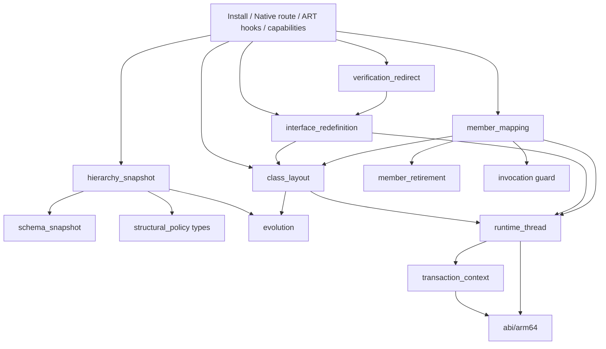

# Structural redefinition engine

English | [中文](STRUCTURAL_REDEFINE_ENGINE.md)

This document explains how the enhancement library evolves classes using the structural redefinition transaction built into the device's ART: which decisions it takes over, what each step does, and the semantics of each change. For user-facing semantics, see [LIMITATIONS.en.md](LIMITATIONS.en.md).

See [COMPATIBILITY.en.md](COMPATIBILITY.en.md) for public device conclusions and [TESTING.en.md](TESTING.en.md) for validation commands, declaration checks and diagnostic fields.

## Goals and prerequisites

- **Goal**: provide VM-level DCEVM inside an app process on Android 11–17 / arm64 without root: add and remove fields and methods, change types, signatures, modifiers and inheritance, and retain compatible field values in live objects.
- **Prerequisite**: the app process must be **Java-debuggable from startup** (manifest `debuggable`). In AOSP `openjdkjvmti/art_jvmti.h`, `can_redefine_classes` belongs to `kNonDebuggableUnsupportedCapabilities`. `IsFullJvmtiAvailable()` accepts only `IsJavaDebuggableAtInit()` or forced interpretation; changing the debug state after process startup has no effect.
- **Outside the design**: replacing system ART, relying on root, deriving addresses or offsets from disassembly, or reimplementing ART's instance migration, reference rewriting, deoptimization and cache invalidation.

## Why ART's structural transaction is the engine

Since Android 11, `Redefiner::StructurallyRedefineClasses` (JVMTI extension `com.android.art.class.structurally_redefine_classes`) already implements the hardest parts of DCEVM:

| Step | Existing ART implementation (`ti_redefine.cc`) |
| --- | --- |
| Class allocation | `FinishNewClassAllocations` creates new Class objects for targets and **all loaded subclasses** in topological order. `AllocateNewClassObject` loads from the new DEX and calls `LinkClass`; ClassLinker recalculates the vtable, iftable and field layout |
| Instance migration | `CollectAndCreateNewInstances` walks the heap and allocates a replacement for each old instance |
| Field copying | `UpdateClassStructurally` copies static and instance fields by name and type, migrates the lock word and clears old objects |
| Reference rewriting | `Runtime::VisitReflectiveTargets` rewrites ArtField*/ArtMethod* references in JNI IDs, reflection Field/Method, MethodHandle, VarHandle and DexCache. `HeapExtensions::ReplaceReferences` replaces old objects and classes in the heap and roots |
| Execution state | `DeoptimizeAllThreadFrames` deoptimizes frames, `InvalidateAllCompiledCode` clears JIT code, per-thread interpreter caches are cleared, and old methods are marked obsolete |

ART normally allows additions only; its restrictions are concentrated in a few decision functions. The library takes over those decisions. ART performs the commit, migration and invalidation.

## Interception points

The single assembly entry stays in `structural_redefine_engine.cc`. The standard entry's Native phase lives in `structural_redefine_route.cc`, ART validation/allocation decisions and the commit gate in `structural_redefine_hooks.cc`, and capability reporting in `structural_redefine_capabilities.cc`. The engine and verifier redirect use the explicit `Backend` interface in `interface_redefinition.h`. Interface admission probes, Native group snapshots, and group allocation/failure cleanup live in `interface_admission.cc`, `interface_group_snapshot.cc`, and `interface_allocation.cc`; assembly and reporting remain in `interface_redefinition.cc`.

The interface backend is the sole exception to the principle of taking over decision points only: `FinishNewClassAllocations` collects subclasses but misses interface implementations, so the backend prepares rebuild-group allocation and failure cleanup itself. ART still performs the commit, instance migration, reference rewriting, deoptimization and cache invalidation.

| ART decision point | Original behavior | Enhanced behavior |
| --- | --- | --- |
| `JvmtiFunctions::RedefineClasses` in the public table | Ordinary redefinition rejects structural changes; an exported entry may be inlined | Route to the original structural transaction, retaining argument and capability checks, ClassFileLoadHook and ordinary method-body updates. Before entering ART, load classes referenced by the new DEX through the target's loader, including added interfaces and superclasses, and inspect old declarations |
| `CheckClass` | Class modifiers, superclass and interfaces cannot change | Parse the final DEX, probe the layout, evaluate the [validation rules](#validation-rules) and cache the decision |
| `CheckFields` / `CheckMethods` | Only additions are allowed; modifiers cannot change | Call `RecordNewFieldAdded` / `RecordNewMethodAdded` according to the decision to select ART's structural path; call the original function when no decision exists |
| `FinishNewClassAllocations` / `Run` / `LinkClass` | Collect target subclasses; execute the transaction and link replacement classes | The interface backend prepares group allocation for interfaces and implementations, roots replacements for Run, and cleans up unpublished classes on failure (`interface_allocation.cc`) |
| `AllocateNewClassObject` | Rebuild classes and subclasses using the old hierarchy | On a superclass change, write the new superclass into the caller's superclass handle slot |
| `CheckVerification` | The verifier resolves the class descriptor to the old class | During superclass or interface-group verification, the current thread's `FindClass` uses verification redirection or the interface backend to return the replacement; interface groups match loader identity |
| `CollectAndCreateNewInstances` | Allocate replacements for old instances | After the original succeeds, validate the slot declarations and precompute member mappings. Return an error on failure when the transaction depends on custom mapping |
| `CollectNewFieldAndMethodMappings` | A missing method with the same name and signature causes a CHECK, including when copied default/miranda methods disappear during subclass relinking | Write the precomputed mappings; use the original mapping for transactions without a plan |
| `UpdateClassStructurally` | Migrate fields and lock words, mark methods obsolete, replace references, deoptimize and invalidate caches | Establish the visitor's transaction scope and call the original in full. During copying, substitute old field arrays without retired entries, and temporarily point the new class at the old superclass when the superclass changes |
| `Runtime::VisitReflectiveTargets` | Apply original member mappings and shadowing rules | Restore old field arrays; clear retired members' DexCache entries, record retired JNI IDs, and rewrite reflection `Field` and VarHandle references for retired fields. Delegate all other work to the original visitor |
| `JniIdManager::VisitReflectiveTargets` | Repair JNI ID caches using declaring-class array indexes, which may not exist for copied conflicts | During structural commit, hide ClassExt only for an invalid array owner; the original manager updates the ID map and other caches. Restore before the next visitor call or return |
| JNI table, `Method_invoke`, `Constructor_newInstance0`, MethodHandle entries and JNI ID encoding | Cached targets are obsolete methods of the old declaring class; calls may fail receiver checks or use old vtable indexes to dispatch to another method | Throw before dispatch only for retired targets; forward all other calls unchanged |

## Transaction flow

### Installation

`DcevmRuntime.initialize()` loads `libartdcevm.so` and attaches it as a JVMTI agent. `core/agent.cc` calls the idempotent `structural_redefine::Install`:

1. Check that the agent's own jvmtiEnv has `can_redefine_classes` among its potential capabilities; otherwise fail.
2. Call the official `shadowhook_init()` and resolve the seven base symbols by name: the public table's `JvmtiFunctions::RedefineClasses`, the structural entry, three validation points and two `RecordNew*Added` functions. Initialization fails with a diagnostic if any symbol is missing or the named wrapper does not match the public JVMTI table.
3. `Install` is the only assembly entry. It explicitly prepares, in dependency order: `runtime_thread` → named Class services → retirement guard hooks → member mapping → verification redirection → interface dispatch → interface redefinition. Services are passed in structures. Thread preparation always runs, even if NDK map compatibility or mapping names fail; such failures retain their original `memberMapping` diagnosis. Missing required retirement services disable that hook group; missing `EncodeFieldId` disables only field retirement, and missing both `FindClass` signatures disables superclass changes. The engine records separate process capabilities for thread services, mapping, retirement, field retirement, superclass changes, interface runtime, instance checks and subclass watching.
4. Install every inline hook with `shadowhook_hook_sym_addr()`, routing the standard entry last. Any failure rolls back installed hooks in reverse order with `shadowhook_unhook()` and leaves the JNI function table untouched. The transaction lock prevents routed calls from observing partial installation.
5. Only after all inline hooks succeed, install JNI wrappers through `member_retirement::InstallJniGuards` / `SetJNIFunctionTable`. If that final operation fails, undo retirement/interface inline hooks while keeping the base validators and route, preserving the existing fallback for additions, body edits and other base changes; initialization fails if rollback itself fails. Then obtain retired-field placeholders through JVMTI `GetClassFields` without initializing their classes, and publish the process capabilities.

### Standard entry

1. Before entering ART, the thread remains in Native state. The transaction context first verifies the current thread through the shared thread service. For each target, use `Class.forName(name, false, target class loader)` to load every class referenced by the new DEX's `type_ids`, without initialization. For arrays, load the element class; see [class loading during transactions](#class-loading-during-transactions). Keep added interfaces and the new superclass as policy inputs. Loading precedes declaration snapshots because it may load classes. Then inspect old declarations through public JVMTI: methods declared by loaded subclasses, methods in their interfaces that the subclasses do not declare, and public methods of superclasses.
2. Create one context with `transaction::Scope`, owning the engine batch, mapping plans, interface state, Native-probed thread services, probed layouts and per-target `Requirements`. Nested transactions push and restore the whole context. Batch snapshots are keyed by `jclass`, the same value as ART's `ClassRedefinition::klass_`. Create JNI global roots for affected classes and loaded subclasses in advance. An outer recursive transaction lock serializes snapshotting and the ART transaction. A successful nested transaction initiated by ClassFileLoadHook invalidates the outer snapshot.
3. Call `StructurallyRedefineClasses` unchanged. Keep global roots after successful retirement; otherwise release them. Clear the context on return and return ART's result.

Both standard Route and the retransform wrapper hold `process->transaction_mutex` while calling ART, which synchronously invokes agents' `ClassFileLoadHook` callbacks. The recursive lock permits nested transactions on the same thread. A callback must not block waiting for another thread that is calling or needs to enter `RedefineClasses` or `RetransformClasses`; the transaction lock and the thread wait would form a deadlock cycle.

ART-internal stages such as `Check*` do not use JNI/JVMTI for loading, traversal, assignability or policy computation. One exception is JNI `SetObjectArrayElement` (with named local-reference bridging and exception checks) in the allocation hook, on the current thread's transaction-private arrays and holder. ART 13/14/15/16 `ScopedThreadStateChange` does not transition when both states are Runnable. This store executes ART's own GC write barrier, allocates no managed object and has no suspension point. Local-reference capacity is reserved while Native. This exception never applies inside an ART callback, while holding ART locks, or to published arrays.

Interface selection has a separate, limited JNI upcall exception. After the first selection transaction activates it, a later ordinary `LinkClass` with no Native proof for the current attachment calls `InterfaceLinkProbe.probe`, already loaded, initialized and registered during installation. It enters a genuine Native frame solely to verify Thread/JNIEnv/tid and declaration candidates; it runs no application code or JVMTI. Successful Native probes cache declaration facts without managed references in thread-local storage. A cache hit creates a new proof for the linking context without an upcall or another probe. Caching is enabled only after the agent's own JVMTI `ThreadStart` and `ThreadEnd` notifications are installed. The end callback clears TLS and prevents later agents' end callbacks from repopulating it; the next attachment's start callback permits caching again. This prevents reuse across detach/reattach or reused Thread/JNIEnv addresses. If either event installation fails, each link continues to probe. A failed probe also clears the cache; enclosing transaction proofs are never borrowed.

The upcall precedes the original `LinkClass` body. In fixed [ART 13](https://android.googlesource.com/platform/art/+/refs/tags/android-13.0.0_r1/runtime/class_linker.cc) and [ART 16](https://android.googlesource.com/platform/art/+/refs/tags/android-16.0.0_r1/runtime/class_linker.cc), the ordinary DefineClass caller may hold the target Class object monitor. The thread is Runnable with shared mutator access; it has not acquired the `classlinker_classes_lock_` used later inside LinkClass. The engine holds neither registry/bridge locks nor thread-list/suspend-count locks. JNI's `ScopedObjectAccess` leaves Runnable→Runnable unchanged; ART's JNI invocation bridge performs and restores the actual Native transition into the probe. CheckJNI still checks the current JNIEnv, method and pending exception. Caller Handles root classes and interfaces. The upcall may suspend, so Handles are dereferenced again afterward and no raw heap pointer crosses it. This exception does not permit arbitrary Java callbacks during linking.

### RetransformClasses

On arm64 Android 11–17 (API 30–37, including Android 12L/API 32), retransform shares the standard route's Native snapshots, validation, mapping and retirement. Installation selects a fixed declaration and checks that the public JVMTI table points to named `JvmtiFunctions::RetransformClasses`. Hook `Redefiner::RedefineClassesDirect`, then the wrapper, then standard redefine. Android 11–12L also require named `ArtClassDefinition::InitializeMemory`. Missing declarations, services or a table mismatch leave the group uninstalled and `retransformRouted` false. This diagnostic reports installation; native rejection is not successful enhanced structural evolution. Android 11–12L currently have source, real-symbol and host validation, with arm64 device execution still missing.

A thread-local scope saves the request and restores it on return or exception. After every ClassFileLoadHook finishes, Direct reads a non-owning ABI view outside an engine batch. Fixed declarations come from [Android 11](https://android.googlesource.com/platform/art/+/refs/tags/android-11.0.0_r1/openjdkjvmti/ti_class_definition.h), [Android 12](https://android.googlesource.com/platform/art/+/refs/tags/android-12.0.0_r1/openjdkjvmti/ti_class_definition.h), [Android 12L](https://android.googlesource.com/platform/art/+/refs/tags/android-12.1.0_r1/openjdkjvmti/ti_class_definition.h) and [Android 13–17](https://android.googlesource.com/platform/art/+/refs/tags/android-13.0.0_r1/openjdkjvmti/ti_class_definition.h). Android 11–12L have two 72-byte MemMaps, dex_data_ at 224 and size 288; Android 13–17 have dex_data_ at 72 and size 136. Version differences stay in ABI declarations, without duplicate routes or disassembly-derived layouts. Validate vector stride/count, identical klass_ handles, initialization, redefined_ false, flag bytes and DEX ranges. Failure calls original Direct with its original arguments/type and records this request's fallback reason.

The [fixed 11–12L IsModified/InitializeMemory implementation](https://android.googlesource.com/platform/art/+/refs/tags/android-12.1.0_r1/openjdkjvmti/ti_class_definition.cc) has lazy rules. Equal final/current pointers skip immediately, before reading a header or PROT_NONE memory. If current bytes remain the unexpanded original mapping and a transformer has supplied final bytes, ART considers the entry changed without reading the mapping. Before reading lazy final data or entering the source's comparison branch, validate both MemMaps and the original DexFile, call ART's named materializer and recheck the view, pointers and lengths. Named `IsModified` requires the shared mutator lock, so it is not called directly before Native snapshots. The fixed [transform.cc](https://android.googlesource.com/platform/art/+/refs/tags/android-12.1.0_r1/openjdkjvmti/transform.cc) also calls this service in Native state. Do not rely on a fault: the temporary definition fault handler has already been removed after callbacks. Planning and original Direct compare the same expanded state. The engine never constructs, copies, destroys or fills ART MemMaps itself.

Only changed entries become snapshot targets; an unchanged batch calls original Direct directly. Unchanged entries in mixed batches also stay out of snapshots. Commit always retains ART's complete original Native vector. Final DEX for changed classes enters shared RouteWith, committing original Direct with kStructural. At most three attempts retry only Direct with the same vector/final DEX, repeating neither transformers nor materialization. Direct inside an existing engine batch does not route again. The current request is temporarily cleared during Direct and its callbacks; nested requests save and restore their own scopes. No replacement output retains ART's current-definition semantics; restoration supplies explicit restoration DEX. ART still owns migration, reference replacement, deoptimization, invalidation and atomic commit.

### Class loading during transactions

ART's structural transaction handles subclasses in two steps:

- `FinishNewClassAllocations` walks the heap, collects resolved subclasses of targets, and rebuilds their class objects under the new classes.
- Only afterwards does `CheckVerification` verify the new DEX.

Between these steps, `ClassDefinitionPauser` prevents other threads from defining classes but allows the transaction's own thread to do so. When the verifier resolves types referenced by new code, it can define an unloaded class through `ClassLinker::FindClass`. A subclass defined this way is absent from the rebuild list and remains linked under the old class after commit:

- Its first instantiation fails verification because `this` is not an instance of the new class.
- If verification has been skipped, its field offsets overlap fields added to the new class.

The standard entry therefore loads every class referenced by the submitted DEX through the target's defining loader before entering ART, without initialization. This includes classes that the verifier might load, so the heap walk sees all subclasses and the policy snapshot (`GetLoadedClasses`) includes them. Types that the loader cannot load are left to the verifier's original behavior. Preloading changes only the timing: it does not execute initializers, and loading failures merely mark the class erroneous, as verification or first use would.

Preloading covers only the bytes submitted to the standard entry. Subclasses can still be missed in two cases:

- A class is first referenced by DEX rewritten by ClassFileLoadHook.
- Another thread loads a subclass before ART pauses class definition.

The engine therefore registers JVMTI `ClassPrepare` on its own jvmtiEnv and enables it only during a transaction, covering all threads. Starting with inspection of loaded classes, preparation of any new subclass of a target marks the attempt. ART creates replacement class objects through `LinkClass`, which does not trigger that event.

A marked attempt fails with `JVMTI_ERROR_INTERNAL` in `CollectAndCreateNewInstances`, ART's last fallible step, without committing the batch. The subclass is now loaded, so the standard entry takes a fresh snapshot and retries, up to three attempts. Each RedefineClasses attempt calls ClassFileLoadHook again; RetransformClasses reuses its final definitions and retries only Direct. `subclassLoadRetries` counts retries in the capability report. Without the method-retirement hooks, this failure point is unavailable and only preloading is performed.

### Interface transaction failure cleanup

Each group's old/new Class arrays are created with public NewObjectArray during Native capture and promoted to JNI global references. ClassArrayRoots owns them until Native cleanup; any array or global-reference allocation failure rejects before ART and releases partial roots. Runnable allocation only calls named JavaVMExt::DecodeGlobal and immediately roots the result in an ART HandleScope. It neither caches raw objects across allocation nor calls private ObjectArray::Alloc or chooses an allocator. The signature is unchanged from the fixed [Android 11 declaration](https://android.googlesource.com/platform/art/+/refs/tags/android-11.0.0_r1/runtime/jni/java_vm_ext.h) through the [Android 17 implementation](https://android.googlesource.com/platform/art/+/refs/tags/android-17.0.0_r1/runtime/jni/java_vm_ext.cc). Run still discards failed replacements before releasing the array global roots.

The API 30–37 interface engine accepts multiple interface targets with supported body/member edits alongside unrelated classes, implementations or their subclasses. Parent/child targets share their highest batch ancestor; other interface roots whose loaded subtypes intersect are merged by union-find, while disjoint ones keep separate groups, so each type is replaced and migrated once. ART's `CollectAndCreateNewInstances` collects only `InstanceOf(owner entry's class)` instances on 11–17, so the Native snapshot builds one topological order per owner candidate with that owner first (the private arrays depend only on length and are shared), recording each type's first assignable root; owners covering every concrete (non-interface, non-abstract) member come first. Without a covering owner, after the original `CollectAndCreateNewInstances` the engine sets the holder's original-class slot to each other root in turn and calls the original again, so ART collects the instances and allocates their replacements; each round keeps only instances whose class's first root is that round, the merged arrays are allocated through public JNI on this Runnable thread and written back to the holder, and the slot is restored. ART still allocates and migrates every instance. Interface replacements use the custom allocation path and unrelated classes use ART allocation, within one atomic ART validation/commit/failure transaction. Holder probes use the actual batch length, the fixed `ClassRedefinition` element declaration, three flag vectors and ART-sorted entry indices. While Native, it reuses the standard entry's `GetLoadedClasses` snapshot to collect prepared implementations, their subclasses and subinterfaces, setting proxies aside with public `Proxy.isProxyClass` for [Proxy implementations](#proxy-implementations); some replacements retain their original superclass. On failure ART frees the new DEX, so a later superclass redefinition could collect these abandoned classes from the heap.

Batch implementations/subclasses allocate from their own incoming DEX and holder DexCache; affected types without an incoming DEX keep private link caches for their original DEX. The first affected `FinishNewClassAllocations` entry completes the entire interface group regardless of ART's superclass-depth order. After probing the full fixed holder, only private `initialized_`, `actually_structural_` and `initial_structural_` flags change: the interface owns the initial structural group; batch implementations are allocated structural dependents and later allocation entries skip them. Like ART's `setup_single_redefinition`, every batch entry retains its new-class slot for DEX verification, but only the interface owns the group class/instance arrays. ART's original instance collection, shared mapping plan and structural update therefore process the group once. Abstract-class admission checks every target against the owner's collected instances, avoiding empty dependent-entry arrays. Existing policy still validates implementation additions, retirement and modifiers. An external implementation superclass (a batch class outside every interface root's type relation that is a superclass of a member) is a candidate ancestor of the group: while Native its loaded subtree is selected as well, producing extended members and owner candidates. `CheckAllRedefinitionAreValid` and `MarkStructuralChanges` finish before allocation, so the group's first affected entry chooses: extended members when any ancestor entry needs the structural path, otherwise interface members with ancestors still updated in place by ART. It then takes the first candidate that is an ART initial structural entry as owner, preferring one that covers every concrete member, and collects the other roots' instances in the rounds above. Body-only ancestors in the extended members take the structural path with it. An ancestor changing its own superclass still returns 66, because the group links under unchanged superclass chains. ART's admission of a structural ancestor checks that target's pointer-id subtypes. Verification redirection covers the entire private group, matching old classes with named `LookupClass` and loader identity only during current-thread `CheckVerification`; no replacements enter old class tables or old DexCaches.

A named `Redefiner::Run` hook roots every group replacement array in a separate ART HandleScope until the batch result is known. A named `ClassLinker::LinkClass` hook only assigns a linked replacement to a reserved pending HandleScope root, without JNI or heap-array stores. The allocation hook transfers it to the private array after returning outside the callback and ART locks. The pending root covers failures while allocating JNI ID arrays, including classes not yet stored in the holder. Failed returns and native allocation exceptions discard the private replacements before their DEX is freed; successful returns preserve their status.

Cleanup uses the named, allocation-free `Class::SetStatusInternal` writer to set only unpublished replacements to `kErrorUnresolved`, preserving subtype bits. In `android-13.0.0_r1` `mirror/class.h`, `kErrorResolved` still satisfies `IsResolved()` and cannot exclude them from heap scans. The ordinary `SetStatus` initialization, locking, exception and notification protocol does not apply to these discarded private classes. As specified by `class-refvisitor-inl.h`, GC still visits Class instance references and native roots; skipping static references is safe because failure precedes the commit's static-field copy and private replacements never execute initializers.

Private implementation caches reuse the named `ClassRedefinition::CreateNewDexCache` service with the current driver and a non-owning prefix for the original DEX. The original DexCache is unchanged and the new cache is not registered. ART handles allocation, roots, location, the dex lock and initialization. Descriptor redirection uses the named `LookupClass`, which does not fill the cache (`const char*` or `string_view`, selected by the named symbol). Assignability uses JNI `IsAssignableFrom` only in the Native snapshot phase. An `IdentityHashMap` keyed by Class identity distinguishes same-named classes in different loaders. Direct superclass/interface edges feed one Kahn traversal, producing a topology and superclass indices in expected O(loaded classes + affected types + direct edges) work. ART allocation only decodes these roots, checks resolved status and the target-first invariant, and uses the saved superclass index; it performs no class traversal or pairwise assignability ordering. `ClassPrepare` still marks subtypes loaded after capture, rejects before instance allocation and triggers a fresh snapshot/retry at the standard entry. Named `JNIEnvExt::NewLocalRef/DeleteLocalRef` services create real local references, and private array stores use JNI `SetObjectArrayElement`, including ART's write barrier, only outside callbacks and ART locks in the allocation hook. `LinkClass` only assigns the pending root; cleanup covers that root as well as the replacement array.

Thread, Class and HandleScope differences live only in `platform/abi/arm64/androidNN/`. The interface runtime registry limits installation-time platform API admission to admitted API 30–37; subsequent declaration selection uses the bottom-layer `abi/arm64/release_order.h` ordering through `class_layout::CandidateReleases` and the same `VerifyTarget` member probes to filter interface declarations. Native capture checks the current JNI environment, OS tid and marking-flag range. Before creating any private HandleScope, admission uses named `Thread::HandleScopeVisitRoots` to observe ART's existing root slots. Its callback only records addresses: no allocation, JNI, object dereference or scope mutation. The single-root scopes in both fixed admission callers must match the candidate header/capacity/size, the actual incoming Handle slot and ART's root walk. A candidate Thread scope pointer is never dereferenced unless it is adjacent to that known root at the source-declared header position.

`Run` requires completed probes; the chosen declaration is local to the transaction thread and restored after nested transactions. Before allocation, holder probes check array length, vector target and begin/end/capacity, all three boolean-vector lengths and the new DEX-cache slot. Only a declaration mismatch disables interface redefinition with an explicit rejection reason while ordinary class transactions remain available. ART's named Mark service still handles read barriers; the private JNI store exception is unchanged.

ART-called hooks and visitors must not propagate C++ exceptions. The interface path no longer registers `VisitClasses` callbacks. Admission, class checking, allocation, and instance/mapping preparation translate failures locally to `OUT_OF_MEMORY` or `INTERNAL` without allocating another diagnostic. The pending root covers replacements whose transfer to the private array fails; failed lookup redirection records an error that allocation must reject. Catching at `Run` alone would already unwind ART frames.

Shared commit mapping, update, reflective visitor, and ID encoding boundaries are explicitly `noexcept`. ART offers no recoverable error protocol after its commit point: native allocation failure there remains fatal, rather than continuing a partial commit. Real memory exhaustion recovery is not established.

Interface admission reads access flags from the target's current DEX ClassDef with `evolution::ReadClassAccess`, using the same valid interface bits as the access probes in `class_layout`. JVMTI `GetClassModifiers` cannot supply this baseline: it prefers InnerClass flags, where member interfaces include `static`, while ClassDef and runtime Class flags do not. Nested and top-level interfaces follow the same admission rules.

Permanent disablement is limited to declaration evidence: Thread env/tid/marking fields, HandleScope root traversal under an accepted Class candidate, Class flags checked against their own DEX, the Redefiner's current thread, and holder/private-array/private-DexCache shape and identity probes. Missing target member evidence, no supported Class candidate, unavailable ClassDef, initialization changes since capture, incomplete admission, and unsuitable holder index/allocation/structural state reject only the current transaction with a reason. Boolean-vector lengths probe declarations; their values describe the current transaction and are checked separately. Hooks save only static rejection reasons; Native return formats the target descriptor and reason into `lastRejection`.

ART class states use the complete fixed `abi::arm64::ClassStatus` enum shared by 11–17 in `platform/abi/arm64/common/class_status.h`, referenced directly by the shared implementation. Status reads return that enum; initialization and cleanup comparisons use named states rather than numbers or JVMTI status masks. Java/DEX access bits use named constants, including interface, class super, synthetic, annotation and enum flags. Proxy detection remains a public Native-phase API check, without internal Proxy flag access.

Structural interface admission checks every type in its captured group with ART's pointer-id marker semantics: any nonnull, non-array instanceJfieldIDs, jmethodIDs or staticJfieldIDs slot rejects with 79 and names the marked class in lastRejection. Named FindInstanceField resolves Class.extData, the three ID slots and Class.componentType by name/descriptor; ART read barriers handle references, with no fixed field offsets or old ClassExt writes. ART creates the marker when first preparing JNI ID slots in swapable-pointer mode; switching to indices preserves it. Sources: [ClassExt](https://android.googlesource.com/platform/art/+/refs/tags/android-13.0.0_r1/runtime/mirror/class_ext-inl.h), [JNI ID manager](https://android.googlesource.com/platform/art/+/refs/tags/android-13.0.0_r1/runtime/jni/jni_id_manager.cc).

Plain pointer mode returns ArtMethod/ArtField pointers directly and may create no marker. During Native snapshot preparation, public GetClassMethods supplies one existing method ID; a group without methods uses GetClassFields to check a field ID. Fixed Android 11–17 IndexToId/DecodeGenericId declarations distinguish odd index IDs from even pointers. A pointer rejects with 79 before interface reconstruction can leave cached JNI calls targeting old members. One index ID establishes the mode for that snapshot; structural admission still checks every class for historical pointer-id markers. The probe neither dereferences the ID nor changes the runtime mode.

ART may check structural admission more than once in a transaction. After the admission hook successfully calls ART EnsureInitialized, it updates that target's expected initialization state for the transaction. A subsequent admission therefore recognizes initialization completed by the hook itself.

The Thread layout table lives in `platform/abi/arm64/runtime_thread_table.h`. A compile-time assertion requires declarations sharing a JNI-env offset to share exception and top-HandleScope offsets. Only `runtime_thread::Ready()` can construct a `VerifiedThread`; `Read`, `Layout` and `LayoutFor` require it. Interface probes and operations use `LayoutFor` for the selected release, including tid, exception and HandleScope slots.

### Validation

`CheckClass` reads `klass` and `dex_file` according to `redefinition.h`, calling the original function if the class is absent from the context. It then reads the new declaration (ClassDef 0) through `DexView`, probes the layout, reads runtime flags of added interfaces and the new superclass, and calls `structural_policy::Evaluate`:

- On rejection, write only `driver_->result_` and return false; `Redefiner::RecordFailure` itself does the same. Record the reason in `lastRejection` and logcat.
- On acceptance, store the decision, including the retired-declaration list, in the context's engine batch keyed by `ClassRedefinition*`, record mapping and verification requirements in shared per-target `Requirements`, and store instance-check requirements in the engine batch Part. The policy directly sets `Decision::requires_member_mapping` when accepting a mapping-dependent branch; the engine no longer derives it with a second evaluation disabling mapping. For accepted decisions, it equals rejection with mapping and its derived abilities disabled while retaining `instance_check`: field retirement, method retirement/signature changes, native-to-Java changes, interface member additions (including abstract methods), superclass changes, and copied/miranda changes rejected without custom mapping. Adding an interface itself, ordinary member additions, modifier changes and body edits do not inherently require mapping; making a class abstract only requires instance inspection. Interface targets still unconditionally require mapping, including body-only edits. Rejected decisions carry no requirement.

`CheckFields` / `CheckMethods` call the appropriate `RecordNew*Added` according to `fields_structural` / `methods_structural`. The decision is cleared after `CheckMethods`.

### Mapping and commit

The engine owns the `CollectAndCreateNewInstances` hook at ART's last fallible step. Its fixed order is: subclass-load retry guard → original ART function → live-instance checks for classes made abstract → replacement-layout verification and member planning → new-superclass verification → interface narrowing and Proxy plans → dispatch sealing. Checks carry the Native-probed `VerifiedThread`; rejections use `transaction::Context::Reject` to set both the reason and `driver->result`. `member_mapping` only builds/stores plans and applies them in ART's later commit hooks; it does not inspect instances. Layout or planning failure rejects mapping-dependent transactions; other transactions retain ART's original mapping.

`PlanMethods` is shared by every layout and structural transaction, including ordinary classes. It decodes each method's name and full prototype using its declaring class DEX and `dex_method_index`, then matches (name, descriptor); raw indices are not comparable across DEX files. The interface engine introduced this rule because ART `HasSameNameAndSignature`/`GetCanonicalMethod` consult the obsolete method array's DexCache, whereas copied default/miranda storage belongs to an implementation class. Replacing an interface can invalidate that assumption. The mapping no longer depends on those two named symbols; the catalog and checker retain only currently referenced services.

The remaining commit cannot fail. `CollectNewFieldAndMethodMappings` only writes the plan into ART's maps, after confirming they are empty libc++ trees. `UpdateClassStructurally` calls the original in full. The engine only swaps field arrays and superclass pointers around the copying phase and handles retired members in the visitor. The commit section performs no JNI/JVMTI calls or Java-object allocation.

## Interface member evolution

On Android 13/API 33, Android 14/API 34, Android 15/API 35 and Android 16/API 36 arm64, interface targets with verified runtime declarations and member mapping support new public abstract and default methods, static methods at any access level (including synthetic methods), and private instance methods. Any method can be deleted or change signature, an existing public instance method can switch between abstract and default, static fields can be added, deleted or retyped, and parent interfaces can be added or removed (see [removing interfaces](#removing-interfaces)). Adding native methods rejects with 63; an added `<clinit>` is accepted as for a class but never runs on an initialized interface; field-modifier changes other than synthetic, and method-modifier changes other than descriptive flags and the supported kind transitions, still reject with 64 and 71.

A deleted default/abstract declaration retires through the ordinary mapping to itself. The copied defaults/mirandas that re-linked implementations no longer carry take the existing path that maps a vanished copy to its declaring class's canonical member; that canonical member is the retired old declaration, so DexCache entries are cleared, re-resolution throws `NoSuchMethodError`, and the existing guards reject JNI, reflection and MethodHandle access. A default made abstract behaves as an abstract addition (item 4 below); an abstract made default reuses the `subtype_shadows` check of default additions. Fields reuse ordinary field retirement and static-field copying; interfaces are initialized at admission, so added statics keep default values.

For an added parent interface, the Native phase reads through public JVMTI the virtual methods declared by the new parent and by its parents the target did not already inherit (decided with `IsAssignableFrom`). Without symbolic services, the policy rejects methods hidden by target static/private methods. With those services, own declarations and parent dispatch remain distinct; static declarations activate the same fresh lookup protection. Parent collisions with active target frames remain unsupported because original ART obsolete-frame relinking is not aligned. Without JBR selection services, the policy also rejects defaults shadowing implementation class-chain methods. Abstract methods of the new parent behave as abstract additions: calls on an implementation without them throw `AbstractMethodError`. If the batch rebuilds an added interface (it or one of its parents is a target), the new class must link its replacement, or copied defaults and dispatch slots would stay on the version published before the commit. The target's `Requirements::linked_interfaces` records the added interfaces. The whole-batch graph orders final superclass and interface dependencies; ART's type lookups while linking and `FindClass` during `CheckVerification` resolve old classes to their replacements. Allocation can interleave groups, and only an actual cycle in the final class graph rejects with 61. Interfaces always use structural replacement; the engine enables `Abilities::interface_members` only when it owns member mapping.

The existing interface group is reused: ART re-links the interface, loaded subinterfaces, implementations and their subclasses. An implementation without submitted DEX keeps its original DEX and a private DexCache and still receives copied defaults. New declarations have no old mapping entry. Public class implementations take precedence; a more specific subinterface overrides its parent, and a miranda can become a default copy. ART continues to perform all instance migration, reference rewriting, deoptimization and cache invalidation.

The following checks constrain additions:

1. A new static/private method may hide an inherited superinterface method when verified symbolic-cache and invocation guards are available; otherwise return 63. Object-method hiding retains rejection 63. `CollectInheritedInterface` records actual parent methods in `inherited_interface` and Object methods in `inherited_public`. The accepted transaction reuses caller scanning and compiler restrictions from invoke-kind changes. A new private declaration also requires the Native active-frame snapshot; an obsolete self frame still requires its named selection service.

   A retained parent's canonical ArtMethod remains valid for parent calls and cached reflection, JNI IDs and MethodHandles. That identity does not prove that an old child-owned DEX symbol still resolves. In ART's existing post-copy reflective visitor, accepted parent removal or direct hiding clears interface-owned resolved-method cache entries using the fixed `DexCacheSourceInfo` cache/index and the named resolved-type lookup. ART performs the cache invalidation; the library does not implement another resolver or retire the unchanged parent. Later calls reuse ART resolution and existing invocation guards: missing inherited symbols throw NSME, private hiding throws IAE and static hiding throws ICCE before null receiver or IMT selection. The visitor only runs in the irreversible update; failed planning publishes no cache changes. The first such transaction lazily installs a named MethodHandle refinement guard; installation failure rejects it. Android 13--17 use `DoMethodHandleInvokeMethod` after argument conversion, while 11--12 use `RefineTargetMethod` and unwrap caller-transformer frames as the fixed source does. The source-declared ShadowFrame/InstructionOperands ABI, saved MethodType receiver class and probed Class IfTable distinguish an interface handle losing its declaring interface (ICCE) from a cached class virtual handle losing its default slot (AME). Reflection retains IllegalArgumentException; handle argument casts, null receivers and exceptions thrown inside the target body keep ART's original ordering. No Java upcall or global exception replacement is introduced.

   Fresh MethodHandle lookup has a separate libcore boundary. Fixed [Class.java](https://android.googlesource.com/platform/libcore/+/android-13.0.0_r1/ojluni/src/main/java/java/lang/Class.java) filters static declarations in `getInstanceMethod`, prefers virtual declarations without the requested return type, and uses declared-only lookup for `findStatic`. `method_handle_lookup.cc` hooks the named FastNative `Class_getDeclaredMethodInternal` entry ([13](https://android.googlesource.com/platform/art/+/android-13.0.0_r1/runtime/native/java_lang_Class.cc), [16](https://android.googlesource.com/platform/art/+/android-16.0.0_r1/runtime/native/java_lang_Class.cc)). Public field and stack IDs identify live app classes and exact `getInstanceMethod`/`Lookup.findVirtual` or `getMethod`/`getDeclaredMethod`/`Lookup.findStatic` frames, including inlined frames. Public `GetMaxLocals`/`GetLocalObject` read the live MethodType; JNI supplies the parameter Class array. An own interface static declaration matching the full descriptor throws IAE for `findVirtual` before loader identity checks. For instance candidates in the direct declared traversal, matching binary descriptors with distinct parameter/return Class identities also throw IAE; a wrong descriptor retains NSME. Actual identities come from ART reflection conversion, without a second class-loader search.

   For `findStatic` on a public app interface, the named `Class::FindInterfaceMethod` resolves the complete name and descriptor under the FastNative caller's shared mutator access. This reuses ART's declaration/parent rules and performs no allocation or suspension inside the resolver; it does not introduce another inheritance resolver. No matching method produces NSME, while an instance result produces IAE. Own static methods continue through identity checks and original access handling. The fixed PointerSize declarations differ between Android 11–14 and 15–17 and live only in the ABI layer. Named `JavaVMExt::DecodeGlobal` and `JNIEnvExt::NewLocalRef` root the nonmoving declaring Class. Bootstrap targets, bootstrap declarations and obsolete mirrors delegate to libcore, retaining hidden-API and obsolete checks. Ordinary reflection, cached handles and unrelated lookup frames retain their original routes. Deep recursive-interface instance aliasing remains unproven.

   Preparation runs once in the Native interface-batch path, before loaded-class capture and ART's redefinition/linker locks. Temporary Java probes must actually observe the live type; stock libcore's IAE does not count as proof. The existing virtual proof remains required, while static resolution additionally requires its named services and independent inherited-instance/wrong-return proof. After removing the temporary hook, the first Native interface batch enables the guard; failure rejects that batch with 71. No installation mutex spans JNI/JVMTI or Java, and same-thread preparation reentry reports not-ready. The guard executes at an ordinary FastNative JNI entry outside validation/link/allocation callbacks; JNI references root objects across suspending operations. ART's [local-access implementation](https://android.googlesource.com/platform/art/+/android-13.0.0_r1/openjdkjvmti/ti_method.cc) owns stack walking, verification, root transfer and instrumentation. Service failures preserve pending exceptions or report InternalError. An aborted batch may leave the guard enabled, without publishing class definitions or Java arrays.

2. For a new default matching a protected/package-private virtual class method, `Abilities::interface_selection` admits JBR selection: the class method takes precedence, interface calls throw `IllegalAccessError`, and existing class calls retain their behavior. More specific public overrides still win. `subtype_shadows` retains conservative rejection when services are unavailable; default additions, abstract/default transitions and defaults from added parents require the named services and runtime probes.
3. As on JBR, a new default conflict is accepted: ART links a conflict method for two unrelated interfaces' same-signature defaults, and calls through it throw `IncompatibleClassChangeError`. `PlanMethods` maps the old copied default to that conflict method, so cached resolutions are invalidated. A later transaction that removes the conflict restores calls to the single default.

4. Public abstract additions, default-to-abstract transitions and abstract methods from added parents are admissible. Missing implementations throw `AbstractMethodError`; private class methods are not implementations, while package-private/protected virtual methods select `IllegalAccessError`. ART still determines real bridges, more specific defaults, abstract masking and conflicts. Private/default selection also depends on where the interface first enters the class chain, as detailed below; the same path covers structural rebuilds and later ordinary class definitions.

The fixed JBR selection matrix uses complete signatures, including return types:

| Class chain | Added abstract / default to abstract | Added default / abstract to default / added default parent |
| --- | --- | --- |
| No class declaration | AME | Interface default |
| Own private declaration, first implementing the interface here | AME | Interface default |
| Private declaration in a superclass, first implementing the interface here | AME | Interface default |
| Private declaration in the chain, interface default inherited through a superclass | AME | AME, including a private redeclaration on this receiver |
| Nearest non-private class declaration is package-private or protected | IAE | IAE |
| More specific public class override | Public override | Public override |

Check actual interface identities in the final superclass IfTable. JBR's `defaultMethods::find_empty_vtable_slots` skips regeneration of an inherited default slot when ordinary class lookup finds a private declaration. That rule does not suppress a newly implemented interface's default. Class-method selection skips private declarations and finds the nearest non-private declaration. Package or loader boundaries do not turn a selected non-public class method into a default. Ordinary class dispatch still respects runtime packages: identical package names in different defining loaders do not share package-private overriding. Preserve class declarations and their call slots without changing published method access flags.

`interface_method_selection.cc` shares the existing `LinkMethods` hook and captures the real ClassLinker receiver from outer `LinkClass`, rather than treating the template helper as a linker. An independent valid DEX temporarily hides only the private replacement class's own interface list while keeping every ID, signature and code item. A fresh private DexCache is used even for normal class definitions, so no shared live cache is changed. Its DexFile and the class cache are restored through movable Handles after original linking. ART assigns ordinary class vtable indexes. A second empty abstract class, never published in ClassTable, implements the final interface graph and asks ART to select defaults, mirandas and conflicts. Selected methods are copied into the receiver and its private vtable/IfTable; outer ART still owns layout and publication.

Non-public error targets are public abstract copied mirandas with real interface signatures, cleared code and no executable default flag; original class methods and virtual slots remain intact. JIT cannot inline this non-invokable target as the class method or default. Named invocation-time/abstract error services select IAE/AME for registered targets. A named interpreter-to-interpreter boundary supplies the same error when legacy MethodHandle invocation skips abstract checks. Ordinary ART mirandas also return to the original invocation-time service here instead of entering an absent CodeItem. The interpreter bridge is not installed during initialization. The first error registration, linked ordinary abstract miranda, or abstract target found during member mapping uses one idempotent installation path; failure rejects the unpublished class or transaction and removes staged registrations and roots. Fixed ART 11–15 MethodHandle code does not fully check the missing-CodeItem case; ART 16/17 adds that check. Platform API alone cannot establish an updated ART module's behavior, so every supported declaration uses the same activation by actual abstract targets. Once installed, the bridge remains for process lifetime even if the triggering transaction later fails; ordinary interpreter calls take a flag fast path. Registration precedes class publication. Failure removes registrations and roots; success retains loader roots through process lifetime, like retired members, preventing native method address reuse. Later normal definitions reuse the attachment's Native declaration proof, calling the preloaded JNI native probe only on a cache miss; the cache and upcall boundaries are described under Standard entry. `interfaceMethodSelection` reports service availability separately.

Interface direct-method retirement reuses `{old, old, kRetired}`, DexCache clearing and the existing access guards. Bytecode, JNI and MethodHandle calls throw `NoSuchMethodError`; cached reflection wraps it in `InvocationTargetException`; active old frames continue. Standard-entry roots already cover the interface and its full subtype group and are retained until process exit after retirement. Each target records retired kinds, so restoring the same name/descriptor checks the old kind and applies the same invocation protection or 71 restriction as a direct kind change. No interface-specific access guard is needed.

### Lambdas in interface defaults

Appending or inserting lambdas in interface defaults can generate private static implementations, public static synthetic bridges and synthetic classes, and can change signatures or remove old bridges. New interface bodies can also generate `DefaultImpls` and implementation bridges. The reload tool must append new classes first, then atomically submit the interface, changed existing synthetic classes and implementation bridges. Patch distribution and new-class loading belong to the tool. See [compatibility](COMPATIBILITY.en.md#compiler-sample) for the compiler sample versions and conclusions.

Renumbering can change an old lambda instance's synthetic class into another lambda's implementation; changing its functional interface may still reject with 66. Tools must isolate old closures as they do for ordinary classes, or preserve old bridges and only append new ones. Supporting direct-method retirement does not preserve an old closure's business meaning.

## Validation rules

`structural_policy` is a pure function that can be tested on the host. Field identity is (name, type, static); method identity is (name, descriptor), and a method's invoke kind is further constrained by [invoke kind changes](#invoke-kind-changes). Before comparison, raw DEX flags are normalized to the JVMTI view, consistently with `ti_method.cc`, `ti_field.cc` and `ti_class.cc`: retain Java flag bits, map a method's declared-synchronized flag to synchronized, and remove native from abstract methods.

“Retirement available” means the method-retirement hooks are installed and this transaction's layout probes pass. Field changes also require field guards.

| Change | Result |
| --- | --- |
| Interface target method-body edits | Accepted with verified interface runtime and member mapping |
| Interface target new public abstract/default/static methods and private instance methods; deletion or signature change of any method; public instance abstract ↔ default; static field additions, deletions or type changes | Accept with verified member mapping and interface runtime, subject to inherited and shadow checks; a missing implementation or default conflict throws at the call |
| Interface target new native methods; direct-method hiding; non-public link failure without selection services | Reject `METHOD_ADDED` (63) |
| Interface target field modifiers; method modifiers other than abstract ↔ default; a failed new-parent shadow check; kind conversions failing their [matrix prerequisites](CLASS_KIND_EVOLUTION.md) | Reject `SCHEMA_CHANGED` (64), `METHOD_MODIFIERS_CHANGED` (71), `HIERARCHY_CHANGED` (66), and `CLASS_MODIFIERS_CHANGED` (70), respectively |
| Unavailable interface runtime capability (unsupported version, named service or probe) | Reject `NOT_AVAILABLE` (98); declaration changes use the standard errors above |
| Add fields or methods | Accept |
| Change existing members' access, final, volatile, transient or synchronized flags, except making an instance method private; Java → native; abstract ↔ concrete | Accept |
| Make a method final when a loaded subclass overrides it | Reject with `METHOD_MODIFIERS_CHANGED` (71) |
| Add an instance method or change its access level when it may displace a loaded subclass's copied default/miranda method | Accept through custom mapping when retirement is available; otherwise reject additions with `METHOD_ADDED` (63) and access changes with 71 |
| native → Java | Accept when retirement is available; the engine handles JNI-entry copying. Otherwise reject with 71 |
| Switch a method between static and instance, make an instance method private, or re-add a retired method as another invoke kind | Accept static/instance switches with named invocation protection; old bytecode calls throw ICCE. Virtual-to-private changes allow external callers without access to remain and throw IAE; obsolete self frames directly select the new private declaration when named selection services and layout probes pass; other paths retain rejection 71. The old declaration retires and the new-kind declaration is a new member (see [invoke kind changes](#invoke-kind-changes)) |
| Change a method's bridge, varargs, strict or synthetic flags | Accept through the structural path; the new method carries the new flags, which only describe it to reflection and linking |
| Delete methods or change signatures, including native, abstract, constructors and class initializers | Accept when retirement is available; otherwise reject with `METHOD_DELETED` (67) |
| Delete fields or change their types or static flags | Accept when retirement and field guards are available; otherwise reject with `SCHEMA_CHANGED` (64) |
| Change class visibility, final, abstract, synthetic or InnerClass flags | Accept through the structural path. Adding final with a loaded subclass rejects with `CLASS_MODIFIERS_CHANGED` (70); adding abstract while the class itself has instances rejects with 70 after `CollectAndCreateNewInstances` |
| Class/interface/annotation/enum conversion | Apply the [directional matrix and allocation/dispatch prerequisites](CLASS_KIND_EVOLUTION.md) |
| Add interfaces, with optional reordering | Accept with readable runtime flags and successful resolution/access checks; adding an interface alone does not require member mapping for a class, but does for an interface target. When the batch rebuilds the interface or one of its parents, that rebuild is allocated first and the class links its replacement. Unresolved, non-interface or inaccessible types reject with `FAILS_VERIFICATION` (62); no usable layout for reading flags rejects with `HIERARCHY_CHANGED` (66); a newly linked default conflict rejects with 63 when using custom mapping |
| Remove an interface; repeat an interface | An ordinary class, or an interface target removing a parent, may remove one when member mapping and dispatch sealing are available; see [removing interfaces](#removing-interfaces). An ordinary class in an interface group of the batch, or missing services, reject with 66. A duplicate rejects with 62 |
| Change the superclass | Accept when the new superclass extends the original; other cases reject with 62, 61 or 66 under the conditions in [widening superclass changes](#widening-superclass-changes) |

Descriptive method bits (synthetic, bridge, varargs and strict) are excluded from interface kind selection checks and validated by the common method modifier path. Field synthetic uses the common field modifier path; interfaces still reject other field flag changes. Interface changes require verified member mapping and take the structural path without retiring the member or changing published access flags. The replacement declaration supplies the new metadata.

## Runtime probes

Fixed source declarations are selected by probes on each transaction, rather than an SDK, vendor or build-number allowlist:

- **Declaration sources**: compare AOSP source for `android-11.0.0_r1` through `android-17.0.0_r1`, including `12.1.0_r1` for Android 12. Shared declarations live in `platform/abi/arm64/common/`: Object/ObjectArray, the DexCache prefix, ArtField, ArtMethod for 12–17, Handle, RedefinitionDataHolder slots, the reflection visitor and source types, and the libc++ pointer map. Differences live in version directories: the Class field arrays in `android11`–`android17/class.h` (`ifields_/sfields_` in 11–15, `fields_` in 16–17, with `access_flags_` moving accordingly), and `android11/art_method.h`, which has an extra `dex_code_item_offset_`.
- **CheckClass probes**: obtain each target's Class through `ClassRedefinition::GetMirrorClass`, and compare `access_flags_` with ClassDef flags under each candidate declaration. First use `FindDeclaredInstanceField` to look up `java.lang.Class.iFields`/`sFields` (11–15) or `fields` (16–17), and check the declaring class, instance storage and fixed slot offset before reading any array length. Then use the target's ArtFields returned by `FindDeclared*Field` to check array bounds, declaring classes, JVMTI modifiers and DEX field identities. Total field counts must match JVMTI, including empty arrays. [Android 16 QPR2 ART](https://android.googlesource.com/platform/art/+/refs/heads/android16-qpr2-release/runtime/class_linker.cc) uses a shared nonnull empty array for classes without fields, so lack of a named field witnessing a nonnull pointer cannot itself reject that array. Check declared method counts, modifiers and DEX method identities with each candidate ArtMethod stride. Candidate arrays are not dereferenced before their position has been established. Consider only versions no older than the platform, since the ART module cannot predate it, and try the platform's own version first. A candidate is usable only if every target in the transaction accepts it. With no usable candidate, the transaction cannot retire members or change copied members.
- **Commit-time checks**: after the first retirement, confirm that ART marked retired methods obsolete; otherwise guards switch to direct table lookup. Obtain MethodHandle's `artFieldOrMethod` offset and the VarHandle access-mask offset from ART's field table through `Class::FindInstanceField`, rather than hardcoding layouts.
- **NDK map**: the pointer-map boundary between ART and the NDK is restricted to libc++ ABI v1. Check NDK type sizes at compile time and verify sentinel, root, size and value layouts at initialization using the library's own empty and one-node maps.
- **DEX identity**: the bounded reader accepts both standard DEX and Android 11–15 CompactDex, where ID tables are in the main region and strings and type lists are in a separate data region. Redefinition input accepts only single-class standard DEX.

### Shared thread service and GC read barriers

`runtime_thread` probes the current thread in the Native phase of every standard-entry transaction. Installation resolves `Thread::CurrentFromGdb`, `ReadBarrier::Mark` and optional `gUseReadBarrier` by name. Each transaction follows the bottom-layer `abi/arm64/release_order.h` order through `runtime_thread_table.h`, checking `jni_env`, Linux tid and the 0/1 range of `is_gc_marking` against the fixed `android11`–`android17/thread.h` declarations. Accepted candidates, the preferred declaration and the thread pointer belong to `transaction::Context::thread`; nested transactions restore them with the context. The interface module reuses these results without probing Thread again. It still verifies Class, HandleScope and holder itself, and interface admission remains limited to API 33–36.

`is_gc_marking` describes the CC thread read-barrier state, not CMC concurrent marking. ART performs CC marking/forwarding through `Mark`; CMC coordinates roots and compacted pages through thread root flipping, compaction pauses and page faults, without CC’s `Mark`. See [testing](TESTING.en.md#fixed-declaration-checks) for the source comparisons of compile-time and runtime collector selection.

Shared `Read` requires a probed transaction. When named `gUseReadBarrier` exists, false permits direct reading according to the CMC source above; true passes nonnull references to named `Mark`, which checks the actual thread's marking state inside ART. This also avoids marking-slot ambiguity between identical JNI/tid prefixes after Mainline updates. Without that export, follow the flag fast path in the fixed Thread declaration and `BarrierForRoot`: call `Mark` only when `is_gc_marking` is true. This also covers compile-time forced CC builds. Read the flag afresh for each reference rather than caching its Native-phase value into the Runnable phase.

A failed Thread probe or missing required symbol disables the transaction's layout/member-mapping probe before reading layout references. For prepared mapping, `class_layout::VerifyTarget` reports `rejected: runtime Thread...`. An unavailable mapping retains its original installation reason; Thread probing does not overwrite it. Existing policy and the engine commit gate still determine error codes. There is no raw-reference fallback for an unverified thread. Internally violating this precondition is a fatal invariant error.

### Interface declarations and admission boundary

[interface_runtime_table.h](../artdcevm/src/main/cpp/platform/abi/arm64/interface_runtime_table.h) registers interface declarations, API ranges and status: `kDeviceVerified` (API 33–36), `kSourceAligned` (API 30–32 and 37: fixed AOSP declarations, and named services present in every stored device library, without device runs) and `kPreparedOnly`. Admitted (source-aligned or device-verified) entries participate in runtime candidate selection; prepared-only entries reject interface installation before service resolution or hooking. Current interface admission covers API 30–37; interface targets on other releases return 98. After probes pass, `interfaceRuntime` names a source-aligned release as not yet device-validated. Shared thread services for ordinary classes are independent of this interface gate.

Version differences stay in `platform/abi/arm64/androidNN/`. Shared code uses fixed source declarations, without copying backends or deriving offsets from disassembly or memory samples. Identical Thread pointer/statistics prefixes share declarations. RootVisitor vtable order, Handles, holder, ClassRedefinition and function prototypes must match the corresponding fixed source. A missing name for the exact signature fails the probe; the other prototype is never substituted.

Source declarations, compilation assertions and offline named-symbol inventories prove only their respective scopes, not device execution. See [testing](TESTING.en.md#fixed-declaration-checks) for declaration checks and [compatibility](COMPATIBILITY.en.md) for public coverage and pending validation.

## Member mapping and method retirement

Keep ART's `FinishNewClassAllocations`, `AllocateNewClassObject`, `CollectAndCreateNewInstances` and `UpdateClassStructurally`. Every transaction whose probes pass uses custom mapping, including cases where disappearing subclass copied default/miranda methods would CHECK in ART's original mapping. Mapping uses the actual declaring class and members with the same name and signature to distinguish declared, inherited and copied members:

- Map a deleted real declaration to itself and retire it, without fabricating members or offsets.
- Map a disappearing copied method to its real canonical member and clear that DexCache resolution for the transaction. It is not a deleted declaration and does not enter the permanent retirement set.
- A signature change retires the old signature and adds the new one. Restoring a member with the same name and signature creates a new member; old cached targets remain retired.

ART's obsolete marking for all old methods, old declaring-class fixup and ClassExt retention continue unchanged.

### Access guards

Ordinary bytecode calls need no guard. During commit, ART visits every DexCache in the heap, including caches retained by old classes. The visitor clears resolutions to retired methods; a subsequent resolution that cannot find a member throws `NoSuchMethodError`. Deleting an override falls back to a superclass or interface default implementation. The vtable/iftable contains only new methods, and ART clears per-thread interpreter caches and JIT code. Guards are installed only at entries that can still obtain a retired method directly:

- **JNI**: use public JVMTI `SetJNIFunctionTable` to wrap every `Call*Method*` in front of the current table: virtual, nonvirtual and static, including A/V forms, plus `NewObject`/`NewObjectV`/`NewObjectA`. Retired IDs are looked up without decoding and immediately throw `NoSuchMethodError`. Forward other calls to the original table, which is the checked table when CheckJNI is enabled. Two `EncodeMethodId` overloads record index-form IDs encoded after retirement.
- **Reflection**: hook the native implementations of `Method.invoke` and `Constructor.newInstance` (`Method_invoke` and `Constructor_newInstance0`; each runtime has one of two spellings). Identify retired targets before ART checks the receiver or allocates a new-class instance, and throw `InvocationTargetException` wrapping `NoSuchMethodError`. Executing a retired constructor would run old code on a new-class object, so both paths must be intercepted.
- **MethodHandle**: `MethodHandleInvoke`/`MethodHandleInvokeExact` read the handle's `artFieldOrMethod` before dispatch. Combinator handles return to these entries through invoke-polymorphic on Android 11/12. From 13 onward, they call `MethodHandleInvokeExact` through `MethodHandleInvokeExactWithFrame`; guard that function when present to cover compiler inlining.

The deoptimization-resume paths for existing frames are not intercepted. Active old frames continue to execute old method bodies.

### Method kinds

- **native**: ART's `UpdateClassStructurally` looks up every old native method by name in the new class and copies its JNI entry, assuming the destination is still native; this is the same in 11–17. Deletion may yield no method (a null pointer) or a superclass method with the same name. Changing native to Java would overwrite a Java method's data field. Record these old methods during planning and remove their native flags only during ART's copying loop. That loop also writes obsolete stubs into their entries. Because a native method's entry determines active frame sizes during stack walking, restore native flags and original entries at the visitor entry.
- **abstract**: retire abstract declarations like ordinary methods. Calls through the declaration resolve again and throw `NoSuchMethodError`; a subclass's own implementation remains unaffected. When a method becomes abstract, calling it on a subclass instance without an implementation throws `AbstractMethodError`, following JVM linking semantics.
- **Constructors**: retire them like ordinary methods. Bytecode `new` throws `NoSuchMethodError` after resolution; guards reject cached `Constructor` objects and JNI constructor IDs.
- **Class initializers**: an initialized class does not run `<clinit>` again. Deleting it retires the old method while static field values are copied as usual.

### Keeping retired members alive

To prevent GC, class-loader unloading or address reuse from turning retired pointers into dangling keys, the standard entry creates JNI global roots for affected classes while still in Native state. Release them for failed batches or batches without retirement. Successful retirement retains and deduplicates roots across batches. ART's reference replacement updates the roots to the new Class, whose obsolete chain protects old members. **These classes and their class loaders remain alive until process exit.**

## Field retirement

An old field is retired when its name, type or storage no longer appears in the new class. Keep the real old ArtField, without manufacturing a tombstone. A same-name new field in the new class starts at its default value.

For an instance reference field that only changes declared type (same name and storage, both descriptors `L`), the new type is resolved while Native, and at commit an old value is checked as by the fixed [JBR `DcevmSharedGC::is_compatible`](https://github.com/JetBrains/JetBrainsRuntime/blob/cf1f197170a0f04c6559feb873e362583be021d1/src/hotspot/share/gc/shared/dcevmSharedGC.cpp): the value's final class (its replacement when it participates in the batch) or a superclass must carry the field type's name, or directly declare an interface of that name. Implementing it only through a superinterface does not count, and names are compared rather than class identities. Other values, and array retypes, start from null. Direct interfaces come from the ClassDef interface list, a Proxy class's `interfaces` static, or an array class's IfTable. ART proxies share the `java.lang.reflect.Proxy` DexCache but retain `kDexNoIndex16` as their ClassDef index; that cache must not be read as their own definition. Retyping an instance field from `Object` to a proxy's directly declared interface or `Proxy` superclass preserves its value, including inherited fields; a superinterface alone still clears it. Values are only final at commit, so reference compatibility reads DEX data here: only the mapped ClassDef interface lists, cached per class; a read failure clears the value as incompatible.

Static fields follow the fixed [JBR FieldCopier](https://github.com/JetBrains/JetBrainsRuntime/blob/cf1f197170a0f04c6559feb873e362583be021d1/src/hotspot/share/prims/jvmtiEnhancedRedefineClasses.cpp): matching name, storage and signature normally copy, with an extra check for a signature naming an interface lost in the batch. Only `L` → `L` retypes can copy compatible values; array retypes and static/instance changes start from defaults. Compatibility requires the value's actual class to participate in redefinition, including implicitly affected descendants, and matches the target signature against final class-chain names and directly declared interface names. It does not use general transitive interface assignability. Thus even an otherwise compatible object may be cleared: static `String` → `CharSequence` becomes null. Same-signature arrays remain intact. Planning uses final fields and the whole batch's final type graph. Commit only reads planned slots and rooted class identities to copy or clear; it performs no DEX parsing or type lookup.
- **Copying during commit**: ART's `CopyFields`/`ClearFields` walks old-class field arrays and looks up same-name, same-type fields in the new class; a missing field causes a `CHECK`. After `CollectAndCreateNewInstances`, prepare an array copy without retired entries for each affected old class. Swap the old class's field-array slot to the copy at the start of Update, and restore it when ART reaches the visitor, after copying and before visiting in every version 11–17. Confirm restoration again at the end of Update. After commit, clear retired static reference fields in the old class so permanently retained old classes do not keep those objects alive.
- **Bytecode**: the visitor clears retired-field resolutions from DexCache. Resolving `iget/sget` again throws `NoSuchFieldError`; old active frames also fail when accessing retired fields.
- **JNI**: wrap `Get/Set<Type>Field`, `GetStatic/SetStatic<Type>Field` and `ToReflectedField` in the JNI table. The visitor records retired IDs in the JNI tables. `JniIdManager::EncodeFieldId` records retired or placeholder field IDs encoded afterwards; there are two overloads for each of the old and new signatures, and either complete pair suffices. Pointer-form IDs are compared by address. Matches throw `NoSuchFieldError` without decoding the ID.
- **Reflection `Field`**: `ReplaceReferences` changes a `Field` object's declaring class to the new class while its index and offset still describe the old field. The visitor maps it to a field of the same primitive type in the library's placeholder class, `com.github.ytlog.artdcevm.internal.RetiredField` for instance fields or `RetiredStaticField` for static fields. `Field::VisitTarget` then rewrites the declaring class, index and offset. Instance access fails the receiver check with `IllegalArgumentException`. `RetiredStaticField` initialization has already failed during installation, so static access throws `NoClassDefFoundError`, caused by `NoSuchFieldError`.
- **MethodHandle**: the handle guard reads `artFieldOrMethod` and throws `NoSuchFieldError` when the target is a retired field.
- **VarHandle**: accessors in 11–17 first check `accessModesBitMask`, both in `VarHandleInvokeAccessorImpl` and the JIT intrinsic. The visitor zeros the mask of a VarHandle targeting a retired field, so later access throws `UnsupportedOperationException`.
- **Uncovered access**: raw field offsets cached by `sun.misc.Unsafe`, `Atomic*FieldUpdater` and similar APIs bypass all ART entry points. Any structural redefinition that changes an instance layout, including adding fields, invalidates them. This is a restriction of ART's structural redefinition itself.

## Adding interfaces

Interface/class combinations use the whole-batch final hierarchy below. Dependencies between groups do not establish a class-level cycle: groups determine migration ownership, not contiguous allocation order.

ART's `AllocateNewClassObject` does not call `LoadSuperAndInterfaces`. It marks the new class kLoaded and calls `LinkClass` directly. For each interface in the new DEX, `LinkClass` calls `ClassLinker::LookupResolvedType` ([16: NonProxyInterfacesAccessor](https://android.googlesource.com/platform/art/+/refs/tags/android-16.0.0_r1/runtime/class_linker.cc#7183); Android 11 uses [`Class::GetDirectInterface`](https://android.googlesource.com/platform/art/+/refs/tags/android-11.0.0_r1/runtime/mirror/class.cc#1217)), looking only in the new class loader's class table. A miss returns null, which release builds dereference. A hit is checked only for being an interface, not for accessibility. The engine therefore handles:

- **Pre-resolution**: before entering ART, call `Class.forName(name, false, target's defining loader)` for every added interface. In 11–17, `Class.forName` calls `ClassLinker::FindClass`, which inserts the returned class into the initiating loader's class table even when a parent loader defined it ([16: class_linker.cc#3444](https://android.googlesource.com/platform/art/+/refs/tags/android-16.0.0_r1/runtime/class_linker.cc#3444)). `LinkClass` can then find it. Interfaces are not initialized here. `CheckClass` reads DEX after ClassFileLoadHook; the policy rejects unresolved interfaces introduced there.
- **Reading flags**: `CheckClass` decodes each resolved interface with `GetMirrorClass`, which in 11–17 reads only `driver_->self_` and `klass_`. Read Java bits from `Class::access_flags_` using the layout accepted by this transaction's probes. These must be ClassDef flags: ART's `Class::CanAccess` reads them, while JVMTI `GetClassModifiers` reports InnerClass flags. For example, a protected nested interface has public ClassDef flags.
- **Policy**: reject with 62 if a type cannot be resolved, is not an interface, or is neither public nor in the same runtime package, which requires both the same package name and defining loader. Reject with 66 if no usable layout is available to read flags.
- **Mapping and subclasses**: adding interfaces only adds copied default/miranda methods or turns an old copy into a conflict method; it does not make old copies disappear. `FinishNewClassAllocations` relinks loaded subclasses, which also acquire the new interfaces.

## Widening superclass changes

The new superclass B must be a proper subclass of the original superclass A, for example by inserting a class between T and A. T retains every existing supertype, so verified code's type assumptions remain valid. Instances of T and its loaded subclasses acquire B's fields, initialized to zero, and its methods. ART's transaction assumes an unchanged hierarchy, so four decisions need interception:

- **Resolution and policy**: resolve B before entering ART, without initialization. Use JNI to check whether B extends A or instead extends T, and JVMTI to collect final methods declared between B and A. `CheckClass` reads B's runtime ClassDef flags through the selected layout. Reject when:
  - B cannot be resolved, is an interface, is final, or is inaccessible: 62;
  - B extends T, creating a cycle: `CIRCULAR_CLASS_DEFINITION` (61);
  - B does not extend A, which narrows the hierarchy: 66;
  - the new definition or a loaded subclass overrides a final method in B's chain: 62;
  - custom member mapping or verification redirection is unavailable: 66. B may make copied default/miranda methods in T disappear, which requires custom mapping.
- **Batch allocation**: freeze migration ownership, then topologically order all replacement classes once by their final direct superclass and interfaces. Reuse `chain_rebuilds`, `linked_interfaces`, interface groups and their rooted snapshots; ordinary structural roots use the same private class arrays. Structural ancestor subtrees join interface groups, and ART's initial-structural flags select remaining ordinary roots. Each old class has one owner. Allocation may interleave owners while their array order remains unchanged. Rooted class identity distinguishes loaders; superclass handles and private-DexCache interface lookups select final replacements. Mapping and verification reuse those arrays. A cycle in the final graph rejects with 61 before publication; two targets in one old superclass subtree both moving still reject with 66, matching the fixed JBR.
- **Verification**: starting with Android 13, the verifier resolves the class itself by descriptor through its loader and still obtains the old class, whose superclass is A. A new constructor calling B's constructor would fail verification. ART on Android 11/12 itself writes the new class into the new DexCache. The engine hooks `ClassRedefinition::CheckVerification`: while verifying this class, the current thread's `ClassLinker::FindClass` returns the new class object from the holder for that descriptor. There are two signatures and every runtime has at least one. If another verifier uses a different resolution path, verification fails with 62; unverified code is never committed. While a batched subclass S verifies, the old T that the original `FindClass` resolves is replaced by the new T, matched by identity against the holder's original-class slot; ART verifies supertypes first, and the engine records T's holder entry while verifying T. Without this redirect, S code passing `this` as a B fails verification with 62.
- **Field copying**: ART pairs superclass chains level by level. Reserve temporary superclass slots for every replacement in an owner's array. During Update, skip inserted ancestors and pair each old ancestor with its final replacement, retaining correct field offsets when that ancestor also changes layout. Restore final chains at the reflective visitor and Update exit. Old instances retain compatible own and old-ancestor fields; inserted-parent fields remain zero. Each instance commits one migration. ART still performs instance copying, reference replacement, deoptimization and cache invalidation.

Native capture sends unchanged-hierarchy ordinary batches through ART's existing equivalent ordering. Interface or hierarchy batches use one plan for all their replacements. Before Run, public JVMTI admission supplies the genuine ART HandleScope for runtime probes, including RetransformClasses paths without an earlier admission call.

The fixed `android-13.0.0_r1` and `android-16.0.0_r1` sources agree: `FinishNewClassAllocations` originally allocates each target and old subtree separately; `AllocateNewClassObject` uses the supplied superclass handle; `CollectAndCreateNewInstances` collects only initial-structural owners; `UpdateClassStructurally` consumes each owner's class/instance pairs. Each holder entry has 13 slots: new DexCache at 3, old class at 4, new class at 8, old/new instances at 9/10 and old/new class arrays at 11/12. The plan changes allocation decisions and declaration pairing only, through fixed declarations and named ELF services. Thread, HandleScope, Class and holder probes remain prerequisites.

B is not initialized during redefinition; its static initialization runs when first needed. Existing instances do not execute B's constructor.

## Removing interfaces

When an ordinary class T stops implementing interface L (directly, or by losing L as a parent of a removed interface), verified code may still use a T value as L. ART's verifier never checks an invoke-interface receiver ([method_verifier.cc](https://android.googlesource.com/platform/art/+/refs/tags/android-16.0.0_r1/runtime/verifier/method_verifier.cc)), and code such as `L l = t;` carries no runtime cast. The interpreter looks the call up in the receiver's IfTable through `FindVirtualMethodForInterface` and throws `IncompatibleClassChangeError` when it finds nothing; the IMT conflict trampoline falls back to the same lookup when its table misses ([artInvokeInterfaceTrampoline](https://android.googlesource.com/platform/art/+/refs/tags/android-16.0.0_r1/runtime/entrypoints/quick/quick_trampoline_entrypoints.cc)). Only direct IMT entries skip the receiver check: JIT code, boot-image AOT code and nterp call whatever implementation sits in L's IMT slot, which ART's own arm64 code generator records as b/18116999. A slot used by a single method stores that implementation directly (`ClassLinker::SetIMTRef`), so the call may jump to another method of T.

The first accepted interface-narrowing decision activates process-wide dispatch protection. Before a new class publishes `kResolved`, a named class-linking boundary fills all 43 temporary IMT slots with ART's canonical conflict method and marks new conflicts, preventing reuse of an ancestor table or its populated caches. During commit preparation, each concrete replacement still has its embedded vtable/IMT checked and receives a private IMT. Its slots also use the canonical method: ART lazily creates private conflict methods and caches when used, instead of allocating 43 methods per class in advance. A missing interface goes through ART lookup and throws `IncompatibleClassChangeError`.
- **Layout**: `Class::ImtPtrOffset` is `RoundUp(sizeof(Class) + 4, 8)` in 11–17, with `sizeof(Class)` taken from each release's fixed declaration (11–16 end with `virtual_methods_offset_`, 17 with `status_`). Before writing, the engine checks that the embedded vtable length fits the class size, that every declared or copied virtual method sits at its `method_index`, and that no IMT slot is empty; otherwise it rejects with 66. The LinearAlloc allocation uses named `LinearAlloc::Alloc`, with `LinearAllocKind::kNoGCRoots` on ART 14 and later.
- **Later rebuilds and loads**: protection lasts for the process and covers later ordinary structural transactions, interface rebuilds with no further removal, and concrete descendants loaded after an abstract ancestor with no IMT. Inheriting the superclass's populated conflict caches is insufficient: all new slots must point to the canonical method before publication. A rejected transaction may retain protection while preserving old definitions and call results.
- **Cost and installation**: once active, protection affects classes linked later, beyond the types narrowed by the first transaction. Local call and class-loading measurements appear under Risks; whole-application and heap-snapshot costs remain unquantified. Services are unavailable until hooks are installed; installation rollback revokes availability and retries install the hooks again. Resolved addresses alone do not establish installation.
- **Named-service differences**: modern runtimes prefer the complete `LinkMethodsHelper`; legacy runtimes use `FillImtFromSuperClass` with its explicit canonical argument. Initialization must prove the selected callback executes during real class linking. Without a getter, a modern probe saturates all 43 slots. Capture requires original success, a false-to-true conflict flag, identical nonnull outputs and no library modification yet. In the fixed ART source, each flag transition leaves a canonical slot that later direct entries cannot overwrite, proving the single output value is canonical. This reads no Runtime fields or arbitrary published IMTs. Probe failure rolls back the optional hook group before irreversible JNI-table publication, preserving base member capabilities.
- **Members**: copied defaults and mirandas of the removed interface vanish from the re-linked classes. The existing path maps a vanished copy to its declaring class's canonical method, so an old `invoke-virtual` re-resolves and throws `NoSuchMethodError`. Removal therefore requires the engine's own member mapping.
- **Interface targets removing a parent**: when L stops extending M, each subinterface, implementation and subclass follows all final inheritance paths; another path retains M. An interface group's replacements sit in its owner entry's arrays, which need not be L's entry, so once any target narrows, every entry's replacements are sealed; entries without class arrays are skipped. Proxy implementations are planned and published separately from the complete batch interface graph; see [Proxy implementations](#proxy-implementations).
- **Batch groups and rejection**: an ordinary class may remove an interface within a batched interface rebuild. Protection follows the actual owner's replacement arrays. Missing member mapping or dispatch protection rejects with 66.
- **Existing references**: static fields follow the JBR FieldCopier rules under [field retirement](#field-retirement). Instance fields follow JBR's holder classification: non-redefined holders check fields whose signatures name a removed interface; affected holders with unchanged layouts preserve references; holders needing instance updates check them. Field count, name, signature or offset changes and a new superclass require updates, propagated through final superclass and interface relationships. Compatibility matches the field signature against the value's final class-chain names and directly declared interfaces, rather than general transitive assignability. An existing `Thread.target` may therefore be cleared, making its next `run()` do nothing. Restoring the interface does not restore cleared fields. Verified code constructing `Thread(task)` after narrowing creates a reference this transaction cannot clear; its boot call must still throw `IncompatibleClassChangeError`. Array elements and locals do not undergo this field cleanup.
- **Traversal and snapshot**: `narrowed_references` reuses ART's `ReplaceObjectReferences` heap traversal by hooking the fixed named non-static field callback of `ResizeReferenceVisitor`. ART first performs its normal replacement; the library only writes null to planned slots. It provides no separate migration or reference-rewrite engine. Native capture keeps rooted loaded-class identities and required interface facts. It walks every loaded class (about twenty thousand), so it runs only when a submitted DEX drops an interface the class implements; when the removal only appears in the bytes after a ClassFileLoadHook, `CheckClass` fails that attempt and the next one captures. Pre-commit planning computes offsets and compatibility. Commit only refreshes a preallocated identity table and performs bounded lookups. DEX loses original ClassFile field declaration order, so equivalent instance-update behavior for declaration-only reorderings is unproven. ART static-offset movement caused only by its embedded vtable does not itself imply a JBR instance update. A generated Proxy has no ClassDef despite borrowing its parent's DexCache: do not read synthetic DEX indices, but still check inherited instance fields. Any ClassPrepare during narrowing requires a full snapshot retry, including unrelated new holder classes. A missing callback or failed plan rejects narrowing before commit.
- **Cached calls**: ordinary-class interface removal also enables the shared final-IfTable handle check. Cached interface `invokeExact` throws ICCE; a cached class handle losing its default throws AME while an own implementation survives. Unbound argument conversion retains CCE precedence. Exactly bound calls also need a check before libcore `BindTo.transform` writes the captured receiver: the Native snapshot loads only bootstrap `Transformers$BindTo` and retains a process root, then the verified Class probe decodes its identity through the named service. Existing MethodHandle entries read the delegate/receiver through named fields, prove the complete call type through named `MethodType::IsExactMatch`, and reuse the receiver check. Wrong MethodType, null, retired-member and target-body exception ordering remains intact. Object reads use ART's existing Runnable/shared-mutator scopes and named field lookup; JNI handles are never dereferenced while Native.
- **Remaining call gaps**: a bound interface handle's `invokeWithArguments` takes the fixed Android 13–17 Java `invokeFromTransform` shortcut directly into `transform`, bypassing these Native entries. After interface loss it still throws libcore IllegalStateException, where the pinned JBR throws ICCE. The independent `receiver-loss-bound` probe retains this failure outside the passing scope. Valid own-class method IDs are covered; interface JNI IDs on receivers that actually lost the interface, V/A/nonvirtual forms, ID modes and active-frame combinations still need separate ART boundary checks. JBR CheckJNI termination on an invalid receiver is recorded only as a diagnostic.

## Proxy implementations

A class generated by `java.lang.reflect.Proxy` has no DEX for ART to `LinkClass` again, and its instances only hold an `InvocationHandler`, so they need no migration. A Proxy implementation of an interface target therefore keeps its Class; at commit, its complete IfTable is replaced using the final interface graph of the batch (`proxy_relink.{h,cc}`):

- **Native**: compute one final transitive interface graph per affected Proxy from all incoming interface declarations. Parents precede children and shared parents occur once; the Proxy and its superclass chain keep their direct interfaces. A newly gained parent may itself be redefined by the batch. JNI preallocates a rooted complete IfTable and a method array per final interface.
- **Before commit**: match each interface's replacement by identity across the complete ART holder. Retained methods map to the original Proxy methods; additions keep their default/abstract behavior. Prepare the prototype updates and a private sealed IMT. Reference cleanup uses this same final table to propagate instance-update requirements, while ART still performs its existing heap walk.
- **At commit**: ART has disabled moving GC and suspended every mutator. Publish the complete table once after the first structural update, redirect Proxy method prototypes to the new interface methods, and publish the sealed IMT. Later ART reference passes visit this rooted table too. Raw reference stores follow the fixed CardTable write barrier. A failure before commit publishes neither tables nor prototypes; ART still owns migration and reference cleanup.

- **Instance collection**: ART's `CollectAndCreateNewInstances` collects every `InstanceOf(interface)` object, which includes Proxy instances it has no replacement class for (in release builds the lookup runs past the end of the class arrays). With Proxy classes, each candidate owner of a group therefore uses class roots: every rebuilt class whose superclass is outside the rebuild; interfaces have none. Every round, the first included, temporarily sets the entry's class to its class root before calling ART's collection, and the rounds are merged by class root, so Proxy instances never enter it.

Deleted interface methods leave the IfTable, and old bytecode re-resolving them throws `NoSuchMethodError`; the Proxy's own methods keep their old prototypes. Neither the Proxy invocation handler nor the `Proxy` cache needs changes.

Proxy type identity and field compatibility are separate decisions. If a Proxy directly implements A and B, both originally extending Shared, dropping Shared only from A retains Shared membership and calls through retained local Shared references. The fixed JBR nevertheless clears Shared instance fields in unaffected holders because their compatibility check uses directly declared interfaces; Object fields and statics in unaffected holders remain. Once the last path disappears, retained local/static interface calls throw exact ICCE, and interface Method.invoke throws IllegalArgumentException. A generated method still declared by the Proxy class can continue to reach its original handler through reflection. Restoring the interface does not restore cleared fields.

The fixed-JBR oracle and device `proxy-interface` group use cached A+B and A-only Proxy classes, checking aliases, identity hashes, handlers, cached interface Methods, cached Proxy constructors and later instances. Added gains Root while both parents are redefined in the batch: defaults use the new bodies, missing abstracts throw AME and neither reaches the handler. Two rounds use `A,Added,Root,B` and `B,Root,Added,A`, with reversed restoration orders. The report validator independently compares complete behavior vectors between orders. Cyclic definitions and injected failures after planning Shared removal, Added/Root addition and Added/Root removal check atomicity, GC and successful retries. The JBR oracle checks malformed-input batch rejection separately; the post-planning injection belongs to the ART debug test engine.

## Narrowing is unsupported

A new superclass chain that omits an old superclass is rejected with 66. The issue is verified code, not just existing references. ART's verifier previously proved that a T value could be used as A, so this code has no runtime cast. The interpreter does not check the receiver type for access already resolved to a field in superclass A, either: it reads or writes the T instance using A's offset. Unlike an interface call, a field access has no dispatch table that could be turned into a lookup.

Checking the heap and stacks at commit covers only existing references, not this code when it executes later. Safe superclass narrowing would require ART to reverify every loaded class that may depend on the old type relationships. No usable named entry exists for that operation.

## Invoke kind changes

Verified code may resolve a method without checking its invocation kind. From Android 16, unchecked `ClassLinker::ResolveMethodId` no longer receives an invoke type. Using a newly static method's index for an old `invoke-virtual` can therefore dispatch to an unrelated method.

For static/instance changes in either direction, `invoke_kind` checks the resolved static flag against the actual instruction before dispatch. Older interpreters use named hooks on both `ClassLinker::ResolveMethod<kNoChecks>` overloads. `NterpGetMethod` covers nterp and the switch interpreter sharing that entry from Android 14, extracting the invoke type and method_idx from 35c/3rc instructions; Android 16+ uses named `ResolveMethodId` to obtain the result. A mismatch calls ART `Thread::ThrowNewException` with `IncompatibleClassChangeError` and returns before vtable/IMT indexing or call-site cache fill. Existing resolution failures and access-check behavior are preserved. The ClassLinker identity comes from the existing `FindClass` hooks, without reading private Runtime fields. For a default interface method changed to static, old `invoke-interface` instructions name the interface and throw ICCE. An old `invoke-virtual` naming its implementation class instead throws `NoSuchMethodError`, because that class no longer inherits the default, matching the fixed JBR comparison.

An interface static method restored as a default also makes old `invoke-static` instructions naming the interface throw ICCE.

Interpreter checks alone are insufficient: JIT can recompile an old call into an invalid dispatch. `CheckClass` scans bounded DEX code of loaded non-boot classes outside the batch for references to the old identity through the target or its loaded subtypes, planning without modifying those callers. At commit, under ART's existing JIT suspension and suspend-all, declared bytecode methods of those classes receive `kAccCompileDontBother` and lose their version-specific `kAccPreCompiled` flag. ART's `IsCompilable` prevents both compilation and inlining. ART's structural transaction still owns all existing-code deoptimization, invalidation, migration and cache clearing. Later implicit caller rebuilds preserve the restriction; explicitly submitting corrected caller DEX uses the new declarations' flags. Old caller classes remain interpreted until their code is updated; JIT stays enabled elsewhere.

A class prepared after the caller snapshot causes rejection before instance allocation and a fresh snapshot. Static/instance transactions allow active frames: old caller frames and obsolete frames of the target throw ICCE at their next old call. Failed transactions do not apply compilation restrictions. Type checking can stay enabled monotonically without changing valid calls in the old definition. Missing named services retain the 71 protection.

Restoring an interface private instance method as public reuses the added default/abstract checks and relinks its implementations; old invoke-direct self calls remain valid without a caller scan.

Structural method-table changes also enable the existing verification redirection: self-descriptor lookup must see the replacement declaration, and lookups of allocated subclasses use ART's rooted old/new class arrays so a replacement parent is never paired with its old child. This includes tool-appended subclasses. Otherwise restoring private to virtual verifies the new invoke-virtual against the published private method and fails with 62.

For virtual-to-private changes, old external virtual/super/interface sites without access throw `IllegalAccessError` before reading or caching a direct-method index as a dispatch slot. Old virtual calls naming an implementation that no longer inherits an interface default instead fail resolution with `NoSuchMethodError`. Existing declared overrides remain callable through their own symbolic identity; newly compiled self calls use invoke-direct and reach the private body. The same caller compilation protection covers these changes and retired identities re-added as private.

JBR also allows obsolete self frames to invoke the new private body directly, ignoring subclass overrides. The fixed-source `FindMethodToCall<kVirtual/kInterface>` functions select the callee before the switch interpreter reads the vtable/IMT. Install each selector independently and admit transactions according to the target's class/interface kind; copied defaults belong to interface targets. Resolve the old frame's method, confirm self access by declaring descriptor and defining loader, then select the private declaration directly. Preserve resolution errors; authorized self calls with a null receiver throw NPE, while unauthorized old external calls throw IAE. `runtime_roots` shares the named interface-admission root visitors and Class/Thread/HandleScope probes to protect and refresh ART's receiver local across suspending resolution. Android 16–17 use `ClassLinker::ResolveMethodId`; Android 14–15 use the fixed `ResolveMethod<kNoChecks>(Thread*, …)` and preserve self-resolution context through its nested cache overload.

`privateSelfSelectionClass` and `privateSelfSelectionInterface` report installed services separately; `privateSelfSelection` remains their conjunction. Each `…Reason` is empty when available and explains missing services or dependencies otherwise. These diagnostics do not replace the transaction's runtime layout probes. Active-frame snapshots also match retained obsolete Class objects by JVMTI descriptor and defining loader, in addition to reference identity. Query failures fail the transaction rather than silently admitting an unprotected obsolete self frame.

A name-table audit of the 37 stored runtime sets gives the following coverage. Names alone prove neither ABI, call boundaries nor device behavior. Debug API 36 runs mask each selector independently to verify partial installation; they are not API 34/37 device validation.

| API | Both template selectors | Interface template only | No usable fixed-source selector |
| --- | ---: | ---: | ---: |
| 30–33 | 0 | 0 | 16 |
| 34 | 4 | 1 | 1 |
| 35 | 5 | 0 | 0 |
| 36 | 7 | 0 | 0 |
| 37 | 0 | 2 | 1 |

The [fixed API 30–33 interpreter source](https://android.googlesource.com/platform/art/+/refs/tags/android-13.0.0_r1/runtime/interpreter/interpreter_common.h) inlines selection into `DoInvoke`. Stored libraries export `FindMethodFromCode`, but that switch path does not call it. Named `DoCall` runs after dispatch and cannot prevent interpreting a private direct-method index as a vtable/IMT slot. API 34/37 modules missing only the virtual template now admit interface targets, retaining rejection 71 for class targets. The [fixed Android 17 source](https://android.googlesource.com/platform/art/+/refs/tags/android-17.0.0_r1/runtime/entrypoints/entrypoint_utils-inl.h) still uses templates; no matching fixed source has been found for the non-template `FindMethodToCall(…, InvokeType, …)` in two modules, so it is not used. The virtual `NterpGetMethod` cache value decodes as a vtable index, not an arbitrary private target; the interface Object-method tag cannot encode that target either. Instruction-event entries do not select a callee, and forced single-step is not a substitute. Access flags and obsolete DEX remain intact; no disassembly or return-address inference locates inlined logic.

An old interface default frame can execute a method copy in an implementation class. After marking the copy obsolete, ART's original `GetObsoleteDexCache` requires it to belong to the declaring interface's method array and aborts. DEX ownership hooks install independently of selectors so rejected requests can also resume their old frames. The named entries select that retained interface's old DEX for structural copies, delegating methods already in the normal obsolete map to ART to preserve earlier body-redefinition DEX files. Class and ClassExt fields are confirmed by the existing declaration probes and named field table. Barrier reads honor CC/CMC selection; no-barrier stack walks retain their original behavior. ART's existing transaction still owns migration, reference replacement, deoptimization and cache clearing. Shared JBR/device fixtures cover class and interface self frames, overriding receivers, range calls, null, GC, two restore cycles, observed single-step callbacks and a preceding body update that retains an earlier DEX in processes with selection services. API 33 without selectors can still hit ART's obsolete-copy check during that preliminary default-body update; this compound path is not claimed there. ClassFile nest access is distinct from external access; the access oracle uses a separate top-level caller without private access. Interface targets also retain their existing added-member checks; missing abstract implementations or default conflicts fail at invocation. Constructors and class initializers do not switch invocation kinds. Field resolution already distinguishes static storage, so field storage changes continue to use retirement.

The ART 11–13 non-template obsolete-cache getter does not require the later exported `gUseReadBarrier` service. When the named Mark service exists, install its existing copied-method ownership guard; private reads still wait for the Class/Thread declaration proof, and the existing reference reader uses the verified current-thread marking offset. The pinned [ART 13 getter](https://android.googlesource.com/platform/art/+/refs/tags/android-13.0.0_r1/runtime/art_method.cc) and read-barrier declarations establish this path. Requiring the modern collector flag would omit the guard on older modules and allow Profile Saver to abort on retained copied defaults during repeated updates.

## Active frames

In a process debuggable from startup, app code is either JIT-compiled in debuggable mode or interpreted. ART's `DeoptimizeAllThreadFrames` covers all app frames. Only boot-image frames cannot be deoptimized. Boot code is compiled independently, does not inline app code and holds only references. Member changes therefore need no additional handling: ART's deoptimization and obsolete-method mechanisms provide it.

## Source organization

Under `artdcevm/src/main/cpp`:

| Component | Location |
| --- | --- |
| JVMTI agent entry and JNI exports for `DcevmRuntime` | `core/agent.cc` |
| Public engine entry, prerequisites, single installation assembly and rollback | `platform/common/structural_redefine_engine.{h,cc}` |
| Standard-entry Native phase: declaration/hierarchy snapshots, retention, watches and retries | `platform/common/structural_redefine_route.cc` |
| ART hooks: policy, allocation decisions and instance/layout/mapping/dispatch commit checks | `platform/common/structural_redefine_hooks.cc` |
| Capability and diagnostic JSON reports | `platform/common/structural_redefine_capabilities.cc` |
| Private engine process state and batch Part declarations | `platform/common/structural_redefine_internal.h` |
| Shared DEX access-bit to JVMTI modifier mapping | `evolution/modifiers.h` |
| Validation policy, including interface additions and inherited/shadow facts | `platform/common/structural_policy.{h,cc}` |
| Transaction context, nested scopes and per-target policy requirements | `platform/common/transaction_context.{h,cc}` |
| Shared Native Thread probes and named GC read barriers for ordinary classes and interfaces | `platform/common/runtime_thread.{h,cc}` |
| Class layout probes and per-transaction layout selection | `platform/common/class_layout.{h,cc}` |
| Proxy implementations of interface targets: method arrays, prototypes and IMTs at commit | `platform/common/proxy_relink.{h,cc}` |
| Persistent dispatch protection and canonical IMT slots after interface removal | `platform/common/imt_sealing.{h,cc}`, `platform/symbols/imt_sealing_symbols.h` |
| Instance-field compatibility after interface narrowing | `platform/common/narrowed_references.{h,cc}`, `platform/symbols/narrowed_reference_symbols.h` |
| Shared layout readers and field-array probes | `platform/common/class_layout_table.h`, `platform/common/field_array_probe.h` |
| Member mapping plans and commit | `platform/common/member_mapping.{h,cc}` |
| Retirement registry, retained class roots, field placeholders and JNI/reflection/MethodHandle guards | `platform/common/member_retirement.{h,cc}` |
| CheckVerification/FindClass redirection during verification | `platform/common/verification_redirect.{h,cc}` |
| Optional interface backend contract, assembly, reports and verification lookup | `platform/common/interface_redefinition.{h,cc}` |
| Interface admission and Thread/Class/HandleScope probes | `platform/common/interface_admission.cc` |
| Native interface-group snapshots, descriptions and query-type preparation | `platform/common/interface_group_snapshot.cc` |
| Group allocation, conservative link-error diagnostics, resolution redirection, Run roots and failure cleanup | `platform/common/interface_allocation.cc` |
| JBR interface selection, private linking DEX, error-target registration and later class definitions | `platform/common/interface_method_selection.cc` |
| Private interface process/transaction state and shared helpers | `platform/common/interface_redefinition_internal.h` |
| Bounded DEX method identity shared by mapping and link-error diagnostics | `platform/common/art_method_identity.h` |
| Native snapshot of affected interface types, inheritance edges and rebuild order | `platform/common/interface_snapshot.{h,cc}` |
| Public JNI/JVMTI type preloading, new superclass/interface resolution, hierarchy facts and a shared loaded-class index per attempt | `platform/common/hierarchy_snapshot.{h,cc}` |
| Old-schema inspection through public JVMTI | `platform/common/schema_snapshot.{h,cc}` |
| Class declarations read from ART's mapped DEX | `platform/common/art_dex_view.h`, `evolution/class_schema.h`, `evolution/dex_schema.cc` |
| Interface runtime registry, device-verification status, API admission and maximum HandleScope header size | `platform/abi/arm64/interface_runtime_table.h` |
| Release candidate ordering and fixed Class/Thread tables | `platform/abi/arm64/release_order.h`, `class_layout_table.h`, `runtime_thread_table.h` |
| Fixed declarations shared by 11–17 | `platform/abi/arm64/common/` |
| Declarations with real version differences | `platform/abi/arm64/android11`–`android17/` |
| Named symbols and ShadowHook lookup | `platform/symbols/` |

Dependencies form a directed acyclic graph from the engine to lower modules. `hierarchy_snapshot` and `schema_snapshot` share the public JNI/JVMTI layer: the former depends only on the latter, policy types and `evolution`, receiving environments and root containers explicitly without engine globals or layout, thread, mapping or interface internals. The target list is independent of declaration snapshots that a nested preload-time transaction may clear, so retention still covers the original submitted batch. Each attempt scans loaded classes once after `GetLoadedClasses`, using JNI `IsAssignableFrom` to select each ordinary target and its subtypes while producing the all-status retention union. Assignability distinguishes same-named classes in different loaders without assigning identity hashes to all loaded classes or building a superclass graph. Subtype lists preserve loaded order and the PREPARED bit, sharing one class-status read across overlapping targets; policy reads only prepared subclasses. Interface policy still receives the original `GroupTypes`, while retention includes every loaded type assignable to an interface target. The ordering of `Probe`, `Begin`, watch setup and retries stays unchanged. `Install` assembles services and capabilities; its commit gate calls layout and mapping checks. `verification_redirect` binds the same nullable backend during installation and queries it for interface-group verification replacements. `interface_redefinition` uses snapshots, layouts and the runtime registry; mapping uses layout readers and retirement guards, and asks the public invocation-guard service to protect actual abstract targets before commit. Its common Update path publishes planned Proxy tables after ART reference replacement. Layout readers depend on `runtime_thread`, which depends only on transaction context, bottom-layer ABI tables, named services and the empty-in-production fault interface. Release ordering and ABI tables do not depend on shared implementations or symbols. The transaction context owns module Part slots and shared requirements; it calls no module. ART still owns migration, reference rewriting, deoptimization and cache invalidation.

`Install` alone constructs the engine's process state and calls each module's `Prepare` in dependency order. The retirement and interface modules create their own process-lived state on the first `Prepare` and reach it through that single path. `Backend` is created only when the interface runtime's named services are available; it exposes only the operations the engine and verifier redirect call, while admission and failure cleanup stay inside the module. One publication makes the same nullable backend pointer visible to both the engine and the verifier redirect through atomic loads, and absent backends keep the existing capability/rejection diagnostics. Once created, the backend stays for the process lifetime; rollback or degradation withdraws only the published view without destroying an object borrowed by hooks already on ART stacks. Original function slots, hook tokens, process capabilities and diagnostics no longer live as separate file globals. Thread-local field-ID capture and interface timing retain their original lifetimes.

Module-specific context data now lives in Parts: `verification_redirect` owns the active verification scope, and the engine batch owns instance-check requirements and the subclass-watch pointer. The Native phase creates the verification Part before ART hooks need it; those hooks do not allocate it. Nested transactions restore all Parts with their context. Targets, rejection, `layouts/probed` and enclosing relationships stay shared. `Requirements::superclass` remains shared because the engine selects and validates the allocation's parent while member mapping derives field-copy superclass pairing from the complete replacement arrays. Moving it into the engine Part would make mapping depend back on the engine; moving it into mapping would make allocation decisions depend on mapping internals. `descriptor`, `member_mapping` and `redirect_verification` likewise pass constraints between the engine, mapping or verifier. Layout and policy share `evolution/modifiers.h`; layout no longer depends on policy.

Reflection placeholder classes for retired fields live in `artdcevm/src/main/java/com/github/ytlog/artdcevm/internal/`.

### JNI ID array ownership

ART still owns the lock and ID-map updates in `JniIdManager::VisitReflectiveTargets`. Fixed Android 11–17 encoding excludes obsolete methods from declaring-class ID arrays, and Android 14–17 also explicitly exclude default-conflict copies, but redefine repair lacks the corresponding ownership check. A copy stored in an implementation class has no slot in its declaring interface array. The member-mapping layer wraps the named visitor entry and checks array ownership using the verified Class/ArtMethod declarations. Only after the original visitor returns a different method does it temporarily hide `Class.extData` on a side without an array slot, allowing ART to skip invalid array repair. It restores the reference before the next visitor call and before the manager returns. The scope is restricted to structural commit with all threads suspended and moving GC disabled; it neither allocates, suspends nor changes method flags. The original manager retains the ID vector, index mode, locking and repair of unmasked valid caches. Host regression covers both ownership sides, a shared owner and scope restoration; full device suites cover repeated conflict-method JNI ID transitions and restoration. Sources: [ART 11 JNI ID manager](https://android.googlesource.com/platform/art/+/refs/tags/android-11.0.0_r1/runtime/jni/jni_id_manager.cc), [ART 17 JNI ID manager](https://android.googlesource.com/platform/art/+/refs/tags/android-17.0.0_r1/runtime/jni/jni_id_manager.cc).

## Risks

The interface-symbol feature lazily adds a MethodHandle refinement Hook on first use, checking the final IfTable for interface-declared targets. The first Native interface batch also requests public local-variable access: ART may replace non-debuggable boot entry points, and compiled local reads can suspend threads to instrument caller stacks. Once enabled, declared-method lookup reads Class flags and inspects up to four public frames, including for ordinary-class lookup. Matching virtual lookup paths enumerate declared members; matching descriptors inspect the live MethodType and actual parameter/return identities. Matching static lookup paths read the live type and use the named interface resolver. General dispatch/load-link benchmark controls do not separately quantify repeated fresh findVirtual/findStatic cost. These costs must remain separate from ART 13's historical post-structural JIT slowdown, reproduced by the direct ART control.

- **Interface dispatch cost**: the first narrowing keeps protection active for the process and for classes linked later. In the benchmark below, `removed` versus `added` increases late-loaded monomorphic interface calls by about 51.0% on API 33 in interpreter mode, and 2.9%/26.7% on API 36 in interpreter/JIT modes. This quantifies that local call only; whole-application and heap-snapshot costs remain unmeasured. The capability cannot be enabled without a named service covering all relevant linking paths.
- **Mainline updates**: ART APEX is replaced through Google Play system updates, so the platform version can differ from the ART source version. Candidate declarations cover source versions 11–17 and are checked by runtime probes on each transaction. New ART source versions require source review; add a version directory when there is a real difference.
- **ART service changes**: probes can verify only declarations with ART services or JVMTI as a reference: Class, ArtField, ArtMethod, DexCache, slots, maps, obsolete flags and MethodHandle offsets. Visitor vtable order, source types, Handle and guard signatures rely on source declarations and exact symbol names. Check source and device behavior when extending version coverage. Put differences only in `platform/abi/arm64/androidNN/`, without copying the backend.
- **Retired access boundaries**: retain real old ArtMethod/ArtField objects and guard new access. Raw offsets cached by `Unsafe` and field updaters cannot be intercepted.

Resident JNI, reflection and resolution guards still have a cost. The interpreter invocation bridge installs only when actual abstract targets need it. Later links reuse thread proofs, with an upcall only on a cache miss. The following results cover the tested API 33/36 configurations, CheckJNI off, and five fresh processes per state/mode. Values are same-round paired median increases of `engine` over `agent`, with historical `b716affa` on the left and this run on the right. Cross-commit differences include all intervening changes and execution conditions.

| Interpreter workload | API 33: historical → current | API 36: historical → current |
| --- | --- | --- |
| Monomorphic virtual call | -0.1% → -0.1% | +3.0% → +3.2% |
| Monomorphic interface call | -0.1% → -0.2% | +4.5% → +2.0% |
| Late-loaded monomorphic interface call | +2.4% → +0.2% | +4.5% → +2.1% |
| JNI CallIntMethod | +18.2% → +5.0% | +5.6% → +6.9% |
| Method.invoke | +17.3% → +12.8% | +12.2% → +6.6% |

Current JIT-mode paired increases for JNI/reflection are about +5.5%/+13.2% on API 33 and +11.0%/+15.7% on API 36. API 33 still retains about 262 ns per hot call after structural redefinition because of ART's own process-wide entry/exit instrumentation. That structural-state JIT regression is recorded separately and excluded from hook attribution.

To measure linking after activation, use `--states none,agent,engine,engine-client,added,removed,selected`. The `selected` state must first observe the exact interface-selection IAE, then load late types and all 128 `HookBenchLoadTypes`. The same fixture gives these load/link medians before and after this change (µs/class):

| Configuration | Before → after |
| --- | --- |
| API 33, interpreter | 64.683 → 60.155 |
| API 33, JIT | 65.886 → 59.575 |
| API 36, interpreter | 125.996 → 110.979 |
| API 36, JIT | 59.128 → 58.482 |

These are independent measurement periods. The updated API 36 interpreter range is 82.191–140.788 µs/class, so a fixed speedup is not established. Cache hits eliminate repeat probing; interface selection still scans class chains and allocates private tables.
