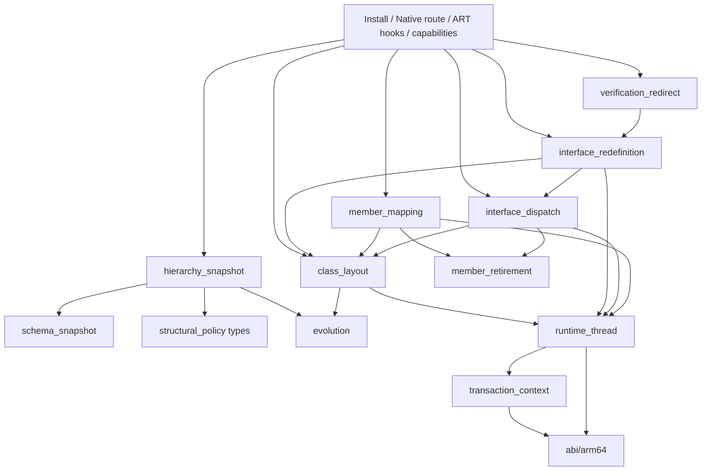

# Structural redefinition engine

English | [中文](STRUCTURAL_REDEFINE_ENGINE.md)

This document explains how the enhancement library evolves classes using the structural redefinition transaction built into the device's ART: which decisions it takes over, what each step does, and the semantics of each change. For user-facing semantics, see [LIMITATIONS.en.md](LIMITATIONS.en.md).

See [COMPATIBILITY.en.md](COMPATIBILITY.en.md) for public device conclusions and [TESTING.en.md](TESTING.en.md) for validation commands, declaration checks and diagnostic fields.

## Goals and prerequisites

- **Goal**: provide VM-level DCEVM inside an app process on Android 11–17 / arm64 without root: add and remove fields and methods, change types, signatures, modifiers and inheritance, and retain compatible field values in live objects.
- **Prerequisite**: the app process must be **Java-debuggable from startup** (manifest `debuggable`). In AOSP `openjdkjvmti/art_jvmti.h`, `can_redefine_classes` belongs to `kNonDebuggableUnsupportedCapabilities`. `IsFullJvmtiAvailable()` accepts only `IsJavaDebuggableAtInit()` or forced interpretation; changing the debug state after process startup has no effect.
- **Outside the design**: replacing system ART, relying on root, deriving addresses or offsets from disassembly, or reimplementing ART's instance migration, reference rewriting, deoptimization and cache invalidation.

## Why ART's structural transaction is the engine

Since Android 11, `Redefiner::StructurallyRedefineClasses` (JVMTI extension `com.android.art.class.structurally_redefine_classes`) already implements the hardest parts of DCEVM:

| Step | Existing ART implementation (`ti_redefine.cc`) |
| --- | --- |
| Class allocation | `FinishNewClassAllocations` creates new Class objects for targets and **all loaded subclasses** in topological order. `AllocateNewClassObject` loads from the new DEX and calls `LinkClass`; ClassLinker recalculates the vtable, iftable and field layout |
| Instance migration | `CollectAndCreateNewInstances` walks the heap and allocates a replacement for each old instance |
| Field copying | `UpdateClassStructurally` copies static and instance fields by name and type, migrates the lock word and clears old objects |
| Reference rewriting | `Runtime::VisitReflectiveTargets` rewrites ArtField*/ArtMethod* references in JNI IDs, reflection Field/Method, MethodHandle, VarHandle and DexCache. `HeapExtensions::ReplaceReferences` replaces old objects and classes in the heap and roots |
| Execution state | `DeoptimizeAllThreadFrames` deoptimizes frames, `InvalidateAllCompiledCode` clears JIT code, per-thread interpreter caches are cleared, and old methods are marked obsolete |

ART normally allows additions only; its restrictions are concentrated in a few decision functions. The library takes over those decisions. ART performs the commit, migration and invalidation.

## Interception points

The single assembly entry stays in `structural_redefine_engine.cc`. The standard entry's Native phase lives in `structural_redefine_route.cc`, ART validation/allocation decisions and the commit gate in `structural_redefine_hooks.cc`, and capability reporting in `structural_redefine_capabilities.cc`. The engine and verifier redirect use the explicit `Backend` interface in `interface_redefinition.h`. Interface admission probes, Native group snapshots, and group allocation/failure cleanup live in `interface_admission.cc`, `interface_group_snapshot.cc`, and `interface_allocation.cc`; assembly and reporting remain in `interface_redefinition.cc`.

The interface backend is the sole exception to the principle of taking over decision points only: `FinishNewClassAllocations` collects subclasses but misses interface implementations, so the backend prepares rebuild-group allocation and failure cleanup itself. ART still performs the commit, instance migration, reference rewriting, deoptimization and cache invalidation.

| ART decision point | Original behavior | Enhanced behavior |
| --- | --- | --- |
| `JvmtiFunctions::RedefineClasses` in the public table | Ordinary redefinition rejects structural changes; an exported entry may be inlined | Route to the original structural transaction, retaining argument and capability checks, ClassFileLoadHook and ordinary method-body updates. Before entering ART, load classes referenced by the new DEX through the target's loader, including added interfaces and superclasses, and inspect old declarations |
| `CheckClass` | Class modifiers, superclass and interfaces cannot change | Parse the final DEX, probe the layout, evaluate the [validation rules](#validation-rules) and cache the decision |
| `CheckFields` / `CheckMethods` | Only additions are allowed; modifiers cannot change | Call `RecordNewFieldAdded` / `RecordNewMethodAdded` according to the decision to select ART's structural path; call the original function when no decision exists |
| `FinishNewClassAllocations` / `Run` / `LinkClass` | Collect target subclasses; execute the transaction and link replacement classes | The interface backend prepares group allocation for interfaces and implementations, roots replacements for Run, and cleans up unpublished classes on failure (`interface_allocation.cc`) |
| `AllocateNewClassObject` | Rebuild classes and subclasses using the old hierarchy | On a superclass change, write the new superclass into the caller's superclass handle slot |
| `CheckVerification` | The verifier resolves the class descriptor to the old class | During superclass or interface-group verification, the current thread's `FindClass` uses verification redirection or the interface backend to return the replacement; interface groups match loader identity |
| `CollectAndCreateNewInstances` | Allocate replacements for old instances | After the original succeeds, validate the slot declarations and precompute member mappings. Return an error on failure when the transaction depends on custom mapping |
| `CollectNewFieldAndMethodMappings` | A missing method with the same name and signature causes a CHECK, including when copied default/miranda methods disappear during subclass relinking | Write the precomputed mappings; use the original mapping for transactions without a plan |
| `UpdateClassStructurally` | Migrate fields and lock words, mark methods obsolete, replace references, deoptimize and invalidate caches | Establish the visitor's transaction scope and call the original in full. During copying, substitute old field arrays without retired entries, and temporarily point the new class at the old superclass when the superclass changes |
| `Runtime::VisitReflectiveTargets` | Apply original member mappings and shadowing rules | Restore old field arrays; clear retired members' DexCache entries, record retired JNI IDs, and rewrite reflection `Field` and VarHandle references for retired fields. Delegate all other work to the original visitor |
| JNI table, `Method_invoke`, `Constructor_newInstance0`, MethodHandle entries and JNI ID encoding | Cached targets are obsolete methods of the old declaring class; calls may fail receiver checks or use old vtable indexes to dispatch to another method | Throw before dispatch only for retired targets; forward all other calls unchanged |

## Transaction flow

### Installation

`DcevmRuntime.initialize()` loads `libartdcevm.so` and attaches it as a JVMTI agent. `core/agent.cc` calls the idempotent `structural_redefine::Install`:

1. Check that the agent's own jvmtiEnv has `can_redefine_classes` among its potential capabilities; otherwise fail.
2. Call the official `shadowhook_init()` and resolve the seven base symbols by name: the public table's `JvmtiFunctions::RedefineClasses`, the structural entry, three validation points and two `RecordNew*Added` functions. Initialization fails with a diagnostic if any symbol is missing or the named wrapper does not match the public JVMTI table.
3. `Install` is the only assembly entry. It explicitly prepares, in dependency order: `runtime_thread` → named Class services → retirement guard hooks → member mapping → verification redirection → interface dispatch → interface redefinition. Services are passed in structures. Thread preparation always runs, even if NDK map compatibility or mapping names fail; such failures retain their original `memberMapping` diagnosis. Missing required retirement services disable that hook group; missing `EncodeFieldId` disables only field retirement, and missing both `FindClass` signatures disables superclass changes. The engine records separate process capabilities for thread services, mapping, retirement, field retirement, superclass changes, interface runtime, instance checks and subclass watching.
4. Install every inline hook with `shadowhook_hook_sym_addr()`, routing the standard entry last. Any failure rolls back installed hooks in reverse order with `shadowhook_unhook()` and leaves the JNI function table untouched. The transaction lock prevents routed calls from observing partial installation.
5. Only after all inline hooks succeed, install JNI wrappers through `member_retirement::InstallJniGuards` / `SetJNIFunctionTable`. If that final operation fails, undo retirement/interface inline hooks while keeping the base validators and route, preserving the existing fallback for additions, body edits and other base changes; initialization fails if rollback itself fails. Then obtain retired-field placeholders through JVMTI `GetClassFields` without initializing their classes, and publish the process capabilities.

### Standard entry

1. Before entering ART, the thread remains in Native state. The transaction context first verifies the current thread through the shared thread service. For each target, use `Class.forName(name, false, target class loader)` to load every class referenced by the new DEX's `type_ids`, without initialization. For arrays, load the element class; see [class loading during transactions](#class-loading-during-transactions). Keep added interfaces and the new superclass as policy inputs. Loading precedes declaration snapshots because it may load classes. Then inspect old declarations through public JVMTI: methods declared by loaded subclasses, methods in their interfaces that the subclasses do not declare, and public methods of superclasses.
2. Create one context with `transaction::Scope`, owning the engine batch, mapping plans, interface state, Native-probed thread services, probed layouts and per-target `Requirements`. Nested transactions push and restore the whole context. Batch snapshots are keyed by `jclass`, the same value as ART's `ClassRedefinition::klass_`. Create JNI global roots for affected classes and loaded subclasses in advance. An outer recursive transaction lock serializes snapshotting and the ART transaction. A successful nested transaction initiated by ClassFileLoadHook invalidates the outer snapshot.
3. Call `StructurallyRedefineClasses` unchanged. Keep global roots after successful retirement; otherwise release them. Clear the context on return and return ART's result.

ART-internal stages such as `Check*` do not use JNI/JVMTI for loading, traversal, assignability or policy computation. The sole exception is JNI `SetObjectArrayElement` (with named local-reference bridging and exception checks) in the allocation hook, on the current thread's transaction-private arrays and holder. ART 13/14/15/16 `ScopedThreadStateChange` does not transition when both states are Runnable. This store executes ART's own GC write barrier, allocates no managed object and has no suspension point. Local-reference capacity is reserved while Native. This exception never applies inside an ART callback, while holding ART locks, or to published arrays.

### Class loading during transactions

ART's structural transaction handles subclasses in two steps:

- `FinishNewClassAllocations` walks the heap, collects resolved subclasses of targets, and rebuilds their class objects under the new classes.
- Only afterwards does `CheckVerification` verify the new DEX.

Between these steps, `ClassDefinitionPauser` prevents other threads from defining classes but allows the transaction's own thread to do so. When the verifier resolves types referenced by new code, it can define an unloaded class through `ClassLinker::FindClass`. A subclass defined this way is absent from the rebuild list and remains linked under the old class after commit:

- Its first instantiation fails verification because `this` is not an instance of the new class.
- If verification has been skipped, its field offsets overlap fields added to the new class.

The standard entry therefore loads every class referenced by the submitted DEX through the target's defining loader before entering ART, without initialization. This includes classes that the verifier might load, so the heap walk sees all subclasses and the policy snapshot (`GetLoadedClasses`) includes them. Types that the loader cannot load are left to the verifier's original behavior. Preloading changes only the timing: it does not execute initializers, and loading failures merely mark the class erroneous, as verification or first use would.

Preloading covers only the bytes submitted to the standard entry. Subclasses can still be missed in two cases:

- A class is first referenced by DEX rewritten by ClassFileLoadHook.
- Another thread loads a subclass before ART pauses class definition.

The engine therefore registers JVMTI `ClassPrepare` on its own jvmtiEnv and enables it only during a transaction, covering all threads. Starting with inspection of loaded classes, preparation of any new subclass of a target marks the attempt. ART creates replacement class objects through `LinkClass`, which does not trigger that event.

A marked attempt fails with `JVMTI_ERROR_INTERNAL` in `CollectAndCreateNewInstances`, ART's last fallible step, without committing the batch. The subclass is now loaded, so the standard entry takes a fresh snapshot and retries, up to three attempts. Each attempt calls ClassFileLoadHook again. `subclassLoadRetries` counts retries in the capability report. Without the method-retirement hooks, this failure point is unavailable and only preloading is performed.

### Interface transaction failure cleanup

Each group's old/new Class arrays are created with public NewObjectArray during Native capture and promoted to JNI global references. ClassArrayRoots owns them until Native cleanup; any array or global-reference allocation failure rejects before ART and releases partial roots. Runnable allocation only calls named JavaVMExt::DecodeGlobal and immediately roots the result in an ART HandleScope. It neither caches raw objects across allocation nor calls private ObjectArray::Alloc or chooses an allocator. The signature is unchanged from the fixed [Android 11 declaration](https://android.googlesource.com/platform/art/+/refs/tags/android-11.0.0_r1/runtime/jni/java_vm_ext.h) through the [Android 17 implementation](https://android.googlesource.com/platform/art/+/refs/tags/android-17.0.0_r1/runtime/jni/java_vm_ext.cc). Run still discards failed replacements before releasing the array global roots.

The API 33–36 interface engine accepts multiple interface targets with supported body/member edits alongside unrelated classes, implementations or their subclasses. Parent/child targets share their highest batch ancestor; other interface roots whose loaded subtypes intersect are merged by union-find, while disjoint ones keep separate groups, so each type is replaced and migrated once. ART's `CollectAndCreateNewInstances` collects only `InstanceOf(owner entry's class)` instances on 11–17, so the Native snapshot builds one topological order per owner candidate with that owner first (the private arrays depend only on length and are shared), recording each type's first assignable root; owners covering every concrete (non-interface, non-abstract) member come first. Without a covering owner, after the original `CollectAndCreateNewInstances` the engine sets the holder's original-class slot to each other root in turn and calls the original again, so ART collects the instances and allocates their replacements; each round keeps only instances whose class's first root is that round, the merged arrays are allocated through public JNI on this Runnable thread and written back to the holder, and the slot is restored. ART still allocates and migrates every instance. Interface replacements use the custom allocation path and unrelated classes use ART allocation, within one atomic ART validation/commit/failure transaction. Holder probes use the actual batch length, the fixed `ClassRedefinition` element declaration, three flag vectors and ART-sorted entry indices. While Native, it reuses the standard entry's `GetLoadedClasses` snapshot to collect prepared implementations, their subclasses and subinterfaces, rejecting proxies with public `Proxy.isProxyClass`; some replacements retain their original superclass. On failure ART frees the new DEX, so a later superclass redefinition could collect these abandoned classes from the heap.

Batch implementations/subclasses allocate from their own incoming DEX and holder DexCache; affected types without an incoming DEX keep private link caches for their original DEX. The first affected `FinishNewClassAllocations` entry completes the entire interface group regardless of ART's superclass-depth order. After probing the full fixed holder, only private `initialized_`, `actually_structural_` and `initial_structural_` flags change: the interface owns the initial structural group; batch implementations are allocated structural dependents and later allocation entries skip them. Like ART's `setup_single_redefinition`, every batch entry retains its new-class slot for DEX verification, but only the interface owns the group class/instance arrays. ART's original instance collection, shared mapping plan and structural update therefore process the group once. Abstract-class admission checks every target against the owner's collected instances, avoiding empty dependent-entry arrays. Existing policy still validates implementation additions, retirement and modifiers. An external implementation superclass (a batch class outside every interface root's type relation that is a superclass of a member) is a candidate ancestor of the group: while Native its loaded subtree is selected as well, producing extended members and owner candidates. `CheckAllRedefinitionAreValid` and `MarkStructuralChanges` finish before allocation, so the group's first affected entry chooses: extended members when any ancestor entry needs the structural path, otherwise interface members with ancestors still updated in place by ART. It then takes the first candidate that is an ART initial structural entry as owner, preferring one that covers every concrete member, and collects the other roots' instances in the rounds above. Body-only ancestors in the extended members take the structural path with it. An ancestor changing its own superclass still returns 66, because the group links under unchanged superclass chains. ART's admission of a structural ancestor checks that target's pointer-id subtypes. Verification redirection covers the entire private group, matching old classes with named `LookupClass` and loader identity only during current-thread `CheckVerification`; no replacements enter old class tables or old DexCaches.

A named `Redefiner::Run` hook roots every group replacement array in a separate ART HandleScope until the batch result is known. A named `ClassLinker::LinkClass` hook only assigns a linked replacement to a reserved pending HandleScope root, without JNI or heap-array stores. The allocation hook transfers it to the private array after returning outside the callback and ART locks. The pending root covers failures while allocating JNI ID arrays, including classes not yet stored in the holder. Failed returns and native allocation exceptions discard the private replacements before their DEX is freed; successful returns preserve their status.

Cleanup uses the named, allocation-free `Class::SetStatusInternal` writer to set only unpublished replacements to `kErrorUnresolved`, preserving subtype bits. In `android-13.0.0_r1` `mirror/class.h`, `kErrorResolved` still satisfies `IsResolved()` and cannot exclude them from heap scans. The ordinary `SetStatus` initialization, locking, exception and notification protocol does not apply to these discarded private classes. As specified by `class-refvisitor-inl.h`, GC still visits Class instance references and native roots; skipping static references is safe because failure precedes the commit's static-field copy and private replacements never execute initializers.

Private implementation caches reuse the named `ClassRedefinition::CreateNewDexCache` service with the current driver and a non-owning prefix for the original DEX. The original DexCache is unchanged and the new cache is not registered. ART handles allocation, roots, location, the dex lock and initialization. Descriptor redirection uses the named `LookupClass`, which does not fill the cache (`const char*` or `string_view`, selected by the named symbol). Assignability uses JNI `IsAssignableFrom` only in the Native snapshot phase. An `IdentityHashMap` keyed by Class identity distinguishes same-named classes in different loaders. Direct superclass/interface edges feed one Kahn traversal, producing a topology and superclass indices in expected O(loaded classes + affected types + direct edges) work. ART allocation only decodes these roots, checks resolved status and the target-first invariant, and uses the saved superclass index; it performs no class traversal or pairwise assignability ordering. `ClassPrepare` still marks subtypes loaded after capture, rejects before instance allocation and triggers a fresh snapshot/retry at the standard entry. Named `JNIEnvExt::NewLocalRef/DeleteLocalRef` services create real local references, and private array stores use JNI `SetObjectArrayElement`, including ART's write barrier, only outside callbacks and ART locks in the allocation hook. `LinkClass` only assigns the pending root; cleanup covers that root as well as the replacement array.

Thread, Class and HandleScope differences live only in `platform/abi/arm64/androidNN/`. The interface runtime registry limits installation-time platform API admission to active API 33–36; subsequent declaration selection uses the bottom-layer `abi/arm64/release_order.h` ordering through `class_layout::CandidateReleases` and the same `VerifyTarget` member probes to filter interface declarations. Native capture checks the current JNI environment, OS tid and marking-flag range. Before creating any private HandleScope, admission uses named `Thread::HandleScopeVisitRoots` to observe ART's existing root slots. Its callback only records addresses: no allocation, JNI, object dereference or scope mutation. The single-root scopes in both fixed admission callers must match the candidate header/capacity/size, the actual incoming Handle slot and ART's root walk. A candidate Thread scope pointer is never dereferenced unless it is adjacent to that known root at the source-declared header position.

`Run` requires completed probes; the chosen declaration is local to the transaction thread and restored after nested transactions. Before allocation, holder probes check array length, vector target and begin/end/capacity, all three boolean-vector lengths and the new DEX-cache slot. Only a declaration mismatch disables interface redefinition with an explicit rejection reason while ordinary class transactions remain available. ART's named Mark service still handles read barriers; the private JNI store exception is unchanged.

ART-called hooks and visitors must not propagate C++ exceptions. The interface path no longer registers `VisitClasses` callbacks. Admission, class checking, allocation, and instance/mapping preparation translate failures locally to `OUT_OF_MEMORY` or `INTERNAL` without allocating another diagnostic. The pending root covers replacements whose transfer to the private array fails; failed lookup redirection records an error that allocation must reject. Catching at `Run` alone would already unwind ART frames.

Shared commit mapping, update, reflective visitor, and ID encoding boundaries are explicitly `noexcept`. ART offers no recoverable error protocol after its commit point: native allocation failure there remains fatal, rather than continuing a partial commit. Real memory exhaustion recovery is not established.

Interface admission reads access flags from the target's current DEX ClassDef with `evolution::ReadClassAccess`, using the same valid interface bits as the access probes in `class_layout`. JVMTI `GetClassModifiers` cannot supply this baseline: it prefers InnerClass flags, where member interfaces include `static`, while ClassDef and runtime Class flags do not. Nested and top-level interfaces follow the same admission rules.

Permanent disablement is limited to declaration evidence: Thread env/tid/marking fields, HandleScope root traversal under an accepted Class candidate, Class flags checked against their own DEX, the Redefiner's current thread, and holder/private-array/private-DexCache shape and identity probes. Missing target member evidence, no supported Class candidate, unavailable ClassDef, initialization changes since capture, incomplete admission, and unsuitable holder index/allocation/structural state reject only the current transaction with a reason. Boolean-vector lengths probe declarations; their values describe the current transaction and are checked separately. Hooks save only static rejection reasons; Native return formats the target descriptor and reason into `lastRejection`.

ART class states use the complete fixed `abi::arm64::ClassStatus` enum shared by 11–17 in `platform/abi/arm64/common/class_status.h`, referenced directly by the shared implementation. Status reads return that enum; initialization and cleanup comparisons use named states rather than numbers or JVMTI status masks. Java/DEX access bits use named constants, including interface, class super, synthetic, annotation and enum flags. Proxy detection remains a public Native-phase API check, without internal Proxy flag access.

Structural interface admission checks every type in its captured group with ART's pointer-id marker semantics: any nonnull, non-array instanceJfieldIDs, jmethodIDs or staticJfieldIDs slot rejects with 79 and names the marked class in lastRejection. Named FindInstanceField resolves Class.extData, the three ID slots and Class.componentType by name/descriptor; ART read barriers handle references, with no fixed field offsets or old ClassExt writes. ART creates the marker when first preparing JNI ID slots in swapable-pointer mode; switching to indices preserves it. Sources: [ClassExt](https://android.googlesource.com/platform/art/+/refs/tags/android-13.0.0_r1/runtime/mirror/class_ext-inl.h), [JNI ID manager](https://android.googlesource.com/platform/art/+/refs/tags/android-13.0.0_r1/runtime/jni/jni_id_manager.cc).

Plain pointer mode returns ArtMethod/ArtField pointers directly and may create no marker. During Native snapshot preparation, public GetClassMethods supplies one existing method ID; a group without methods uses GetClassFields to check a field ID. Fixed Android 11–17 IndexToId/DecodeGenericId declarations distinguish odd index IDs from even pointers. A pointer rejects with 79 before interface reconstruction can leave cached JNI calls targeting old members. One index ID establishes the mode for that snapshot; structural admission still checks every class for historical pointer-id markers. The probe neither dereferences the ID nor changes the runtime mode.

ART may check structural admission more than once in a transaction. After the admission hook successfully calls ART EnsureInitialized, it updates that target's expected initialization state for the transaction. A subsequent admission therefore recognizes initialization completed by the hook itself.

The Thread layout table lives in `platform/abi/arm64/runtime_thread_table.h`. A compile-time assertion requires declarations sharing a JNI-env offset to share exception and top-HandleScope offsets. Only `runtime_thread::Ready()` can construct a `VerifiedThread`; `Read`, `Layout` and `LayoutFor` require it. Interface probes and operations use `LayoutFor` for the selected release, including tid, exception and HandleScope slots. The interface registry's `linked_iftable_acceptance` property determines whether early link-error services are required; shared code contains no release-number special case.

### Validation

`CheckClass` reads `klass` and `dex_file` according to `redefinition.h`, calling the original function if the class is absent from the context. It then reads the new declaration (ClassDef 0) through `DexView`, probes the layout, reads runtime flags of added interfaces and the new superclass, and calls `structural_policy::Evaluate`:

- On rejection, write only `driver_->result_` and return false; `Redefiner::RecordFailure` itself does the same. Record the reason in `lastRejection` and logcat.
- On acceptance, store the decision, including the retired-declaration list, in the context's engine batch keyed by `ClassRedefinition*`, record mapping and verification requirements in shared per-target `Requirements`, and store instance-check requirements in the engine batch Part. The policy directly sets `Decision::requires_member_mapping` when accepting a mapping-dependent branch; the engine no longer derives it with a second evaluation disabling mapping. For accepted decisions, it equals rejection with mapping and its derived abilities disabled while retaining `instance_check`: field retirement, method retirement/signature changes, native-to-Java changes, interface member additions (including abstract methods), superclass changes, and copied/miranda changes rejected without custom mapping. Adding an interface itself, ordinary member additions, modifier changes and body edits do not inherently require mapping; making a class abstract only requires instance inspection. Interface targets still unconditionally require mapping, including body-only edits. Rejected decisions carry no requirement.

`CheckFields` / `CheckMethods` call the appropriate `RecordNew*Added` according to `fields_structural` / `methods_structural`. The decision is cleared after `CheckMethods`.

### Mapping and commit

The engine owns the `CollectAndCreateNewInstances` hook at ART's last fallible step. Its fixed order is: subclass-load retry guard → original ART function → live-instance checks for classes made abstract → replacement-layout verification and member planning → new-superclass verification → interface dispatch validation → new default conflicts. Checks carry the Native-probed `VerifiedThread`; rejections use `transaction::Context::Reject` to set both the reason and `driver->result`. `member_mapping` only builds/stores plans and applies them in ART's later commit hooks; it does not inspect instances or call interface dispatch. Layout or planning failure rejects mapping-dependent transactions; other transactions retain ART's original mapping.

`PlanMethods` is shared by every layout and structural transaction, including ordinary classes. It decodes each method's name and full prototype using its declaring class DEX and `dex_method_index`, then matches (name, descriptor); raw indices are not comparable across DEX files. The interface engine introduced this rule because ART `HasSameNameAndSignature`/`GetCanonicalMethod` consult the obsolete method array's DexCache, whereas copied default/miranda storage belongs to an implementation class. Replacing an interface can invalidate that assumption. The mapping no longer depends on those two named symbols; the catalog and checker retain only currently referenced services.

Newly linked default conflicts are semantic rejections before commit; see [interface member evolution](#interface-member-evolution).

The remaining commit cannot fail. `CollectNewFieldAndMethodMappings` only writes the plan into ART's maps, after confirming they are empty libc++ trees. `UpdateClassStructurally` calls the original in full. The engine only swaps field arrays and superclass pointers around the copying phase and handles retired members in the visitor. The commit section performs no JNI/JVMTI calls or Java-object allocation.

## Interface member evolution

On Android 13/API 33, Android 14/API 34, Android 15/API 35 and Android 16/API 36 arm64, interface targets with verified runtime declarations and member mapping support new public abstract and default methods, static methods at any access level (including synthetic methods), and private instance methods. Any method can be deleted or change signature, an existing public instance method can switch between abstract and default, static fields can be added, deleted or retyped, and parent interfaces can be added. Adding native methods rejects with 63; an added `<clinit>` is accepted as for a class but never runs on an initialized interface; field-modifier changes, parent-interface removal and other method-modifier changes still reject with 64, 66 and 71.

A deleted default/abstract declaration retires through the ordinary mapping to itself. The copied defaults/mirandas that re-linked implementations no longer carry take the existing path that maps a vanished copy to its declaring class's canonical member; that canonical member is the retired old declaration, so DexCache entries are cleared, re-resolution throws `NoSuchMethodError`, and the existing guards reject JNI, reflection and MethodHandle access. A default made abstract reuses the pending conditions and IfTable acceptance of abstract additions; an abstract made default reuses the `subtype_shadows` check of default additions, and the mapping plan still rejects conflicts. Fields reuse ordinary field retirement and static-field copying; interfaces are initialized at admission, so added statics keep default values.

For an added parent interface, the Native phase reads through public JVMTI the virtual methods declared by the new parent and by its parents the target did not already inherit (decided with `IsAssignableFrom`), keeping a global root for each declaring interface. The policy rejects methods hidden by target static/private methods and defaults that shadow implementation class-chain methods, and records a pending condition with the declaring interface for each abstract method the target does not override with a default. Dispatch acceptance locates the rebuild through the target interface, then reads every concrete class's IfTable by the unchanged declaring interface's identity; the rejection is prefixed by the submitted interface and names the new parent method and the class without it. If the batch rebuilds an added interface (it or one of its parents is a target), the new class must link its replacement, or copied defaults and dispatch slots would stay on the version published before the commit. The target's `Requirements::linked_interfaces` records the added interfaces; before the class is allocated (by ART itself or within its interface group) those rebuilds are allocated, ART's type lookups while linking and `FindClass` during `CheckVerification` resolve the old interface to its replacement, and abstract methods of an added parent are accepted against the replacement's identity. Rebuilds that depend on each other, or a reversed order within one group, reject with 66. Interfaces always use structural replacement; the engine enables `Abilities::interface_members` only when it owns member mapping.

The existing interface group is reused: ART re-links the interface, loaded subinterfaces, implementations and their subclasses. An implementation without submitted DEX keeps its original DEX and a private DexCache and still receives copied defaults. New declarations have no old mapping entry. Public class implementations take precedence; a more specific subinterface overrides its parent, and a miranda can become a default copy. ART continues to perform all instance migration, reference rewriting, deoptimization and cache invalidation.

The following checks constrain additions:

1. A new static/private method must not hide an inherited superinterface virtual method or a public Object instance method; otherwise return 63. `CollectInheritedInterface` records their identities in `LoadedHierarchy::inherited_interface`. Already verified `invoke-interface` code may still dispatch through the IMT; changing the declaration cannot safely make it throw an invoke-kind error.
2. A new default must not overlap a same-signature static/non-public method in an implementation or its superclass chain. Reject with 63 and name that declaring class. `subtype_shadows` uses `interface_redefinition::Backend::GroupTypes`, matching the prepared, non-error types ART actually rebuilds. Superclass chains are included; unique boot descriptors may be deduplicated, while names from other loaders are not. Public instance implementations remain admissible.
3. `PlanMethods` reads ART's linked result and records any newly introduced `IsDefaultConflicting` method. Before ART's no-failure point, `CollectAndCreateNewInstances` returns 63 and `lastRejection` names the implementation and method descriptor, preserving old definitions. It does not use `Fail()`, which denotes a layout probe failure and could fall back to ART mapping. This check is shared by all structural transactions using custom mapping, including ordinary classes gaining interfaces.

4. New public abstract declarations bypass the default-only `subtype_shadows` check. The policy records pending (name, full descriptor) conditions. `CheckClass` stores them with the interface's `ClassRedefinition*` identity in the batch-wide `interface_dispatch` Part, independently of which input owns the rebuild group. The dispatch verifier finds the candidate interface by old identity in the owner's old/new class arrays, then checks every concrete implementation's actual IfTable, including classes without instances or submitted DEX. An ancestor owner validates conditions from dependent subinterface inputs; same-named types in other loaders or groups stay distinct.

The read-only accessor follows fixed-source `mirror/class-inl.h::FindVirtualMethodForInterface`: select the IfTable entry by candidate declaring-class identity and index its PointerArray by the candidate method's `method_index`. Before following pointers, named `FindDeclaredInstanceField` confirms `java.lang.Class.ifTable`'s owner, type, instance storage and fixed offset. Runtime ObjectArray/long[] classes, paired length, consecutive declared-interface method indices, method-array length and target membership in known method arrays are checked before reading target flags and DEX identity. The fixed PointerArray declaration follows `android-13.0.0_r1`, `android-14.0.0_r1`, `android-15.0.0_r1` and `android-16.0.0_r1` `mirror/array.h` (8-byte data alignment on arm64); IfTable follows these releases' `mirror/iftable.h`. Heap references use shared `runtime_thread::Read` and the named Mark read barrier. Class probes and mapping plans use the same reader for declaring classes, DexCaches and array elements, so concurrent GC forwarding cannot make an identity comparison treat them as different classes. The accessor neither writes dispatch tables nor simulates method selection.

Dispatch must select a public, concrete, non-static/non-private, non-conflicting, non-obsolete and non-retired method with the same DEX name and full descriptor. Existing/same-batch and inherited implementations and a more specific default selected by ART are accepted; bridges must actually exist. Failure rejects the whole batch with 63, naming the interface method and concrete class in `lastRejection`. Accessor mismatches also reject with 63 and a probe reason. Validation runs beside default-conflict rejection in the `CollectAndCreateNewInstances` planning stage, before the no-failure boundary, and reuses existing abandoned-class cleanup and retry. Every transaction checks dispatch conditions again.

Dispatch validation lives in `interface_dispatch`, which owns read-only layout probes, obligation checks and rejection formatting. `structural_redefine_hooks` schedules it through the optional backend’s `Check` at the commit gate after member planning; mapping has no dispatch dependency. Both reuse bounded DEX identity readers in `art_method_identity.h`. ART 13's `LinkInterfaceMethods` calls the fixed-source `ThrowIllegalAccessErrorForImplementingMethod` before constructing a usable IfTable for a non-public implementation. `interface_redefinition` observes the actual selected pair through this named NO_INLINE service. Under linker locks it records only native metadata and existing HandleScope roots, preserving the original service. After allocation fails and leaves those locks, the verifier matches candidate interface identity and complete descriptor to produce rejection 63. It neither parses exception text nor guesses implementations by name, and does not relax ART linking. If this service cannot be located on ART 13, only abstract additions are disabled with a capability and rejection reason. ART 14 filters non-public class methods in `AssignVTableIndexes`; its early error call in `FindCopiedMethodsForInterface` applies to interface declarations, not concrete class selection. Its profile conservatively retains the named service requirement. ART 15 and 16 validate the linked IfTable; ART 15 selects only public class methods in `AssignVTableIndexes` and installs their arrays in `FinalizeIfTable`.

The predicate uses fixed source declarations: for 12–17, common/runtime_objects.h compares the relevant intrinsic/copied/abstract/default bits with copied/abstract/default (`0x80000000`, `0x01000000`, `0x0400`, `0x00400000`, respectively). Android 11's android11/art_method.h instead tests its dedicated `0x01000000` default-conflict bit and excludes intrinsics. ArtMethod overloads select the predicate without new offsets. Existing lengths bound method-array iteration; a non-null address does not prove members exist. Shared empty field arrays on API 36 must also pass the existing layout probes.

Interface direct-method retirement reuses `{old, old, kRetired}`, DexCache clearing and the existing access guards. Bytecode, JNI and MethodHandle calls throw `NoSuchMethodError`; cached reflection wraps it in `InvocationTargetException`; active old frames continue. Standard-entry roots already cover the interface and its full subtype group and are retained until process exit after retirement. Each target records retired kinds, so restoring the same name/descriptor with another invoke kind still rejects with 71. No interface-specific access guard is needed.

### Lambdas in interface defaults

Appending or inserting lambdas in interface defaults can generate private static implementations, public static synthetic bridges and synthetic classes, and can change signatures or remove old bridges. New interface bodies can also generate `DefaultImpls` and implementation bridges. The reload tool must append new classes first, then atomically submit the interface, changed existing synthetic classes and implementation bridges. Patch distribution and new-class loading belong to the tool. See [compatibility](COMPATIBILITY.en.md#compiler-sample) for the compiler sample versions and conclusions.

Renumbering can change an old lambda instance's synthetic class into another lambda's implementation; changing its functional interface may still reject with 66. Tools must isolate old closures as they do for ordinary classes, or preserve old bridges and only append new ones. Supporting direct-method retirement does not preserve an old closure's business meaning.

## Validation rules

`structural_policy` is a pure function that can be tested on the host. Field identity is (name, type, static); method identity is (name, descriptor), and a method's invoke kind is further constrained by [invoke kind changes](#invoke-kind-changes). Before comparison, raw DEX flags are normalized to the JVMTI view, consistently with `ti_method.cc`, `ti_field.cc` and `ti_class.cc`: retain Java flag bits, map a method's declared-synchronized flag to synchronized, and remove native from abstract methods.

“Retirement available” means the method-retirement hooks are installed and this transaction's layout probes pass. Field changes also require field guards.

| Change | Result |
| --- | --- |
| Interface target method-body edits | Accepted with verified interface runtime and member mapping |
| Interface target new public abstract/default/static methods and private instance methods; deletion or signature change of any method; public instance abstract ↔ default; static field additions, deletions or type changes | Accept with verified member mapping and interface runtime, subject to inherited/shadow/default-conflict and abstract-dispatch checks |
| Interface target new native methods; abstract additions without valid dispatch or a verified IfTable accessor; direct-method hiding or default conflicts | Reject `METHOD_ADDED` (63) |
| Interface target field modifiers; method modifiers other than abstract ↔ default; parent removal or a failed new-parent shadow check; class kind | Reject `SCHEMA_CHANGED` (64), `METHOD_MODIFIERS_CHANGED` (71), `HIERARCHY_CHANGED` (66), and `CLASS_MODIFIERS_CHANGED` (70), respectively |
| Unavailable interface runtime capability (unsupported version, named service or probe) | Reject `NOT_AVAILABLE` (98); declaration changes use the standard errors above |
| Add fields or methods | Accept |
| Change existing members' access, final, volatile, transient or synchronized flags, except making an instance method private; Java → native; abstract ↔ concrete | Accept |
| Make a method final when a loaded subclass overrides it | Reject with `METHOD_MODIFIERS_CHANGED` (71) |
| Add an instance method or change its access level when it may displace a loaded subclass's copied default/miranda method | Accept through custom mapping when retirement is available; otherwise reject additions with `METHOD_ADDED` (63) and access changes with 71 |
| native → Java | Accept when retirement is available; the engine handles JNI-entry copying. Otherwise reject with 71 |
| Switch a method between static and instance, make an instance method private, or re-add a retired method as another invoke kind | Accept when no loaded class outside the batch still names it with the old kind and no batch class has an active frame: the old declaration retires and the new-kind declaration is a new member; otherwise reject with 71 (see [invoke kind changes](#invoke-kind-changes)) |
| Change a method's bridge, varargs, strict or synthetic flags | Accept through the structural path; the new method carries the new flags, which only describe it to reflection and linking |
| Delete methods or change signatures, including native, abstract, constructors and class initializers | Accept when retirement is available; otherwise reject with `METHOD_DELETED` (67) |
| Delete fields or change their types or static flags | Accept when retirement and field guards are available; otherwise reject with `SCHEMA_CHANGED` (64) |
| Change class visibility, final, abstract, synthetic or InnerClass flags | Accept through the structural path. Adding final with a loaded subclass rejects with `CLASS_MODIFIERS_CHANGED` (70); adding abstract while the class itself has instances rejects with 70 after `CollectAndCreateNewInstances` |
| Switch a class between class, interface, annotation and enum kinds | Reject with 70 |
| Add interfaces, with optional reordering | Accept with readable runtime flags and successful resolution/access checks; adding an interface alone does not require member mapping for a class, but does for an interface target. When the batch rebuilds the interface or one of its parents, that rebuild is allocated first and the class links its replacement. Unresolved, non-interface or inaccessible types reject with `FAILS_VERIFICATION` (62); no usable layout for reading flags rejects with `HIERARCHY_CHANGED` (66); a newly linked default conflict rejects with 63 when using custom mapping |
| Remove an interface; repeat an interface | An ordinary class may remove one when member mapping and dispatch sealing are available; see [removing interfaces](#removing-interfaces). An interface target removing a parent, a target in an interface group of the batch, or missing services reject with 66. A duplicate rejects with 62 |
| Change the superclass | Accept when the new superclass extends the original; other cases reject with 62, 61 or 66 under the conditions in [widening superclass changes](#widening-superclass-changes) |

## Runtime probes

Fixed source declarations are selected by probes on each transaction, rather than an SDK, vendor or build-number allowlist:

- **Declaration sources**: compare AOSP source for `android-11.0.0_r1` through `android-17.0.0_r1`, including `12.1.0_r1` for Android 12. Shared declarations live in `platform/abi/arm64/common/`: Object/ObjectArray, the DexCache prefix, ArtField, ArtMethod for 12–17, Handle, RedefinitionDataHolder slots, the reflection visitor and source types, and the libc++ pointer map. Differences live in version directories: the Class field arrays in `android11`–`android17/class.h` (`ifields_/sfields_` in 11–15, `fields_` in 16–17, with `access_flags_` moving accordingly), and `android11/art_method.h`, which has an extra `dex_code_item_offset_`.
- **CheckClass probes**: obtain each target's Class through `ClassRedefinition::GetMirrorClass`, and compare `access_flags_` with ClassDef flags under each candidate declaration. First use `FindDeclaredInstanceField` to look up `java.lang.Class.iFields`/`sFields` (11–15) or `fields` (16–17), and check the declaring class, instance storage and fixed slot offset before reading any array length. Then use the target's ArtFields returned by `FindDeclared*Field` to check array bounds, declaring classes, JVMTI modifiers and DEX field identities. Total field counts must match JVMTI, including empty arrays. [Android 16 QPR2 ART](https://android.googlesource.com/platform/art/+/refs/heads/android16-qpr2-release/runtime/class_linker.cc) uses a shared nonnull empty array for classes without fields, so lack of a named field witnessing a nonnull pointer cannot itself reject that array. Check declared method counts, modifiers and DEX method identities with each candidate ArtMethod stride. Candidate arrays are not dereferenced before their position has been established. Consider only versions no older than the platform, since the ART module cannot predate it, and try the platform's own version first. A candidate is usable only if every target in the transaction accepts it. With no usable candidate, the transaction cannot retire members or change copied members.
- **Commit-time checks**: after the first retirement, confirm that ART marked retired methods obsolete; otherwise guards switch to direct table lookup. Obtain MethodHandle's `artFieldOrMethod` offset and the VarHandle access-mask offset from ART's field table through `Class::FindInstanceField`, rather than hardcoding layouts.
- **NDK map**: the pointer-map boundary between ART and the NDK is restricted to libc++ ABI v1. Check NDK type sizes at compile time and verify sentinel, root, size and value layouts at initialization using the library's own empty and one-node maps.
- **DEX identity**: the bounded reader accepts both standard DEX and Android 11–15 CompactDex, where ID tables are in the main region and strings and type lists are in a separate data region. Redefinition input accepts only single-class standard DEX.

### Shared thread service and GC read barriers

`runtime_thread` probes the current thread in the Native phase of every standard-entry transaction. Installation resolves `Thread::CurrentFromGdb`, `ReadBarrier::Mark` and optional `gUseReadBarrier` by name. Each transaction follows the bottom-layer `abi/arm64/release_order.h` order through `runtime_thread_table.h`, checking `jni_env`, Linux tid and the 0/1 range of `is_gc_marking` against the fixed `android11`–`android17/thread.h` declarations. Accepted candidates, the preferred declaration and the thread pointer belong to `transaction::Context::thread`; nested transactions restore them with the context. The interface module reuses these results without probing Thread again. It still verifies Class, HandleScope and holder itself, and interface admission remains limited to API 33–36.

`is_gc_marking` describes the CC thread read-barrier state, not CMC concurrent marking. ART performs CC marking/forwarding through `Mark`; CMC coordinates roots and compacted pages through thread root flipping, compaction pauses and page faults, without CC’s `Mark`. See [testing](TESTING.en.md#fixed-declaration-checks) for the source comparisons of compile-time and runtime collector selection.

Shared `Read` requires a probed transaction. When named `gUseReadBarrier` exists, false permits direct reading according to the CMC source above; true passes nonnull references to named `Mark`, which checks the actual thread's marking state inside ART. This also avoids marking-slot ambiguity between identical JNI/tid prefixes after Mainline updates. Without that export, follow the flag fast path in the fixed Thread declaration and `BarrierForRoot`: call `Mark` only when `is_gc_marking` is true. This also covers compile-time forced CC builds. Read the flag afresh for each reference rather than caching its Native-phase value into the Runnable phase.

A failed Thread probe or missing required symbol disables the transaction's layout/member-mapping probe before reading layout references. For prepared mapping, `class_layout::VerifyTarget` reports `rejected: runtime Thread...`. An unavailable mapping retains its original installation reason; Thread probing does not overwrite it. Existing policy and the engine commit gate still determine error codes. There is no raw-reference fallback for an unverified thread. Internally violating this precondition is a fatal invariant error.

### Interface declarations and admission boundary

[interface_runtime_table.h](../artdcevm/src/main/cpp/platform/abi/arm64/interface_runtime_table.h) registers interface declarations, API ranges, preparation/activation status and `linked_iftable_acceptance`. Only active entries participate in runtime candidate selection; prepared-only entries reject interface installation before service resolution or hooking. Current interface admission covers API 33–36; interface targets on other releases return 98. Shared thread services for ordinary classes are independent of this interface gate.

Version differences stay in `platform/abi/arm64/androidNN/`. Shared code uses fixed source declarations, without copying backends or deriving offsets from disassembly or memory samples. Identical Thread pointer/statistics prefixes share declarations. RootVisitor vtable order, Handles, holder, ClassRedefinition and function prototypes must match the corresponding fixed source. A missing name for the exact signature fails the probe; the other prototype is never substituted.

Source declarations, compilation assertions and offline named-symbol inventories prove only their respective scopes, not device execution. See [testing](TESTING.en.md#fixed-declaration-checks) for declaration checks and [compatibility](COMPATIBILITY.en.md) for public coverage and pending validation.

## Member mapping and method retirement

Keep ART's `FinishNewClassAllocations`, `AllocateNewClassObject`, `CollectAndCreateNewInstances` and `UpdateClassStructurally`. Every transaction whose probes pass uses custom mapping, including cases where disappearing subclass copied default/miranda methods would CHECK in ART's original mapping. Mapping uses the actual declaring class and members with the same name and signature to distinguish declared, inherited and copied members:

- Map a deleted real declaration to itself and retire it, without fabricating members or offsets.
- Map a disappearing copied method to its real canonical member and clear that DexCache resolution for the transaction. It is not a deleted declaration and does not enter the permanent retirement set.
- A signature change retires the old signature and adds the new one. Restoring a member with the same name and signature creates a new member; old cached targets remain retired.

ART's obsolete marking for all old methods, old declaring-class fixup and ClassExt retention continue unchanged.

### Access guards

Ordinary bytecode calls need no guard. During commit, ART visits every DexCache in the heap, including caches retained by old classes. The visitor clears resolutions to retired methods; a subsequent resolution that cannot find a member throws `NoSuchMethodError`. Deleting an override falls back to a superclass or interface default implementation. The vtable/iftable contains only new methods, and ART clears per-thread interpreter caches and JIT code. Guards are installed only at entries that can still obtain a retired method directly:

- **JNI**: use public JVMTI `SetJNIFunctionTable` to wrap every `Call*Method*` in front of the current table: virtual, nonvirtual and static, including A/V forms, plus `NewObject`/`NewObjectV`/`NewObjectA`. Retired IDs are looked up without decoding and immediately throw `NoSuchMethodError`. Forward other calls to the original table, which is the checked table when CheckJNI is enabled. Two `EncodeMethodId` overloads record index-form IDs encoded after retirement.
- **Reflection**: hook the native implementations of `Method.invoke` and `Constructor.newInstance` (`Method_invoke` and `Constructor_newInstance0`; each runtime has one of two spellings). Identify retired targets before ART checks the receiver or allocates a new-class instance, and throw `InvocationTargetException` wrapping `NoSuchMethodError`. Executing a retired constructor would run old code on a new-class object, so both paths must be intercepted.
- **MethodHandle**: `MethodHandleInvoke`/`MethodHandleInvokeExact` read the handle's `artFieldOrMethod` before dispatch. Combinator handles return to these entries through invoke-polymorphic on Android 11/12. From 13 onward, they call `MethodHandleInvokeExact` through `MethodHandleInvokeExactWithFrame`; guard that function when present to cover compiler inlining.

The deoptimization-resume paths for existing frames are not intercepted. Active old frames continue to execute old method bodies.

### Method kinds

- **native**: ART's `UpdateClassStructurally` looks up every old native method by name in the new class and copies its JNI entry, assuming the destination is still native; this is the same in 11–17. Deletion may yield no method (a null pointer) or a superclass method with the same name. Changing native to Java would overwrite a Java method's data field. Record these old methods during planning and remove their native flags only during ART's copying loop. That loop also writes obsolete stubs into their entries. Because a native method's entry determines active frame sizes during stack walking, restore native flags and original entries at the visitor entry.
- **abstract**: retire abstract declarations like ordinary methods. Calls through the declaration resolve again and throw `NoSuchMethodError`; a subclass's own implementation remains unaffected. When a method becomes abstract, calling it on a subclass instance without an implementation throws `AbstractMethodError`, following JVM linking semantics.
- **Constructors**: retire them like ordinary methods. Bytecode `new` throws `NoSuchMethodError` after resolution; guards reject cached `Constructor` objects and JNI constructor IDs.
- **Class initializers**: an initialized class does not run `<clinit>` again. Deleting it retires the old method while static field values are copied as usual.

### Keeping retired members alive

To prevent GC, class-loader unloading or address reuse from turning retired pointers into dangling keys, the standard entry creates JNI global roots for affected classes while still in Native state. Release them for failed batches or batches without retirement. Successful retirement retains and deduplicates roots across batches. ART's reference replacement updates the roots to the new Class, whose obsolete chain protects old members. **These classes and their class loaders remain alive until process exit.**

## Field retirement

An old field is retired when its name, type or storage no longer appears in the new class. Keep the real old ArtField, without manufacturing a tombstone. A same-name new field in the new class starts at its default value.

The exception is a reference field that only changes its declared type (same name and storage, both descriptors `L` types). An old value that the new type accepts (the new type is on the value's class chain, is an interface it implements, or is `Object`) moves to the new field; anything else starts from null, as in JBR's FieldCopier. The snapshot resolves the new type through the target's loader with `Class.forName(..., false, loader)`; a type that cannot be loaded is retired as usual. Array types are not checked and also start from null. At commit, before Update calls ART's original function, every old instance of the target and its loaded subclasses, and the static value, is read from the old slot, checked and written to the replacement's new field. Retired fields are not in ART's copy arrays, so nothing overwrites them, and ART's per-object write barrier afterwards covers these stores.

- **Copying during commit**: ART's `CopyFields`/`ClearFields` walks old-class field arrays and looks up same-name, same-type fields in the new class; a missing field causes a `CHECK`. After `CollectAndCreateNewInstances`, prepare an array copy without retired entries for each affected old class. Swap the old class's field-array slot to the copy at the start of Update, and restore it when ART reaches the visitor, after copying and before visiting in every version 11–17. Confirm restoration again at the end of Update. After commit, clear retired static reference fields in the old class so permanently retained old classes do not keep those objects alive.
- **Bytecode**: the visitor clears retired-field resolutions from DexCache. Resolving `iget/sget` again throws `NoSuchFieldError`; old active frames also fail when accessing retired fields.
- **JNI**: wrap `Get/Set<Type>Field`, `GetStatic/SetStatic<Type>Field` and `ToReflectedField` in the JNI table. The visitor records retired IDs in the JNI tables. `JniIdManager::EncodeFieldId` records retired or placeholder field IDs encoded afterwards; there are two overloads for each of the old and new signatures, and either complete pair suffices. Pointer-form IDs are compared by address. Matches throw `NoSuchFieldError` without decoding the ID.
- **Reflection `Field`**: `ReplaceReferences` changes a `Field` object's declaring class to the new class while its index and offset still describe the old field. The visitor maps it to a field of the same primitive type in the library's placeholder class, `com.github.ytlog.artdcevm.internal.RetiredField` for instance fields or `RetiredStaticField` for static fields. `Field::VisitTarget` then rewrites the declaring class, index and offset. Instance access fails the receiver check with `IllegalArgumentException`. `RetiredStaticField` initialization has already failed during installation, so static access throws `NoClassDefFoundError`, caused by `NoSuchFieldError`.
- **MethodHandle**: the handle guard reads `artFieldOrMethod` and throws `NoSuchFieldError` when the target is a retired field.
- **VarHandle**: accessors in 11–17 first check `accessModesBitMask`, both in `VarHandleInvokeAccessorImpl` and the JIT intrinsic. The visitor zeros the mask of a VarHandle targeting a retired field, so later access throws `UnsupportedOperationException`.
- **Uncovered access**: raw field offsets cached by `sun.misc.Unsafe`, `Atomic*FieldUpdater` and similar APIs bypass all ART entry points. Any structural redefinition that changes an instance layout, including adding fields, invalidates them. This is a restriction of ART's structural redefinition itself.

## Adding interfaces

ART's `AllocateNewClassObject` does not call `LoadSuperAndInterfaces`. It marks the new class kLoaded and calls `LinkClass` directly. For each interface in the new DEX, `LinkClass` calls `ClassLinker::LookupResolvedType` ([16: NonProxyInterfacesAccessor](https://android.googlesource.com/platform/art/+/refs/tags/android-16.0.0_r1/runtime/class_linker.cc#7183); Android 11 uses [`Class::GetDirectInterface`](https://android.googlesource.com/platform/art/+/refs/tags/android-11.0.0_r1/runtime/mirror/class.cc#1217)), looking only in the new class loader's class table. A miss returns null, which release builds dereference. A hit is checked only for being an interface, not for accessibility. The engine therefore handles:

- **Pre-resolution**: before entering ART, call `Class.forName(name, false, target's defining loader)` for every added interface. In 11–17, `Class.forName` calls `ClassLinker::FindClass`, which inserts the returned class into the initiating loader's class table even when a parent loader defined it ([16: class_linker.cc#3444](https://android.googlesource.com/platform/art/+/refs/tags/android-16.0.0_r1/runtime/class_linker.cc#3444)). `LinkClass` can then find it. Interfaces are not initialized here. `CheckClass` reads DEX after ClassFileLoadHook; the policy rejects unresolved interfaces introduced there.
- **Reading flags**: `CheckClass` decodes each resolved interface with `GetMirrorClass`, which in 11–17 reads only `driver_->self_` and `klass_`. Read Java bits from `Class::access_flags_` using the layout accepted by this transaction's probes. These must be ClassDef flags: ART's `Class::CanAccess` reads them, while JVMTI `GetClassModifiers` reports InnerClass flags. For example, a protected nested interface has public ClassDef flags.
- **Policy**: reject with 62 if a type cannot be resolved, is not an interface, or is neither public nor in the same runtime package, which requires both the same package name and defining loader. Reject with 66 if no usable layout is available to read flags.
- **Mapping and subclasses**: adding interfaces only adds copied default/miranda methods or turns an old copy into a conflict method; it does not make old copies disappear. `FinishNewClassAllocations` relinks loaded subclasses, which also acquire the new interfaces.

## Widening superclass changes

The new superclass B must be a proper subclass of the original superclass A, for example by inserting a class between T and A. T retains every existing supertype, so verified code's type assumptions remain valid. Instances of T and its loaded subclasses acquire B's fields, initialized to zero, and its methods. ART's transaction assumes an unchanged hierarchy, so four decisions need interception:

- **Resolution and policy**: resolve B before entering ART, without initialization. Use JNI to check whether B extends A or instead extends T, and JVMTI to collect final methods declared between B and A. `CheckClass` reads B's runtime ClassDef flags through the selected layout. Reject when:
  - B cannot be resolved, is an interface, is final, or is inaccessible: 62;
  - B extends T, creating a cycle: `CIRCULAR_CLASS_DEFINITION` (61);
  - B does not extend A, which narrows the hierarchy: 66;
  - the new definition or a loaded subclass overrides a final method in B's chain: 62;
  - the batch also includes a subclass that changes its superclass too: 66; a supertype of T or a class in B's chain that changes only method bodies is accepted (ART takes its non-structural path, so its Class object stays and the new T links under exactly that object); if its final DEX needs the structural path in `CheckClass` (member changes, a superclass change, an added interface, or membership in an interface rebuild group), 66, because the new T would link the version published before the batch; a subclass that only changes members may share the batch, and ART allocates it from its new DEX under the new T;
  - custom member mapping or verification redirection is unavailable: 66. B may make copied default/miranda methods in T disappear, which requires custom mapping.
- **Allocation**: `AllocateNewClassObject` puts the old superclass into a slot in the caller's handle scope, then calls `LinkClass`. The hook writes B into this slot, which remains a GC root, so the new class links under B. Loaded subclasses are then rebuilt under the new T. After `CollectAndCreateNewInstances`, confirm that the new superclass is B; otherwise reject with 66.
- **Verification**: starting with Android 13, the verifier resolves the class itself by descriptor through its loader and still obtains the old class, whose superclass is A. A new constructor calling B's constructor would fail verification. ART on Android 11/12 itself writes the new class into the new DexCache. The engine hooks `ClassRedefinition::CheckVerification`: while verifying this class, the current thread's `ClassLinker::FindClass` returns the new class object from the holder for that descriptor. There are two signatures and every runtime has at least one. If another verifier uses a different resolution path, verification fails with 62; unverified code is never committed. While a batched subclass S verifies, the old T that the original `FindClass` resolves is replaced by the new T, matched by identity against the holder's original-class slot; ART verifies supertypes first, and the engine records T's holder entry while verifying T. Without this redirect, S code passing `this` as a B fails verification with 62.
- **Field copying**: ART's `CopyFields` pairs old and new superclass chains level by level; differing chain lengths cause a `CHECK`. Because B extends A, field offsets in A's chain in the new T remain the same as in the old T. At the start of Update, temporarily change the new T's superclass pointer back to A. ART then pairs (T', T), (A, A), and subsequent levels, copying T's own fields and all inherited fields. Restore B at the visitor entry and at the end of Update.

B is not initialized during redefinition; its static initialization runs when first needed. Existing instances do not execute B's constructor.

## Removing interfaces

When an ordinary class T stops implementing interface L (directly, or by losing L as a parent of a removed interface), verified code may still use a T value as L. ART's verifier never checks an invoke-interface receiver ([method_verifier.cc](https://android.googlesource.com/platform/art/+/refs/tags/android-16.0.0_r1/runtime/verifier/method_verifier.cc)), and code such as `L l = t;` carries no runtime cast. The interpreter looks the call up in the receiver's IfTable through `FindVirtualMethodForInterface` and throws `IncompatibleClassChangeError` when it finds nothing; the IMT conflict trampoline falls back to the same lookup when its table misses ([artInvokeInterfaceTrampoline](https://android.googlesource.com/platform/art/+/refs/tags/android-16.0.0_r1/runtime/entrypoints/quick/quick_trampoline_entrypoints.cc)). Only direct IMT entries skip the receiver check: JIT code, boot-image AOT code and nterp call whatever implementation sits in L's IMT slot, which ART's own arm64 code generator records as b/18116999. A slot used by a single method stores that implementation directly (`ClassLinker::SetIMTRef`), so the call may jump to another method of T.

The engine therefore seals the interface dispatch of every concrete replacement class of the target and its loaded subclasses, last in `CollectAndCreateNewInstances`, while ART can still fail and before the classes are published. It allocates a new IMT from the class loader's LinearAlloc (`ClassLoader.allocator`, read through ART's field lookup), fills every slot with a fresh conflict method from named `Runtime::CreateImtConflictMethod`, each with its own empty table, and stores it as the class's embedded IMT pointer. Every interface call on these classes then goes through the conflict trampoline. On a hit, ART fills that slot's own table with `AddMethodToConflictTable`; L's methods miss and throw `IncompatibleClassChangeError`, as on a JVM. Each slot gets its own conflict method because ART updates a non-shared conflict method's table in place, and subclasses copy their superclass IMT slot by slot.

- **Layout**: `Class::ImtPtrOffset` is `RoundUp(sizeof(Class) + 4, 8)` in 11–17, with `sizeof(Class)` taken from each release's fixed declaration (11–16 end with `virtual_methods_offset_`, 17 with `status_`). Before writing, the engine checks that the embedded vtable length fits the class size, that every declared or copied virtual method sits at its `method_index`, and that no IMT slot is empty; otherwise it rejects with 66. The LinearAlloc allocation uses named `LinearAlloc::Alloc`, with `LinearAllocKind::kNoGCRoots` on ART 14 and later.
- **Subclasses loaded later**: `LinkClass` in 11–17 starts a subclass IMT from its superclass's (`FillImtFromSuperClass`/`LinkMethods`) and calls `SetIMTRef` only for slots with a new implementation in the subclass. Those slots already hold a runtime method, so they become conflict methods rather than direct entries. Untouched slots keep the superclass's conflict method, whose lookups hold for the subclass too. An abstract class has no IMT; a concrete subclass of it loaded later rebuilds its IMT from the IfTable and may still get direct entries; see [risks](#risks).
- **Members**: copied defaults and mirandas of the removed interface vanish from the re-linked classes. The existing path maps a vanished copy to its declaring class's canonical method, so an old `invoke-virtual` re-resolves and throws `NoSuchMethodError`. Removal therefore requires the engine's own member mapping.
- **Rejections**: an interface target removing a parent still rejects with 66. So does a target in an interface group of the batch (it implements an interface the batch rebuilds, or is the superclass of a group member), because the group allocates those classes itself without sealing, and so does a transaction without member mapping or the sealing services.
- **Existing references**: fields, arrays and locals that hold a T instance typed as L keep it; calling L's methods through them throws `IncompatibleClassChangeError`. JBR also clears fields declared with the removed interface type in redefined classes when the value no longer fits; the engine does not do that yet.
- **Boundary**: a non-CheckJNI JNI call or a `MethodHandle` that calls L's method on a receiver not implementing L finds no implementation in ART and has undefined behavior, as the same misuse does on a JVM.

## Narrowing is unsupported

A new superclass chain that omits an old superclass is rejected with 66. The issue is verified code, not just existing references. ART's verifier previously proved that a T value could be used as A, so this code has no runtime cast. The interpreter does not check the receiver type for access already resolved to a field in superclass A, either: it reads or writes the T instance using A's offset. Unlike an interface call, a field access has no dispatch table that could be turned into a lookup.

Checking the heap and stacks at commit covers only existing references, not this code when it executes later. Safe superclass narrowing would require ART to reverify every loaded class that may depend on the old type relationships. No usable named entry exists for that operation.

## Invoke kind changes

Verified code resolves a method by name and signature without checking that it still has the invoke kind it was verified against. Methods that skip access checks use unchecked resolution, and from Android 16 that path (`ClassLinker::ResolveMethodId`) no longer receives the invoke type. The instruction then invokes the result as its own invoke type:

- `invoke-static` that resolves to an instance method runs the instance body without a receiver argument.
- `invoke-virtual` that resolves to a static or private method dispatches through a vtable index the method does not own, reaching another method.

Retiring the old method clears the callers' DexCache entries, so the next call takes exactly this path. The engine cannot make it throw `IncompatibleClassChangeError`, so an invoke-kind change is accepted only when no such caller exists: for every loaded non-boot class outside the batch, `CheckClass` reads its DexFile and ClassDef through the layout, finds the method_ids naming the old identity through the target or a loaded subtype (for an interface target, the implementations, subinterfaces and their subclasses in its group), and walks all of that class's code with bounds checks for invokes (35c, 3rc, 45cc, 4rcc) and method-kind const-method-handle; a match rejects with 71 and names the caller. Classes loaded later verify against the new kind, and boot code cannot name application classes. When the batch may change an invoke kind, the Native phase checks for active frames of batch classes with `GetAllStackTraces`: an old frame keeps running old code whose next call re-resolves by name too. Once accepted, the old declaration retires (the mapping never maps it to the new method of the other kind) and the new declaration is a new member. The same applies to interface targets (default ↔ static, default/abstract → private, static → abstract and so on); the new declaration is checked like an added interface member: a new static/private method must not hide an inherited interface method, a new default must not shadow a subtype method, and a new abstract one needs every loaded implementation. Copies of the old default in implementations disappear through the existing kCopied mapping. A private method may become virtual: only the class's own code invokes it directly, and that remains valid. Constructors and class initializers are always invoked directly and are not restricted.

The engine records the methods each class retired in committed transactions, with their modifiers, and scans callers the same way when the identity is re-added as another invoke kind. The record lasts as long as the process. Field resolution includes the static flag and cannot find a field with the other storage, so a field's static change can retire like any other.

## Active frames

In a process debuggable from startup, app code is either JIT-compiled in debuggable mode or interpreted. ART's `DeoptimizeAllThreadFrames` covers all app frames. Only boot-image frames cannot be deoptimized. Boot code is compiled independently, does not inline app code and holds only references. Member changes therefore need no additional handling: ART's deoptimization and obsolete-method mechanisms provide it.

## Source organization

Under `artdcevm/src/main/cpp`:

| Component | Location |
| --- | --- |
| JVMTI agent entry and JNI exports for `DcevmRuntime` | `core/agent.cc` |
| Public engine entry, prerequisites, single installation assembly and rollback | `platform/common/structural_redefine_engine.{h,cc}` |
| Standard-entry Native phase: declaration/hierarchy snapshots, retention, watches and retries | `platform/common/structural_redefine_route.cc` |
| ART hooks: policy, allocation decisions and instance/layout/mapping/dispatch commit checks | `platform/common/structural_redefine_hooks.cc` |
| Capability and diagnostic JSON reports | `platform/common/structural_redefine_capabilities.cc` |
| Private engine process state and batch Part declarations | `platform/common/structural_redefine_internal.h` |
| Shared DEX access-bit to JVMTI modifier mapping | `evolution/modifiers.h` |
| Validation policy, including interface additions and inherited/shadow facts | `platform/common/structural_policy.{h,cc}` |
| Transaction context, nested scopes and per-target policy requirements | `platform/common/transaction_context.{h,cc}` |
| Shared Native Thread probes and named GC read barriers for ordinary classes and interfaces | `platform/common/runtime_thread.{h,cc}` |
| Class layout probes and per-transaction layout selection | `platform/common/class_layout.{h,cc}` |
| Interface dispatch sealing after an interface removal (private IMTs and conflict methods of replacement classes) | `platform/common/imt_sealing.{h,cc}`, `platform/symbols/imt_sealing_symbols.h` |
| Shared layout readers and field-array probes | `platform/common/class_layout_table.h`, `platform/common/field_array_probe.h` |
| Member mapping plans, commit and newly linked default conflict checks | `platform/common/member_mapping.{h,cc}` |
| Retirement registry, retained class roots, field placeholders and JNI/reflection/MethodHandle guards | `platform/common/member_retirement.{h,cc}` |
| CheckVerification/FindClass redirection during verification | `platform/common/verification_redirect.{h,cc}` |
| Optional interface backend contract, assembly, reports and verification lookup | `platform/common/interface_redefinition.{h,cc}` |
| Interface admission and Thread/Class/HandleScope probes | `platform/common/interface_admission.cc` |
| Native interface-group snapshots, descriptions and query-type preparation | `platform/common/interface_group_snapshot.cc` |
| Group allocation, link observation, resolution redirection, Run roots and failure cleanup | `platform/common/interface_allocation.cc` |
| Private interface process/transaction state and shared helpers | `platform/common/interface_redefinition_internal.h` |
| Candidate IfTable probes, abstract-obligation validation and actual link-selection diagnostics | `platform/common/interface_dispatch.{h,cc}` |
| Bounded DEX method identity shared by mapping and dispatch checks | `platform/common/art_method_identity.h` |
| Native snapshot of affected interface types, inheritance edges and rebuild order | `platform/common/interface_snapshot.{h,cc}` |
| Public JNI/JVMTI type preloading, new superclass/interface resolution, hierarchy facts and a shared loaded-class index per attempt | `platform/common/hierarchy_snapshot.{h,cc}` |
| Old-schema inspection through public JVMTI | `platform/common/schema_snapshot.{h,cc}` |
| Class declarations read from ART's mapped DEX | `platform/common/art_dex_view.h`, `evolution/class_schema.h`, `evolution/dex_schema.cc` |
| Interface runtime registry, device-verification status, API admission and maximum HandleScope header size | `platform/abi/arm64/interface_runtime_table.h` |
| Release candidate ordering and fixed Class/Thread tables | `platform/abi/arm64/release_order.h`, `class_layout_table.h`, `runtime_thread_table.h` |
| Fixed declarations shared by 11–17 | `platform/abi/arm64/common/` |
| Declarations with real version differences | `platform/abi/arm64/android11`–`android17/` |
| Named symbols and ShadowHook lookup | `platform/symbols/` |

Dependencies form a directed acyclic graph from the engine to lower modules. `hierarchy_snapshot` and `schema_snapshot` share the public JNI/JVMTI layer: the former depends only on the latter, policy types and `evolution`, receiving environments and root containers explicitly without engine globals or layout, thread, mapping or interface internals. The target list is independent of declaration snapshots that a nested preload-time transaction may clear, so retention still covers the original submitted batch. Each attempt scans loaded classes once after `GetLoadedClasses`, using JNI `IsAssignableFrom` to select each ordinary target and its subtypes while producing the all-status retention union. Assignability distinguishes same-named classes in different loaders without assigning identity hashes to all loaded classes or building a superclass graph. Subtype lists preserve loaded order and the PREPARED bit, sharing one class-status read across overlapping targets; policy reads only prepared subclasses. Interface policy still receives the original `GroupTypes`, while retention includes every loaded type assignable to an interface target. The ordering of `Probe`, `Begin`, watch setup and retries stays unchanged. `Install` assembles services and capabilities; its commit gate calls layout, mapping and dispatch checks. `verification_redirect` binds the same nullable backend during installation and queries it for interface-group verification replacements. `interface_redefinition` uses dispatch diagnostics, snapshots, layouts and the runtime registry; mapping uses layout readers and retirement guards without calling interface modules. Layout and dispatch readers depend on `runtime_thread`, which depends only on transaction context, bottom-layer ABI tables, named services and the empty-in-production fault interface. Release ordering and ABI tables do not depend on shared implementations or symbols. The transaction context owns module Part slots and shared requirements; it calls no module. ART still owns migration, reference rewriting, deoptimization and cache invalidation.

`Install` alone constructs the engine's process state and calls each module's `Prepare` in dependency order. The retirement and interface modules create their own process-lived state on the first `Prepare` and reach it through that single path. `Backend` is created only when the interface runtime's named services are available; it exposes only the operations the engine and verifier redirect call, while admission and failure cleanup stay inside the module. One publication makes the same nullable backend pointer visible to both the engine and the verifier redirect through atomic loads, and absent backends keep the existing capability/rejection diagnostics. Once created, the backend stays for the process lifetime; rollback or degradation withdraws only the published view without destroying an object borrowed by hooks already on ART stacks. Original function slots, hook tokens, process capabilities and diagnostics no longer live as separate file globals. Thread-local field-ID capture and interface timing retain their original lifetimes.

Module-specific context data now lives in Parts: `interface_dispatch` owns batch interface obligations, `verification_redirect` owns the active verification scope, and the engine batch owns instance-check requirements and the subclass-watch pointer. The Native phase creates the verification Part before ART hooks need it; those hooks do not allocate it. Nested transactions restore all Parts with their context. Targets, rejection, `layouts/probed` and enclosing relationships stay shared. `Requirements::superclass` remains shared because the engine selects and validates the allocation's parent while member mapping uses it to prepare superclass pairing during field copying. Moving it into the engine Part would make mapping depend back on the engine; moving it into mapping would make allocation decisions depend on mapping internals. `descriptor`, `member_mapping` and `redirect_verification` likewise pass constraints between the engine, mapping or verifier. Layout and policy share `evolution/modifiers.h`; layout no longer depends on policy.

Reflection placeholder classes for retired fields live in `artdcevm/src/main/java/com/github/ytlog/artdcevm/internal/`.

## Risks

- **Subclasses loaded after an interface removal**: an abstract class has no IMT to seal. A concrete subclass, loaded later, of an abstract class that lost an interface rebuilds its IMT from the IfTable and may place a direct entry in a removed interface's slot; if old code calls such an instance as the removed interface, compiled code may dispatch to the wrong method. Subclasses loaded at redefinition time are all sealed.
- **Mainline updates**: ART APEX is replaced through Google Play system updates, so the platform version can differ from the ART source version. Candidate declarations cover source versions 11–17 and are checked by runtime probes on each transaction. New ART source versions require source review; add a version directory when there is a real difference.
- **ART service changes**: probes can verify only declarations with ART services or JVMTI as a reference: Class, ArtField, ArtMethod, DexCache, slots, maps, obsolete flags and MethodHandle offsets. Visitor vtable order, source types, Handle and guard signatures rely on source declarations and exact symbol names. Check source and device behavior when extending version coverage. Put differences only in `platform/abi/arm64/androidNN/`, without copying the backend.
- **Retired access boundaries**: retain real old ArtMethod/ArtField objects and guard new access. Raw offsets cached by `Unsafe` and field updaters cannot be intercepted.
