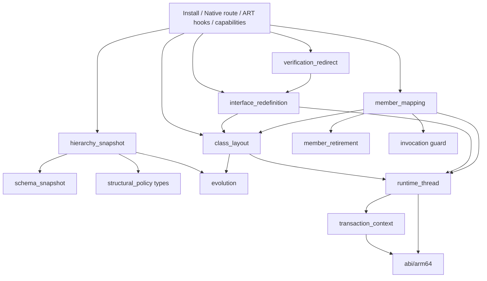

# 结构重定义引擎

[English](STRUCTURAL_REDEFINE_ENGINE.en.md) | 中文

本文说明增强库如何在设备 ART 自带的结构重定义事务之上实现类演进：接管哪些决策点、每一步做什么，以及各类变化的语义。面向使用者的语义汇总见 [LIMITATIONS.md](LIMITATIONS.md)。

公开设备结论见 [COMPATIBILITY.md](COMPATIBILITY.md)，验证命令、声明核对及诊断字段参考见 [TESTING.md](TESTING.md)。

## 目标与前提

- **目标**：在非 root 的 Android 11–17 / arm64 设备上，于应用进程内实现 VM 级 DCEVM：增删字段和方法、改类型与签名、改修饰符、改继承关系，存活对象保留兼容字段的值。
- **前提**：应用进程**从启动时就是 Java 可调试的**（manifest `debuggable`）。依据 AOSP `openjdkjvmti/art_jvmti.h`，`can_redefine_classes` 属于 `kNonDebuggableUnsupportedCapabilities`，`IsFullJvmtiAvailable()` 只认 `IsJavaDebuggableAtInit()` 或强制纯解释模式，进程启动后再切换调试状态无效。
- **不做**：不替换系统 ART，不依赖 root，不通过反汇编推算地址或偏移，不重新实现 ART 已提供的实例迁移、引用改写、去优化与缓存失效。

## 为什么以 ART 结构重定义为引擎

Android 11 起，`Redefiner::StructurallyRedefineClasses`（JVMTI 扩展 `com.android.art.class.structurally_redefine_classes`）已经实现了 DCEVM 最难的部分：

| 步骤 | ART 已有实现（`ti_redefine.cc`） |
| --- | --- |
| 新类分配 | `FinishNewClassAllocations` 为目标类及**所有已加载子类**按拓扑顺序新建 Class，`AllocateNewClassObject` 从新 DEX 加载并 `LinkClass`，vtable、iftable 和字段布局由 ClassLinker 重新计算 |
| 实例迁移 | `CollectAndCreateNewInstances` 遍历堆，为每个旧实例分配新实例 |
| 字段拷贝 | `UpdateClassStructurally` 按名称和类型拷贝静态字段和实例字段，迁移锁字，清空旧对象 |
| 引用改写 | `Runtime::VisitReflectiveTargets` 改写 JNI ID、反射 Field/Method、MethodHandle、VarHandle 和 DexCache 中的 ArtField*/ArtMethod*；`HeapExtensions::ReplaceReferences` 把堆和根中的旧对象、旧类替换为新的 |
| 执行状态 | `DeoptimizeAllThreadFrames` 让所有帧去优化，`InvalidateAllCompiledCode` 清空 JIT，清空各线程解释器缓存，旧方法标记为 obsolete |

ART 原生只允许“只增不删”，限制集中在少数几个决策函数里。增强库只接管这些决策点，提交、迁移和失效全部由 ART 执行。

## 接管点

唯一组装入口位于 `structural_redefine_engine.cc`；标准入口的 Native 阶段位于 `structural_redefine_route.cc`，ART 校验、分配决策与提交前检查位于 `structural_redefine_hooks.cc`，能力报告位于 `structural_redefine_capabilities.cc`。接口后端通过 `interface_redefinition.h` 的显式 `Backend` 接口供引擎与校验重定向调用；准入探测、Native 组快照、组分配与失败清理分别位于 `interface_admission.cc`、`interface_group_snapshot.cc`、`interface_allocation.cc`，组装与报告保留在 `interface_redefinition.cc`。

“只接管决策点”原则的唯一例外是接口后端：为弥补 `FinishNewClassAllocations` 只收集子类、不会收集接口实现类的缺口，后端自行准备重建组分配和失败清理。提交、实例迁移、引用改写、去优化与缓存失效仍由 ART 执行。

| ART 决策点 | ART 原行为 | 增强行为 |
| --- | --- | --- |
| 公开表的 `JvmtiFunctions::RedefineClasses` | 普通重定义拒绝结构变化；导出入口可能内联 | 路由到原始结构事务，保留参数、能力检查、ClassFileLoadHook 和普通方法体更新；进入 ART 前经目标类的加载器加载新 DEX 引用的类（含新增的接口与父类），并读取旧声明 |
| `CheckClass` | 类修饰符、父类、接口不得变化 | 解析最终 DEX，运行布局探测，按[校验规则](#校验规则)评估并缓存决策 |
| `CheckFields` / `CheckMethods` | 只增不删、修饰符不能变化 | 按决策调用 `RecordNewFieldAdded` / `RecordNewMethodAdded` 让 ART 走结构路径；没有决策时调用原函数 |
| `FinishNewClassAllocations` / `Run` / `LinkClass` | 只收集目标类的子类；执行事务并链接新类 | 接口后端准备接口及实现类型的组分配，在 Run 作用域保活替换类，失败时清理未发布的新类（`interface_allocation.cc`） |
| `AllocateNewClassObject` | 使用旧层级重建类和子类 | 父类变化时把新父类写入调用方的父类 handle 槽位 |
| `CheckVerification` | 校验器按描述符解析到旧类 | 父类变化或接口组校验期间，本线程的 `FindClass` 经校验重定向或接口后端返回对应替换类；接口组按加载器身份匹配 |
| `CollectAndCreateNewInstances` | 为旧实例分配新实例 | 类转接口先经精确实例枚举拒绝直接实例；原函数成功后核对槽位声明并预先算好成员映射；依赖自有映射的事务在失败时返回错误 |
| `CollectNewFieldAndMethodMappings` | 缺同名同签名方法会 CHECK，包括重链接子类的 copied default/miranda 消失时 | 写入预先算好的映射；没有计划的事务调用原映射 |
| `UpdateClassStructurally` | 字段/锁字迁移、obsolete、引用替换、去优化、缓存失效 | 只设置 visitor 的事务作用域并完整调用原函数；复制阶段换用不含退役项的旧类字段数组，父类变化时让新类暂指原父类 |
| `Runtime::VisitReflectiveTargets` | 原成员映射与 shadowing 处理 | 换回旧类字段数组；清除退役成员的 DexCache 项，记录退役 JNI ID，改写退役字段的反射 `Field` 与 VarHandle；其余交给原 visitor |
| `JniIdManager::VisitReflectiveTargets` | 按声明类方法数组下标修补 JNI ID 缓存，复制冲突项可能没有对应槽位 | 在结构提交作用域内仅隐藏无效数组归属一侧的 ClassExt；原管理器更新 ID 映射并修补其余缓存，下一次 visitor 或返回前恢复 |
| JNI 函数表、`Method_invoke`、`Constructor_newInstance0`、MethodHandle 入口、JNI ID 编码 | 缓存的目标是旧声明类的 obsolete 方法，可能报接收者类型错误或按旧 vtable 索引分派到别的方法 | 仅对退役目标在分派前抛异常，其他调用原样转发 |

## 事务流程

### 安装

`DcevmRuntime.initialize()` 加载 `libartdcevm.so`、附加为 JVMTI Agent，`core/agent.cc` 调用 `structural_redefine::Install`（幂等）：

1. 用自有 jvmtiEnv 的潜在能力确认 `can_redefine_classes`，否则失败。
2. 调用官方 `shadowhook_init()`，按名称解析基础入口的 7 个符号：公开表的 `JvmtiFunctions::RedefineClasses`、结构入口、三个校验点和两个 `RecordNew*Added`。任一缺失，或公开 JVMTI 表与找到的命名包装器不一致，初始化失败并写明原因。
3. `Install` 是唯一组装入口，按依赖顺序显式准备：`runtime_thread` → Class 命名服务 → 退役守卫 Hook → 成员映射 → 校验重定向 → 接口分派 → 接口重定义，服务通过结构体传入。Thread 准备始终执行，不受 NDK map 自检或映射符号失败影响；这些失败的原始 `memberMapping` 诊断会被保留。退役必需服务缺失时关闭该组 Hook；`EncodeFieldId` 缺失只关闭字段退役，两种 `FindClass` 都缺失时关闭父类变化。引擎分别记录线程服务、映射、退役、字段退役、父类变化、接口运行时、实例检查和子类监视的进程级能力。
4. 用 `shadowhook_hook_sym_addr()` 安装全部 inline hook，标准入口路由最后安装。任一步失败时用 `shadowhook_unhook()` 逆序撤销已安装部分，JNI 函数表保持原状。事务锁阻止已路由调用观察到部分安装状态。
5. 全部 inline hook 成功后，才经 `member_retirement::InstallJniGuards` / `SetJNIFunctionTable` 安装 JNI 包装；该最后操作失败时撤销退役／接口相关的 inline hook，保留基础校验与路由，沿用仅支持新增和方法体等基础变化的降级行为；撤销本身失败时初始化失败。随后经 JVMTI `GetClassFields`（不初始化类）取得退役字段占位，发布进程级能力。

### 标准入口

1. 进入 ART 之前，线程仍处于 Native 状态。事务上下文先通过共享线程服务核对当前线程，再对每个目标类：用 `Class.forName(name, false, 目标类加载器)` 加载（不初始化）新 DEX `type_ids` 引用的全部类（数组取元素类，见下文“事务中的类加载”），其中新增的接口与新父类留作策略输入。这一步可能加载类，所以先于声明快照执行。随后用公开 JVMTI 读取旧声明、已加载子类声明的方法、子类接口中子类未声明的方法，以及父类的 public 方法。
2. `transaction::Scope` 为每次事务建立一个上下文，统一持有引擎批次、映射计划、接口状态、Native 阶段探测的线程服务、已探测布局和每个目标的 `Requirements`；嵌套事务整体压入并恢复该上下文。批次快照按 `jclass` 索引（ART 的 `ClassRedefinition::klass_` 就是同一个值），并为受影响类和已加载子类提前创建 JNI 全局根。外层递归事务锁把快照与 ART 事务串行化；ClassFileLoadHook 引发的嵌套事务成功后使外层快照失效。
3. 原样调用 `StructurallyRedefineClasses`；成功退役时保留全局根，否则释放；返回后清理上下文并返回 ART 的结果。

标准 Route 与 Retransform 包装器均持有 `process->transaction_mutex` 调用 ART，ART 在该调用中同步执行各 Agent 的 `ClassFileLoadHook`。锁可重入，因此允许回调在同一线程发起嵌套事务；回调不得阻塞等待另一条正在调用或需要进入 `RedefineClasses`／`RetransformClasses` 的线程，否则会形成事务锁与线程等待的死锁环。

`Check*` 等 ART 内部阶段不调用 JNI/JVMTI 进行类加载、遍历、可赋值比较或策略计算。例外包括类种类转换的 Collect 前置检查：ART 已暂停类加载与分配，公开 JVMTI 精确实例堆枚举在原实例分配之前拒绝不安全转换，回调不分配、不改 tag、不调用 JNI；详见[类种类演进](CLASS_KIND_EVOLUTION.md)。另一例外是分配 Hook 在当前线程上对本事务私有数组和 holder 使用 JNI `SetObjectArrayElement`（含命名局部引用桥接和异常检查）：ART 13/14/15/16 的 `ScopedThreadStateChange` 在新旧状态同为 Runnable 时不切换状态；该元素写入执行 ART 自己的写屏障，不分配托管对象且没有挂起点。局部引用容量在 Native 状态预留。这一例外禁止用于任何 ART 回调或持有 ART 锁的区域，也不适用于已发布数组。

接口选择还有一个受限的 JNI 上调例外：首次选择事务激活后，后续普通 `LinkClass` 在当前附着线程没有 Native 探测证明时，调用安装阶段已经加载、初始化并注册的 `InterfaceLinkProbe.probe`，只进入真实 Native 帧核对 Thread/JNIEnv/tid 和声明候选，不执行应用代码或 JVMTI。每次成功的 Native 探测把无托管引用的声明事实记入本线程 TLS；命中时为本次链接创建独立证明，不再上调或重新探测。自有 JVMTI 环境启用 `ThreadStart` 和 `ThreadEnd` 后才允许缓存；结束事件清空 TLS 并禁止之后的 Agent 结束回调重新填充，下一附着的开始事件才恢复缓存资格，防止同一 OS 线程重新附着或 Thread/JNIEnv 地址复用。任一事件安装失败时继续逐次探测。失败探测也清空缓存，不复用外层事务的证明。

这一上调发生在原 `LinkClass` 主体之前。固定 [ART 13](https://android.googlesource.com/platform/art/+/refs/tags/android-13.0.0_r1/runtime/class_linker.cc) 与 [ART 16](https://android.googlesource.com/platform/art/+/refs/tags/android-16.0.0_r1/runtime/class_linker.cc) 的普通 DefineClass 调用方可持有目标 Class 的对象 monitor，线程为 Runnable、持有共享 mutator 权限；尚未取得 LinkClass 后部的 `classlinker_classes_lock_`，增强库也不持有 registry/bridge 锁或线程列表／挂起计数锁。JNI 的 `ScopedObjectAccess` 对 Runnable→Runnable 不切换状态，ART 的 JNI 调用桥在进入 native 探针时负责真实 Native 转换并恢复；CheckJNI 仍检查当前 JNIEnv、方法与 pending exception。类与接口由调用方 Handle 保活，上调可能挂起，返回后只重新解引用 Handle，不保留跨上调的裸堆指针。此例外不能推广为在链接中执行任意 Java 回调。

### RetransformClasses

arm64 Android 11–17（API 30–37，含 Android 12L/API 32）复用标准入口的 Native 快照、校验、映射和退役路径。安装时选择固定声明，并核对公开 JVMTI 表指向命名 `JvmtiFunctions::RetransformClasses`；先 Hook `Redefiner::RedefineClassesDirect`，再 Hook 该包装器，最后安装标准重定义入口。11–12L 还要求命名 `ArtClassDefinition::InitializeMemory`。缺少服务、声明或公开表不匹配时不安装这组 Hook，`retransformRouted` 为 false。该诊断只报告安装，不能将原生拒绝算作增强结构变化成功。11–12L 当前只有源码、真实符号和宿主验证，尚缺对应 arm64 设备执行证据。

包装器用线程局部作用域保存请求，返回或异常退出时恢复。ART 完成全部 ClassFileLoadHook 后，Direct Hook 在引擎批次之外读取 ABI 层的非拥有视图。固定声明来自 [Android 11](https://android.googlesource.com/platform/art/+/refs/tags/android-11.0.0_r1/openjdkjvmti/ti_class_definition.h)、[Android 12](https://android.googlesource.com/platform/art/+/refs/tags/android-12.0.0_r1/openjdkjvmti/ti_class_definition.h)、[Android 12L](https://android.googlesource.com/platform/art/+/refs/tags/android-12.1.0_r1/openjdkjvmti/ti_class_definition.h) 与 [Android 13–17](https://android.googlesource.com/platform/art/+/refs/tags/android-13.0.0_r1/openjdkjvmti/ti_class_definition.h)。11–12L 的两个 MemMap 各 72 字节，`dex_data_` 位于 224、结构大小 288；13–17 的 `dex_data_` 位于 72、结构大小 136。只在 ABI 声明层区分版本，不复制路由或从运行库反汇编推算布局。逐项核对向量步长、条目数、同一个 `klass_` 句柄、初始化、`redefined_==false`、标志字节与 DEX 范围；失败就以原参数和原种类调用 Direct，失败时记录本次回退原因。

11–12L 的[固定 IsModified/InitializeMemory 实现](https://android.googlesource.com/platform/art/+/refs/tags/android-12.1.0_r1/openjdkjvmti/ti_class_definition.cc)还包含懒展开规则。最终数据与当前数据指针相同时立即跳过，不读 DEX 魔数或 `PROT_NONE` 内存；当前数据仍是未展开的原始映射、transformer 却已经提供最终字节时，按 ART 规则视为变化，不读取当前映射。需要读取未展开最终数据或进入源码中的比较分支时，先核对两个 MemMap 和原始 DexFile 的前提，调用 ART 命名服务展开，再重新核对视图、指针与长度。`IsModified` 虽有命名符号，但声明要求持有 shared mutator lock，不在 Native 快照前直接调用。固定 [transform.cc](https://android.googlesource.com/platform/art/+/refs/tags/android-12.1.0_r1/openjdkjvmti/transform.cc)也在 Native 状态调用这个服务；这里不通过触发信号展开，因为回调结束后临时定义故障处理器已经移除。展开之后，规划与原始 Direct 使用相同的已展开状态进行比较。引擎不构造、复制、析构或自行填充 ART 的 MemMap。

只为实际变化类建立共享快照，整批不变就直接调用原始 Direct；混合批次中的不变条目也不成为快照目标。提交始终保留 ART 持有的完整 Native 定义向量，变化类的最终 DEX 送入共享 RouteWith，并以 `kStructural` 调用原始 Direct。最多三次尝试只重试 Direct，沿用同一向量与最终 DEX，不重复 transformer 或懒展开。已有引擎批次内的 Direct 不再路由；Direct 及其回调期间暂时清空当前 retransform 请求，嵌套请求各自保存和恢复。无替换输出保持 ART 当前定义语义；恢复使用明确的恢复 DEX。实例迁移、引用替换、去优化、缓存失效与整批提交仍由 ART 完成。

### 事务中的类加载

ART 的结构事务分两步处理子类：
- `FinishNewClassAllocations` 遍历堆，收集目标类已解析的子类，为它们在新类下重建类对象。
- 随后 `CheckVerification` 才校验新 DEX。

两步之间，`ClassDefinitionPauser` 暂停其他线程定义类，却放行发起事务的线程。校验器解析新代码引用的类型时，会经 `ClassLinker::FindClass` 定义尚未加载的类。这样定义出的子类不在重建列表中，提交后仍链接在旧类下：
- 首次实例化时，校验器报告 `this` 不是新类的实例；
- 若已跳过校验，它的字段偏移会与新类新增的字段重叠。

因此标准入口在进入 ART 之前，先经目标类的定义加载器加载（不初始化）新 DEX 引用的每个类。校验器可能加载的类都在其中，堆遍历能看到所有子类，策略快照（`GetLoadedClasses`）也包含它们。加载器无法加载的类型交给校验器按原语义处理。提前加载只改变加载时机：不执行初始化器，加载失败只会把该类标记为错误，与校验器或首次使用时相同。

提前加载只覆盖提交给标准入口的字节。另有两种情况会漏掉子类：
- ClassFileLoadHook 改写后才引用的类；
- ART 暂停类定义之前，其他线程加载的子类。

为此，引擎在自有 jvmtiEnv 上登记 JVMTI `ClassPrepare`，只在事务进行期间启用，覆盖所有线程。从读取已加载类开始，任何目标类的新子类完成准备，都会标记本次尝试。ART 替换用的类对象经 `LinkClass` 建立，不触发该事件。

被标记的尝试在 `CollectAndCreateNewInstances`（ART 最后可失败的一步）以 `JVMTI_ERROR_INTERNAL` 失败，整批不提交。此时该子类已经加载，标准入口随即重新快照并重试，最多三次尝试；RedefineClasses 每次尝试都会再调用 ClassFileLoadHook；RetransformClasses 复用已生成的最终定义，仅重试 Direct。能力报告的 `subclassLoadRetries` 统计重试次数。没有方法退役 Hook 时没有这个失败点，只做提前加载。

### 接口事务的失败清理

每组新旧 `Class[]` 在 Native 快照阶段通过公开 `NewObjectArray` 创建并提升为 JNI 全局引用。`ClassArrayRoots` 随事务持有它们，在返回 Native 后释放；任一数组或全局引用创建失败都在进入 ART 前拒绝并清理。Runnable 分配阶段只调用命名 `JavaVMExt::DecodeGlobal` 读取当前根，并立即放入 ART HandleScope；不缓存跨分配的裸对象指针，不调用私有 `ObjectArray::Alloc` 或选择 allocator。固定 [11 声明](https://android.googlesource.com/platform/art/+/refs/tags/android-11.0.0_r1/runtime/jni/java_vm_ext.h)至 [17 实现](https://android.googlesource.com/platform/art/+/refs/tags/android-17.0.0_r1/runtime/jni/java_vm_ext.cc)的签名一致。失败替换类仍先由 Run 清理，再释放数组全局根。

API 30–37 的接口引擎接受多个接口目标受支持的方法体与成员更新，可与无关类、实现类或实现类的子类同批。父子接口合并到最高批次父接口的一组；其余接口根的已加载子类型若相交，经并查集合并为一组，互不相交的各自一组，每个类型只被替换和迁移一次。ART 的 `CollectAndCreateNewInstances` 在 11–17 都只收集 `InstanceOf(拥有者条目的类)` 的实例，因此 Native 快照为每个候选拥有者按“该拥有者在前”生成拓扑顺序（私有数组只取决于长度，各顺序共用），并记下每个类型最先可赋值的根；覆盖全部具体（非接口、非 abstract）成员的拥有者排在前面。没有覆盖拥有者时，引擎在 `CollectAndCreateNewInstances` 原函数之后，把 holder 的原类槽位依次换成其余各根并再调用原函数，由 ART 收集实例并分配替换实例；每轮只保留类的首个根正是该轮的实例，经公开 JNI 在本 Runnable 线程分配合并数组并写回 holder，再恢复槽位。实例的分配与迁移仍由 ART 完成。接口的替换类由自有分配路径准备，无关类使用 ART 原分配路径，校验、提交与失败返回仍属于同一 ART 原子事务。holder 按实际批次核对数组长度、固定 `ClassRedefinition` 元素声明及三个标志 vector，并使用 ART 排序后的条目索引。它在 Native 状态复用标准入口的 `GetLoadedClasses` 快照，收集全部已准备的实现类、实现类子类及子接口，使用公开 `Proxy.isProxyClass` 把 Proxy 类从重建组中分出，交给 [Proxy 实现类](#proxy-实现类)；这些类可能仍挂在原来的父类下。ART 在事务失败后释放新 DEX，下一次父类重定义的堆扫描便可能碰到这些废弃类。

同批实现类与子类按它们自己的新 DEX 和 holder 的新 DexCache 分配；未提交 DEX 的受影响类型仍用原 DEX 的私有链接缓存。`FinishNewClassAllocations` 的第一个受影响条目先完成接口整组分配，与 ART 按父类深度生成的条目顺序无关。固定 holder 声明经全批探测后，只在事务私有的 `initialized_`、`actually_structural_`、`initial_structural_` 中标记整组：接口为唯一初始结构条目，同批实现类条目已分配且不是初始结构条目，后续分配跳过。与 ART 的 `setup_single_redefinition` 一样，各条目保留自己的新类槽位用于 DEX 校验，但只有接口条目携带整组新旧类及实例数组，原 `CollectAndCreateNewInstances`、公共映射计划和 `UpdateClassStructurally` 因而仅处理整组一次。“类加 abstract”对整组收集的实例检查各目标，避免从属条目的空实例数组漏检。实现类的新增、退役与修饰符仍由现有策略评估。实现类的外部父类（批次中不属于任何接口根类型关系、却是组内类型父类的类）作为组的候选祖先：Native 阶段另外选出其已加载子树，生成含祖先子树的扩展成员与候选拥有者。`CheckAllRedefinitionAreValid` 与 `MarkStructuralChanges` 在分配之前完成，组内第一个受影响条目据此选择：任一祖先条目确需结构路径时使用扩展成员，否则使用接口成员，祖先仍由 ART 原地更新；随后取第一个为 ART 初始结构条目的候选作为拥有者，覆盖全部具体成员者优先，其余根的实例按上述轮次收集。扩展成员中只改方法体的祖先随之走结构路径。祖先改变父类仍以 66 拒绝，因为整组按未变的父类链链接。结构祖先自身的 pointer-id 子类型检查由 ART 对该目标的准入完成。校验重定向也覆盖本事务整组的新类，按命名 `LookupClass` 和类加载器身份匹配原类，仅本线程的 `CheckVerification` 返回替换类；旧类表和旧 DexCache 不写入替换类。

引擎在命名 `Redefiner::Run` 入口建立事务作用域，把每组替换类数组单独放入 ART HandleScope，直到整批结果确定。命名 `ClassLinker::LinkClass` Hook 只把替换类赋入预留的 pending HandleScope 根，不调用 JNI 或写入堆数组；分配入口返回后才在无锁位置写入私有替换数组，因此也覆盖 `AllocateNewClassObject` 随后的 JNI ID 数组分配失败、尚未写入 holder 的类。任意失败返回或本机分配异常退出都会在释放 DEX 之前清理；成功返回则保留新类状态。

清理调用命名 `Class::SetStatusInternal`，仅把本事务未发布的替换类变为 `kErrorUnresolved`，不做 Java 分配或 JNI/JVMTI 调用，也不改变旧类。依据 `android-13.0.0_r1` 的 `mirror/class.h`，`kErrorResolved` **仍满足 `IsResolved()`**，不能排除后续堆扫描。普通 `SetStatus` 的初始化状态转换、锁、异常与通知协议也不适用于这些私有废弃类。内部写入路径保留 subtype bits；`class-refvisitor-inl.h` 的 GC 仍扫描 Class 的实例引用与 native roots，跳过静态字段扫描是安全的，因为失败发生在提交复制静态字段之前，私有类也没有执行初始化器。

ART 调用的入口与 visitor 不允许向调用方传播 C++ 异常。接口路径不再注册 `VisitClasses` 回调；准入、类校验、分配及实例/映射准备入口在本层转换为 `OUT_OF_MEMORY` 或 `INTERNAL`，错误转换不分配诊断字符串。私有数组转存失败时，pending 根保证尚未入数组的替换类仍会清理；解析重定向失败则登记事务错误，在分配入口重新获得控制时拒绝事务。不能依赖外层 `Run` 捕获异常，因为异常到达它之前已经穿过 ART 栈帧。

公共 Hook 也按可失败阶段与不可失败阶段核对：提交映射、更新、反射 visitor 和 ID 编码入口显式为 `noexcept`。ART 的提交阶段没有可恢复的错误返回协议，发生本机分配失败时仍是致命失败，不能通过吞掉异常继续部分提交；这不等同于证明真实内存耗尽可以恢复。

私有实现类缓存直接复用命名 `ClassRedefinition::CreateNewDexCache`：用当前 driver 和原 DEX 的非 owning 前缀调用，不修改原 DexCache，也不注册新缓存。该入口自身负责分配、根管理、location、dex lock 与初始化。描述符重定向使用不填充缓存的命名 `LookupClass`（API 33 为 `const char*`，API 36 为 `string_view`）；可赋值比较只在 Native 快照阶段使用 JNI `IsAssignableFrom`。以 Class 身份为键的 `IdentityHashMap` 保证不同加载器的同名类不混淆，直接父类/父接口构成边，Kahn 遍历一次生成顺序及父类索引，预期复杂度为 O(已加载类数 + 受影响类型数 + 直接继承边数)。ART 分配阶段只解码这些根、核对已解析状态及目标位于首项，并按父类索引使用替换父类，不再遍历类或进行两两可赋值比较。快照之后的新子类型仍由 `ClassPrepare` 标记，在实例分配前拒绝并由标准入口重试。通过命名 `JNIEnvExt::NewLocalRef/DeleteLocalRef` 创建真实局部引用后，私有数组写入仅在分配入口的非回调、无 ART 锁位置使用 JNI `SetObjectArrayElement`，由 ART 执行写屏障；`LinkClass` 只写 pending 根，清理同时覆盖该根与替换数组。

线程、Class 与 HandleScope 的差异只放在 `platform/abi/arm64/androidNN/`，公共路径访问固定源码声明。安装时的平台 API 准入由接口运行时登记表限制为准入的 API 30–37；准入后的声明选择通过 `class_layout::CandidateReleases` 复用底层 `abi/arm64/release_order.h` 的发布版本顺序，并在准入时使用同一个 `VerifyTarget` 的成员探测结果筛选接口声明候选。Native 阶段先核对当前线程 JNI env、OS tid 和标记位范围；准入 Hook 在建立任何自有 HandleScope 之前，再用命名 `Thread::HandleScopeVisitRoots` 观察 ART 已有的根槽位。观察回调只记录地址，不分配、不调用 JNI、不解引用根对象，也不改作用域。两版准入调用方的单根作用域必须与候选 header/capacity/size、传入 Handle 的实际根位置及 ART 的根遍历结果一致；线程槽位若不指向已知根邻近的 header，就不解引用该候选指针。

进入 `Run` 必须已有通过的声明；当前事务线程独立保存并在嵌套事务退出时恢复候选。分配前再核对 holder 数组长度、vector 的目标对象与 begin/end/capacity、三份布尔 vector 的长度及新 DEX 缓存槽位。声明核对失败才禁用接口重定义，记录明确拒绝原因，普通类事务仍可使用。读屏障仍由 ART 命名 Mark 服务处理；JNI 私有数组写入例外范围不变。

接口准入复用 ART 的 pointer-id marker 语义：在结构准入时检查接口组快照中的全部类型，`ClassExt` 的 instanceJfieldIDs、jmethodIDs、staticJfieldIDs 任一非空且不是数组便以 79 拒绝，`lastRejection` 指明实际带标记的类。Class.extData、三个 JNI ID 字段和 Class.componentType 均经命名 `FindInstanceField` 按名称与描述符查找，所有引用使用 ART 读屏障；不写死偏移、不改旧 ClassExt。标记由 ART 在 swapable-pointer 模式首次创建 JNI ID 槽位时存入；切换 indices 后仍保留，不能把旧 pointer ID 当作可改写的 index ID。源码依据：[ClassExt](https://android.googlesource.com/platform/art/+/refs/tags/android-13.0.0_r1/runtime/mirror/class_ext-inl.h)、[JNI ID manager](https://android.googlesource.com/platform/art/+/refs/tags/android-13.0.0_r1/runtime/jni/jni_id_manager.cc)。

纯 pointer 模式会直接返回 ArtMethod／ArtField 指针，不一定建立上述标记。Native 快照阶段通过公开 `GetClassMethods` 取得一个现有方法 ID；组内没有方法时通过 `GetClassFields` 检查字段 ID。按固定 11–17 源码的 `IndexToId`／`DecodeGenericId` 规则检查最低位：奇数为 index ID，偶数为指针。发现指针时以 79 拒绝，避免接口重建成功后缓存 JNI 调用仍指向旧成员。一次快照只需确认一次 index 模式；结构准入仍逐类检查历史 pointer-id 标记。没有读取 JNI ID 指向的内存或切换运行时模式。

ART 可能在同一事务内多次检查结构准入。准入 Hook 成功调用 ART `EnsureInitialized` 后更新该目标在事务内的预期初始化状态，避免下一次准入把自身完成的初始化误判为快照外变化。

接口准入的访问位基准是目标当前 DEX 的 ClassDef，经 `evolution::ReadClassAccess` 读取，并使用与 `class_layout` 的访问位探测相同的接口有效位掩码。不能用 JVMTI `GetClassModifiers` 作基准：它优先报告 InnerClass 标志，成员接口包含 `static`，而 ClassDef 与运行时 Class 不包含该位。嵌套接口与顶层接口遵循同一准入规则。

永久禁用点逐项限于声明证据：Thread 的 env/tid/标记位、已接受 Class 候选下的 HandleScope 根遍历、Redefiner 的当前线程，以及 holder/私有数组/私有 DexCache 的结构与身份探测。单个目标无法提供成员探测证据、没有支持的 Class 候选、缺少 ClassDef、初始化状态在快照后变化、事务尚未完成准入，或 holder 的索引/分配状态/结构事务标志不适用，都只拒绝本次事务并说明原因，不写入进程级禁用原因。holder 的 vector 长度用于核对声明，其元素值用于核对本次事务，两者分开处理。Hook 只保存静态拒绝原因，返回 Native 后才按目标描述符格式化为 `lastRejection`。

类状态使用 `platform/abi/arm64/common/class_status.h` 中 11–17 一致的完整 `abi::arm64::ClassStatus` 固定枚举，公共实现直接使用该声明；状态读取返回该枚举类型，初始化与清理比较不再使用裸数字，也不与 JVMTI 状态掩码混用。Java/DEX 访问位使用命名常量，包含接口、类的 super、synthetic、annotation、enum 标志。Proxy 判断仍使用 Native 阶段的公开 API，不读取内部 Proxy 标志位。

Thread 布局表位于 `platform/abi/arm64/runtime_thread_table.h`，编译期断言保证 JNI env 偏移相同的声明，其 exception 与 top HandleScope 偏移也相同。只有 `runtime_thread::Ready()` 能构造 `VerifiedThread`，`Read`、`Layout`、`LayoutFor` 均要求该句柄。接口探测与运行按选中发布版本调用 `LayoutFor`，包括 tid、exception 和 HandleScope 槽位。

### 校验

`CheckClass` 按 `redefinition.h` 取出 `klass` 与 `dex_file`，上下文中找不到该类时调用原函数。随后由 `DexView` 读取新类声明（ClassDef 0），运行布局探测，读取新增接口与新父类的运行时标志，再调用 `structural_policy::Evaluate`：

- 拒绝时只写 `driver_->result_` 并返回 false（`Redefiner::RecordFailure` 本身也只做这件事），原因写入 `lastRejection` 和 logcat。
- 接受时在事务上下文的引擎批次中按 `ClassRedefinition*` 保存决策（含退役声明清单），把映射和校验要求记录到每个目标的共享 `Requirements`，实例检查要求记录到引擎批次 Part；策略在接受依赖映射能力的分支时直接设置 `Decision::requires_member_mapping`，引擎不再用关闭映射能力的第二次评估推导要求。对成功决策，该标志等价于“保留 `instance_check`、关闭映射及其衍生能力后会被拒绝”：包括字段退役、方法退役／改签名、native 改 Java、接口新增成员（含 abstract）、父类变化，以及无自有映射时会被拒绝的 copied/miranda 变化。新增接口本身、普通类新增成员、修饰符或方法体修改不因此依赖映射；改为 abstract 只依赖实例检查。接口目标仍无条件标记依赖映射，包括仅修改方法体。拒绝决策不携带该要求。

`CheckFields` / `CheckMethods` 按决策的 `fields_structural` / `methods_structural` 调用对应的 `RecordNew*Added`，`CheckMethods` 之后清除决策。

### 映射与提交

引擎持有 ART 最后可失败点 `CollectAndCreateNewInstances` 的 Hook，固定按以下顺序调度：子类加载重试判断 → ART 原函数 → 改为 abstract 的类的存活实例检查 → 替换布局核对与成员计划 → 新父类核对 → 接口收窄与 Proxy 计划 → 分派封闭。检查携带 Native 探测取得的 `VerifiedThread`，统一用 `transaction::Context::Reject` 写入拒绝原因和 `driver->result`。`member_mapping` 只生成、保存计划，并在 ART 后续提交 Hook 中应用，不检查实例。布局或计划失败时，依赖自有映射的事务拒绝，其余事务保留 ART 原映射。

`PlanMethods` 在全部布局和所有结构事务共用的模板中，以方法声明类的 DEX 加 `dex_method_index` 解析名称与完整原型，再按（名称、描述符）匹配新声明；DEX 文件不同，不能直接比较索引值。这一规则也用于普通类事务，并非只对接口启用。接口引擎引入该规则是因为 ART `HasSameNameAndSignature`/`GetCanonicalMethod` 会查询 obsolete 方法所属数组的 DexCache，而 copied default/miranda 实际存放在实现类数组中；接口替换后，这个假设可能不成立。映射不再依赖这两个命名符号，目录和核对工具仅保留当前引用的名称。

此后进入不可失败的提交：`CollectNewFieldAndMethodMappings` 只把计划写入 ART 的 map（写入前确认它们是空的 libc++ 树）；`UpdateClassStructurally` 完整调用原函数，引擎只在复制阶段前后换入、换回字段数组与父类指针，并在 visitor 中处理退役成员。提交段内没有 JNI/JVMTI 调用或 Java 对象分配。

## 接口成员演进

Android 13/API 33、Android 14/API 34、Android 15/API 35 与 Android 16/API 36 的 arm64 接口目标在运行时与成员映射探测通过后，支持新增 public abstract、default、static（任意访问级别，含 synthetic）、private 实例方法，删除或改签名任一方法，已有 public 实例方法在 abstract 与 default 之间切换，静态字段的增删与改类型，以及新增或移除父接口（移除见[移除接口](#移除接口)）。新增 native 以 63 拒绝；新增 `<clinit>` 与普通类一样接受但不会在已初始化的接口上执行；synthetic 之外的字段修饰符、描述标志及已支持种类切换之外的方法修饰符变化仍分别拒绝 64、71。

删除的 default/abstract 声明按普通退役映射到自身；重链接后的实现类不再携带的 copied default/miranda 走现有“消失的 copied 方法映射到声明类的 canonical 成员”路径，canonical 即已退役的旧声明，因此 DexCache 清除、重新解析抛 `NoSuchMethodError`，JNI、反射与 MethodHandle 由现有守卫拒绝。default 改为 abstract 与新增 abstract 相同（见下文第 4 条）；abstract 改为 default 复用新增 default 的 `subtype_shadows` 检查。字段沿用普通类的字段退役与静态字段复制；接口在准入时已初始化，新增静态字段取默认值。

新增父接口时，Native 阶段经公开 JVMTI 读取新父接口及其目标原先未继承（`IsAssignableFrom` 判定）的父接口所声明的虚方法。符号服务缺失时，策略据此拒绝被目标 static/private 方法遮蔽的方法；服务可用时保留自身声明与父接口独立分派，static 情况启用同一 fresh 查找保护。存在批次活动帧时仍拒绝这类父接口变化，原 ART 的旧帧重链接尚未对齐。策略同时拒绝选择服务不可用时遮蔽实现类链方法的 default；新父接口的 abstract 方法与新增 abstract 相同，实现类缺少实现时调用抛 `AbstractMethodError`。新增的接口若由同批重建（它本身或其父接口是目标），新类必须链接其替换类，否则 copied default 与分派槽位会停留在提交前的旧版本。目标的 `Requirements::linked_interfaces` 记下新增接口，整批分配图把最终接口和父类作为依赖；ART 链接期间的类型查找与 `CheckVerification` 期间的 `FindClass` 都把旧类换成替换类。组之间互相引用可按类粒度交错分配，只有最终类图真正成环时才拒绝 61。接口始终使用结构路径，`Abilities::interface_members` 仅在引擎拥有成员映射时启用。

这复用接口现有的重建组：接口、已加载子接口、实现类及其子类按新接口重新 `LinkClass`，未提交 DEX 的实现类使用原 DEX 与私有 DexCache，同样获得 copied default。新方法没有旧对应项，不进入旧方法映射。类链上的 public 实现优先于 default；更具体的子接口覆盖父接口，原 miranda 可变为 default 拷贝。实例迁移、引用改写、去优化与缓存失效仍全部由 ART 完成。

新增方法还须满足以下检查：

1. 已验证符号缓存与调用守卫时，允许新增 static/private 方法遮蔽继承的父接口方法；能力不可用时仍返回 63。遮蔽 Object 方法继续拒绝 63。`CollectInheritedInterface` 把真实父接口方法记入 `inherited_interface`，Object 方法记入 `inherited_public`。事务复用调用方式变化的调用者扫描与编译保护；新增 private 声明还须有 Native 活动帧快照，obsolete 自身帧继续要求对应命名选择服务。

   保留父接口的 canonical ArtMethod 对父接口调用及缓存反射、JNI ID、MethodHandle 仍然有效，但不能证明旧的子接口 DEX 符号仍可解析。在 ART 现有复制后反射访问器中，已接受的父接口移除或 direct 遮蔽按固定 `DexCacheSourceInfo` 的 cache/index 与命名类型查找，清除以接口为符号所有者的 resolved-method 缓存条目。缓存失效由 ART 执行；增强库不另写解析器，也不退役未变化的父接口声明。之后复用 ART 解析与现有调用守卫：缺失的继承符号抛 NSME、private 遮蔽抛 IAE、static 遮蔽抛 ICCE，均先于 null 接收者及 IMT 选择。访问器只在不可失败的更新阶段执行，规划失败不发布缓存变化。首次这类事务延迟安装命名 MethodHandle 细化守卫，安装失败即拒绝事务。Android 13--17 使用参数转换后的 `DoMethodHandleInvokeMethod`，11--12 使用 `RefineTargetMethod` 并按固定源码解开 caller-transformer 帧。固定 ShadowFrame/InstructionOperands 声明、保存的 MethodType 接收者类型与已探测 Class IfTable 区分接口句柄丢失声明接口的 ICCE，以及缓存类虚句柄丢失 default 槽位的 AME。反射保持 IllegalArgumentException；句柄参数转换、null 接收者及目标方法体自身异常保留原有次序。不增加 Java 上调或全局异常替换。

   新建 MethodHandle 另有 libcore 边界：固定 [Class.java](https://android.googlesource.com/platform/libcore/+/android-13.0.0_r1/ojluni/src/main/java/java/lang/Class.java) 的 `getInstanceMethod` 过滤 static 声明，声明 getter 不按请求返回类型选择 virtual，而 `findStatic` 只查自身声明。`method_handle_lookup.cc` 包装命名 FastNative `Class_getDeclaredMethodInternal` 入口（[13](https://android.googlesource.com/platform/art/+/android-13.0.0_r1/runtime/native/java_lang_Class.cc)、[16](https://android.googlesource.com/platform/art/+/android-16.0.0_r1/runtime/native/java_lang_Class.cc)）。公开字段与栈帧 ID 限定活的应用类及精确 `getInstanceMethod`／`Lookup.findVirtual` 或 `getMethod`／`getDeclaredMethod`／`Lookup.findStatic` 调用链，包括内联帧。公开 `GetMaxLocals`／`GetLocalObject` 读取活 MethodType，JNI 提供参数 Class 数组。自身接口 static 声明的名称与完整描述符匹配时，`findVirtual` 在加载器身份检查前抛 IAE；直接声明遍历中的实例候选若二进制描述符匹配、参数或返回 Class 身份却不同，也抛 IAE，错误描述符保留 NSME。实际 Class 身份来自 ART 的反射转换，不再按字符串搜索另一遍加载器。

   对 public 应用接口的 `findStatic`，在 FastNative 调用方的共享 mutator 权限下，命名 `Class::FindInterfaceMethod` 按完整名称与描述符执行 ART 原有的自身／父接口解析，解析函数内不分配、不挂起，不另建继承解析器。未匹配抛 NSME，匹配到实例方法抛 IAE，自身 static 继续身份检查与原访问检查。Android 11–14 和 15–17 的 PointerSize 声明差异只保留在 ABI 层。命名 `JavaVMExt::DecodeGlobal` 和 `JNIEnvExt::NewLocalRef` 为不移动的声明 Class 建根；bootstrap 目标、bootstrap 声明及 obsolete mirror 交回 libcore，保留 hidden API 和 obsolete 检查。普通反射、缓存句柄及其他查找帧保留原路径。深层递归接口的实例类型别名仍未证明完整覆盖。

   准备只在 Native 接口批次路径执行一次，先于已加载类快照及 ART 重定义／链接锁。临时 Java 探针必须实际观察到活参数，原 libcore 的 IAE 不能充当证明；保留原 virtual 必需证明，static 另需对应命名服务及独立的继承实例／错误返回类型证明。撤下临时 Hook 后，首个 Native 接口批次启用保护，失败以 71 拒绝该批次。安装锁不跨 JNI/JVMTI 或 Java，同线程准备重入报告未就绪。保护位于普通 FastNative JNI 入口，处于结构校验／链接／分配回调之外，跨可挂起操作的对象均由 JNI 引用保活。ART 的[局部变量实现](https://android.googlesource.com/platform/art/+/android-13.0.0_r1/openjdkjvmti/ti_method.cc)负责栈遍历、验证、根转移及仪器化。服务失败时保留 pending exception 或报告 InternalError；中止批次可保留已启用保护，但不发布类定义或 Java 数组。

2. 新增 default 与类链 protected/package-private 虚方法同签名时，`Abilities::interface_selection` 决定能否按 JBR 接受：类方法优先，接口调用抛 `IllegalAccessError`，原有类方法调用保留；更具体 public 覆写仍优先。`subtype_shadows` 保留服务不可用时的拒绝依据，命名服务与运行时声明探测通过后才放开新增 default、abstract/default 切换和新增父接口带来的 default。
3. 与 JBR 相同，新出现的 default 冲突照常接受：ART 为两个无关接口的同签名 default 链接冲突方法，调用时抛 `IncompatibleClassChangeError`；`PlanMethods` 把旧 copied default 映射到该冲突方法，缓存的旧解析随之失效。之后的事务消除冲突时，调用恢复到唯一的 default。

4. 新增 public abstract、default 改为 abstract 和新增父接口的 abstract 方法均可接受。缺少实现时调用抛 `AbstractMethodError`；private 类方法不作为实现，package-private/protected 虚方法选择 `IllegalAccessError`。真实 bridge、更具体 default、abstract 遮蔽和冲突仍由 ART 的链接器决定。private/default 的选择还取决于接口进入类链的位置，不能仅按 private 声明位于自身或父类分类（见下表）；同一路径覆盖结构重建和后续普通类加载。

固定 JBR 的非 public 类链选择矩阵（签名包含返回类型）：

| 类链状态 | 新增或切换为 abstract | 新增或切换为 default／新增 default 父接口 |
| --- | --- | --- |
| 无类方法 | AME | 接口 default |
| 自身 private，首次在该类实现接口 | AME | 接口 default |
| 父类 private，该类首次实现接口 | AME | 接口 default |
| 类链有 private，default 已从父类实现的接口继承 | AME | AME；包括该类自身重声明 private |
| 最近的非 private 类声明为 package-private／protected | IAE | IAE |
| 更具体的 public 类覆写 | public 覆写 | public 覆写 |

这里“父类已实现”按最终父类 IfTable 中的真实接口身份判断。JBR 的 `defaultMethods::find_empty_vtable_slots` 会因普通类查找找到 private 声明而跳过继承 default 槽的重新生成；新实现接口的 default 不受这一继承槽规则抑制。解析类方法时跳过 private 后寻找最近的非 private 声明。package-private／protected 的接口调用选择不因跨包或跨加载器而变成 default；普通类调用仍服从运行时包及覆写规则，例如不同加载器定义的同包名类不共享 package-private 覆写关系。原类声明和调用槽保留，不修改已发布方法的访问标志。

`interface_method_selection.cc` 共用现有 `LinkMethods` 钩子，并从外层 `LinkClass` 保存真实 ClassLinker 接收者，避免把模板 helper 当作链接器。它用独立有效 DEX 暂时隐藏私有替换类自身的接口列表，保留全部 ID、签名与代码；包括普通类加载在内，先分配仅属于待链接类的私有 DexCache；仅在原链接调用期间替换该私有 cache 的 DexFile，并通过可移动 Handle 恢复，不切换共享 cache。ART 照常分配类方法 vtable 索引。另一个不发布到 ClassTable 的空抽象类实现最终接口图，借用 ART 的默认方法、miranda 与冲突选择；然后将选中方法复制进接收类，填好私有 vtable/IfTable，仍由外层 ART 完成类布局和发布。

非 public 错误入口采用真实接口签名的 public abstract copied miranda，清除代码和可执行 default 标志，保留原类方法与其虚调用槽。JIT 无法将这个不可执行入口内联为原类方法或 default。命名的 invocation-time/abstract 错误服务为登记入口选择 IAE/AME；旧版 MethodHandle 跳过抽象检查时，由命名的 interpreter-to-interpreter 调用入口在执行前抛出相同错误；普通 ART miranda 也必须在此交回原 invocation-time 服务，不能进入不存在的 CodeItem。解释器桥不在初始化时安装：首次登记错误目标、链接出普通 abstract miranda，或成员映射发现抽象目标时，经同一个幂等安装入口建立命名 Hook；安装失败在类发布／事务提交前拒绝，撤销本次登记与根。固定 ART 11–15 的 MethodHandle 缺 CodeItem 路径没有完整抽象检查，ART 16/17 已增加检查；不能仅凭平台 API 判断更新后的 ART 模块语义，因此所有支持声明共用按实际抽象目标激活的路径。已安装的桥保留到进程结束，即使触发它的事务后来失败；它只为抽象目标选择异常，普通解释器方法经过标志快路径。登记在类发布前完成；失败删除登记和根，成功时像退役成员一样保留类加载器根至进程结束，避免原生方法地址重用。后续普通类加载复用本线程已验证的 Native 声明事实，仅缓存未命中时调用预加载的 JNI native 探针，沿用已验证 Class 布局；缓存与上调边界见“标准入口”。`interfaceMethodSelection` 单独报告服务可用性。

接口 direct 方法退役使用现有 `{old, old, kRetired}` 映射、DexCache 清理与访问守卫：字节码、JNI、MethodHandle 调用抛 `NoSuchMethodError`，缓存反射调用抛包装它的 `InvocationTargetException`；活动旧帧继续执行。标准入口的保活根已覆盖接口及整组子类型，发生退役时保留至进程结束；每个目标独立记录 retired kinds，因此之后以另一种调用方式恢复同名同描述符时，仍按原调用方式检查，采用与直接切换相同的调用保护或 71 限制。接口不需要新的访问守卫。

### 接口 default 中的 lambda

在接口 default 中追加或插入 lambda 可能生成 private static 实现方法、public static synthetic 桥与合成类，也可能改签名或删除旧桥；新增有函数体的接口方法还可能为 `DefaultImpls` 和实现类生成桥。热重载端须先将新类追加到加载器，再将接口与发生变化的已有合成类、实现类 bridge 同批提交。引擎不负责补丁分发或新增类的加载协议。编译器样例的版本与结论见[兼容性文档](COMPATIBILITY.md#编译器样例)。

序号改变会让旧 lambda 实例所属的合成类改为另一个 lambda 的实现；函数接口变化仍可能被 66 拒绝。热重载端须按普通类 lambda 的规则隔离旧闭包，或保留旧桥并只追加新桥。支持 direct 方法退役不保证旧闭包保持原来的业务含义。

## 校验规则

`structural_policy` 是纯函数，可在主机测试。成员身份：字段为（名称、类型、static），方法为（名称、描述符），方法的调用方式还受[调用方式变化](#调用方式变化)约束。比较前把 DEX 原始标志规范化为 JVMTI 视图（与 `ti_method.cc`、`ti_field.cc`、`ti_class.cc` 一致：取 Java 标志位，方法的 declared-synchronized 映射为 synchronized，abstract 方法去掉 native）。

“可退役”指方法退役 Hook 已安装且本事务的布局探测通过；字段变化另需字段守卫可用。

| 变化 | 结果 |
| --- | --- |
| 接口目标的方法体更新 | 接受；需接口运行时探测与成员映射通过 |
| 接口目标新增 public abstract/default/static/private 实例方法；删除或改签名任一方法；public 实例方法 abstract ↔ default；静态字段增删或改类型 | 成员映射与接口运行时可用、且继承与遮蔽检查通过时接受；缺实现或 default 冲突在调用时抛错 |
| 接口目标新增 native；direct 遮蔽；选择服务不可用时的非 public 链接失败 | 拒绝 `METHOD_ADDED`（63） |
| 接口目标字段修饰符变化；abstract ↔ default 之外的方法修饰符变化；新父接口方法遮蔽检查失败；不满足前提的类种类变化（见[矩阵](CLASS_KIND_EVOLUTION.md)） | 分别拒绝 `SCHEMA_CHANGED`（64）、`METHOD_MODIFIERS_CHANGED`（71）、`HIERARCHY_CHANGED`（66）、`CLASS_MODIFIERS_CHANGED`（70） |
| 接口运行时能力不可用（版本、命名服务或探测不支持） | 拒绝 `NOT_AVAILABLE`（98）；声明变化使用上述标准错误码 |
| 新增字段、方法 | 接受 |
| 已有成员的访问级别、final、volatile、transient、synchronized 变化（实例方法改为 private 除外）；Java → native；abstract ↔ concrete | 接受 |
| 方法新增 final，且已加载的子类覆写它 | 拒绝 `METHOD_MODIFIERS_CHANGED`（71） |
| 新增或改变访问级别的实例方法，可能顶替已加载子类的 copied default/miranda | 可退役时接受，由自有映射处理；否则新增拒绝 `METHOD_ADDED`（63），访问级别变化拒绝 71 |
| native → Java | 可退役时接受（引擎处理 JNI 入口复制）；否则拒绝 71 |
| 方法在 static 与实例之间变化，实例方法改为 private；已退役的方法以另一种调用方式重新加入 | static／实例互换在命名调用方式保护可用时接受，旧字节码调用抛 ICCE；virtual 改为 private 可保留无访问权的外部旧调用方，调用时抛 IAE；目标自身旧活动帧在命名调用选择与布局探测通过后可直接调用新 private 方法，其余路径保留 71；旧声明退役，新调用方式的声明是新成员（见[调用方式变化](#调用方式变化)） |
| 方法的 bridge、varargs、strict、synthetic 标志变化 | 接受并走结构路径，新方法带新标志（这些标志只供反射与链接描述方法） |
| 删除方法、改签名（含 native、abstract、构造器、类初始化器） | 可退役时接受；否则拒绝 `METHOD_DELETED`（67） |
| 删除字段，字段类型或 static 属性变化 | 可退役且字段守卫可用时接受；否则拒绝 `SCHEMA_CHANGED`（64） |
| 类的可见性、final、abstract、synthetic 或 InnerClass 标志变化 | 接受并走结构路径；加 final 而有已加载子类时拒绝 `CLASS_MODIFIERS_CHANGED`（70）；加 abstract 而该类自身仍有实例时，在 `CollectAndCreateNewInstances` 之后拒绝 70 |
| 类在普通类、接口、注解、枚举之间变化 | 按[转换矩阵](CLASS_KIND_EVOLUTION.md)检查方向、实例、子类型及分配／分派前提 |
| 新增接口（可同时调整顺序） | 运行时标志可读取且解析与访问检查通过时接受，普通类不单独依赖成员映射，接口目标需要；该接口本身或其父接口同批重建时先完成该重建并链接其替换类；无法解析、不是接口或不可访问时拒绝 `FAILS_VERIFICATION`（62）；没有可用布局读取标志时拒绝 `HIERARCHY_CHANGED`（66）；使用自有映射时新产生的 default 冲突拒绝 63 |
| 移除接口；重复接口 | 普通类与接口目标（移除父接口）在成员映射与分派封闭可用时接受，见[移除接口](#移除接口)；普通类属于本批的接口组，或上述服务不可用时拒绝 66；重复拒绝 62 |
| 父类变化 | 新父类扩展原父类时接受；其余按[放宽的父类变化](#放宽的父类变化)中的条件以 62、61 或 66 拒绝 |

接口种类选择检查先剥离方法描述位（synthetic、bridge、varargs、strict），再交给公共方法修饰符路径校验；字段 synthetic 同样走公共字段修饰符路径，接口的其他字段标志变化仍拒绝。接口变化要求已验证成员映射并走结构路径，不退役该成员、不修改已发布成员的访问标志，新元数据来自替换声明。

## 运行时探测

固定源码声明不按 SDK、厂商或构建编号放行，而由每次事务的探测选择：

- **声明来源**：逐版核对 `android-11.0.0_r1` 至 `android-17.0.0_r1`（12 含 `12.1.0_r1`）的 AOSP 源码。一致的声明放 `platform/abi/arm64/common/`：Object/ObjectArray、DexCache 前缀、ArtField、12–17 的 ArtMethod、Handle、RedefinitionDataHolder 槽位、反射 visitor 与来源类型、libc++ 指针 map。差异放各版本目录：`android11`–`android17/class.h` 的 Class 字段数组（11–15 为 `ifields_/sfields_`，16–17 为 `fields_`，`access_flags_` 随之移动），以及 `android11/art_method.h`（多 `dex_code_item_offset_`）。
- **CheckClass 探测**：对每个目标，用 `ClassRedefinition::GetMirrorClass` 取 Class，按候选声明核对 `access_flags_` 与 ClassDef 标志；先用 `FindDeclaredInstanceField` 查找 `java.lang.Class` 的 `iFields`/`sFields`（11–15）或 `fields`（16–17），核对声明类、实例存储与固定槽位偏移，确认后才读取数组长度；再用 `FindDeclared*Field` 返回的目标字段核对数组范围、声明类、JVMTI 修饰符与 DEX 字段身份。字段总数必须与 JVMTI 一致，包括空数组。[Android 16 QPR2 的 ART](https://android.googlesource.com/platform/art/+/refs/heads/android16-qpr2-release/runtime/class_linker.cc) 会在无字段时使用地址非空、长度为零的共享数组，因此不能以“没有具名字段证明非空指针”为由拒绝；按候选 ArtMethod 步长核对声明方法数、修饰符与 DEX 方法身份。确认位置前不解引用候选数组。候选只取不早于平台版本的版本（ART 模块不会比平台旧），与平台同名的版本优先。事务内所有目标都接受的候选才可用；没有可用候选时，该事务不允许退役与 copied 成员变化。
- **提交期核对**：首次退役后确认 ART 已给退役方法设置 obsolete 标志，否则守卫改为直接查表。MethodHandle 的 `artFieldOrMethod` 与 VarHandle 访问掩码的偏移通过 `Class::FindInstanceField` 从 ART 字段表取得，不写死布局。
- **NDK map**：ART 与 NDK 的指针 map 边界限定 libc++ ABI v1；编译时检查 NDK 类型大小，初始化时用增强库自己的 empty/one-node map 验证 sentinel、root、size 和 value 布局。
- **DEX 身份**：有界读取同时接受标准 DEX 与 Android 11–15 的 CompactDex（ID 表在主区，字符串与类型列表在独立数据区）；重定义输入只接受单类标准 DEX。

### 共享线程服务与 GC 读屏障

`runtime_thread` 在每次标准入口事务的 Native 阶段探测当前线程：安装时按名称解析 `Thread::CurrentFromGdb`、`ReadBarrier::Mark` 和可选的 `gUseReadBarrier`，事务中按底层 `abi/arm64/release_order.h` 的顺序，经 `runtime_thread_table.h` 使用 `android11`–`android17/thread.h` 的固定声明核对 `jni_env`、Linux tid 和 `is_gc_marking` 的 0/1 范围。所有通过的候选与首选声明、线程指针属于 `transaction::Context::thread`，嵌套事务随上下文恢复。接口模块只复用这些结果，不重复探测线程；它仍自行核对 Class、HandleScope 与 holder，接口版本开关仍仅 API 33–36。

`is_gc_marking` 仅表示 CC 的线程读屏障状态，不表示 CMC 的并发标记。CC 的 `Mark` 由 ART 完成标记与转发；CMC 通过线程根翻转、压缩暂停和缺页处理协调根与压缩页，不调用 CC 的 `Mark`。编译期和运行时收集器选择的源码核对见[测试指南](TESTING.md#固定声明核对)。

共享 `Read` 只允许已探测的事务调用。存在命名 `gUseReadBarrier` 时，false 按上述 CMC 源码直接读取；true 将非空引用交给命名 `Mark`，由 ART 自己检查实际线程的标记状态，也避免 Mainline 更新后相同 JNI/tid 前缀的标记槽位歧义。没有该导出时，遵循固定线程声明与 `BarrierForRoot` 的标志快路径：仅在 `is_gc_marking` 为真时调用 `Mark`。这也适用于编译期强制 CC 的构建。每次读取重新检查标志，不把 Native 阶段的标志值缓存到 Runnable 阶段。

线程探测或必需符号失败时，在任何布局引用读取前令本事务的布局／成员映射探测失败，已准备的映射通过 `class_layout::VerifyTarget` 报告 `rejected: runtime Thread...`；映射本身不可用时保留原始安装原因，线程探测不改写它。策略与引擎最后可失败点继续决定错误码。没有未验证线程的原始引用回退；内部越过该前置条件属于致命不变量错误。

### 接口声明与准入边界

接口声明及其 API 范围与状态统一登记在 [interface_runtime_table.h](../artdcevm/src/main/cpp/platform/abi/arm64/interface_runtime_table.h)：`kDeviceVerified`（API 33–36）、`kSourceAligned`（API 30–32 与 37：固定 AOSP 声明，且各已存设备运行库都提供所需命名服务，但未在设备上运行）和 `kPreparedOnly`。准入（源码对齐或已经真机验证）条目参与运行时候选选择；仅准备条目在解析或 Hook 服务前拒绝接口安装。当前接口准入为 API 30–37，其他版本的接口目标返回 98；探测通过后，`interfaceRuntime` 会注明源码对齐的版本尚未经真机验证；普通类的共享线程服务独立于这个接口开关。

版本差异只放在 `platform/abi/arm64/androidNN/`，公共路径访问固定源码声明，不复制后端、不从反汇编或内存样本推算偏移。相同的 Thread 指针/统计前缀复用公共声明；RootVisitor 的虚表顺序、Handle、holder、ClassRedefinition 和函数原型均须与相应固定源码一致。缺少准确签名对应的命名服务时探测失败，不转换到另一种原型。

源码声明、编译断言和离线命名符号覆盖只证明各自范围，不能代替设备执行。声明核对方法见[测试指南](TESTING.md#固定声明核对)，公开覆盖与待验证项见[兼容性结论](COMPATIBILITY.md)。

## 成员映射与方法退役

保留 ART 的 `FinishNewClassAllocations`、`AllocateNewClassObject`、`CollectAndCreateNewInstances` 和 `UpdateClassStructurally`。探测通过的事务一律使用自有映射，以处理子类 copied default/miranda 消失等 ART 原映射会 CHECK 的情况。映射以真实 declaring class 与同名同签名成员区分声明、继承及 copied 成员：

- 被删除的真实旧声明映射到自身并退役，不制造假的成员或偏移。
- 消失的 copied 方法映射到真正的 canonical 成员并清除该次 DexCache 解析，不当作被删除的声明，也不进入永久退役集合。
- 签名替换是旧签名退役与新签名新增；恢复同名同签名成员会产生新成员，旧缓存目标仍退役。

原 ART 对所有旧方法的 obsolete 标记、旧 declaring class 修复和 ClassExt 保活照常进行。

### 访问守卫

普通字节码调用无需守卫：ART 在提交时访问堆中全部 DexCache（含旧类保留的），visitor 清除指向退役方法的解析项，重新解析找不到成员就抛 `NoSuchMethodError`；删除覆写方法后落到父类或接口默认实现。vtable/iftable 只含新方法，线程解释器缓存与 JIT 代码由 ART 清空。守卫只放在退役方法仍可能被直接拿到的入口：

- **JNI**：用公开的 JVMTI `SetJNIFunctionTable` 在当前函数表前包装全部 `Call*Method*`（普通、非虚、静态，含 A/V）与 `NewObject`/`NewObjectV`/`NewObjectA`。退役 ID 只查表、不解码，直接抛 `NoSuchMethodError`；其余调用转给原表，CheckJNI 开启时原表就是检查表。两个 `EncodeMethodId` 重载记录退役后新编码的索引 ID。
- **反射**：Hook `Method.invoke` 与 `Constructor.newInstance` 的 native 实现（`Method_invoke`、`Constructor_newInstance0`，每套库有两种拼写之一）。在 ART 核对接收者或为新类分配对象之前识别退役目标，抛出包装 `NoSuchMethodError` 的 `InvocationTargetException`。退役构造器若被执行，会在新类的对象上运行旧代码，所以这两处都必须拦截。
- **MethodHandle**：`MethodHandleInvoke`/`MethodHandleInvokeExact` 在分派前读取句柄的 `artFieldOrMethod`。组合句柄在 Android 11/12 经 invoke-polymorphic 回到这两个入口，13 起经 `MethodHandleInvokeExactWithFrame` 调用 `MethodHandleInvokeExact`；该函数存在时也加守卫，以防编译器内联。

已有帧的去优化恢复路径不接管，活动旧帧继续执行旧方法体。

### 方法种类

- **native**：ART 的 `UpdateClassStructurally` 对每个旧 native 方法按名称在新类中查找，并把 JNI 入口复制过去，同时假定找到的仍是 native（11–17 相同）。删除 native 方法时找不到（空指针）或找到父类的同名方法；native 改为 Java 时会覆盖 Java 方法的数据字段。计划阶段记下这些旧方法，提交时只在 ART 的复制循环期间去掉它们的 native 标志。同一循环还会把 obsolete 桩写入它们的入口，而 native 方法的入口决定活动帧的大小、供栈遍历使用，所以 visitor 入口处恢复 native 标志与原入口。
- **abstract**：abstract 声明按普通方法退役；通过它的调用重新解析时抛 `NoSuchMethodError`，子类自己的实现不受影响。方法变为 abstract 后，没有实现它的子类实例被调用时抛 `AbstractMethodError`，与 JVM 链接语义一致。
- **构造器**：按普通方法退役；字节码 `new` 重新解析时抛 `NoSuchMethodError`，缓存的 `Constructor` 与 JNI 构造器 ID 由守卫拒绝。
- **类初始化器**：已初始化的类不会再执行 `<clinit>`，删除它只是让旧方法退役，静态字段值照常复制。

### 保活

为避免 GC、class loader 卸载或地址复用让退役指针变成悬空键，标准入口在 Native 状态提前创建受影响类的 JNI 全局根。失败或没有退役的批次释放这些根；成功退役后保留并跨批次去重，ART 的引用替换会把根更新到新 Class，其 obsolete 链保护旧成员。**这些类及其 class loader 会保留到进程结束。**

## 字段退役

旧字段的名称、类型或存储不再出现在新类中时，该旧字段退役：保留真实旧 ArtField，不制造墓碑；新类中同名的新字段从默认值开始。

实例引用字段只改变声明类型时（同名、同存储，新旧描述符均为 `L`），Native 阶段解析新类型，提交时按固定 [JBR `DcevmSharedGC::is_compatible`](https://github.com/JetBrains/JetBrainsRuntime/blob/cf1f197170a0f04c6559feb873e362583be021d1/src/hotspot/share/gc/shared/dcevmSharedGC.cpp) 判断旧值：值的最终类（参与本批时取替换类）及其父类链中，有类名等于新字段类型，或某一层直接声明了该名称的接口，才保留；只经父接口实现的不算，按名称而不是类身份比较；其余从 null 开始，数组改类型同样从 null 开始。直接接口取自 ClassDef 的接口列表；Proxy 类取其 `interfaces` 静态字段，数组类取其 IfTable。ART 代理共享 `java.lang.reflect.Proxy` 的 DexCache，但 ClassDef 索引仍为 `kDexNoIndex16`，不能把该缓存当作代理自身的定义读取。实例字段从 `Object` 改为代理直接声明的接口或 `Proxy` 父类时保留原值，继承字段同样适用；仅经父接口实现时仍清空。值只在提交时确定，引用兼容性在这里读取 DEX：只读映射中的 ClassDef 接口表，按类缓存，读取失败按不兼容清空。

静态字段按固定 [JBR FieldCopier](https://github.com/JetBrains/JetBrainsRuntime/blob/cf1f197170a0f04c6559feb873e362583be021d1/src/hotspot/share/prims/jvmtiEnhancedRedefineClasses.cpp) 规划：同名、同存储、同类型通常复制；类型为本批失去的接口时额外检查。仅 `L` → `L` 的改类型允许兼容复制，数组改类型与 static/实例互换产生默认值。兼容检查要求旧值的实际类参与本批重定义（含随父类型变化而受影响的类），并在其最终类链的类名或各层直接声明的接口名中匹配新字段类型；这里按签名名称匹配，不使用一般的接口传递可赋值关系。未参与重定义的兼容对象也可能被清空，例如静态 `String` → `CharSequence` 为 null。同类型数组仍照常保留。准备阶段从最终字段表和完整批次的最终类型图生成计划；提交阶段只读已确定的字段槽位、受根保护的类身份并复制或清空，不再解析 DEX 或查询类型。
- **提交复制**：ART 的 `CopyFields`/`ClearFields` 按旧类字段数组逐个在新类中查找同名同类型字段，找不到即 `CHECK`。`CollectAndCreateNewInstances` 之后为每个含退役字段的旧类准备一份去掉退役项的数组副本；Update 开始时把旧类的字段数组槽位换成副本，ART 的 visitor 调用到达时换回原数组（11–17 均在复制之后、visitor 之前），Update 结束时再确认已换回。提交后把旧类中退役的静态引用置空，避免永久保留的旧类继续持有对象。
- **字节码**：visitor 清除 DexCache 中的退役字段解析项，`iget/sget` 重新解析时抛 `NoSuchFieldError`；旧活动帧访问退役字段同样报错。
- **JNI**：JNI 函数表包装 `Get/Set<Type>Field`、`GetStatic/SetStatic<Type>Field` 与 `ToReflectedField`。visitor 记录 JNI 表中的退役 ID；`JniIdManager::EncodeFieldId`（新旧两种签名各两个重载，任一对齐全即可）记录之后编码的退役或占位字段 ID；指针 ID 按地址比对。命中时抛 `NoSuchFieldError`，不解码 ID。
- **反射 `Field`**：`ReplaceReferences` 会把 `Field` 对象的声明类改成新类，而它的下标与 offset 仍描述旧字段。visitor 因此把它映射到库内占位类 `com.github.ytlog.artdcevm.internal.RetiredField`（实例）或 `RetiredStaticField`（静态）中同一基本类型的字段，`Field::VisitTarget` 随之改写声明类、下标与 offset。访问实例字段时接收者检查失败，抛 `IllegalArgumentException`；`RetiredStaticField` 的初始化在安装时就已失败，访问静态字段抛 `NoClassDefFoundError`（原因为 `NoSuchFieldError`）。
- **MethodHandle**：句柄守卫读取 `artFieldOrMethod`，目标是退役字段时抛 `NoSuchFieldError`。
- **VarHandle**：访问器在 11–17 都先检查 `accessModesBitMask`（`VarHandleInvokeAccessorImpl` 与 JIT intrinsic）。visitor 把指向退役字段的 VarHandle 的掩码清零，之后的访问抛 `UnsupportedOperationException`。
- **无法覆盖**：`sun.misc.Unsafe` 与 `Atomic*FieldUpdater` 等缓存的原始字段 offset 不经过任何 ART 入口。任何改变实例布局的结构重定义（包括新增字段）都会使它们失效，这是 ART 结构重定义本身的限制。

## 新增接口

接口与普通类组合使用下节的整批最终层级排序；组之间互相引用不等于类依赖成环。接口组只决定迁移归属，不再决定连续分配顺序。

ART 的 `AllocateNewClassObject` 不调用 `LoadSuperAndInterfaces`，而是把新类直接置为 kLoaded 后调用 `LinkClass`。`LinkClass` 对新 DEX 接口列表中的每一项调用 `ClassLinker::LookupResolvedType`（[16: NonProxyInterfacesAccessor](https://android.googlesource.com/platform/art/+/refs/tags/android-16.0.0_r1/runtime/class_linker.cc#7183)；11 为 [`Class::GetDirectInterface`](https://android.googlesource.com/platform/art/+/refs/tags/android-11.0.0_r1/runtime/mirror/class.cc#1217)），只在新类的类加载器的类表中查找。找不到时返回 null，release 构建会解引用空指针；找到时只检查它是不是接口，不检查可访问性。因此：

- **预先解析**：进入 ART 之前，对新增的每个接口调用 `Class.forName(name, false, 目标类的定义加载器)`。11–17 的 `Class.forName` 都调用 `ClassLinker::FindClass`，后者把返回的类插入发起加载器的类表，即使该类由父加载器定义（[16: class_linker.cc#3444](https://android.googlesource.com/platform/art/+/refs/tags/android-16.0.0_r1/runtime/class_linker.cc#3444)），`LinkClass` 随后就能查到。接口不在此初始化。`CheckClass` 读取的是 ClassFileLoadHook 之后的 DEX，那里出现的未解析接口按策略拒绝。
- **标志读取**：`CheckClass` 用 `GetMirrorClass`（11–17 都只读 `driver_->self_` 与 `klass_`）解码每个已解析接口，再按本事务探测接受的布局读取 `Class::access_flags_` 的 Java 位。这里要的是 ClassDef 标志：ART 的 `Class::CanAccess` 读它，而 JVMTI `GetClassModifiers` 报告 InnerClass 标志（例如 protected 嵌套接口的 ClassDef 标志为 public）。
- **策略**：无法解析、不是接口，或既不是 public 又不在同一运行时包（同包名且同一定义加载器）时拒绝 62；没有可用布局读取标志时拒绝 66。
- **映射与子类**：新增接口只会增加 copied default/miranda，或把旧 copy 变成冲突方法，不会让旧 copy 消失。已加载子类由 `FinishNewClassAllocations` 重新链接，同样获得新接口。

## 放宽的父类变化

新父类 B 必须是原父类 A 的真子类（例如在 T 与 A 之间插入一个类）。这样 T 保留原有的全部父类型，已校验代码的类型假设依然成立；T 与已加载子类的实例获得 B 的字段（零值）与方法。ART 的事务原本假定层级不变，需要接管四处：

- **解析与策略**：标准入口在进入 ART 前解析 B（不初始化），用 JNI 判断 B 是否扩展 A、是否反过来扩展 T，用 JVMTI 收集 B 到 A 之间声明的 final 方法；`CheckClass` 按探测选中的布局读取 B 的运行时 ClassDef 标志。拒绝条件：
  - 无法解析、是接口、是 final，或不可访问：62；
  - 循环（B 扩展 T）：`CIRCULAR_CLASS_DEFINITION`（61）；
  - 不扩展 A（收窄）：66；
  - 新定义或已加载子类覆写了 B 链上的 final 方法：62；
  - 没有自有成员映射或校验重定向：66（B 会让 T 中的 copied default/miranda 消失，所以需要自有映射）。
- **批内分配**：批次先冻结迁移归属，再把全部替换类按最终直接父类和接口依赖做一次拓扑排序。接口组沿用 `chain_rebuilds`、`linked_interfaces` 和已加载类型快照；普通结构根使用同样的私有类数组。结构父类子树并入接口组，剩余普通根只由 ART 的 initial-structural 标志选择，每个旧类恰有一个拥有者。分配顺序可以跨组交错，数组仍按原拥有者顺序保存。节点以有根类身份区分加载器，父类 handle 和私有 DexCache 中的接口查找均链接最终替换类；成员映射与校验重定向复用这些数组。最终图有环时提交前拒绝 61；原层级中父子两个目标同时改父类仍按固定 JBR 拒绝 66。
- **校验**：自 Android 13 起，校验器按描述符经类加载器解析类本身，得到的仍是旧类（父类为 A），新构造器调用 B 的构造器就会校验失败；Android 11/12 的 ART 自己把新类写入新 DexCache。引擎 Hook `ClassRedefinition::CheckVerification`：校验该类期间，本线程的 `ClassLinker::FindClass`（两种签名，每套库至少有一种）对该描述符返回 holder 中的新类对象。若某版本的校验器走其他解析路径，校验失败并以 62 拒绝，不会提交未校验的代码。校验同批子类 S 时，本线程 `FindClass` 原样解析出的旧 T 按身份（holder 槽位中的原类）改为新 T；ART 先校验父类型，引擎在校验 T 时记下其 holder 条目。没有该重定向时，把 `this` 当作 B 传递的 S 代码以 62 校验失败。
- **字段复制**：ART 的 `CopyFields` 逐层配对父类链。计划为拥有者数组中的每个替换类预留临时父类槽位；Update 时略过新插入的祖先，并配对旧祖先的最终替换类，保留同批布局变化后的正确字段偏移。反射 visitor 与 Update 退出时恢复最终链。这样旧实例保留自身及旧父类链的兼容字段，新父类字段为零；每个实例只提交一次迁移。增强库不复制实例、不改写对象引用，也不重做 ART 的去优化或缓存失效。

Native 快照对层级不变的纯普通类批次沿用 ART 等价的原排序；接口或层级变化批次统一规划全部替换类。进入 Run 之前经公开 JVMTI admission 取得真实 ART HandleScope 做声明探测，也覆盖此前没有 admission 的 RetransformClasses 路径。

固定 `android-13.0.0_r1` / `android-16.0.0_r1` 的 `ti_redefine.cc` 在此流程一致：`FinishNewClassAllocations` 原先逐条目分配目标及旧子树，`AllocateNewClassObject` 直接使用传入父类 handle，`CollectAndCreateNewInstances` 只收集 initial-structural 拥有者，`UpdateClassStructurally` 消费它的类与实例对应数组。holder 每条目 13 槽：3 为新 DexCache，4 为旧类，8 为新类，9/10 为旧/新实例，11/12 为旧/新类数组。统一计划只替换分配决策和声明配对，使用固定声明及命名 ELF 服务；运行时 Thread、HandleScope、Class、holder 探测仍是前置条件。

B 不在重定义时初始化，其静态初始化照常在首次需要时执行；已有实例不执行 B 的构造器。

## 移除接口

普通类 T 不再实现接口 L（直接移除，或因此失去 L 的父接口）时，已校验的代码仍可能把 T 的值当作 L 使用：ART 校验器不检查 invoke-interface 的接收者（[method_verifier.cc](https://android.googlesource.com/platform/art/+/refs/tags/android-16.0.0_r1/runtime/verifier/method_verifier.cc)），`L l = t;` 这类代码也不带运行时转换。解释器经 `FindVirtualMethodForInterface` 按接收者的 IfTable 查找，找不到时抛 `IncompatibleClassChangeError`；IMT 冲突蹦床在冲突表未命中时回到同一查找（[artInvokeInterfaceTrampoline](https://android.googlesource.com/platform/art/+/refs/tags/android-16.0.0_r1/runtime/entrypoints/quick/quick_trampoline_entrypoints.cc)）。不检查接收者的只有 IMT 中的直接项：JIT 代码、boot 镜像的 AOT 代码与 nterp 按 L 方法的 IMT 槽位取出实现直接调用，ART 自己在 arm64 代码生成器中把这一点记为 b/18116999。只有一个方法的槽位直接存放该实现（`ClassLinker::SetIMTRef`），调用可能跳到 T 的其他方法。

引擎在首个接口收窄决策通过时启用进程级的分派保护。新类发布 `kResolved` 之前，命名类链接边界把临时 IMT 的 43 个槽位改为 ART 自己的 canonical conflict 方法，并标记存在新冲突，防止共享祖先表或已有冲突缓存。提交准备阶段仍对每个具体替换类核对嵌入 vtable/IMT 并分配私有 IMT；每个槽位也使用 canonical 方法，由 ART 在实际使用时延迟创建私有冲突方法和缓存，不再为每个类预先创建 43 个方法。无对应接口的调用经 ART 的查找抛 `IncompatibleClassChangeError`。
- **布局**：11–17 的 `Class::ImtPtrOffset` 都是 `RoundUp(sizeof(Class) + 4, 8)`，`sizeof(Class)` 来自各版本固定声明（11–16 以 `virtual_methods_offset_` 结尾，17 以 `status_` 结尾）。写入前核对嵌入 vtable 长度落在类大小之内、每个自有或拷贝的虚方法位于其 `method_index` 处，以及 IMT 每个槽位非空；不符时以 66 拒绝。LinearAlloc 分配使用命名 `LinearAlloc::Alloc`，ART 14 起的版本带 `LinearAllocKind::kNoGCRoots`。
- **之后的重建与加载**：保护持续到进程结束，覆盖后续普通类结构事务、没有再次移除接口的接口重建组，以及晚加载的具体子类（包括抽象父类没有 IMT 的情况）。不能仅继承父类当前的冲突缓存；新类的全部槽位必须在发布前重新指向 canonical 方法。失败事务可以保留这项保护，旧定义和调用结果仍保持原状。
- **代价与安装**：保护启用后，此后链接的类都走这条接口查找路径，影响范围超出首次收窄的类型；局部调用和类加载测量见“风险”；完整应用与全堆快照成本仍待量化。安装完成前不报告服务可用，安装回滚后重试必须重新安装 Hook；准备好函数地址不能代替实际安装。
- **命名服务差异**：现代运行库优先使用完整 `LinkMethodsHelper`，旧版使用带显式 canonical 参数的 `FillImtFromSuperClass`；两者都须由安装时的真实类链接探测证明回调到达。getter 缺失时，现代探测类使 43 个槽位全部冲突：只在原函数成功、冲突标志从 false 变 true、全部非空输出严格相同且尚未经过增强库改写时捕获该值。固定 ART 的 `SetIMTRef` 每次置 true 都留下 canonical 槽，之后不会被直接项覆盖，因此这项严格验收能证明同值就是 canonical；不读取 Runtime 字段或任意已发布类的 IMT。探测失败时，在不可逆的 JNI 表发布前撤回整组可选 Hook，保留基础成员能力。
- **成员**：被移除接口的 copied default/miranda 从重链接的类中消失，沿用“消失的 copied 方法映射到声明类的 canonical 成员”路径，旧 `invoke-virtual` 重新解析时抛 `NoSuchMethodError`。因此移除需要自有成员映射。
- **接口目标移除父接口**：接口 L 不再继承 M 时，组内的子接口、实现类及其子类按最终的全部继承路径判断是否仍实现 M；有其他路径的 M 保留。接口组的替换类保存在拥有者条目的数组中，未必是 L 的条目，因此事务中只要有目标收窄，每个条目的替换类都被封闭；没有类数组的条目跳过。Proxy 实现类由同一批次的完整接口图单独规划和发布，见 [Proxy 实现类](#proxy-实现类)。
- **同批组与拒绝**：普通类可以在同批接口重建组内移除接口，分派保护跟随实际拥有者的替换数组。成员映射或分派保护服务不可用时以 66 拒绝。
- **已有引用**：静态字段遵循[字段退役](#字段退役)中的 JBR FieldCopier 规则。实例字段按固定 JBR 的持有者分类处理：未参与重定义的持有者会检查被移除接口签名的字段；同批受影响、布局不变的持有者保留原引用；字段数量、名称、类型或偏移变化以及新父类变化需要实例更新时才检查，并把这项需求沿最终父类和接口关系传播。检查在实际值的最终类链和各层直接声明接口名中匹配字段签名，不使用一般的传递可赋值关系。已有 `Thread.target` 因此可能被清空，之后 `run()` 无动作；恢复接口不会恢复被清空的字段。已校验代码在收窄后才新建 `Thread(task)` 的引用不会被这次事务追溯清理，其 boot 调用仍须抛 `IncompatibleClassChangeError`。数组元素和局部引用不走这项字段清理。
- **遍历与快照**：`narrowed_references` 复用 ART 的 `ReplaceObjectReferences` 全堆遍历，只 Hook 固定命名的 `ResizeReferenceVisitor` 非静态字段回调。ART 先完成原引用替换，增强库随后仅对已规划槽位写 null；不另建迁移或引用改写引擎。Native 阶段保留已加载类的有根身份和必要接口事实——这要遍历全部已加载类（约两万个），因此只在提交的 DEX 移除了某个现有接口时才做；若 ClassFileLoadHook 之后的字节才出现移除，`CheckClass` 让本次尝试失败并在下一次强制快照。提交前生成偏移与兼容计划；提交期间只刷新预分配身份表并做有界查询。DEX 不保留原 ClassFile 的字段声明顺序，纯声明重排的实例更新语义仍未证明有等价表示；ART 自身因 vtable 改变而移动的静态偏移不单独视为 JBR 实例更新。生成 Proxy 没有自己的 ClassDef，不能因借用父类 DexCache 而读取伪 DEX 索引，但它继承的实例字段仍参与检查。收窄事务中任何新的 ClassPrepare 都要求完整快照重试，包括不在原目标子树内的新持有者。命名回调缺失或计划无法完成时，收窄在提交前拒绝。
- **缓存调用**：普通类移除接口也启用共享的最终 IfTable 句柄检查。缓存接口句柄的 `invokeExact` 抛 ICCE，缓存类句柄在丢失 default 时抛 AME，自身实现保留；未绑定句柄的参数转换继续先抛 CCE。精确绑定另需在 libcore `BindTo.transform` 写入已捕获接收者之前检查：Native 快照只加载 bootstrap `Transformers$BindTo` 并保留进程级根，已验证 Class 探针通过命名服务解码其身份。现有 MethodHandle 入口按 Class 身份及命名字段取得 delegate/receiver，由命名 `MethodType::IsExactMatch` 证明完整调用类型后复用接收者检查。错误 MethodType、null、退役成员及目标方法体异常维持原有顺序。全部对象访问处于 ART 现有 Runnable/shared-mutator 作用域，字段偏移由命名查找取得；不在 Native 状态解引用 JNI 句柄。
- **仍有差异的调用路径**：已绑定接口句柄的 `invokeWithArguments` 在固定 Android 13–17 的 Java `invokeFromTransform` 捷径直接进入 `transform`，绕过上述 Native 入口；丢失接口时仍抛 libcore 的 IllegalStateException，固定 JBR 为 ICCE。独立 `receiver-loss-bound` 探针保留这一失败，不计入通过范围。未丢失接口的类方法 ID 已随同验证；保留的接口 JNI ID 在真正丢失接口的接收者上，以及 V/A/nonvirtual、ID 模式和活动帧组合，仍需 ART 独立边界验证。JBR 的非法接收者 CheckJNI 终止只记为诊断结果。

## Proxy 实现类

`java.lang.reflect.Proxy` 生成的类没有 DEX，ART 无法为它重新 `LinkClass`；它的实例也只持有 `InvocationHandler`，无需迁移。因此接口目标的 Proxy 实现类保留原 Class，在提交时按整批最终接口图一次替换它的 IfTable（`proxy_relink.{h,cc}`）：

- **Native**：每个受影响 Proxy 根据所有接口目标的新声明计算一次最终接口闭包，父接口先于子接口，同一父接口只出现一次。Proxy 自身与父类原有的直接接口保持不变。新父接口也在批次中时，遍历其新父接口列表和新方法数；尚有其他继承路径的父接口不会误删。通过公开 JNI 为完整最终 IfTable 及每个接口的方法数组预分配有根数组，不在提交阶段分配。
- **提交前**：在整个 ART holder 的新旧类数组中按身份定位每个接口的替换类，填入最终 IfTable；保留方法映射到原 Proxy 方法，新方法沿用 default／abstract 语义。记录应改写的 Proxy 方法原型，并准备私有封闭 IMT。引用清理使用同一份最终接口表传播实例更新需求，不重新遍历堆。
- **提交时**：ART 已禁止移动 GC 并挂起所有线程。首次结构更新后一次发布完整 IfTable，原 Proxy 方法的 data_／dex_method_index 指向对应的新接口方法，并发布封闭 IMT；后续 ART 引用改写继续访问这份有根表。原始引用写入遵循固定 CardTable 写屏障。整个批次提交前失败时不发布任何 Proxy 表或方法原型；实例迁移和引用清理仍由 ART 原事务执行。

- **实例收集**：ART 的 `CollectAndCreateNewInstances` 收集所有 `InstanceOf(接口)` 的对象，会把 Proxy 实例也收进来，却找不到它的替换类（release 构建中查找越过类数组末尾）。因此有 Proxy 时，组的每个候选拥有者改用类根：重建组中父类不在组内的每个类；接口没有类根。包括第一轮在内的每一轮都把条目的类暂时设为该类根后调用 ART 的收集，再按类根合并，Proxy 实例从不进入收集。

被删除的接口方法不再出现在 IfTable 中，旧字节码重新解析时抛 `NoSuchMethodError`；Proxy 自己的方法仍保留旧原型。Proxy 的调用处理入口与 `Proxy` 缓存都不需要改动。

Proxy 的类型身份与字段兼容清理分别判断。例如 Proxy 直接实现 A、B，两者原先都继承 Shared；只有 A 移除 Shared 时，Proxy 仍是 Shared，保留的局部 Shared 引用继续调用 handler。但是固定 JBR 对未参与重定义的持有者按字段类型与值的直接声明接口匹配，因此其 Shared 实例字段仍会清空；Object 字段与未重定义持有者的静态 Shared 引用保留。最后一条继承路径移除后，局部和保留静态接口引用的调用抛精确 ICCE，接口 Method.invoke 抛 IllegalArgumentException；Proxy 类自身仍保留的生成方法可以经反射继续交给原 handler。恢复接口不会恢复已清空字段。

`compare-jbr-proxy-parents.py` 与设备 `proxy-interface` 组同时使用 A+B 和仅 A 的两个缓存 Proxy 类，核对原对象、identityHashCode、handler、缓存接口 Method、缓存 Proxy 构造器和新对象。新增父接口 Added 本身新增 Root 父接口，并与 Root 一同重定义，要求 default 使用新方法体、缺实现的 abstract 抛 AME，二者不进入 handler。两轮使用 `A,Added,Root,B` 与 `B,Root,Added,A`，恢复时也使用相反顺序；报告验证器独立比较对应场景的完整行为向量。循环继承拒绝以及移除 Shared、新增 Added/Root、移除 Added/Root 三处规划后的故障注入都检查旧状态，包含 GC 和后续成功重试。JBR 另测损坏输入导致的整批拒绝；规划后注入只在 ART 调试测试引擎执行。

## 收窄不支持

新父类链不再包含原有的某个父类时以 66 拒绝。原因不在现存引用，而在已校验的代码：ART 校验器依据旧的类型关系证明了“T 的值可以当作 A 使用”，这类代码不带运行时转换。已解析为父类 A 字段的访问，在解释器中同样不检查接收者类型，会按 A 的偏移读写 T 的实例；与接口调用不同，字段访问没有可以改为查找的分派表。

在提交时检查堆和栈只能覆盖已经存在的引用，覆盖不了之后才执行的这类代码。安全的父类收窄需要 ART 重新校验所有可能依赖旧类型关系的已加载类，目前没有可用的命名入口。

## 调用方式变化

已校验代码会跳过方法调用方式检查。Android 16 起，不受检的 `ClassLinker::ResolveMethodId` 甚至不接收调用类型；直接用重新解析出的 static 方法的索引执行旧 `invoke-virtual`，会分派到错误目标。

方法在 static 与实例之间切换时，`invoke_kind` 在命名解析入口补查 static 标志与实际指令的调用类型：较早版本 Hook `ClassLinker::ResolveMethod<kNoChecks>` 的两种重载；`NterpGetMethod` 覆盖 nterp 和 Android 14 起共用该入口的 switch 解释器，按 35c／3rc 指令取调用类型及 method_idx。Android 16 起通过命名 `ResolveMethodId` 取得解析结果。类型不匹配时使用 ART `Thread::ThrowNewException` 抛 `IncompatibleClassChangeError`，在读取 vtable／IMT 槽位和填充调用点缓存之前返回；解析本身的失败保持不变。检查不改变原有的访问检查策略。ClassLinker 身份复用已有 `FindClass` Hook 的观察结果，不读取 Runtime 私有字段。接口 default 改为 static 时，旧 `invoke-interface` 直接命名接口，抛 ICCE；旧 `invoke-virtual` 若命名实现类，该类已不再继承此 default，按固定 JBR 对照抛 `NoSuchMethodError`。

接口 static 改回 default 时，旧 `invoke-static` 仍直接命名接口，抛 ICCE。

仅检查解释器还不够：JIT 可以把重新解析的旧调用再次编译为错误分派。`CheckClass` 有界扫描批次外已加载非 boot 类的 DEX，找出仍通过目标及其已加载子类型引用旧方法身份的类；提交前不修改它们。提交时在 ART 原有的 JIT 暂停和 suspend-all 内，将这些类声明的字节码方法标为 `kAccCompileDontBother`，同时清除对应版本的 `kAccPreCompiled`；ART 的 `IsCompilable` 同时阻止 JIT 编译及内联。已有机器码的去优化、失效、对象迁移和缓存清理仍完全由 ART 结构事务执行。之后因父类或接口变化而隐式重建的调用方继承这项标记；显式提交已修正调用方式的新 DEX 则使用新声明的标志。这些旧调用方保持解释执行，直到其代码被更新；不全局关闭 JIT。

调用方集合规划后若又有类完成加载，在实例分配前失败并重新快照。static／实例互换的事务可以保留旧活动帧，旧调用方和目标自身的 obsolete 帧在下一次旧调用处抛 ICCE。一次失败的事务不会应用调用方编译标记；已启用的类型检查可单调保留，原定义中的合法调用行为不变。缺少命名入口时保留 71 保护。

接口 private 实例方法恢复为 public 时复用新增 default/abstract 的校验并重链实现类；原 invoke-direct 自身调用继续有效，无需旧调用方扫描。

方法表的结构变化同时启用已有验证重定向：自身描述符必须解析到替换声明，已分配子类的查找也复用 ART 保活的旧/新类数组，避免替换父类与旧子类混用身份，包含由工具追加的子类。否则 private 恢复 virtual 时，新 invoke-virtual 会按已发布的旧 private 声明校验并以 62 失败。

virtual 改 private 后，无访问权的外部旧 virtual/super/interface 调用在读取或缓存直接方法索引为分派槽之前抛 `IllegalAccessError`。经实现类命名、且该类不再继承此 default 的旧虚调用保持解析失败并抛 `NoSuchMethodError`。子类自身声明的覆写仍可按自己的符号身份调用；新编译的自身调用使用 invoke-direct，能进入 private 方法体。同样的调用方编译保护覆盖这些切换，以及退役后以 private 方式重新加入的身份。

JBR 还允许自身 obsolete 帧直接调用新 private 方法体，并忽略子类覆写。固定源码中的 `FindMethodToCall<kVirtual/kInterface>` 是 switch 解释器读取 vtable/IMT 前的调用选择点。两个入口独立安装，事务按目标的类／接口种类选择服务；接口 default 副本属于接口目标。旧帧先解析方法，按声明描述符和定义加载器确认自身访问权，再直接选择新 private 声明。解析失败保持原异常；合法自身调用的 null 接收者抛 NPE，外部无访问权的旧调用抛 IAE。`runtime_roots` 复用接口准入的命名根访问器和 Class/Thread/HandleScope 探测，在解析可能挂起时保护并更新 ART 的接收者局部变量。Android 16–17 经 `ClassLinker::ResolveMethodId` 解析；Android 14–15 经固定的 `ResolveMethod<kNoChecks>(Thread*, …)`，并在其嵌套 cache 重载中保留自身解析上下文。

`privateSelfSelectionClass`／`privateSelfSelectionInterface` 分别报告已安装的选择服务，旧键 `privateSelfSelection` 保持两者交集；对应的 `…Reason` 在服务可用时为空，否则说明缺少的服务或依赖。这些诊断不代替事务准入的运行时布局探测。活动帧扫描除引用身份外，还以 JVMTI 声明描述符和定义加载器匹配先前重定义保留的旧 Class；查询失败使事务失败，不能遗漏 obsolete 自身帧后接受不受保护的变化。

对已存 37 套运行库进行命名表审计，结果如下。此表仅证明精确符号名称存在，不证明 ABI、实际调用边界或真机通过；API 36 的单入口安装在 Debug 进程中分别屏蔽另一入口验证，不等同于 API 34/37 上机验证。

| API | 两个模板入口 | 仅 interface 模板入口 | 无可用固定源码选择入口 |
| --- | ---: | ---: | ---: |
| 30–33 | 0 | 0 | 16 |
| 34 | 4 | 1 | 1 |
| 35 | 5 | 0 | 0 |
| 36 | 7 | 0 | 0 |
| 37 | 0 | 2 | 1 |

API 30–33 的[固定解释器源码](https://android.googlesource.com/platform/art/+/refs/tags/android-13.0.0_r1/runtime/interpreter/interpreter_common.h)把选择内联在 `DoInvoke` 中：已存库虽有 `FindMethodFromCode`，该 switch 路径并不经过它；命名 `DoCall` 位于分派之后，无法防止把新 private 的直接方法索引当成 vtable/IMT 槽。API 34/37 仅缺 virtual 模板的模块现在允许接口目标，类目标仍保留活动帧拒绝 71。[Android 17 固定源码](https://android.googlesource.com/platform/art/+/refs/tags/android-17.0.0_r1/runtime/entrypoints/entrypoint_utils-inl.h)仍使用模板；两个模块中的非模板 `FindMethodToCall(…, InvokeType, …)` 尚未找到对应固定源码，不使用它。`NterpGetMethod` 的 virtual 缓存值按 vtable 索引解码，不能表示任意 private 直接目标；interface 的 Object 标记也不能表达这种目标。指令事件入口不提供 callee 选择服务，不能靠强制 single-step 替代它。不改访问标志、不改写 obsolete DEX，也不从反汇编或返回地址定位内联逻辑。

接口 default 的旧活动帧可能来自实现类中的方法副本。ART 将副本标为 obsolete 后，原 `GetObsoleteDexCache` 要求它位于声明接口的方法数组中，从而中止事务。obsolete DEX 所属关系的 Hook 独立于选择入口安装，拒绝的请求也需要旧帧安全继续。对应命名入口对结构退役接口的副本选择该接口保留的旧 DEX；若方法已在正常 obsolete map 中，仍交回 ART，以保留更早方法体重定义的 DEX。Class 与 ClassExt 字段经已有声明探测和命名字段表确认；带读屏障路径遵循 CC/CMC 选择，不带屏障的栈访问路径保持原语义。迁移、引用替换、去优化和缓存清理仍由 ART 原事务负责。共享 JBR/设备样例覆盖类与接口自身旧帧、覆盖接收者、range、null、GC、两轮恢复、实际 single-step 回调，以及先更新方法体再改 private 的旧 DEX（选择服务可用的进程）。无选择服务的 API 33 在这项前置 default 方法体更新中仍可能触发 ART obsolete 副本检查，不据此宣称支持复合路径。ClassFile nest 的访问权与外部调用不同；访问对照使用没有 private 访问权的独立顶层调用方。接口目标遵循相同的调用方式规则及既有新增成员校验；缺少 abstract 实现或 default 冲突在调用时抛错。构造器和类初始化器不参与调用方式切换。字段解析本身区分 static 属性，字段存储变化继续按退役处理。

ART 11–13 的非模板 obsolete-cache getter 不要求较新模块才导出的 `gUseReadBarrier`。命名 Mark 服务存在时安装既有 copied 方法归属保护；私有读取仍等待 Class／Thread 声明证明，既有引用读取路径在没有该全局标志时使用已验证的当前线程 marking 偏移。固定 [ART 13 getter](https://android.googlesource.com/platform/art/+/refs/tags/android-13.0.0_r1/runtime/art_method.cc) 与读屏障声明提供此路径依据。错误地要求现代 collector 标志会漏装旧模块的保护，重复更新时 Profile Saver 可能因保留的 copied default 中止。

## 活动帧

在启动时即可调试的进程里，应用代码以可调试方式 JIT 编译或解释执行，ART 的 `DeoptimizeAllThreadFrames` 能覆盖全部应用帧。仍然不可去优化的只有 boot 镜像帧；boot 代码独立编译、不内联应用代码，这些帧只持有引用。因此成员变化不需要额外处理，由 ART 的去优化和 obsolete 方法机制保证。

## 目录落点

`artdcevm/src/main/cpp` 下：

| 内容 | 位置 |
| --- | --- |
| JVMTI Agent 入口与 `DcevmRuntime` 的 JNI 导出 | `core/agent.cc` |
| 引擎公开入口、前提检查、唯一安装组装与回滚 | `platform/common/structural_redefine_engine.{h,cc}` |
| 标准入口 Native 阶段：声明/层级快照、保活、监视与重试 | `platform/common/structural_redefine_route.cc` |
| ART 阶段 Hook：策略、分配决策、实例/布局/映射/分派提交前检查 | `platform/common/structural_redefine_hooks.cc` |
| 能力与诊断 JSON 报告 | `platform/common/structural_redefine_capabilities.cc` |
| 引擎进程状态与批次 Part 的私有声明 | `platform/common/structural_redefine_internal.h` |
| DEX 访问位到 JVMTI 修饰符的公共映射 | `evolution/modifiers.h` |
| 校验策略（含接口新增与继承／遮蔽事实，纯函数、主机可测） | `platform/common/structural_policy.{h,cc}` |
| 事务上下文、嵌套事务作用域与每个目标的策略要求 | `platform/common/transaction_context.{h,cc}` |
| 普通类与接口共用的 Native 线程探测、命名 GC 读屏障 | `platform/common/runtime_thread.{h,cc}` |
| Class 布局探测与事务内布局选择 | `platform/common/class_layout.{h,cc}` |
| 接口目标的 Proxy 实现类：方法数组、原型与 IMT 的提交 | `platform/common/proxy_relink.{h,cc}` |
| 移除接口后的持久分派保护与 canonical IMT 槽位 | `platform/common/imt_sealing.{h,cc}`、`platform/symbols/imt_sealing_symbols.h` |
| 接口收窄后的实例字段兼容检查 | `platform/common/narrowed_references.{h,cc}`、`platform/symbols/narrowed_reference_symbols.h` |
| 探测与映射共用的布局读取助手及字段数组探测 | `platform/common/class_layout_table.h`、`platform/common/field_array_probe.h` |
| 成员映射计划与提交 | `platform/common/member_mapping.{h,cc}` |
| 退役登记、旧类保活、字段占位与 JNI／反射／MethodHandle 访问守卫 | `platform/common/member_retirement.{h,cc}` |
| 验证期间的 CheckVerification／FindClass 重定向 | `platform/common/verification_redirect.{h,cc}` |
| 可选接口后端契约、组装、状态报告与校验查找 | `platform/common/interface_redefinition.{h,cc}` |
| 接口准入、Thread/Class/HandleScope 探测 | `platform/common/interface_admission.cc` |
| 接口组的 Native 快照、描述与查询类型准备 | `platform/common/interface_group_snapshot.cc` |
| 接口组分配、保守链接错误诊断、解析重定向、Run 保活与失败清理 | `platform/common/interface_allocation.cc` |
| JBR 接口方法选择、私有链接 DEX、抛错入口登记与后续类加载 | `platform/common/interface_method_selection.cc` |
| 接口进程/事务状态与共享助手的私有声明 | `platform/common/interface_redefinition_internal.h` |
| 映射与链接错误诊断共用的有界 DEX 方法身份读取 | `platform/common/art_method_identity.h` |
| 接口受影响类型、继承边与重建顺序的 Native 快照 | `platform/common/interface_snapshot.{h,cc}` |
| 公开 JVMTI/JNI 的类型预加载、新父类／新增接口解析、层级事实与每次尝试共用的已加载类索引 | `platform/common/hierarchy_snapshot.{h,cc}` |
| 用公开 JVMTI 读取旧类结构 | `platform/common/schema_snapshot.{h,cc}` |
| 读取 ART 已映射 DEX 中的类声明 | `platform/common/art_dex_view.h`、`evolution/class_schema.h`、`evolution/dex_schema.cc` |
| 接口运行时登记表、设备验证标记、API 准入与 HandleScope 头最大尺寸 | `platform/abi/arm64/interface_runtime_table.h` |
| 发布版本候选顺序与固定 Class/Thread 表 | `platform/abi/arm64/release_order.h`、`class_layout_table.h`、`runtime_thread_table.h` |
| 11–17 一致的固定声明 | `platform/abi/arm64/common/` |
| 确有版本差异的声明 | `platform/abi/arm64/android11`–`android17/` |
| 命名符号与 ShadowHook 查找 | `platform/symbols/` |

依赖由引擎向下组成有向无环图。`hierarchy_snapshot` 与 `schema_snapshot` 同属公开 JNI/JVMTI 层：前者只依赖后者、策略类型与 `evolution`，通过参数接收环境和根容器，不读取引擎全局状态，也不依赖布局、线程、映射或接口内部实现。目标清单独立于可能被嵌套预加载事务清空的声明快照，保活仍覆盖原始提交批次。每次尝试在 `GetLoadedClasses` 之后只遍历一次已加载类，用 JNI `IsAssignableFrom` 判断每个普通目标的子类型（含目标），同时产出全部状态的受影响类型并集供保活使用。可赋值关系按类身份区分不同加载器的同名类，无需对全部已加载类取 identity hash 或建立父类图。子类型列表保留已加载顺序和 PREPARED 标记，重叠目标共用一次类状态读取，策略只读取已准备的子类。接口策略继续接收原 `GroupTypes`，保活并集仍包含可赋值给接口的全部已加载类型。`Probe`、`Begin`、监视器建立及失败重试时序不变。`Install` 组装服务与能力，提交前检查调用布局与映射；`verification_redirect` 在安装时绑定同一个可空接口后端，通过它查询接口组的校验替换类。`interface_redefinition` 使用快照、布局和运行时登记表；映射使用布局读取与退役守卫，并通过公开的调用守卫服务在提交前保护实际抽象目标；公共 Update 路径在 ART 引用替换后发布已规划的 Proxy 表。布局读取依赖 `runtime_thread`，后者只依赖事务上下文、底层 ABI 表、命名服务与生产构建为空的故障接口。版本顺序与 ABI 表不依赖公共实现或符号。事务上下文只持有模块 Part 槽位和跨模块要求，不调用任何模块。实例迁移、引用改写、去优化与缓存失效仍由 ART 执行。

`Install` 唯一构造引擎的进程状态，并按依赖顺序调用各模块的 `Prepare`；退役与接口模块在首次 `Prepare` 时创建自己的进程状态，此后随进程保留，模块内只经这一条路径访问。接口运行时命名服务可用时才创建 `Backend`；它只暴露引擎与校验重定向调用的操作，准入与失败清理留在模块内部。引擎与校验重定向经同一次发布原子地看到同一个可空后端指针，缺失后端时保留原有能力与拒绝诊断。后端一旦创建便随进程保留；安装回滚或降级只撤销已发布的可用视图，不销毁已被 ART 栈上 Hook 借用的对象。原函数指针、Hook 令牌、进程能力和诊断不再各自散落为文件级全局状态；线程局部的字段 ID 捕获与接口计时仍保持原生命周期。

`Context` 的模块专属内容已归回 Part：`verification_redirect` 持有当前校验作用域，引擎批次持有实例检查要求与子类监视指针。Native 阶段预先创建校验 Part，ART Hook 不为它分配内存；嵌套事务随整个上下文恢复各 Part。`targets`、拒绝原因、`layouts/probed` 与嵌套关系继续共享。`Requirements::superclass` 保留，因为引擎负责分配与提交前父类验收，成员映射则从整批替换数组准备字段复制时的父类配对；移入引擎 Part 会使映射反向依赖引擎，移入映射 Part 又会让分配决策依赖映射内部。`descriptor`、`member_mapping` 与 `redirect_verification` 同样在引擎、映射或校验模块间传递约束，不强行私有化。布局与策略共用 `evolution/modifiers.h`，布局不再依赖策略。

退役字段的反射占位类在 `artdcevm/src/main/java/com/github/ytlog/artdcevm/internal/`。

### JNI ID 数组归属

`JniIdManager::VisitReflectiveTargets` 仍由 ART 持有锁并更新 ID 映射。固定 Android 11–17 的编码路径跳过 obsolete 方法的声明类 ID 数组，Android 14–17 还显式排除 default-conflict 副本，但重定义的修补路径没有同样的数组归属检查：副本存储在实现类中，直接求声明接口数组下标会越界。成员映射层通过命名入口包装该次 visitor，使用已核对的 Class/ArtMethod 声明判断实际数组归属；仅在原 visitor 返回不同方法后，暂时隐藏无对应数组槽位一侧的 `Class.extData`，使 ART 跳过无效的数组修补。下一次 visitor 调用及管理器返回前恢复原引用。作用域限于结构提交的 suspend-all、移动 GC 已禁用阶段，不分配、不挂起、不改方法标志；ID 向量、索引模式、锁和合法缓存的修补继续由原管理器负责。宿主回归覆盖双侧归属、共享 owner 与作用域恢复；设备完整套件覆盖冲突方法 JNI ID 的多轮转换和恢复。源码依据见 [ART 11 JNI ID manager](https://android.googlesource.com/platform/art/+/refs/tags/android-11.0.0_r1/runtime/jni/jni_id_manager.cc) 与 [ART 17 JNI ID manager](https://android.googlesource.com/platform/art/+/refs/tags/android-17.0.0_r1/runtime/jni/jni_id_manager.cc)。

## 风险

接口符号功能在首次使用时延迟增加 MethodHandle 细化 Hook，对接口声明目标核对最终 IfTable。首次 Native 接口批次还申请公开局部变量访问：ART 可能替换不可调试的 boot 方法入口，读取编译帧局部变量可能暂停线程以仪器化调用栈。保护启用后，声明方法查找读取 Class 标志并检查至多四层公开栈帧，普通类查找也会经过此检查。匹配的 virtual 路径枚举声明成员，完整描述符匹配时读取活 MethodType 并核对实际参数／返回身份；匹配的 static 路径读取活类型并调用命名接口解析器。通用分派／加载链接基准不能单独量化反复新建 findVirtual/findStatic 的成本；这些成本须与直接 ART 对照也能复现的 ART 13 历史结构重定义后 JIT 降速分开。

- **Mainline 更新**：ART APEX 会随 Play 系统更新替换，平台版本与 ART 源码版本可能不同。候选声明覆盖 11–17 源码，由运行时探测在每次事务中核对；新的 ART 源码版本须补充核对，确有差异时新增版本目录。
- **ART 服务语义漂移**：探测只能核对有 ART 服务或 JVMTI 作对照的声明（Class、ArtField、ArtMethod、DexCache、槽位、map、obsolete 标志、MethodHandle 偏移）；visitor 虚表顺序与来源类型、Handle 与守卫签名依赖源码声明与精确符号名。扩展版本时核对源码与设备行为，差异只放 `platform/abi/arm64/androidNN/`，不复制后端。
- **接口分派成本**：首次收窄后，保护持续到进程结束并覆盖之后链接的类。下述基准中，`removed` 相对 `added` 的晚加载单态接口调用增加约 51.0%（API 33 解释模式）、2.9%／26.7%（API 36 解释／JIT）；这仅量化该局部调用，完整应用与全堆快照成本仍待测量。覆盖完整链接路径的命名服务缺失时不能启用该能力。
- **退役访问边界**：保留真实旧 ArtMethod/ArtField 并守卫新访问；`Unsafe` 与字段更新器缓存的原始 offset 无法拦截。

常驻 JNI、反射和解析守卫仍有成本。解释器调用桥只在实际抽象目标需要它时安装；后续链接复用线程证明，仅缓存未命中时上调。以下为受测 API 33/36 配置、关闭 CheckJNI、每种状态／模式五个独立进程的结果。同轮 `engine` 相对 `agent` 的配对中位增量，左值为 `b716affa` 历史基准、右值为本轮；跨提交差异包含其间全部变化和运行条件影响。

| 解释模式工作负载 | API 33：历史 → 本轮 | API 36：历史 → 本轮 |
| --- | --- | --- |
| virtual 单态调用 | -0.1% → -0.1% | +3.0% → +3.2% |
| interface 单态调用 | -0.1% → -0.2% | +4.5% → +2.0% |
| 晚加载 interface 单态调用 | +2.4% → +0.2% | +4.5% → +2.1% |
| JNI CallIntMethod | +18.2% → +5.0% | +5.6% → +6.9% |
| Method.invoke | +17.3% → +12.8% | +12.2% → +6.6% |

JIT 模式下，本轮 JNI／反射配对增量分别约为 +5.5%／+13.2%（API 33）与 +11.0%／+15.7%（API 36）。API 33 结构重定义后仍可因 ART 自身的进程级入口／出口插桩而保留约 262 ns/次的热点调用成本；该结构状态的 JIT 退化单列，排除在 Hook 归因之外。

为测量激活后的链接路径，使用 `--states none,agent,engine,engine-client,added,removed,selected`；`selected` 必须先观察接口选择的精确 IAE，再加载 late 类型及 128 个 `HookBenchLoadTypes`。同一夹具在本次修改前后的加载／链接中位数如下（µs/类）：

| 配置 | 修改前 → 修改后 |
| --- | --- |
| API 33，解释模式 | 64.683 → 60.155 |
| API 33，JIT 模式 | 65.886 → 59.575 |
| API 36，解释模式 | 125.996 → 110.979 |
| API 36，JIT 模式 | 59.128 → 58.482 |

这是两个独立时段的测量；API 36 解释模式修改后范围为 82.191–140.788 µs/类，不能承诺固定提速。缓存命中消除了再次探测，接口选择本身的类链扫描与私有表分配仍有开销。
