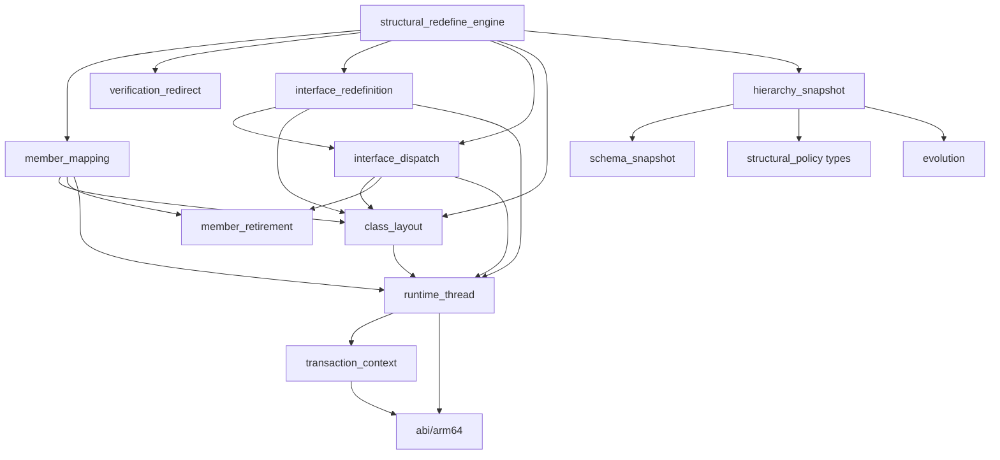

# 结构重定义引擎

[English](STRUCTURAL_REDEFINE_ENGINE.en.md) | 中文

本文说明增强库如何在设备 ART 自带的结构重定义事务之上实现类演进：接管哪些决策点、每一步做什么，以及各类变化的语义。面向使用者的语义汇总见 [LIMITATIONS.md](LIMITATIONS.md)。

## 目标与前提

- **目标**：在非 root 的 Android 11–17 / arm64 设备上，于应用进程内实现 VM 级 DCEVM：增删字段和方法、改类型与签名、改修饰符、改继承关系，存活对象保留兼容字段的值。
- **前提**：应用进程**从启动时就是 Java 可调试的**（manifest `debuggable`）。依据 AOSP `openjdkjvmti/art_jvmti.h`，`can_redefine_classes` 属于 `kNonDebuggableUnsupportedCapabilities`，`IsFullJvmtiAvailable()` 只认 `IsJavaDebuggableAtInit()` 或强制纯解释模式，进程启动后再切换调试状态无效。
- **不做**：不替换系统 ART，不依赖 root，不通过反汇编推算地址或偏移，不重新实现 ART 已提供的实例迁移、引用改写、去优化与缓存失效。

## 为什么以 ART 结构重定义为引擎

Android 11 起，`Redefiner::StructurallyRedefineClasses`（JVMTI 扩展 `com.android.art.class.structurally_redefine_classes`）已经实现了 DCEVM 最难的部分：

| 步骤 | ART 已有实现（`ti_redefine.cc`） |
| --- | --- |
| 新类分配 | `FinishNewClassAllocations` 为目标类及**所有已加载子类**按拓扑顺序新建 Class，`AllocateNewClassObject` 从新 DEX 加载并 `LinkClass`，vtable、iftable 和字段布局由 ClassLinker 重新计算 |
| 实例迁移 | `CollectAndCreateNewInstances` 遍历堆，为每个旧实例分配新实例 |
| 字段拷贝 | `UpdateClassStructurally` 按名称和类型拷贝静态字段和实例字段，迁移锁字，清空旧对象 |
| 引用改写 | `Runtime::VisitReflectiveTargets` 改写 JNI ID、反射 Field/Method、MethodHandle、VarHandle 和 DexCache 中的 ArtField*/ArtMethod*；`HeapExtensions::ReplaceReferences` 把堆和根中的旧对象、旧类替换为新的 |
| 执行状态 | `DeoptimizeAllThreadFrames` 让所有帧去优化，`InvalidateAllCompiledCode` 清空 JIT，清空各线程解释器缓存，旧方法标记为 obsolete |

ART 原生只允许“只增不删”，限制集中在少数几个决策函数里。增强库只接管这些决策点，提交、迁移和失效全部由 ART 执行。

## 接管点

| ART 决策点 | ART 原行为 | 增强行为 |
| --- | --- | --- |
| 公开表的 `JvmtiFunctions::RedefineClasses` | 普通重定义拒绝结构变化；导出入口可能内联 | 路由到原始结构事务，保留参数、能力检查、ClassFileLoadHook 和普通方法体更新；进入 ART 前经目标类的加载器加载新 DEX 引用的类（含新增的接口与父类），并读取旧声明 |
| `CheckClass` | 类修饰符、父类、接口不得变化 | 解析最终 DEX，运行布局探测，按[校验规则](#校验规则)评估并缓存决策 |
| `CheckFields` / `CheckMethods` | 只增不删、修饰符不能变化 | 按决策调用 `RecordNewFieldAdded` / `RecordNewMethodAdded` 让 ART 走结构路径；没有决策时调用原函数 |
| `AllocateNewClassObject` | 使用旧层级重建类和子类 | 父类变化时把新父类写入调用方的父类 handle 槽位 |
| `CheckVerification` | 校验器按描述符解析到旧类 | 父类变化时，校验期间本线程的 `FindClass` 对该类描述符返回新类对象 |
| `CollectAndCreateNewInstances` | 为旧实例分配新实例 | 原函数成功后核对槽位声明并预先算好成员映射；依赖自有映射的事务在失败时返回错误 |
| `CollectNewFieldAndMethodMappings` | 缺同名同签名方法会 CHECK，包括重链接子类的 copied default/miranda 消失时 | 写入预先算好的映射；没有计划的事务调用原映射 |
| `UpdateClassStructurally` | 字段/锁字迁移、obsolete、引用替换、去优化、缓存失效 | 只设置 visitor 的事务作用域并完整调用原函数；复制阶段换用不含退役项的旧类字段数组，父类变化时让新类暂指原父类 |
| `Runtime::VisitReflectiveTargets` | 原成员映射与 shadowing 处理 | 换回旧类字段数组；清除退役成员的 DexCache 项，记录退役 JNI ID，改写退役字段的反射 `Field` 与 VarHandle；其余交给原 visitor |
| JNI 函数表、`Method_invoke`、`Constructor_newInstance0`、MethodHandle 入口、JNI ID 编码 | 缓存的目标是旧声明类的 obsolete 方法，可能报接收者类型错误或按旧 vtable 索引分派到别的方法 | 仅对退役目标在分派前抛异常，其他调用原样转发 |

## 事务流程

### 安装

`DcevmRuntime.initialize()` 加载 `libartdcevm.so`、附加为 JVMTI Agent，`core/agent.cc` 调用 `structural_redefine::Install`（幂等）：

1. 用自有 jvmtiEnv 的潜在能力确认 `can_redefine_classes`，否则失败。
2. 调用官方 `shadowhook_init()`，按名称解析基础入口的 7 个符号：公开表的 `JvmtiFunctions::RedefineClasses`、结构入口、三个校验点和两个 `RecordNew*Added`。任一缺失，或公开 JVMTI 表与找到的命名包装器不一致，初始化失败并写明原因。
3. `Install` 是唯一组装入口，按依赖顺序显式准备：`runtime_thread` → Class 命名服务 → 退役守卫 Hook → 成员映射 → 校验重定向 → 接口分派 → 接口重定义，服务通过结构体传入。Thread 准备始终执行，不受 NDK map 自检或映射符号失败影响；这些失败的原始 `memberMapping` 诊断会被保留。退役必需服务缺失时关闭该组 Hook；`EncodeFieldId` 缺失只关闭字段退役，两种 `FindClass` 都缺失时关闭父类变化。引擎分别记录线程服务、映射、退役、字段退役、父类变化、接口运行时、实例检查和子类监视的进程级能力。
4. 用 `shadowhook_hook_sym_addr()` 安装全部 inline hook，标准入口路由最后安装。任一步失败时用 `shadowhook_unhook()` 逆序撤销已安装部分，JNI 函数表保持原状。事务锁阻止已路由调用观察到部分安装状态。
5. 全部 inline hook 成功后，才经 `member_retirement::InstallJniGuards` / `SetJNIFunctionTable` 安装 JNI 包装；该最后操作失败时撤销退役／接口相关的 inline hook，保留基础校验与路由，沿用仅支持新增和方法体等基础变化的降级行为；撤销本身失败时初始化失败。随后经 JVMTI `GetClassFields`（不初始化类）取得退役字段占位，发布进程级能力。

### 标准入口

1. 进入 ART 之前，线程仍处于 Native 状态。事务上下文先通过共享线程服务核对当前线程，再对每个目标类：用 `Class.forName(name, false, 目标类加载器)` 加载（不初始化）新 DEX `type_ids` 引用的全部类（数组取元素类，见下文“事务中的类加载”），其中新增的接口与新父类留作策略输入。这一步可能加载类，所以先于声明快照执行。随后用公开 JVMTI 读取旧声明、已加载子类声明的方法、子类接口中子类未声明的方法，以及父类的 public 方法。
2. `transaction::Scope` 为每次事务建立一个上下文，统一持有引擎批次、映射计划、接口状态、Native 阶段探测的线程服务、已探测布局和每个目标的 `Requirements`；嵌套事务整体压入并恢复该上下文。批次快照按 `jclass` 索引（ART 的 `ClassRedefinition::klass_` 就是同一个值），并为受影响类和已加载子类提前创建 JNI 全局根。外层递归事务锁把快照与 ART 事务串行化；ClassFileLoadHook 引发的嵌套事务成功后使外层快照失效。
3. 原样调用 `StructurallyRedefineClasses`；成功退役时保留全局根，否则释放；返回后清理上下文并返回 ART 的结果。

`Check*` 等 ART 内部阶段不调用 JNI/JVMTI 进行类加载、遍历、可赋值比较或策略计算。唯一例外是分配 Hook 在当前线程上对本事务私有数组和 holder 使用 JNI `SetObjectArrayElement`（含命名局部引用桥接和异常检查）：ART 13/14/16 的 `ScopedThreadStateChange` 在新旧状态同为 Runnable 时不切换状态；该元素写入执行 ART 自己的写屏障，不分配托管对象且没有挂起点。局部引用容量在 Native 状态预留。这一例外禁止用于任何 ART 回调或持有 ART 锁的区域，也不适用于已发布数组。

### 事务中的类加载

ART 的结构事务分两步处理子类：
- `FinishNewClassAllocations` 遍历堆，收集目标类已解析的子类，为它们在新类下重建类对象。
- 随后 `CheckVerification` 才校验新 DEX。

两步之间，`ClassDefinitionPauser` 暂停其他线程定义类，却放行发起事务的线程。校验器解析新代码引用的类型时，会经 `ClassLinker::FindClass` 定义尚未加载的类。这样定义出的子类不在重建列表中，提交后仍链接在旧类下：
- 首次实例化时，校验器报告 `this` 不是新类的实例；
- 若已跳过校验，它的字段偏移会与新类新增的字段重叠。

因此标准入口在进入 ART 之前，先经目标类的定义加载器加载（不初始化）新 DEX 引用的每个类。校验器可能加载的类都在其中，堆遍历能看到所有子类，策略快照（`GetLoadedClasses`）也包含它们。加载器无法加载的类型交给校验器按原语义处理。提前加载只改变加载时机：不执行初始化器，加载失败只会把该类标记为错误，与校验器或首次使用时相同。

提前加载只覆盖提交给标准入口的字节。另有两种情况会漏掉子类：
- ClassFileLoadHook 改写后才引用的类；
- ART 暂停类定义之前，其他线程加载的子类。

为此，引擎在自有 jvmtiEnv 上登记 JVMTI `ClassPrepare`，只在事务进行期间启用，覆盖所有线程。从读取已加载类开始，任何目标类的新子类完成准备，都会标记本次尝试。ART 替换用的类对象经 `LinkClass` 建立，不触发该事件。

被标记的尝试在 `CollectAndCreateNewInstances`（ART 最后可失败的一步）以 `JVMTI_ERROR_INTERNAL` 失败，整批不提交。此时该子类已经加载，标准入口随即重新快照并重试，最多三次尝试；每次尝试都会再调用 ClassFileLoadHook。能力报告的 `subclassLoadRetries` 统计重试次数。没有方法退役 Hook 时没有这个失败点，只做提前加载。

### 接口事务的失败清理

API 33/34/36 的接口引擎接受多个接口目标受支持的方法体与成员更新，可与无关类、实现类或实现类的子类同批。父子接口合并到最高批次父接口的一组；互不相交的接口各自拥有一组。没有批次共同祖先却共享子类型的接口组以 66 拒绝，以避免重复实例迁移和提交。接口的替换类由自有分配路径准备，无关类使用 ART 原分配路径，校验、提交与失败返回仍属于同一 ART 原子事务。holder 按实际批次核对数组长度、固定 `ClassRedefinition` 元素声明及三个标志 vector，并使用 ART 排序后的条目索引。它在 Native 状态复用标准入口的 `GetLoadedClasses` 快照，收集全部已准备的实现类、实现类子类及子接口，使用公开 `Proxy.isProxyClass` 拒绝 Proxy；这些类可能仍挂在原来的父类下。ART 在事务失败后释放新 DEX，下一次父类重定义的堆扫描便可能碰到这些废弃类。

同批实现类与子类按它们自己的新 DEX 和 holder 的新 DexCache 分配；未提交 DEX 的受影响类型仍用原 DEX 的私有链接缓存。`FinishNewClassAllocations` 的第一个受影响条目先完成接口整组分配，与 ART 按父类深度生成的条目顺序无关。固定 holder 声明经全批探测后，只在事务私有的 `initialized_`、`actually_structural_`、`initial_structural_` 中标记整组：接口为唯一初始结构条目，同批实现类条目已分配且不是初始结构条目，后续分配跳过。与 ART 的 `setup_single_redefinition` 一样，各条目保留自己的新类槽位用于 DEX 校验，但只有接口条目携带整组新旧类及实例数组，原 `CollectAndCreateNewInstances`、公共映射计划和 `UpdateClassStructurally` 因而仅处理整组一次。“类加 abstract”对整组收集的实例检查各目标，避免从属条目的空实例数组漏检。实现类的新增、退役与修饰符仍由现有策略评估。实现类的外部父类若同批只改方法体可以接受；其结构变化以 66 拒绝，因为 ART 父类事务与接口事务会共享并重复重建实现子树。Native 快照记录重叠关系，最终 DEX 策略只在该外部父类确需结构路径时拒绝，并写明类与重叠原因。校验重定向也覆盖本事务整组的新类，按命名 `LookupClass` 和类加载器身份匹配原类，仅本线程的 `CheckVerification` 返回替换类；旧类表和旧 DexCache 不写入替换类。

引擎在命名 `Redefiner::Run` 入口建立事务作用域，把每组替换类数组单独放入 ART HandleScope，直到整批结果确定。命名 `ClassLinker::LinkClass` Hook 只把替换类赋入预留的 pending HandleScope 根，不调用 JNI 或写入堆数组；分配入口返回后才在无锁位置写入私有替换数组，因此也覆盖 `AllocateNewClassObject` 随后的 JNI ID 数组分配失败、尚未写入 holder 的类。任意失败返回或本机分配异常退出都会在释放 DEX 之前清理；成功返回则保留新类状态。

清理调用命名 `Class::SetStatusInternal`，仅把本事务未发布的替换类变为 `kErrorUnresolved`，不做 Java 分配或 JNI/JVMTI 调用，也不改变旧类。依据 `android-13.0.0_r1` 的 `mirror/class.h`，`kErrorResolved` **仍满足 `IsResolved()`**，不能排除后续堆扫描。普通 `SetStatus` 的初始化状态转换、锁、异常与通知协议也不适用于这些私有废弃类。内部写入路径保留 subtype bits；`class-refvisitor-inl.h` 的 GC 仍扫描 Class 的实例引用与 native roots，跳过静态字段扫描是安全的，因为失败发生在提交复制静态字段之前，私有类也没有执行初始化器。

`InterfaceAbortInstrumentation` 在同一进程中验证真实 DEX 校验失败（错误的返回指令，以及以整数为接收者调用 `String.length()`，均返回 62）、链接产生类之后返回失败、完整分配后失败、实例分配失败和实际映射探测拒绝，再重定义原父类、成功更新接口并 GC。类型不兼容的调用失败后先显式 GC，再执行后续事务。ClassFileLoadHook 引入晚加载实现类的场景另外验证引擎真实失败重试。故障注入和测试用 JNI 导出只由 app 测试模块的 Debug CMake 参数显式启用。app 复用同一引擎源目录构建测试副本；库自身的 Debug 与 Release 都默认关闭该选项，独立库构建即使误传开启参数也会拒绝。测试 APK 选择 app 副本，`tools/check-interface-abort-isolation.py` 用 `llvm-nm` 核对两份 AAR 和匹配 Build ID 的未剥离产物，确认不含注入符号，并检查 APK 的 Build ID 来自 app 测试副本。

ART 调用的入口与 visitor 不允许向调用方传播 C++ 异常。接口路径不再注册 `VisitClasses` 回调；准入、类校验、分配及实例/映射准备入口在本层转换为 `OUT_OF_MEMORY` 或 `INTERNAL`，错误转换不分配诊断字符串。私有数组转存失败时，pending 根保证尚未入数组的替换类仍会清理；解析重定向失败则登记事务错误，在分配入口重新获得控制时拒绝事务。不能依赖外层 `Run` 捕获异常，因为异常到达它之前已经穿过 ART 栈帧。

公共 Hook 也按可失败阶段与不可失败阶段核对：提交映射、更新、反射 visitor 和 ID 编码入口显式为 `noexcept`。ART 的提交阶段没有可恢复的错误返回协议，发生本机分配失败时仍是致命失败，不能通过吞掉异常继续部分提交；这不等同于证明真实内存耗尽可以恢复。遍历回调删除后，故障注入 6、7、9、10 同时删除；失败仪器保留准入、解析重定向及数组转存的 Hook 边界异常，并验证 Native 作用域构造失败后统一事务上下文恢复，验证错误码、旧实例、后续父类与接口事务及 GC；已验证设备的两种 JNI 模式均执行这些检查。

这些行为已在 Android 13 / API 33、Android 14 / API 34 和 Android 16 / API 36 的普通模式和 CheckJNI 下验证；API 33 关闭清理的对照 APK 在失败测试中崩溃。已知限制：实际耗尽 Java/native 内存的异常、其他 ART 模块版本，以及其他 Android 版本尚未验证；分配故障注入不能替代真实内存耗尽验证。

私有实现类缓存直接复用命名 `ClassRedefinition::CreateNewDexCache`：用当前 driver 和原 DEX 的非 owning 前缀调用，不修改原 DexCache，也不注册新缓存。该入口自身负责分配、根管理、location、dex lock 与初始化。描述符重定向使用不填充缓存的命名 `LookupClass`（API 33 为 `const char*`，API 36 为 `string_view`）；可赋值比较只在 Native 快照阶段使用 JNI `IsAssignableFrom`。以 Class 身份为键的 `IdentityHashMap` 保证不同加载器的同名类不混淆，直接父类/父接口构成边，Kahn 遍历一次生成顺序及父类索引，预期复杂度为 O(已加载类数 + 受影响类型数 + 直接继承边数)。ART 分配阶段只解码这些根、核对已解析状态及目标位于首项，并按父类索引使用替换父类，不再遍历类或进行两两可赋值比较。快照之后的新子类型仍由 `ClassPrepare` 标记，在实例分配前拒绝并由标准入口重试。失败仪器分别覆盖晚加载的父类子类和直接实现类，并验证重新快照后的成功分派与 GC。通过命名 `JNIEnvExt::NewLocalRef/DeleteLocalRef` 创建真实局部引用后，私有数组写入仅在分配入口的非回调、无 ART 锁位置使用 JNI `SetObjectArrayElement`，由 ART 执行写屏障；`LinkClass` 只写 pending 根，清理同时覆盖该根与替换数组。

线程、Class 与 HandleScope 的差异只放在 `platform/abi/arm64/androidNN/`，公共路径访问固定源码声明。安装时的平台 API 准入由接口运行时登记表限制为已验证的 API 33/34/36；准入后的声明选择通过 `class_layout::CandidateReleases` 复用底层 `abi/arm64/release_order.h` 的发布版本顺序，并在准入时使用同一个 `VerifyTarget` 的成员探测结果筛选接口声明候选。Native 阶段先核对当前线程 JNI env、OS tid 和标记位范围；准入 Hook 在建立任何自有 HandleScope 之前，再用命名 `Thread::HandleScopeVisitRoots` 观察 ART 已有的根槽位。观察回调只记录地址，不分配、不调用 JNI、不解引用根对象，也不改作用域。两版准入调用方的单根作用域必须与候选 header/capacity/size、传入 Handle 的实际根位置及 ART 的根遍历结果一致；线程槽位若不指向已知根邻近的 header，就不解引用该候选指针。

进入 `Run` 必须已有通过的声明；当前事务线程独立保存并在嵌套事务退出时恢复候选。分配前再核对 holder 数组长度、vector 的目标对象与 begin/end/capacity、三份布尔 vector 的长度及新 DEX 缓存槽位。声明核对失败才禁用接口重定义，`interfaceRuntime` 记录明确原因，普通类事务仍可使用。通过全部探测后才报告 `verified`。读屏障仍由 ART 命名 Mark 服务处理；JNI 私有数组写入例外范围不变。设备验证仍限于 Android 13/API33、Android14/API34 和 Android16/API36，不据此声明其他平台或 ART 模块受支持。失败仪器另用独立进程核对 Thread、HandleScope、holder 三种探测拒绝后的禁用与类事务可用性。

接口准入复用 ART 的 pointer-id marker 语义：在结构准入时检查接口组快照中的全部类型，`ClassExt` 的 instanceJfieldIDs、jmethodIDs、staticJfieldIDs 任一非空且不是数组便以 79 拒绝，`lastRejection` 指明实际带标记的类。Class.extData、三个 JNI ID 字段和 Class.componentType 均经命名 `FindInstanceField` 按名称与描述符查找，所有引用使用 ART 读屏障；不写死偏移、不改旧 ClassExt。标记由 ART 在 swapable-pointer 模式首次创建 JNI ID 槽位时存入；切换 indices 后仍保留，不能把旧 pointer ID 当作可改写的 index ID。测试在安装 Agent 前使用正常 JNI ID API 尝试生成真实标记，并另外注入校验结果来覆盖目标和子类型拒绝，不向已发布对象写入假标记。源码依据：[ClassExt](https://android.googlesource.com/platform/art/+/refs/tags/android-13.0.0_r1/runtime/mirror/class_ext-inl.h)、[JNI ID manager](https://android.googlesource.com/platform/art/+/refs/tags/android-13.0.0_r1/runtime/jni/jni_id_manager.cc)。

接口准入的访问位基准是目标当前 DEX 的 ClassDef，经 `evolution::ReadClassAccess` 读取，并使用与 `class_layout` 的访问位探测相同的接口有效位掩码。不能用 JVMTI `GetClassModifiers` 作基准：它优先报告 InnerClass 标志，成员接口包含 `static`，而 ClassDef 与运行时 Class 不包含该位。嵌套接口与顶层接口遵循同一准入规则。

永久禁用点逐项限于声明证据：Thread 的 env/tid/标记位、已接受 Class 候选下的 HandleScope 根遍历、Redefiner 的当前线程，以及 holder/私有数组/私有 DexCache 的结构与身份探测；测试注入的 Thread/HandleScope/holder 探测失败也属于这一类。单个目标无法提供成员探测证据、没有支持的 Class 候选、缺少 ClassDef、初始化状态在快照后变化、事务尚未完成准入，或 holder 的索引/分配状态/结构事务标志不适用，都只拒绝本次事务并说明原因，不写入进程级禁用原因。holder 的 vector 长度用于核对声明，其元素值用于核对本次事务，两者分开处理。Hook 只保存静态拒绝原因，返回 Native 后才按目标描述符格式化为 `lastRejection`。嵌套接口回归核对已有实例默认方法更新、GC、拒绝不支持的新增方法，以及随后顶层接口成功更新；完整套件与失败仪器都执行该顺序。

压力场景 `interface-stress` 预先加载 200 个实现类、四个构成菱形的子接口及两级受影响父类，快照必须恰有 207 个类型；核对旧实例字段保留、新旧实例分派及 GC 后行为。`interfaceSnapshotNanos` 统计本次 `GetLoadedClasses` 与接口子类型捕获/排序，`interfaceAllocationNanos` 统计接口类分配 Hook（含私有缓存、链接及数组写入），均使用单调时钟，单位为纳秒。它们属于当前事务线程的最近一次诊断，不是性能保证；逐设备实测结果只保留在本地验证记录。

接口命名服务目录随实现维护：已删除 `VisitClasses` 及不再使用的 ClassVisitor 声明。`tools/check-structural-symbols.py` 拒绝没有被实现引用的接口目录项，报告目录及实现哈希，并按每个名称及其声明的 ELF 表报告覆盖率。准入拼写和数组分配重载是候选项，目录总数不代表每台设备必须同时具备的名称数量。

类状态使用 `platform/abi/arm64/common/class_status.h` 中 11–17 一致的完整 `abi::arm64::ClassStatus` 固定枚举，公共实现直接使用该声明；状态读取返回该枚举类型，初始化与清理比较不再使用裸数字，也不与 JVMTI 状态掩码混用。Java/DEX 访问位使用命名常量，包含接口、类的 super、synthetic、annotation、enum 标志。Proxy 判断仍使用 Native 阶段的公开 API，不读取内部 Proxy 标志位。

Thread 布局表位于 `platform/abi/arm64/runtime_thread_table.h`，编译期断言保证 JNI env 偏移相同的声明，其 exception 与 top HandleScope 偏移也相同。只有 `runtime_thread::Ready()` 能构造 `VerifiedThread`，`Read`、`Layout`、`LayoutFor` 均要求该句柄。接口探测与运行按选中发布版本调用 `LayoutFor`，包括 tid、exception 和 HandleScope 槽位。接口登记表的 `linked_iftable_acceptance` 属性决定是否需要早期链接错误服务，公共实现不再按版本号写特殊分支。

### 校验

`CheckClass` 按 `redefinition.h` 取出 `klass` 与 `dex_file`，上下文中找不到该类时调用原函数。随后由 `DexView` 读取新类声明（ClassDef 0），运行布局探测，读取新增接口与新父类的运行时标志，再调用 `structural_policy::Evaluate`：

- 拒绝时只写 `driver_->result_` 并返回 false（`Redefiner::RecordFailure` 本身也只做这件事），原因写入 `lastRejection` 和 logcat。
- 接受时在事务上下文的引擎批次中按 `ClassRedefinition*` 保存决策（含退役声明清单），并把映射、实例和校验要求记录到每个目标的 `Requirements`；策略在接受依赖映射能力的分支时直接设置 `Decision::requires_member_mapping`，引擎不再用关闭映射能力的第二次评估推导要求。对成功决策，该标志等价于“保留 `instance_check`、关闭映射及其衍生能力后会被拒绝”：包括字段退役、方法退役／改签名、native 改 Java、接口新增成员（含 abstract）、父类变化，以及无自有映射时会被拒绝的 copied/miranda 变化。新增接口本身、普通类新增成员、修饰符或方法体修改不因此依赖映射；改为 abstract 只依赖实例检查。接口目标仍无条件标记依赖映射，包括仅修改方法体。拒绝决策不携带该要求。

`CheckFields` / `CheckMethods` 按决策的 `fields_structural` / `methods_structural` 调用对应的 `RecordNew*Added`，`CheckMethods` 之后清除决策。

### 映射与提交

引擎持有 ART 最后可失败点 `CollectAndCreateNewInstances` 的 Hook，固定按以下顺序调度：子类加载重试判断 → ART 原函数 → 改为 abstract 的类的存活实例检查 → 替换布局核对与成员计划 → 新父类核对 → 接口分派验收 → 新 default 冲突。检查携带 Native 探测取得的 `VerifiedThread`，统一用 `transaction::Context::Reject` 写入拒绝原因和 `driver->result`。`member_mapping` 只生成、保存计划，并在 ART 后续提交 Hook 中应用，不检查实例，也不调用接口分派。布局或计划失败时，依赖自有映射的事务拒绝，其余事务保留 ART 原映射。

`PlanMethods` 在全部布局和所有结构事务共用的模板中，以方法声明类的 DEX 加 `dex_method_index` 解析名称与完整原型，再按（名称、描述符）匹配新声明；DEX 文件不同，不能直接比较索引值。这一规则也用于普通类事务，并非只对接口启用。接口引擎引入该规则是因为 ART `HasSameNameAndSignature`/`GetCanonicalMethod` 会查询 obsolete 方法所属数组的 DexCache，而 copied default/miranda 实际存放在实现类数组中；接口替换后，这个假设可能不成立。映射不再依赖这两个命名符号，目录和核对工具仅保留当前引用的名称。

此后进入不可失败的提交：`CollectNewFieldAndMethodMappings` 只把计划写入 ART 的 map（写入前确认它们是空的 libc++ 树）；`UpdateClassStructurally` 完整调用原函数，引擎只在复制阶段前后换入、换回字段数组与父类指针，并在 visitor 中处理退役成员。提交段内没有 JNI/JVMTI 调用或 Java 对象分配。

## 接口成员演进

Android 13/API 33、Android 14/API 34 与 Android 16/API 36 的 arm64 接口目标在运行时与成员映射探测通过后，支持新增 public abstract、default、static（任意访问级别，含 synthetic）、private 实例方法，以及删除或改签名 static/private 方法。新增 native 或 `<clinit>` 以 63 拒绝；删除或改签名 default/abstract 以 67 拒绝。字段、父接口与方法修饰符变化仍分别拒绝 64、66、71。接口始终使用结构路径，`Abilities::interface_members` 仅在引擎拥有成员映射时启用。

这复用接口现有的重建组：接口、已加载子接口、实现类及其子类按新接口重新 `LinkClass`，未提交 DEX 的实现类使用原 DEX 与私有 DexCache，同样获得 copied default。新方法没有旧对应项，不进入旧方法映射。类链上的 public 实现优先于 default；更具体的子接口覆盖父接口，原 miranda 可变为 default 拷贝。实例迁移、引用改写、去优化与缓存失效仍全部由 ART 完成。

新增方法还须满足以下检查：

1. 新增 static/private 方法不得遮蔽从父接口继承的虚方法或 Object 的 public 实例方法，否则拒绝 63。`CollectInheritedInterface` 将这些身份记录到 `LoadedHierarchy::inherited_interface`。已校验的旧 `invoke-interface` 可能仍按 IMT 分派，引擎不能靠新声明使它安全地抛调用方式错误。
2. 新增 default 不得与实现类自身或其父类链上的同签名 static/非 public 方法重叠，否则拒绝 63，并写明该声明类。`subtype_shadows` 来自 `interface_redefinition::Scope::GroupTypes`，与 ART 实际重建的准备完成且非错误类型一致。实现类父类链也纳入检查，boot 类可按唯一描述符去重，其他加载器不按名称去重；public 实例实现不拒绝。
3. `PlanMethods` 读取 ART 链接结果，发现新出现的 `IsDefaultConflicting` 方法时，记录实现类和方法。`CollectAndCreateNewInstances` 在 ART 不可失败点之前以 63 拒绝，`lastRejection` 写明实现类及名称、描述符；旧定义保留。它不走表示布局探测失败的 `Fail()` 路径，防止退回 ART 原映射而放过冲突。此检查共享于所有使用自有映射的结构事务，也覆盖普通类新增接口。

4. 新增 public abstract 不走 default 的 `subtype_shadows` 拒绝，而由策略决策记录（名称、完整 descriptor）的待验证条件。`CheckClass` 连同 `ClassRedefinition*` 的接口身份写入批次 `Context::interface_obligations`，条件不依赖该输入是否拥有重建组。分派验收器对当前 owner 的新旧类数组按旧接口身份定位候选接口，检查其中所有具体类的实际 IfTable；未提交 DEX、没有实例的类也在数组内。父接口 owner 可验收子接口输入的条件，其他接口组或加载器的同名类不混淆。

只读访问器复刻固定源码 `mirror/class-inl.h::FindVirtualMethodForInterface` 的读取语义：以候选声明类身份选择 IfTable 的接口项，以候选方法的 `method_index` 读取 PointerArray 的目标。先通过命名 `FindDeclaredInstanceField` 核对 `java.lang.Class.ifTable` 的声明、类型、实例存储与固定偏移；再核对 ObjectArray/long[] 的运行时类别、成对长度、接口声明虚方法的连续索引、分派数组长度，以及目标指针属于已知的方法数组，最后才读标志和 DEX 身份。`PointerArray` 的固定声明来自 `android-13.0.0_r1`、`android-14.0.0_r1` 与 `android-16.0.0_r1` 的 `mirror/array.h`（arm64 数据起点按 8 字节对齐），IfTable 来自这三版 `mirror/iftable.h`。堆引用使用共享 `runtime_thread::Read` 的命名 Mark 读屏障；Class 探测与成员计划读取声明类、DexCache 和数组元素也复用此读取路径，避免并发 GC 的转发引用被误判为其他类。此访问器不写入分派表，不解析或模拟方法选择。

合法分派必须为 public、非 static/private/abstract、非冲突、非 obsolete／已退役目标，且真实 DEX 名称与完整 descriptor 相同。已有／同批实现、继承实现与 ART 选中的更具体 default 可接受；bridge 必须真实存在。失败以 63 整批拒绝，`lastRejection` 写出接口方法和具体类；访问器不匹配也以 63 拒绝并报告探测原因。验收紧邻 default 冲突检查，位于 `CollectAndCreateNewInstances` 的计划阶段、不可失败边界之前，沿用现有废弃类清理和重试路径。`interfaceAbstractDispatch` 报告最近的访问器探测状态；每次事务重新检查。

分派验证独立放在 `interface_dispatch`：它持有只读布局探测、逐条件验收和错误格式化；`structural_redefine_engine` 在成员计划之后的提交前检查中调度它，映射模块不依赖分派模块。两者复用 `art_method_identity.h` 的有界 DEX 身份读取。ART 13 的 `LinkInterfaceMethods` 与 ART 14 的 `LinkMethodsHelper::FindCopiedMethodsForInterface` 对非 public 实现在 IfTable 形成之前调用固定源码的 `ThrowIllegalAccessErrorForImplementingMethod`。`interface_redefinition` 通过该命名 NO_INLINE 服务观察实际选择的方法对，在链接锁内只记录原生元数据和已有 HandleScope 根，原服务照常执行；分配返回失败、离开锁后，验证模块按候选接口身份和完整 descriptor 生成 63 的拒绝原因。不截取异常文本、不按名称猜实现，也不放宽 ART 链接。该服务在 ART 13、14 不可定位时仅禁用新增 abstract，并在能力与拒绝原因中说明；ART 16 使用已链接 IfTable 验收。

专项回归还覆盖更具体的 abstract 遮住远处 default、同批移除最后实现、多组中后一组拒绝、映射计划后故障，以及快照后晚加载缺失实现与连续加载耗尽重试。失败前后分别调用缓存的反射、MethodHandle、JNI ID 和预热字节码；修正或撤回后再次提交。`interfaceAbstractMethodAddition` 是细分探测状态，不能替代逐事务验收。

`IsDefaultConflicting` 使用固定源码声明：12–17 在 common/runtime_objects.h 中判定 `intrinsic | copied | abstract | default` 相关位等于 `copied | abstract | default`（分别为 `0x80000000`、`0x01000000`、`0x0400`、`0x00400000`）；11 在 android11/art_method.h 中判定独立的 `0x01000000` default-conflict 位且非 intrinsic。按 ArtMethod 类型选择重载，不增加字段偏移。方法数组按现有长度遍历；地址非空不表示存在成员。API 36 的共享空字段数组也必须通过现有布局探测。

接口 direct 方法退役使用现有 `{old, old, kRetired}` 映射、DexCache 清理与访问守卫：字节码、JNI、MethodHandle 调用抛 `NoSuchMethodError`，缓存反射调用抛包装它的 `InvocationTargetException`；活动旧帧继续执行。标准入口的保活根已覆盖接口及整组子类型，发生退役时保留至进程结束；每个目标独立记录 retired kinds，因此之后以另一种调用方式恢复同名同描述符仍拒绝 71。接口不需要新的访问守卫。

### 接口 default 中的 lambda

Kotlin 2.3.21（`-jvm-default=enable`、JVM target 1.8）与 D8 8.10.9 的本地编译检查表明：在 default 方法中追加 lambda 会新增 private static 实现方法、public static synthetic `$r8$lambda$` 桥和合成类；在已有 lambda 前插入，还可能改变旧实现方法的签名并删除旧桥。新增有函数体的接口方法还可能在 `DefaultImpls` 和实现类增加桥方法。因此热重载端须将接口与发生变化的已有合成类、实现类 bridge 放在同一批，先把新类追加到加载器。引擎不负责补丁分发或新增类的加载协议。

序号改变会让旧 lambda 实例所属的合成类改为另一个 lambda 的实现；函数接口变化仍可能被 66 拒绝。热重载端须按普通类 lambda 的规则隔离旧闭包，或保留旧桥并只追加新桥。支持 direct 方法退役不保证旧闭包保持原来的业务含义。

`InterfaceEvolutionFixture` 与 `interfacelambda` fixture 覆盖新增与退役、copied default、子接口优先、miranda、桥批次和 lambda 插入；`interface-stress-add` 覆盖 200 个实现类。`InterfaceAbortInstrumentation` 验证链接冲突拒绝后，旧行为、后续父类事务、接口事务与 GC 均正常。原始设备日志与逐次验证记录仅存本地忽略目录。

## 校验规则

`structural_policy` 是纯函数，可在主机测试。成员身份：字段为（名称、类型、static），方法为（名称、描述符），方法的调用方式还受[调用方式不变](#调用方式不变)约束。比较前把 DEX 原始标志规范化为 JVMTI 视图（与 `ti_method.cc`、`ti_field.cc`、`ti_class.cc` 一致：取 Java 标志位，方法的 declared-synchronized 映射为 synchronized，abstract 方法去掉 native）。

“可退役”指方法退役 Hook 已安装且本事务的布局探测通过；字段变化另需字段守卫可用。

| 变化 | 结果 |
| --- | --- |
| 接口目标的方法体更新 | 接受；需接口运行时探测与成员映射通过 |
| 接口目标新增 public abstract/default/static/private 实例方法；删除或改签名 static/private 方法 | 成员映射与接口运行时可用、且继承／遮蔽／default 冲突与 abstract 分派检查通过时接受 |
| 接口目标新增 native/`<clinit>`；新增 abstract 无有效实现或 IfTable 探测不通过；direct 遮蔽或 default 冲突 | 拒绝 `METHOD_ADDED`（63） |
| 接口目标删除或改签名 default/abstract 方法 | 拒绝 `METHOD_DELETED`（67） |
| 接口目标字段变化；方法修饰符变化；父接口变化；类修饰符变化 | 分别拒绝 `SCHEMA_CHANGED`（64）、`METHOD_MODIFIERS_CHANGED`（71）、`HIERARCHY_CHANGED`（66）、`CLASS_MODIFIERS_CHANGED`（70） |
| 接口运行时能力不可用（版本、命名服务或探测不支持） | 拒绝 `NOT_AVAILABLE`（98）；声明变化使用上述标准错误码 |
| 新增字段、方法 | 接受 |
| 已有成员的访问级别、final、volatile、transient、synchronized 变化（实例方法改为 private 除外）；Java → native；abstract ↔ concrete | 接受 |
| 方法新增 final，且已加载的子类覆写它 | 拒绝 `METHOD_MODIFIERS_CHANGED`（71） |
| 新增或改变访问级别的实例方法，可能顶替已加载子类的 copied default/miranda | 可退役时接受，由自有映射处理；否则新增拒绝 `METHOD_ADDED`（63），访问级别变化拒绝 71 |
| native → Java | 可退役时接受（引擎处理 JNI 入口复制）；否则拒绝 71 |
| 方法在 static 与实例之间变化，实例方法改为 private；已退役的方法以另一种调用方式重新加入 | 拒绝 71（见[调用方式不变](#调用方式不变)） |
| 方法的 varargs、strict 标志变化 | 拒绝 71 |
| 删除方法、改签名（含 native、abstract、构造器、类初始化器） | 可退役时接受；否则拒绝 `METHOD_DELETED`（67）；接口 default/abstract 始终拒绝 |
| 删除字段，字段类型或 static 属性变化 | 可退役且字段守卫可用时接受；否则拒绝 `SCHEMA_CHANGED`（64） |
| 类的可见性、final、abstract、synthetic 或 InnerClass 标志变化 | 接受并走结构路径；加 final 而有已加载子类时拒绝 `CLASS_MODIFIERS_CHANGED`（70）；加 abstract 而该类自身仍有实例时，在 `CollectAndCreateNewInstances` 之后拒绝 70 |
| 类在接口、注解、枚举之间变化 | 拒绝 70 |
| 新增接口（可同时调整顺序） | 运行时标志可读取且解析与访问检查通过时接受，不单独依赖成员映射；无法解析、不是接口或不可访问时拒绝 `FAILS_VERIFICATION`（62）；没有可用布局读取标志时拒绝 `HIERARCHY_CHANGED`（66）；使用自有映射时新产生的 default 冲突拒绝 63 |
| 移除接口；重复接口 | 移除拒绝 66（见[收窄不支持](#收窄不支持)）；重复拒绝 62 |
| 父类变化 | 新父类扩展原父类时接受；其余按[放宽的父类变化](#放宽的父类变化)中的条件以 62、61 或 66 拒绝 |

## 运行时探测

固定源码声明不按 SDK、厂商或构建编号放行，而由每次事务的探测选择：

- **声明来源**：逐版核对 `android-11.0.0_r1` 至 `android-17.0.0_r1`（12 含 `12.1.0_r1`）的 AOSP 源码。一致的声明放 `platform/abi/arm64/common/`：Object/ObjectArray、DexCache 前缀、ArtField、12–17 的 ArtMethod、Handle、RedefinitionDataHolder 槽位、反射 visitor 与来源类型、libc++ 指针 map。差异放各版本目录：`android11`–`android17/class.h` 的 Class 字段数组（11–15 为 `ifields_/sfields_`，16–17 为 `fields_`，`access_flags_` 随之移动），以及 `android11/art_method.h`（多 `dex_code_item_offset_`）。
- **CheckClass 探测**：对每个目标，用 `ClassRedefinition::GetMirrorClass` 取 Class，按候选声明核对 `access_flags_` 与 ClassDef 标志；先用 `FindDeclaredInstanceField` 查找 `java.lang.Class` 的 `iFields`/`sFields`（11–15）或 `fields`（16–17），核对声明类、实例存储与固定槽位偏移，确认后才读取数组长度；再用 `FindDeclared*Field` 返回的目标字段核对数组范围、声明类、JVMTI 修饰符与 DEX 字段身份。字段总数必须与 JVMTI 一致，包括空数组。[Android 16 QPR2 的 ART](https://android.googlesource.com/platform/art/+/refs/heads/android16-qpr2-release/runtime/class_linker.cc) 会在无字段时使用地址非空、长度为零的共享数组，因此不能以“没有具名字段证明非空指针”为由拒绝；按候选 ArtMethod 步长核对声明方法数、修饰符与 DEX 方法身份。确认位置前不解引用候选数组。候选只取不早于平台版本的版本（ART 模块不会比平台旧），与平台同名的版本优先。事务内所有目标都接受的候选才可用；没有可用候选时，该事务不允许退役与 copied 成员变化。
- **提交期核对**：首次退役后确认 ART 已给退役方法设置 obsolete 标志，否则守卫改为直接查表。MethodHandle 的 `artFieldOrMethod` 与 VarHandle 访问掩码的偏移通过 `Class::FindInstanceField` 从 ART 字段表取得，不写死布局。
- **NDK map**：ART 与 NDK 的指针 map 边界限定 libc++ ABI v1；编译时检查 NDK 类型大小，初始化时用增强库自己的 empty/one-node map 验证 sentinel、root、size 和 value 布局。
- **DEX 身份**：有界读取同时接受标准 DEX 与 Android 11–15 的 CompactDex（ID 表在主区，字符串与类型列表在独立数据区）；重定义输入只接受单类标准 DEX。

### 共享线程服务与 GC 读屏障

`runtime_thread` 在每次标准入口事务的 Native 阶段探测当前线程：安装时按名称解析 `Thread::CurrentFromGdb`、`ReadBarrier::Mark` 和可选的 `gUseReadBarrier`，事务中按底层 `abi/arm64/release_order.h` 的顺序，经 `runtime_thread_table.h` 使用 `android11`–`android17/thread.h` 的固定声明核对 `jni_env`、Linux tid 和 `is_gc_marking` 的 0/1 范围。所有通过的候选与首选声明、线程指针属于 `transaction::Context::thread`，嵌套事务随上下文恢复。接口模块只复用这些结果，不重复探测线程；它仍自行核对 Class、HandleScope 与 holder，接口版本开关仍仅 API 33/34/36。

以下结论逐一核对了本地 `build/evidence/abi-sources/` 中的固定 AOSP 标签：`android-11.0.0_r1`–`android-17.0.0_r1`，以及 `android-12.1.0_r1`。补齐的源码与哈希仅保存在本地证据中。

| 源码版本 | 引用读取与标记语义 |
| --- | --- |
| 11、12/12L、13 | `read_barrier_config.h` 的 `kUseReadBarrier` 是编译期选择。`thread.h` 明确将 `is_gc_marking` 定义为 **CC 专用**；`concurrent_copying.cc` 的根翻转回调开启该标志，关闭标记的 checkpoint 将其清除。`ReadBarrier::BarrierForRoot` 在标志为真时调用 `Mark`，否则返回原引用。`Mark` 进入 `ConcurrentCopying::MarkFromReadBarrier`，由 ART 完成标记／转发；该入口也自行检查当前线程的标志。这里没有 CMC/userfaultfd 收集器。 |
| 14、15、16、17 | `is_gc_marking` 的上述含义保持不变，**不是 CMC 的并发标记状态**。`read_barrier_config.h` 允许编译期强制 CC、无读屏障配置或运行时选择；后者由 `mark_compact.cc` 的 `ShouldUseUserfaultfd` 设置 `gUseUserfaultfd`，并令 `gUseReadBarrier = !gUseUserfaultfd`。运行时选择 CC 时仍需 `Mark`；CMC 时 `BarrierForField`／`BarrierForRoot` 跳过 CC 读屏障。CMC 的 `CompactionPause`／线程根翻转更新根，`KernelPreparation` 与缺页处理协调压缩页，不通过 CC 的 `Mark`。 |

源码依据：[11 读屏障](https://android.googlesource.com/platform/art/+/refs/tags/android-11.0.0_r1/runtime/read_barrier-inl.h)、[12L 线程声明](https://android.googlesource.com/platform/art/+/refs/tags/android-12.1.0_r1/runtime/thread.h)、[13 Mark 入口](https://android.googlesource.com/platform/art/+/refs/tags/android-13.0.0_r1/runtime/gc/collector/concurrent_copying-inl.h)、[14 收集器选择与压缩](https://android.googlesource.com/platform/art/+/refs/tags/android-14.0.0_r1/runtime/gc/collector/mark_compact.cc)、[15 读屏障配置](https://android.googlesource.com/platform/art/+/refs/tags/android-15.0.0_r1/runtime/read_barrier_config.h)、[16 收集器约束](https://android.googlesource.com/platform/art/+/refs/tags/android-16.0.0_r1/runtime/gc/heap.cc)、[17 线程与 Mark 语义](https://android.googlesource.com/platform/art/+/refs/tags/android-17.0.0_r1/runtime/gc/collector/concurrent_copying-inl.h)。

共享 `Read` 只允许已探测的事务调用。存在命名 `gUseReadBarrier` 时，false 按上述 CMC 源码直接读取；true 将非空引用交给命名 `Mark`，由 ART 自己检查实际线程的标记状态，也避免 Mainline 更新后相同 JNI/tid 前缀的标记槽位歧义。没有该导出时，遵循固定线程声明与 `BarrierForRoot` 的标志快路径：仅在 `is_gc_marking` 为真时调用 `Mark`。这也适用于编译期强制 CC 的构建。每次读取重新检查标志，不把 Native 阶段的标志值缓存到 Runnable 阶段。

线程探测或必需符号失败时，在任何布局引用读取前令本事务的布局／成员映射探测失败，已准备的映射通过 `class_layout::VerifyTarget` 报告 `rejected: runtime Thread...`；映射本身不可用时保留原始安装原因，线程探测不改写它。策略与引擎最后可失败点继续决定错误码。没有未验证线程的原始引用回退；内部越过该前置条件属于致命不变量错误。JSON 键与接口准入范围不变。

`InterfaceAbortInstrumentation` 在首次接口事务之前注入普通类线程探测失败，验证错误码 67、`memberMapping` 原因、零共享引用读取与旧定义保留；随后在其他线程保留约 19.7 万个存活对象、持续分配并请求 GC 时交替进行至少 32 次普通类结构重定义；未观测到标记期间读取时有界重试至最多 512 次或 120 秒，覆盖字段和方法增删、旧实例的基本值／引用身份、新字段零值和后续 GC。报告记录实际 GC 次数、分配次数、共享引用读取及 CC 标记期间的读取次数；CMC 的最后一项允许为零，GC 压力本身不等同于每次事务都与 CC 标记重叠。

`python3 tools/test-runtime-thread-host.py` 编译生产线程服务与事务上下文，以命名服务替身覆盖七版 Thread、JNI/tid/标记位拒绝、缺失 Mark、Native 探测后标记位变化、嵌套上下文恢复及 CC/CMC 调用边界；另覆盖 `VerifiedThread` 的编译期约束、`LayoutFor`、相同 JNI 前缀的正反断言，以及映射不可用原因不被线程探测覆盖；该主机测试不模拟收集器算法。

`python3 tools/test-structural-install-host.py` 编译公共生产模块，以公开 JNI/JVMTI 表与 ShadowHook 替身验证安装顺序、幂等性、inline hook 失败时不尝试 JNI 覆盖、JNI 表失败后保留基础能力，以及映射名称缺失后线程服务仍准备且诊断保留。测试不执行 ART 对象、收集器或真实 Hook，不能代替设备 ABI 验证。

### 其他版本的接口固定声明

接口版本统一登记在 [`platform/abi/arm64/interface_runtime_table.h`](../artdcevm/src/main/cpp/platform/abi/arm64/interface_runtime_table.h)：每项包含 Android 源码版本、平台 API 范围、`InterfaceRuntime` 声明、「已设备验证／仅准备」标记，以及是否直接验收已链接 IfTable 的属性。`RuntimeFor` 的候选筛选和安装时的平台 API 开关都只读取此表；只有 13／API 33、14／API 34 与 16／API 36 标记为已设备验证。HandleScope 头最大尺寸也由表中声明计算。`tools/check-interface-abi-preparation.py` 从此表读取版本与声明，核对所有已准备版本、实际候选选择及 API 准入范围。

声明来自 `build/evidence/abi-sources/` 中固定 AOSP 标签的 thread.h、managed_stack.h、runtime_stats.h、handle_scope.h、mirror/class.h、class_status.h、ti_redefine.h/cc；Android 12L 另外核对 android-12.1.0_r1。源码原文、编译输出和逐套运行库报告只在本地忽略目录保存。版本差异只在 `platform/abi/arm64/androidNN/`；相同的 Thread 指针前缀与统计字段复用 common/thread_prefix.h，没有复制后端。

| 版本 | Thread tls32 大小 / tls_ptr 起点 | tid / GC 标记偏移 | JNI env / 顶部 HandleScope 偏移 | HandleScope 头 | ClassRedefinition 末尾标志 |
| --- | --- | --- | --- | --- | --- |
| 11 / API30 | 92 / 160 | 16 / 52 | 216 / 296 | 12，无 size | 四个，末尾 needs_reverify |
| 12、12L / API31–32 | 88 / 152 | 12 / 48 | 208 / 288 | 12，无 size | 四个，末尾 needs_reverify |
| 13 / API33，已验证 | 80 / 144 | 12 / 36 | 200 / 280 | 12，无 size | 四个，末尾 lock_acquired |
| 14 / API34，已验证 | 84 / 152 | 12 / 36 | 208 / 288 | 12，无 size | 四个，末尾 lock_acquired |
| 15 / API35 | 80 / 144 | 12 / 32 | 200 / 280 | 16，有 size | 三个，末尾 has_virtuals |
| 16 / API36，已验证 | 80 / 144 | 12 / 32 | 200 / 280 | 16，有 size | 三个，末尾 has_virtuals |
| 17 / API37 | 80 / 144 | 12 / 32 | 200 / 280 | 16，有 size | 三个，末尾 has_virtuals |

以上数字均由固定声明的 offsetof/sizeof 产生，并由 NDK arm64 编译断言核对；不是从运行库反汇编或内存样本推算。

接口使用的 Class 声明包含 Object 头、class_loader、component_type、dex_cache、ext_data、iftable、name、super_class、vtable、字段数组、methods、access_flags，以及直到 status 的完整后续字段。11–15 为分离的 ifields/sfields，access_flags 为 64、status 为 112；16–17 为合并的 fields，access_flags 为 56、status 为 104。RootVisitor 的虚析构和两个 VisitRoots 重载的顺序在七版一致；RootInfo 仅按引用传递，不读取其字段。ClassStatus 的完整 0–15 枚举在七版及 12L 一致；kErrorResolved 仍是已解析状态，废弃类仍须设为 kErrorUnresolved。

17 的 clinit_thread_id_or_hash 是 atomic 32 位复用槽位：GetClinitThreadId 以高十位是否为零区分 tid 与描述符哈希。android17/Class 声明保留真实槽位名称和按源码定义的 DecodeClinitThreadId；prepared profile 显式传入该字段的 offsetof。没有把它冒充普通 clinit_thread_id，也没有启用该版本。依据：[17 class.h](https://android.googlesource.com/platform/art/+/refs/tags/android-17.0.0_r1/runtime/mirror/class.h)、[17 class-inl.h](https://android.googlesource.com/platform/art/+/refs/tags/android-17.0.0_r1/runtime/mirror/class-inl.h)。

holder 所有版本都是 Handle array、redefinitions vector 指针、initialized/actually_structural/initial_structural 三个 vector<bool>，对应偏移 0、8、16、40、64；libc++ ABI v1 的 vector<bool> 为 24 字节。ClassRedefinition 元素都是 72 字节，driver/klass/DEX 前缀一致，std::string 后 ArrayRef 起点为 48。十三个 Java holder 槽位一致。11 的根遍历线程 ID 参数为 pid_t/int，12 起为 uint32_t；该签名差异仅有离线符号声明，运行时未引用。

接口模块的函数 ABI 仍来自公共固定声明：准入 Handle/Class + string*；Run 的 RedefinerPrefix*；Finish 的 ClassRedefinitionPrefix*、holder&、iter*；AllocateNewClassObject 的三个 Handle 与 uint16 class-def index；CreateNewDexCache 的 loader Handle；LinkClass 的 Thread、descriptor、Class/array Handle 与输出 Handle；LookupClass 的 char* 或 string_view；DoLookupResolvedType 的 TypeIndex/referrer 或 DexCache/loader；SetDexCache 的 Class/DexCache；JNIEnvExt 局部引用桥；ClassStatus 内部写入及 Mark；FindInstanceField 的两个 string_view。ClassExt/数组类别字段继续按 ART 字段表取得，未新增固定偏移。成员映射与校验重定向继续依赖已存在的结构目录和 FindClass 候选声明。

表中的接口运行时仍只选择已在 API 33/34/36 设备上验证的 android13/android14/android16；共享 Thread 探测独立覆盖普通类的 11–17。android11/12/15/17 的 `kPreparedInterfaceRuntime` 以仅准备标记登记，参与固定声明与 arm64 编译核对，不进入运行时候选或 API 准入；引擎不解析、Hook 或调用其离线符号，编译通过不能替代设备验证。

| 版本 | 准备与启用状态 | 启用前需要的验证 |
| --- | --- | --- |
| Android 11 / API 30 | 普通类及 Thread 已真机验证；接口未启用 | Motorola G20 的普通／CheckJNI 完整普通类场景、Thread 拒绝及 GC 压力通过；仍需安全取得 ART allocator 的命名服务或三参数数组分配包装器，以及 signed 根遍历、scope/holder、完整接口事务和失败清理验证 |
| Android 12、12L / API 31–32 | 两 API 的普通类及 Thread 已真机验证；接口未启用 | Pixel 6/API 31、Pixel 6a/API 32 的两模式第一阶段均通过；仍需确认必需命名分配服务，验证旧 Thread 排列所关联的 scope/holder 和完整接口事务 |
| Android 14 / API 34 | 普通类及接口 CC/CMC 已真机验证；已启用 | Galaxy S21 的 CC、Pixel 8 的 CMC 均通过普通／CheckJNI 完整场景（每次 146 项）、声明探测与 abort 恢复；Pixel 8 的 Compose `interface abstract batch` 通过。保持 `linked_iftable_acceptance=false`，由命名的早期链接错误服务把非 public 实现转换为 63 |
| Android 15 / API 35 | 普通类 CC/CMC 已验证；接口待验，未启用 | Galaxy S21 的 CC、Pixel 8 的 CMC 两模式第一阶段均通过，成员映射选择 android15；仍需验证 16 字节 scope、三标志 redefinition、分离 Class 字段数组和完整接口事务 |
| Android 17 / API 37 | 普通类分代 CMC 已验证；CC 与接口待验，未启用 | Pixel 11、Galaxy Z Fold8 的分代 CMC 两模式第一阶段均通过；仍需实际 CC 配置，以及 tid/hash 复用槽、合并 Class 字段数组、映射和接口失败清理验证 |

上述设备验证均须覆盖普通与 CheckJNI 模式及全部探测、同批更新和失败恢复。平台 API 不能证明 ART 模块源码版本；Mainline 更新后的声明与服务仍须核对。逐套运行库的符号表、覆盖统计和采集细节仅保存在本地被忽略的 `assets/runtime_lib/README.md`；原始报告保存在 `build/evidence/`。

第一阶段使用 `tools/run-device-tests.py --scenario-group ordinary` 执行完整普通类场景，再以 `am instrument -w -r -e scenario ordinary -e checkjni <false|true> dev.artdcevm.lab/com.github.ytlog.artdcevm.testing.InterfaceAbortInstrumentation` 独立验证 Thread 拒绝、恢复和 GC 压力。普通类新增接口仍在第一阶段；接口目标场景留到第二阶段。报告必须证明退役场景的 `memberMapping` 已 verified；Android 14 及以上分别记录实际 CC/CMC 配置，不能从零次标记读取推断 CMC。

取得第一阶段设备证据后，每次只核对并开放一个版本；逐项确认固定 Class、HandleScope、holder、ClassRedefinition 标志、IfTable/PointerArray 和命名符号声明，以及 `linked_iftable_acceptance` 的取值。完整接口场景、abort 恢复和 android-compose-hotreload 的 `interface abstract batch` 全部通过后，才为该版本单独提交。云端设备目录、离线符号和编译成功均不能代替实际设备执行结果；未取得完整证据的项保持 `kPreparedOnly`。

## 成员映射与方法退役

保留 ART 的 `FinishNewClassAllocations`、`AllocateNewClassObject`、`CollectAndCreateNewInstances` 和 `UpdateClassStructurally`。探测通过的事务一律使用自有映射，以处理子类 copied default/miranda 消失等 ART 原映射会 CHECK 的情况。映射以真实 declaring class 与同名同签名成员区分声明、继承及 copied 成员：

- 被删除的真实旧声明映射到自身并退役，不制造假的成员或偏移。
- 消失的 copied 方法映射到真正的 canonical 成员并清除该次 DexCache 解析，不当作被删除的声明，也不进入永久退役集合。
- 签名替换是旧签名退役与新签名新增；恢复同名同签名成员会产生新成员，旧缓存目标仍退役。

原 ART 对所有旧方法的 obsolete 标记、旧 declaring class 修复和 ClassExt 保活照常进行。

### 访问守卫

普通字节码调用无需守卫：ART 在提交时访问堆中全部 DexCache（含旧类保留的），visitor 清除指向退役方法的解析项，重新解析找不到成员就抛 `NoSuchMethodError`；删除覆写方法后落到父类或接口默认实现。vtable/iftable 只含新方法，线程解释器缓存与 JIT 代码由 ART 清空。守卫只放在退役方法仍可能被直接拿到的入口：

- **JNI**：用公开的 JVMTI `SetJNIFunctionTable` 在当前函数表前包装全部 `Call*Method*`（普通、非虚、静态，含 A/V）与 `NewObject`/`NewObjectV`/`NewObjectA`。退役 ID 只查表、不解码，直接抛 `NoSuchMethodError`；其余调用转给原表，CheckJNI 开启时原表就是检查表。两个 `EncodeMethodId` 重载记录退役后新编码的索引 ID。
- **反射**：Hook `Method.invoke` 与 `Constructor.newInstance` 的 native 实现（`Method_invoke`、`Constructor_newInstance0`，每套库有两种拼写之一）。在 ART 核对接收者或为新类分配对象之前识别退役目标，抛出包装 `NoSuchMethodError` 的 `InvocationTargetException`。退役构造器若被执行，会在新类的对象上运行旧代码，所以这两处都必须拦截。
- **MethodHandle**：`MethodHandleInvoke`/`MethodHandleInvokeExact` 在分派前读取句柄的 `artFieldOrMethod`。组合句柄在 Android 11/12 经 invoke-polymorphic 回到这两个入口，13 起经 `MethodHandleInvokeExactWithFrame` 调用 `MethodHandleInvokeExact`；该函数存在时也加守卫，以防编译器内联。

已有帧的去优化恢复路径不接管，活动旧帧继续执行旧方法体。

### 方法种类

- **native**：ART 的 `UpdateClassStructurally` 对每个旧 native 方法按名称在新类中查找，并把 JNI 入口复制过去，同时假定找到的仍是 native（11–17 相同）。删除 native 方法时找不到（空指针）或找到父类的同名方法；native 改为 Java 时会覆盖 Java 方法的数据字段。计划阶段记下这些旧方法，提交时只在 ART 的复制循环期间去掉它们的 native 标志。同一循环还会把 obsolete 桩写入它们的入口，而 native 方法的入口决定活动帧的大小、供栈遍历使用，所以 visitor 入口处恢复 native 标志与原入口。
- **abstract**：abstract 声明按普通方法退役；通过它的调用重新解析时抛 `NoSuchMethodError`，子类自己的实现不受影响。方法变为 abstract 后，没有实现它的子类实例被调用时抛 `AbstractMethodError`，与 JVM 链接语义一致。
- **构造器**：按普通方法退役；字节码 `new` 重新解析时抛 `NoSuchMethodError`，缓存的 `Constructor` 与 JNI 构造器 ID 由守卫拒绝。
- **类初始化器**：已初始化的类不会再执行 `<clinit>`，删除它只是让旧方法退役，静态字段值照常复制。

### 保活

为避免 GC、class loader 卸载或地址复用让退役指针变成悬空键，标准入口在 Native 状态提前创建受影响类的 JNI 全局根。失败或没有退役的批次释放这些根；成功退役后保留并跨批次去重，ART 的引用替换会把根更新到新 Class，其 obsolete 链保护旧成员。**这些类及其 class loader 会保留到进程结束。**

## 字段退役

旧字段的名称、类型或存储不再出现在新类中时，该旧字段退役：保留真实旧 ArtField，不制造墓碑；新类中同名的新字段从默认值开始。

- **提交复制**：ART 的 `CopyFields`/`ClearFields` 按旧类字段数组逐个在新类中查找同名同类型字段，找不到即 `CHECK`。`CollectAndCreateNewInstances` 之后为每个含退役字段的旧类准备一份去掉退役项的数组副本；Update 开始时把旧类的字段数组槽位换成副本，ART 的 visitor 调用到达时换回原数组（11–17 均在复制之后、visitor 之前），Update 结束时再确认已换回。提交后把旧类中退役的静态引用置空，避免永久保留的旧类继续持有对象。
- **字节码**：visitor 清除 DexCache 中的退役字段解析项，`iget/sget` 重新解析时抛 `NoSuchFieldError`；旧活动帧访问退役字段同样报错。
- **JNI**：JNI 函数表包装 `Get/Set<Type>Field`、`GetStatic/SetStatic<Type>Field` 与 `ToReflectedField`。visitor 记录 JNI 表中的退役 ID；`JniIdManager::EncodeFieldId`（新旧两种签名各两个重载，任一对齐全即可）记录之后编码的退役或占位字段 ID；指针 ID 按地址比对。命中时抛 `NoSuchFieldError`，不解码 ID。
- **反射 `Field`**：`ReplaceReferences` 会把 `Field` 对象的声明类改成新类，而它的下标与 offset 仍描述旧字段。visitor 因此把它映射到库内占位类 `com.github.ytlog.artdcevm.internal.RetiredField`（实例）或 `RetiredStaticField`（静态）中同一基本类型的字段，`Field::VisitTarget` 随之改写声明类、下标与 offset。访问实例字段时接收者检查失败，抛 `IllegalArgumentException`；`RetiredStaticField` 的初始化在安装时就已失败，访问静态字段抛 `NoClassDefFoundError`（原因为 `NoSuchFieldError`）。
- **MethodHandle**：句柄守卫读取 `artFieldOrMethod`，目标是退役字段时抛 `NoSuchFieldError`。
- **VarHandle**：访问器在 11–17 都先检查 `accessModesBitMask`（`VarHandleInvokeAccessorImpl` 与 JIT intrinsic）。visitor 把指向退役字段的 VarHandle 的掩码清零，之后的访问抛 `UnsupportedOperationException`。
- **无法覆盖**：`sun.misc.Unsafe` 与 `Atomic*FieldUpdater` 等缓存的原始字段 offset 不经过任何 ART 入口。任何改变实例布局的结构重定义（包括新增字段）都会使它们失效，这是 ART 结构重定义本身的限制。

## 新增接口

ART 的 `AllocateNewClassObject` 不调用 `LoadSuperAndInterfaces`，而是把新类直接置为 kLoaded 后调用 `LinkClass`。`LinkClass` 对新 DEX 接口列表中的每一项调用 `ClassLinker::LookupResolvedType`（[16: NonProxyInterfacesAccessor](https://android.googlesource.com/platform/art/+/refs/tags/android-16.0.0_r1/runtime/class_linker.cc#7183)；11 为 [`Class::GetDirectInterface`](https://android.googlesource.com/platform/art/+/refs/tags/android-11.0.0_r1/runtime/mirror/class.cc#1217)），只在新类的类加载器的类表中查找。找不到时返回 null，release 构建会解引用空指针；找到时只检查它是不是接口，不检查可访问性。因此：

- **预先解析**：进入 ART 之前，对新增的每个接口调用 `Class.forName(name, false, 目标类的定义加载器)`。11–17 的 `Class.forName` 都调用 `ClassLinker::FindClass`，后者把返回的类插入发起加载器的类表，即使该类由父加载器定义（[16: class_linker.cc#3444](https://android.googlesource.com/platform/art/+/refs/tags/android-16.0.0_r1/runtime/class_linker.cc#3444)），`LinkClass` 随后就能查到。接口不在此初始化。`CheckClass` 读取的是 ClassFileLoadHook 之后的 DEX，那里出现的未解析接口按策略拒绝。
- **标志读取**：`CheckClass` 用 `GetMirrorClass`（11–17 都只读 `driver_->self_` 与 `klass_`）解码每个已解析接口，再按本事务探测接受的布局读取 `Class::access_flags_` 的 Java 位。这里要的是 ClassDef 标志：ART 的 `Class::CanAccess` 读它，而 JVMTI `GetClassModifiers` 报告 InnerClass 标志（例如 protected 嵌套接口的 ClassDef 标志为 public）。
- **策略**：无法解析、不是接口，或既不是 public 又不在同一运行时包（同包名且同一定义加载器）时拒绝 62；没有可用布局读取标志时拒绝 66。
- **映射与子类**：新增接口只会增加 copied default/miranda，或把旧 copy 变成冲突方法，不会让旧 copy 消失。已加载子类由 `FinishNewClassAllocations` 重新链接，同样获得新接口。

## 放宽的父类变化

新父类 B 必须是原父类 A 的真子类（例如在 T 与 A 之间插入一个类）。这样 T 保留原有的全部父类型，已校验代码的类型假设依然成立；T 与已加载子类的实例获得 B 的字段（零值）与方法。ART 的事务原本假定层级不变，需要接管四处：

- **解析与策略**：标准入口在进入 ART 前解析 B（不初始化），用 JNI 判断 B 是否扩展 A、是否反过来扩展 T，用 JVMTI 收集 B 到 A 之间声明的 final 方法；`CheckClass` 按探测选中的布局读取 B 的运行时 ClassDef 标志。拒绝条件：
  - 无法解析、是接口、是 final，或不可访问：62；
  - 循环（B 扩展 T）：`CIRCULAR_CLASS_DEFINITION`（61）；
  - 不扩展 A（收窄）：66；
  - 新定义或已加载子类覆写了 B 链上的 final 方法：62；
  - 同批还有 T 的父类、子类或 B 链上的类：66；
  - 没有自有成员映射或校验重定向：66（B 会让 T 中的 copied default/miranda 消失，所以需要自有映射）。
- **分配**：`AllocateNewClassObject` 把旧父类放进调用方 handle scope 中的槽位，再交给 `LinkClass`。Hook 在该槽位写入 B（槽位仍是 GC 根），新类因此链接在 B 之下；已加载子类随后以新 T 为父类重建。`CollectAndCreateNewInstances` 之后核对新类的父类确为 B，否则以 66 拒绝。
- **校验**：自 Android 13 起，校验器按描述符经类加载器解析类本身，得到的仍是旧类（父类为 A），新构造器调用 B 的构造器就会校验失败；Android 11/12 的 ART 自己把新类写入新 DexCache。引擎 Hook `ClassRedefinition::CheckVerification`：校验该类期间，本线程的 `ClassLinker::FindClass`（两种签名，每套库至少有一种）对该描述符返回 holder 中的新类对象。若某版本的校验器走其他解析路径，校验失败并以 62 拒绝，不会提交未校验的代码。
- **字段复制**：ART 的 `CopyFields` 逐层配对新旧父类链，链长不同就会 `CHECK` 失败。由于 B 扩展 A，新 T 中 A 链各字段的偏移与旧 T 相同。Update 开始时把新 T 的父类指针暂时改回 A，ART 于是配对 (T', T)、(A, A) 等层级，复制 T 自身与全部继承字段；visitor 入口与 Update 结束时恢复为 B。

B 不在重定义时初始化，其静态初始化照常在首次需要时执行；已有实例不执行 B 的构造器。

## 收窄不支持

失去任何父类型（移除接口，或新父类链不再包含原有的某个父类）都以 66 拒绝。原因不在现存引用，而在已校验的代码：ART 校验器依据旧的类型关系证明了“T 的值可以当作 L 使用”，这类代码不带运行时转换。

- 接口：`L l = t; l.m();` 这类代码在收窄后若被 JIT 编译，会按 IMT 槽位分派；只有一个方法的槽位直接存放实现方法（`ClassLinker::SetIMTRef`），不检查接收者是否实现 L，可能跳到 T 的其他方法。
- 父类：已解析为父类 A 字段的访问，在解释器中同样不检查接收者类型，会按 A 的偏移读写 T 的实例。

在提交时检查堆和栈只能覆盖已经存在的引用，覆盖不了之后才执行的这类代码。安全的收窄需要 ART 重新校验所有可能依赖旧类型关系的已加载类，目前没有可用的命名入口。

## 调用方式不变

已校验的代码按名称与签名解析方法，不检查方法是否仍是校验时的调用方式：跳过访问检查的方法使用不带检查的解析，Android 16 起这条路径（`ClassLinker::ResolveMethodId`）不再接收调用类型。解析结果随后按指令的调用类型执行：

- `invoke-static` 解析到实例方法时，以缺少接收者的参数执行实例方法体。
- `invoke-virtual` 解析到 static 方法或 private 方法时，按它们并不拥有的 vtable 索引分派到别的方法。

调用方的 DexCache 项随旧方法退役而清除，之后的重新解析正是这条路径；引擎无法让它抛 `IncompatibleClassChangeError`，所以同一方法身份（名称、描述符）始终保持 static 或实例，虚方法不会变成 private。private 方法可以变成虚方法：直接调用它的只有该类自己的代码，仍然有效。构造器与类初始化器总是直接调用，不受此限制。

引擎记录每个类在已提交事务中退役的方法及其修饰符，之后重新加入同一身份时按同样规则检查；记录随类保留到进程结束。字段的解析带有 static 属性，找不到另一种存储方式的同名字段，因此字段的 static 变化可以按退役处理。

## 活动帧

在启动时即可调试的进程里，应用代码以可调试方式 JIT 编译或解释执行，ART 的 `DeoptimizeAllThreadFrames` 能覆盖全部应用帧。仍然不可去优化的只有 boot 镜像帧；boot 代码独立编译、不内联应用代码，这些帧只持有引用。因此成员变化不需要额外处理，由 ART 的去优化和 obsolete 方法机制保证。

## 能力报告

`DcevmRuntime.capabilities()` 返回的 JSON：

| 键 | 含义 |
| --- | --- |
| `installed`、`standardRedefineRouted` | 基础入口已安装，标准 `RedefineClasses` 已路由到结构事务 |
| `memberAddition`、`memberModifierChange`、`classModifierChange` | 新增成员、成员与类修饰符变化，安装后即为 true |
| `methodDeletion`、`methodSignatureChange`、`interfaceAddition` | 方法退役 Hook 已安装 |
| `fieldDeletion`、`fieldTypeChange`、`memberDeletion`、`memberTypeChange` | 字段守卫也可用 |
| `superclassWidening` | 方法退役 Hook 与校验重定向均已安装 |
| `hierarchyChange`、`fullDcevmComplete` | 始终为 false：收窄不支持，完整 DCEVM 尚未完成 |
| `interfaceRedefinition` | 布尔值；安装且 Class/Thread/HandleScope/holder 全部探测通过时为 true。初始化后尚未探测、版本或服务不可用、进程级探测停用时为 false；单个目标拒绝不清除此值 |
| `interfaceRuntime` | `unavailable`、`unverified: interface runtime declarations`、`verified: androidNN Class/Thread/HandleScope/holder probes` 或 `disabled: 原因`；可用版本仅 API 33/34/36，其他版本禁用并说明原因 |
| `interfaceAbstractMethodAddition` | 接口运行时与分派探测均通过、必要链接错误服务可用时为 true；每次事务仍须全部实现类验收 |
| `interfaceAbstractDispatch` | 新增 abstract 的只读 IfTable 访问器：`unavailable`、`unverified: ...`、`verified: ...` 或 `rejected: 原因`；方法实际可分派性仍逐事务验收 |
| `interfaceSnapshotTypes` | 当前事务线程最近一次接口快照的类型数（目标、子接口、实现类及其子类） |
| `interfaceSnapshotNanos`、`interfaceAllocationNanos` | 同一线程最近一次快照（含 GetLoadedClasses）和接口分配的单调时钟耗时，单位纳秒；仅供诊断，无接口事务时可为零 |
| `memberMapping` | 安装不可用原因或最近一次探测结果（可能来自 Native Thread 探测）：`unavailable`（可附原因）、`unverified`、`verified: androidNN class layout` 或 `rejected: 原因` |
| `jniRetirementGuards` | JNI 与反射守卫实际拒绝退役目标的次数 |
| `subclassLoadRetries` | 事务期间有目标类的子类加载而重试的次数（见[事务中的类加载](#事务中的类加载)） |
| `diagnostic`、`lastRejection` | 安装诊断；最近一次标准入口事务失败时的类与原因，成功时为空。策略、快照与提交前核对的拒绝写明各自原因；ART 自己的检查拒绝时（如 boot 接口在入口即以 79 拒绝），标准入口写明被拒的接口或不可修改的类，否则列出批次中的类与错误名，ART 的原文只在 logcat 的 `FAILURE TO REDEFINE` 之后 |

设备端工具应区分 `interfaceAddition`（给普通类新增接口）与 `interfaceRedefinition`（接口运行时探测状态）。在 Android 13/API 33、Android 14/API 34 和 Android 16/API 36 上，直接提交受支持的接口方法体与成员修改，并按返回码处理：0 表示成功；98 表示运行时不可用，提示重启应用进程后重试；其他标准 JVMTI 错误码显示 `lastRejection` 中的类名和原因。`interfaceRedefinition`、`interfaceRuntime` 仅供参考，不作为放开接口修改拦截的前提，也不要求先提交一次不改变语义的重定义。每次实际事务都会完成策略与运行时探测检查；这些参考状态描述运行时探测，成员变化与批次准入仍按每次事务检查。

每项能力仍由每次事务的探测决定是否可用；探测未通过时，相应变化以 JVMTI 错误拒绝。

## 命名符号

ART 私有能力只通过命名 ELF 符号访问，运行时由官方 ShadowHook 按目录声明的表范围查找；`.gnu_debugdata` 也是命名符号表，不涉及反汇编或地址推算。

- [structural_redefine_symbols.h](../artdcevm/src/main/cpp/platform/symbols/structural_redefine_symbols.h)：每套运行库都具备的 22 个当前使用的名称（19 个限定 `.dynsym`，标准 JVMTI 包装器与两个 MethodHandle 入口允许任一命名表）。
- [member_retirement_symbols.h](../artdcevm/src/main/cpp/platform/symbols/member_retirement_symbols.h)：退役访问守卫使用的可变拼写：`Method_invoke` 与 `Constructor_newInstance0` 的无后缀和固定 `.__uniq` 后缀两种拼写、`EncodeFieldId` 新旧两组签名，以及可选的 `MethodHandleInvokeExactWithFrame`（13 起）。
- [verification_redirect_symbols.h](../artdcevm/src/main/cpp/platform/symbols/verification_redirect_symbols.h)：验证重定向使用的 `FindClass` 新旧两种签名。

- [runtime_thread_symbols.h](../artdcevm/src/main/cpp/platform/symbols/runtime_thread_symbols.h)：普通类与接口共用的 `CurrentFromGdb`、`ReadBarrier::Mark` 与可选 `gUseReadBarrier`。
- [interface_redefinition_symbols.h](../artdcevm/src/main/cpp/platform/symbols/interface_redefinition_symbols.h)：接口路径的活动目录。包含普通／结构准入的 `CanRedefineClass`／`GetClassRedefinitionError` 候选、`FinishNewClassAllocations`、`Run`、`HandleScopeVisitRoots`、`EnsureInitialized`、`NewLocalRef`／`DeleteLocalRef`、`CreateNewDexCache`、两个 `DoLookupResolvedType`、两种 `LookupClass`、`SetDexCache`、两种三参数 `ObjectArray::Alloc`、`LinkClass`、`SetStatusInternal`，以及可选的 `ThrowIllegalAccessErrorForImplementingMethod` 命名候选。沿用结构目录的 `GetMirrorClass`、`AllocateNewClassObject` 和 `FindInstanceField`。
- [interface_abi_preparation_symbols.h](../artdcevm/src/main/cpp/platform/symbols/interface_abi_preparation_symbols.h)：仅供离线核对的 signed-tid 根遍历与两个带 AllocatorType 的数组分配名称；运行时未解析或调用。

名称存在只说明可以定位；固定声明由运行时探测核对，Hook 覆盖由设备回归确认。

## 目录落点

`artdcevm/src/main/cpp` 下：

| 内容 | 位置 |
| --- | --- |
| JVMTI Agent 入口与 `DcevmRuntime` 的 JNI 导出 | `core/agent.cc` |
| 引擎：前提检查、唯一安装入口、标准入口路由、提交前检查与进程级能力 | `platform/common/structural_redefine_engine.{h,cc}` |
| 校验策略（含接口新增与继承／遮蔽事实，纯函数、主机可测） | `platform/common/structural_policy.{h,cc}` |
| 事务上下文、嵌套事务作用域与每个目标的策略要求 | `platform/common/transaction_context.{h,cc}` |
| 普通类与接口共用的 Native 线程探测、命名 GC 读屏障 | `platform/common/runtime_thread.{h,cc}` |
| Class 布局探测与事务内布局选择 | `platform/common/class_layout.{h,cc}` |
| 探测与映射共用的布局读取助手及字段数组探测 | `platform/common/class_layout_table.h`、`platform/common/field_array_probe.h` |
| 成员映射计划、提交与新出现的 default 冲突检查 | `platform/common/member_mapping.{h,cc}` |
| 退役登记、旧类保活、字段占位与 JNI／反射／MethodHandle 访问守卫 | `platform/common/member_retirement.{h,cc}` |
| 验证期间的 CheckVerification／FindClass 重定向 | `platform/common/verification_redirect.{h,cc}` |
| 接口重建组、分配、解析重定向与失败清理 | `platform/common/interface_redefinition.{h,cc}` |
| 候选 IfTable 只读探测、抽象义务验收及实际链接选择的诊断 | `platform/common/interface_dispatch.{h,cc}` |
| 映射与分派共用的有界 DEX 方法身份读取 | `platform/common/art_method_identity.h` |
| 接口受影响类型、继承边与重建顺序的 Native 快照 | `platform/common/interface_snapshot.{h,cc}` |
| 公开 JVMTI/JNI 的类型预加载、新父类／新增接口解析、层级事实与每次尝试共用的已加载类索引 | `platform/common/hierarchy_snapshot.{h,cc}` |
| 用公开 JVMTI 读取旧类结构 | `platform/common/schema_snapshot.{h,cc}` |
| 读取 ART 已映射 DEX 中的类声明 | `platform/common/art_dex_view.h`、`evolution/class_schema.h`、`evolution/dex_schema.cc` |
| 接口运行时登记表、设备验证标记、API 准入与 HandleScope 头最大尺寸 | `platform/abi/arm64/interface_runtime_table.h` |
| 发布版本候选顺序与固定 Class/Thread 表 | `platform/abi/arm64/release_order.h`、`class_layout_table.h`、`runtime_thread_table.h` |
| 生产构建为空的故障宏；实现、计数器和 JNI 导出仅在 app Debug | `platform/common/fault_injection.h`；`app/src/debug/cpp/testing/fault_injection.cc`（仓库根目录起） |
| 11–17 一致的固定声明 | `platform/abi/arm64/common/` |
| 确有版本差异的声明 | `platform/abi/arm64/android11`–`android17/` |
| 命名符号与 ShadowHook 查找 | `platform/symbols/` |

依赖由引擎向下组成有向无环图。`hierarchy_snapshot` 与 `schema_snapshot` 同属公开 JNI/JVMTI 层：前者只依赖后者、策略类型与 `evolution`，通过参数接收环境和根容器，不读取引擎全局状态，也不依赖布局、线程、映射或接口内部实现。目标清单独立于可能被嵌套预加载事务清空的声明快照，保活仍覆盖原始提交批次。每次尝试在 `GetLoadedClasses` 之后只遍历一次已加载类，用 JNI `IsAssignableFrom` 判断每个普通目标的子类型（含目标），同时产出全部状态的受影响类型并集供保活使用。可赋值关系按类身份区分不同加载器的同名类，无需对全部已加载类取 identity hash 或建立父类图。子类型列表保留已加载顺序和 PREPARED 标记，重叠目标共用一次类状态读取，策略只读取已准备的子类。接口策略继续接收原 `GroupTypes`，保活并集仍包含可赋值给接口的全部已加载类型。`Probe`、`Begin`、监视器建立及失败重试时序不变。`Install` 组装服务与能力，提交前检查调用布局、映射和分派检查；`verification_redirect` 通过显式服务接收接口查询。`interface_redefinition` 使用分派诊断、快照、布局和运行时登记表；映射使用布局读取与退役守卫，不调用接口模块。布局与分派读取依赖 `runtime_thread`，后者只依赖事务上下文、底层 ABI 表、命名服务与生产构建为空的故障接口。版本顺序与 ABI 表不依赖公共实现或符号。事务上下文只持有模块私有状态与要求，不调用任何模块。故障实现、计数器及全部 `InterfaceAbortInstrumentation` JNI 导出位于 app Debug 源文件，生产模块只有会被擦除的故障／计数宏。实例迁移、引用改写、去优化与缓存失效仍由 ART 执行。

退役字段的反射占位类在 `artdcevm/src/main/java/com/github/ytlog/artdcevm/internal/`。

## 风险

- **Mainline 更新**：ART APEX 会随 Play 系统更新替换，平台版本与 ART 源码版本可能不同。候选声明覆盖 11–17 源码，由运行时探测在每次事务中核对；新的 ART 源码版本须补充核对，确有差异时新增版本目录。
- **ART 服务语义漂移**：探测只能核对有 ART 服务或 JVMTI 作对照的声明（Class、ArtField、ArtMethod、DexCache、槽位、map、obsolete 标志、MethodHandle 偏移）；visitor 虚表顺序与来源类型、Handle 与守卫签名依赖源码声明与精确符号名。扩展版本时核对源码与设备行为，差异只放 `platform/abi/arm64/androidNN/`，不复制后端。
- **退役访问边界**：保留真实旧 ArtMethod/ArtField 并守卫新访问；`Unsafe` 与字段更新器缓存的原始 offset 无法拦截。
